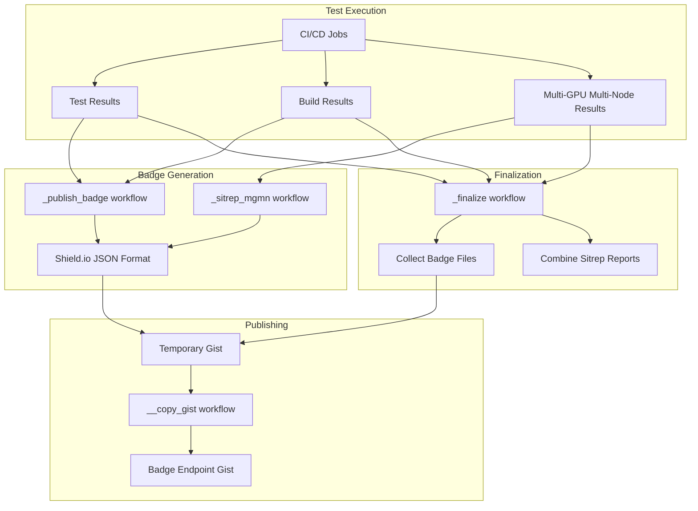
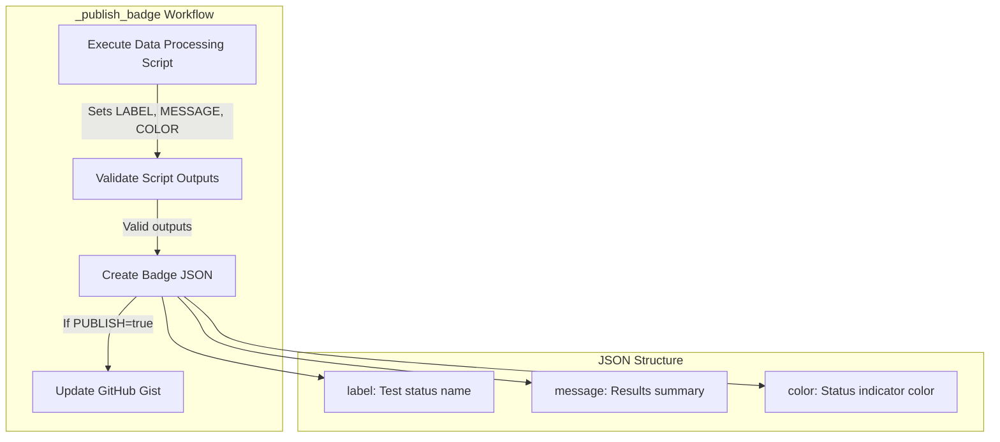
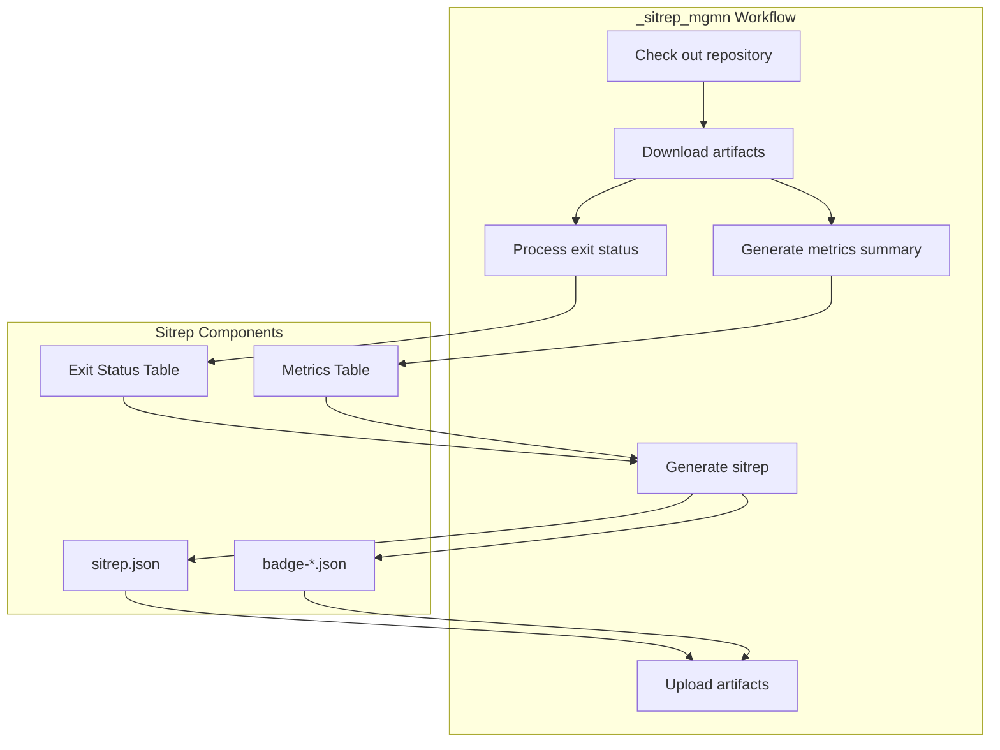
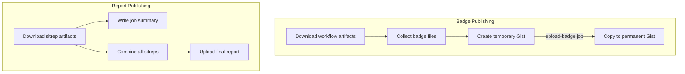
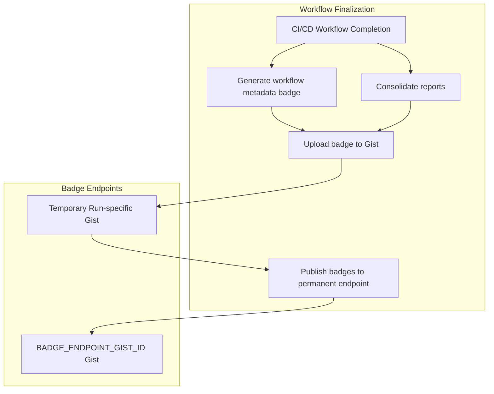

<!-- source: DeepWiki mcp.deepwiki.com · repo NVIDIA/JAX-Toolbox · page 3.3 Badges and Reporting · fetched 2026-10-26 -->

# Badges and Reporting

<details>
<summary>Relevant source files</summary>

The following files were used as context for generating this wiki page:

- [.github/workflows/__copy_gist.yaml](.github/workflows/__copy_gist.yaml)
- [.github/workflows/_finalize.yaml](.github/workflows/_finalize.yaml)
- [.github/workflows/_publish_badge.yaml](.github/workflows/_publish_badge.yaml)
- [.github/workflows/_sitrep_mgmn.yaml](.github/workflows/_sitrep_mgmn.yaml)
- [.github/workflows/assistant.yaml](.github/workflows/assistant.yaml)

</details>


## Purpose and Overview

The JAX-Toolbox Badges and Reporting system provides automated status visualization and result tracking for the CI/CD pipeline. It generates status badges that reflect build health, test results, and workflow execution status, which are displayed in the repository README and documentation. The system also compiles detailed reports (situation reports or "sitreps") to help developers quickly assess the state of the codebase and identify potential issues.

This page focuses on the technical implementation of badges and reporting in the CI/CD pipeline. For information about build workflows, see [Build Workflows](#3.1), and for details on the test infrastructure, see [Test Infrastructure](#3.2).

Sources: [.github/workflows/_publish_badge.yaml:1-94](), [.github/workflows/_finalize.yaml:1-19]()

## Badge System Architecture

The badge system follows a multi-stage process where test results are processed, formatted into shield.io-compatible JSON, and published to GitHub Gists for display.



Sources: [.github/workflows/_publish_badge.yaml:1-94](), [.github/workflows/_finalize.yaml:25-93](), [.github/workflows/__copy_gist.yaml:1-54]()

## Badge Generation Process

The badge generation process converts test and build results into standardized shield.io-compatible JSON files. There are two primary workflows for badge generation:

1. **General Badge Publishing** (`_publish_badge.yaml`): A reusable workflow that executes a script and converts its output into a shield.io JSON badge.

2. **MGMN Test Reporting** (`_sitrep_mgmn.yaml`): Specifically processes Multi-GPU Multi-Node test results to generate badges.

### Shield.io Badge Format

All badges follow the shield.io schema:

```json
{
  "schemaVersion": 1,
  "label": "LABEL_TEXT",
  "message": "MESSAGE_TEXT",
  "color": "COLOR_CODE"
}
```

The `_publish_badge` workflow expects scripts to set outputs for `LABEL`, `MESSAGE`, and `COLOR`, which are then formatted into this JSON structure.



Sources: [.github/workflows/_publish_badge.yaml:34-64]()

## Situation Reports (Sitreps)

Situation Reports (sitreps) are detailed summaries of test executions that include:

1. Overall test status (pass/fail)
2. Test count statistics
3. Metrics collected during test execution
4. Detailed error information when relevant

The MGMN sitrep generation workflow (`_sitrep_mgmn.yaml`) specifically handles Multi-GPU Multi-Node test results by:

1. Collecting exit status information
2. Compiling metrics data 
3. Generating summary statistics
4. Creating both a human-readable markdown report and a JSON sitrep

### Sitrep Components

A typical sitrep includes:

- **Summary**: Brief status overview
- **Test Statistics**: Counts of passed/failed tests
- **Badge Information**: Label, message, and color for the badge
- **Full Results**: Detailed markdown of all test outcomes

The sitrep format is consistent across different test types to enable standardized processing in the finalization step.



Sources: [.github/workflows/_sitrep_mgmn.yaml:24-168]()

## Badge and Report Publishing

Once badges and reports are generated, they need to be published to make them visible. This involves:

1. **Temporary Storage**: Badges and reports are first uploaded as GitHub Actions artifacts
2. **Gist Creation**: A temporary GitHub Gist is created containing these files
3. **Persistent Publishing**: Selected files are copied to a persistent Gist that serves as the badge endpoint

The `_finalize.yaml` workflow handles this process, collecting artifacts from previous jobs and publishing them to the appropriate Gist.



### GitHub Gists as Badge Endpoints

The system uses GitHub Gists as shield.io badge endpoints because:

1. They are accessible without authentication
2. They provide version history
3. They support multiple files in a single endpoint
4. They can be updated programmatically through the GitHub API

The badge endpoint Gist ID is stored as a repository variable (`BADGE_ENDPOINT_GIST_ID`), with a separate mock ID (`MOCK_BADGE_ENDPOINT_GIST_ID`) used for testing.

Sources: [.github/workflows/_finalize.yaml:59-274](), [.github/workflows/__copy_gist.yaml:21-54]()

## Integration with CI/CD Workflow

The badge and reporting system integrates with the overall CI/CD pipeline in several key places:

1. **Test Completion**: Each test job generates result artifacts
2. **Build Completion**: Build jobs create status artifacts
3. **Workflow Finalization**: The `_finalize.yaml` workflow runs after all other jobs to collect and publish results

### Workflow Metadata Badge

A special badge is generated for each workflow run containing metadata about the run itself:

```json
{
  "schemaVersion": 1,
  "label": "workflow metadata",
  "message": "YYYY-MM-DD: run #1234567",
  "color": "bisque"
}
```

This provides easy access to when a particular set of badges was generated and links back to the specific workflow run.

### Final Report Generation

The finalization process also creates a comprehensive report by combining all individual sitreps:

1. All sitrep.json files are collected
2. A consolidated JSON is created containing all test results
3. A human-readable summary is written to the GitHub Actions job summary
4. The complete report is uploaded as an artifact

This consolidated report provides a single source of truth for the status of all components tested in the workflow run.



Sources: [.github/workflows/_finalize.yaml:21-224]()

## Usage in Repository Documentation

The published badges are typically embedded in the repository's README.md and documentation using Markdown image links pointing to shield.io, which in turn references the GitHub Gist:

```markdown

```

This allows for real-time status updates in the repository documentation without needing to update the documentation files themselves. The badges serve as a quick visual indicator of the repository's health, including:

- Build status
- Test pass rates
- Performance metrics
- Compatibility information

Sources: [.github/workflows/_finalize.yaml:225-274]()

---

