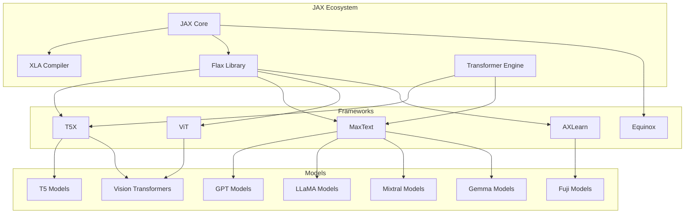
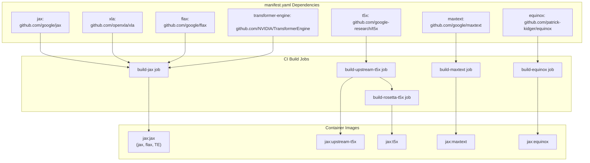
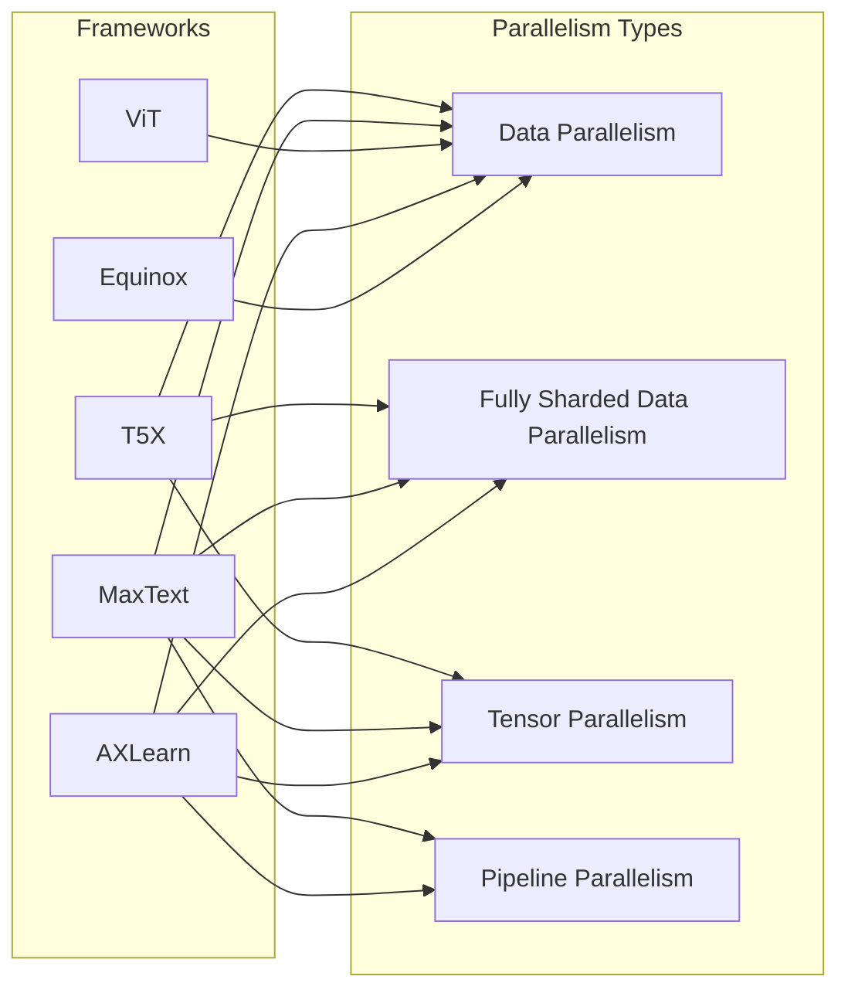
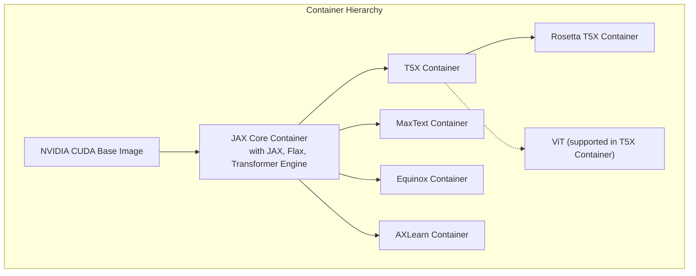
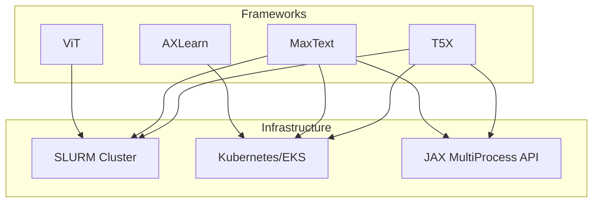

<!-- source: DeepWiki mcp.deepwiki.com · repo NVIDIA/JAX-Toolbox · page 4 Machine Learning Frameworks · fetched 2026-10-26 -->

# Machine Learning Frameworks

Relevant source files

The following files were used as context for generating this wiki page:

- [.github/container/manifest.yaml](.github/container/manifest.yaml)
- [.github/workflows/_ci.yaml](.github/workflows/_ci.yaml)
- [.github/workflows/ci.yaml](.github/workflows/ci.yaml)
- [README.md](README.md)
- [rosetta/rosetta/data/generate_wds_indices.py](rosetta/rosetta/data/generate_wds_indices.py)
- [rosetta/rosetta/projects/t5x/README.md](rosetta/rosetta/projects/t5x/README.md)
- [rosetta/rosetta/projects/t5x/scripts/example_slurm_ft_frompile.sub](rosetta/rosetta/projects/t5x/scripts/example_slurm_ft_frompile.sub)
- [rosetta/rosetta/projects/t5x/scripts/example_slurm_pretrain_pile.sub](rosetta/rosetta/projects/t5x/scripts/example_slurm_pretrain_pile.sub)
- [rosetta/rosetta/projects/vit/README.md](rosetta/rosetta/projects/vit/README.md)
- [rosetta/rosetta/projects/vit/scripts/example_slurm_finetune.sub](rosetta/rosetta/projects/vit/scripts/example_slurm_finetune.sub)
- [rosetta/rosetta/projects/vit/scripts/example_slurm_pretrain.sub](rosetta/rosetta/projects/vit/scripts/example_slurm_pretrain.sub)

This document provides a comprehensive overview of the JAX-based machine learning frameworks supported in JAX-Toolbox. It covers the framework architecture, supported models, use cases, performance characteristics, and integration with NVIDIA GPU hardware.

For information about the container system architecture that houses these frameworks, see [Container System Architecture](#2).

## Overview of Supported Frameworks

JAX-Toolbox provides support for several popular JAX-based machine learning frameworks, each with its own specialties and supported model architectures:

| Framework | Models | Use cases | Container |
| :--- | :---: | :---: | :---: |
| MaxText | GPT, LLaMA, Gemma, Mistral, Mixtral | pre-training | `ghcr.io/nvidia/jax:maxtext` |
| T5X | T5, ViT | pre-training, fine-tuning | `ghcr.io/nvidia/jax:t5x` |
| T5X (Imagen) | Imagen | pre-training | `ghcr.io/nvidia/t5x:imagen-2023-10-02.v3` |
| AXLearn | Fuji | pre-training | `ghcr.io/nvidia/jax:axlearn` |
| Equinox | - | research, scientific computing | `ghcr.io/nvidia/jax:equinox` |
| ViT | Vision Transformer | pre-training, fine-tuning | (via T5X container) |

Sources: [README.md:11-16]()

## Framework Architecture

The JAX-Toolbox frameworks are built on a common foundation consisting of JAX core and various optimization libraries. Each framework extends this foundation with specialized capabilities for different types of models and training tasks.

### Framework Ecosystem and Dependencies

Framework Dependency Structure

Sources: [README.md:6-16](), [.github/container/manifest.yaml:1-103]()

### Manifest and Build System Integration

Source Code to Container Mapping

Sources: [.github/workflows/_ci.yaml:69-137](), [.github/container/manifest.yaml:1-103]()

### Parallelism Support by Framework

Different frameworks support different types of parallelism strategies, enabling efficient training of large models across multiple GPUs and nodes.

Framework Parallelism Support

Sources: [README.md:11-16](), [rosetta/rosetta/projects/t5x/README.md:82-94](), [rosetta/rosetta/projects/vit/README.md:126-129]()

## Framework Container System

The JAX-Toolbox container system follows a hierarchical structure, where framework-specific containers build upon the JAX core container.

Container Hierarchy

Sources: [README.md:38-205](), [.github/workflows/_ci.yaml:69-137]()

## Framework-Specific Details

### T5X and Rosetta T5X

T5X is a framework for training and evaluating sequence models, particularly the T5 family of encoder-decoder transformer models. Rosetta T5X is an enhanced version maintained within JAX-Toolbox that includes additional optimizations.

#### Supported Models and Hardware

- **Models**: T5, ViT
- **Use cases**: pre-training, fine-tuning
- **Hardware**: Validated on NVIDIA DGX A100 and H100 nodes
- **Container**: `ghcr.io/nvidia/jax:t5x`

#### Key Features

- FP8 support via Transformer Engine (requires H100)
- Multi-node training support via SLURM and Kubernetes
- Optimizations for NVIDIA GPUs
- Support for single-node and multi-node configurations

#### Convergence and Performance

T5X can train models from small to very large scales with strong scaling efficiency:

| Size | GPU | Precision | #GPUs | TP | BS / GPU | Sequences/Sec | GPU-days | MNLI 2.0 - matched | SQuAD v1.1 (EM/F1) |
| ---- | --- | --------- | ----- | -- | -------- | ------------- | -------- | ------------------ | ------------------ |
| T5-v1.1-small | A100 80G SXM | bf16 | 8 | 1 | 256 | ~5712 | 33 | 83.06% | 78.33 / 86.63 |
| T5-v1.1-large | A100 80G SXM | bf16 | 64 | 1 | 32 | ~4853 | 309 | 89.23% | 86.12 / 93.21 |
| T5-v1.1-xl | A100 80G SXM | bf16 | 256 | 1 | 8 | ~4322 | 1,408 | 91.15% | 89.36 / 95.29 |
| T5-v1.1-large | H100 80G SXM | TE-fp8 | 64 | 1 | 32 | ~11139 | 134 | 89.1% | 86.36 / 93.5 |

Sources: [rosetta/rosetta/projects/t5x/README.md:82-94]()

### MaxText

MaxText is a framework for training large language models (LLMs) optimized for NVIDIA GPUs.

#### Supported Models and Hardware

- **Models**: GPT, LLaMA, Gemma, Mistral, Mixtral
- **Use cases**: pre-training
- **Hardware**: Validated on NVIDIA GPUs
- **Container**: `ghcr.io/nvidia/jax:maxtext`

#### Key Features

- Support for various parallelism strategies: Data Parallelism, Fully Sharded Data Parallelism, Tensor Parallelism, and Pipeline Parallelism
- Optimized for training large language models
- FP8 support via Transformer Engine

Sources: [README.md:13](), [.github/workflows/_ci.yaml:84-97]()

### Vision Transformer (ViT)

ViT is an implementation of the Vision Transformer model with model parallel support, included within the T5X container.

#### Supported Models and Hardware

- **Models**: Vision Transformer (ViT-B/16)
- **Use cases**: pre-training, fine-tuning
- **Hardware**: Validated on NVIDIA DGX A100 (8x A100 80G) nodes
- **Container**: Available via T5X container

#### Key Features

- Model parallel support
- Support for single-node and multi-node training
- DALI integration for performant data loading via WebDataset

#### Convergence and Performance

| Size | pre-training/fine-tuning | #GPUs | BS / GPU | Samples/sec | Estimated Walltime (hours) | Imagenet Accuracy |
| ---- | ------------------------ | ----- | -------- | ----------- | -------------------------- | ----------------- |
| ViT/B-16 | pre-training | 8 | 512 | ~7129.27 | 15.01 | N/A |
| ViT/B-16 | fine-tuning | 8 | 64 | ~1841.43 | 1.54 | 0.794 |

Sources: [rosetta/rosetta/projects/vit/README.md:126-129]()

### AXLearn

AXLearn is a machine learning framework used for research and pre-training the Fuji model.

#### Supported Models and Hardware

- **Models**: Fuji
- **Use cases**: pre-training
- **Hardware**: Validated on NVIDIA GPUs including H100
- **Container**: `ghcr.io/nvidia/jax:axlearn`

#### Key Features

- Support for multiple parallelism strategies including Data Parallelism, Fully Sharded Data Parallelism, Tensor Parallelism, and Pipeline Parallelism
- Optimized for large-scale model training

Sources: [README.md:16](), [.github/workflows/_ci.yaml:125-137](), [.github/workflows/_ci.yaml:616-648]()

### Equinox

Equinox is a JAX-based framework focused on scientific computing and machine learning research.

#### Supported Models and Hardware

- **Use cases**: research, scientific computing
- **Hardware**: Validated on NVIDIA GPUs
- **Container**: `ghcr.io/nvidia/jax:equinox`

Sources: [README.md:92](), [.github/workflows/_ci.yaml:69-82]()

## Performance Optimizations

JAX-Toolbox includes several performance optimizations for efficient training on NVIDIA GPUs:

### XLA Flags and Environment Variables

| XLA Flags | Value | Explanation |
| --------- | ----- | ----------- |
| `--xla_gpu_enable_latency_hiding_scheduler` | `true` | allows XLA to move communication collectives to increase overlap with compute kernels |
| `--xla_gpu_enable_triton_gemm` | `false` | use cuBLAS instead of Trition GeMM kernels |

| Environment Variable | Value | Explanation |
| -------------------- | ----- | ----------- |
| `NCCL_NVLS_ENABLE` | `0` | Disables NVLink SHARP |

Sources: [README.md:217-225]()

### Transformer Engine and FP8

For frameworks that support it (like T5X and MaxText), Transformer Engine provides FP8 precision which can significantly accelerate training, especially on H100 GPUs:

- 2.08x faster for T5-large (FP8 on H100 vs BF16 on A100)
- 2.24x faster for T5-xl (FP8 on H100 vs BF16 on A100)

Sources: [rosetta/rosetta/projects/t5x/README.md:211-213]()

## Distributed Training Support

JAX-Toolbox frameworks support distributed training across multiple nodes using various infrastructure:

Distributed Training Infrastructure

Sources: [rosetta/rosetta/projects/t5x/scripts/example_slurm_pretrain_pile.sub:1-94](), [.github/workflows/_ci.yaml:467-552]()

### SLURM Integration

For HPC environments, frameworks provide SLURM submit scripts for launching distributed training jobs. These scripts handle:

- Node configuration
- GPU allocation and binding
- Environment setup
- Container launch

Example scripts:
- T5X: `example_slurm_pretrain_pile.sub` and `example_slurm_ft_frompile.sub`
- ViT: `example_slurm_pretrain.sub` and `example_slurm_finetune.sub`

Sources: [rosetta/rosetta/projects/t5x/scripts/example_slurm_pretrain_pile.sub:1-94](), [rosetta/rosetta/projects/t5x/scripts/example_slurm_ft_frompile.sub:1-96](), [rosetta/rosetta/projects/vit/scripts/example_slurm_pretrain.sub:1-74](), [rosetta/rosetta/projects/vit/scripts/example_slurm_finetune.sub:1-74]()

### Kubernetes/EKS Integration

For cloud environments, frameworks can be deployed on Kubernetes or Amazon EKS, with support for:

- Multi-node training
- GPU resource allocation
- Container orchestration
- S3 integration for logging and checkpoint storage

Sources: [.github/workflows/_ci.yaml:467-552](), [.github/workflows/_ci.yaml:616-648]()

## Data Handling and Preprocessing

Frameworks support different data processing approaches optimized for GPU training:

### WebDataset for Vision Models

ViT uses NVIDIA DALI with WebDataset for efficient data loading:

1. Dataset preparation: Convert to WebDataset format (tar files)
2. Index generation: Create index files for performant loading
3. DALI data pipeline: Efficiently load and preprocess data on CPU

Sources: [rosetta/rosetta/projects/vit/README.md:64-76](), [rosetta/rosetta/data/generate_wds_indices.py:1-44]()

### Text Dataset Integration

T5X integrates with common text datasets like The Pile and supports standard NLP benchmarks:

- MNLI v2 for natural language inference
- SQuAD v1.1 for question answering

MaxText similarly supports text datasets for LLM pretraining.

Sources: [rosetta/rosetta/projects/t5x/README.md:32-38](), [rosetta/rosetta/projects/t5x/README.md:142-152]()

---

