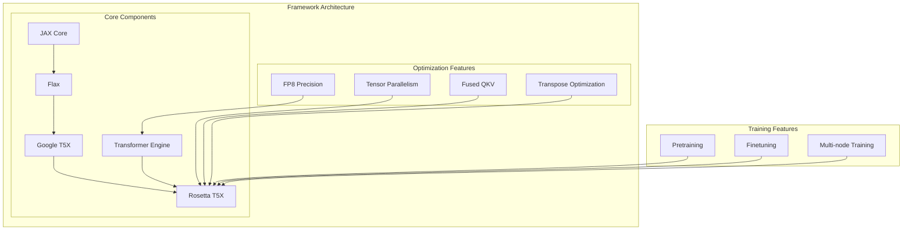
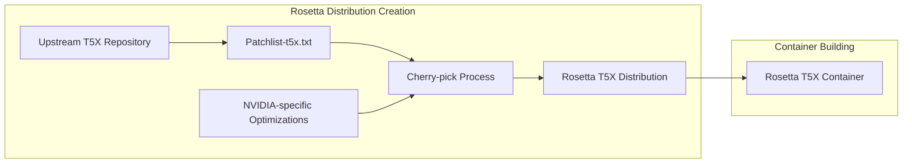
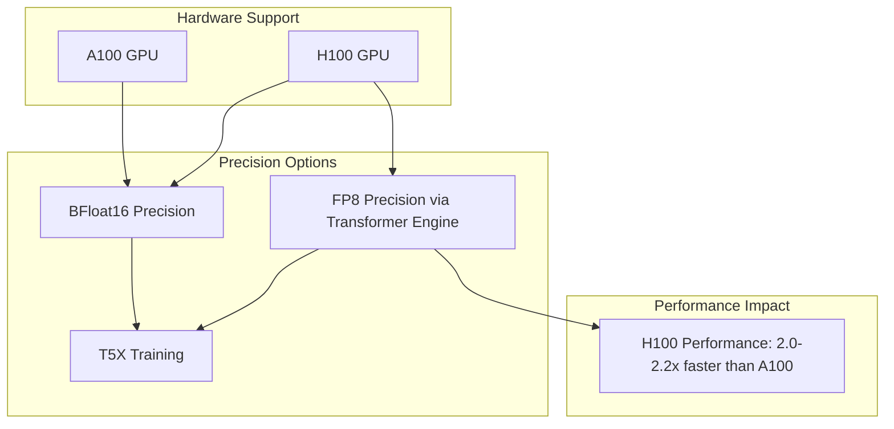
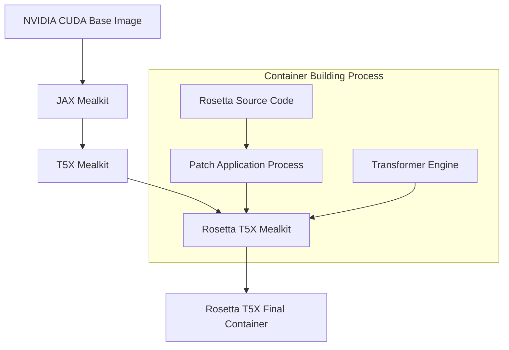

<!-- source: DeepWiki mcp.deepwiki.com · repo NVIDIA/JAX-Toolbox · page 4.1 T5X and Rosetta T5X · fetched 2026-10-26 -->

# T5X and Rosetta T5X

<details>
<summary>Relevant source files</summary>

The following files were used as context for generating this wiki page:

- [.github/container/test-t5x.sh](.github/container/test-t5x.sh)
- [.github/workflows/_sandbox.yaml](.github/workflows/_sandbox.yaml)
- [.github/workflows/_test_distribution.yaml](.github/workflows/_test_distribution.yaml)
- [rosetta/Dockerfile.t5x](rosetta/Dockerfile.t5x)
- [rosetta/README.md](rosetta/README.md)
- [rosetta/docs/DEVELOPMENT.md](rosetta/docs/DEVELOPMENT.md)
- [rosetta/rosetta/data/generate_wds_indices.py](rosetta/rosetta/data/generate_wds_indices.py)
- [rosetta/rosetta/projects/t5x/README.md](rosetta/rosetta/projects/t5x/README.md)
- [rosetta/rosetta/projects/t5x/scripts/example_slurm_ft_frompile.sub](rosetta/rosetta/projects/t5x/scripts/example_slurm_ft_frompile.sub)
- [rosetta/rosetta/projects/t5x/scripts/example_slurm_pretrain_pile.sub](rosetta/rosetta/projects/t5x/scripts/example_slurm_pretrain_pile.sub)
- [rosetta/rosetta/projects/vit/README.md](rosetta/rosetta/projects/vit/README.md)
- [rosetta/rosetta/projects/vit/scripts/example_slurm_finetune.sub](rosetta/rosetta/projects/vit/scripts/example_slurm_finetune.sub)
- [rosetta/rosetta/projects/vit/scripts/example_slurm_pretrain.sub](rosetta/rosetta/projects/vit/scripts/example_slurm_pretrain.sub)

</details>


## Overview

This document provides detailed information about T5X and Rosetta T5X within the JAX-Toolbox ecosystem. T5X is a JAX-based implementation of the Text-to-Text Transfer Transformer (T5) models developed by Google Research. Rosetta T5X is NVIDIA's distribution of T5X with additional performance optimizations, particularly for NVIDIA GPUs, including Transformer Engine integration and FP8 support.

For information about container architecture, see [Container System Architecture](#2). For information about other frameworks like MaxText, see [MaxText](#4.2).

Sources: [rosetta/rosetta/projects/t5x/README.md:1-14](), [rosetta/docs/DEVELOPMENT.md:1-22]()

## System Architecture

T5X and Rosetta T5X are structured as a hierarchical system where Rosetta extends the base T5X framework with performance optimizations for NVIDIA GPUs.



Sources: [rosetta/rosetta/projects/t5x/README.md:12-19](), [rosetta/Dockerfile.t5x:1-85]()

### Distribution Model

Rosetta T5X follows a distribution model, where NVIDIA cherry-picks necessary changes on top of Google's upstream T5X implementation. This approach allows Rosetta to stay up-to-date with the upstream repository while adding NVIDIA-specific optimizations.



Sources: [rosetta/docs/DEVELOPMENT.md:1-42](), [rosetta/Dockerfile.t5x:1-85]()

## Performance Features

Rosetta T5X includes several performance optimizations specifically designed for NVIDIA GPUs that enhance training speed and efficiency.

### Transformer Engine and FP8 Support

One of the key features of Rosetta T5X is the integration with Transformer Engine, which enables FP8 precision training on H100 GPUs. This provides substantial performance improvements compared to standard BF16 precision.



Sources: [rosetta/rosetta/projects/t5x/README.md:204-213](), [rosetta/rosetta/projects/t5x/README.md:156-157]()

### Additional Optimizations

Rosetta T5X includes several other optimizations:

1. **Fused QKV**: Fuses query, key, and value projections for better performance when using FP8
2. **Transpose Batch Size**: An optimization for GPUs that improves memory access patterns
3. **Tensor Parallelism**: Allows model distribution across multiple GPUs

These optimizations can be controlled via environment variables in the training scripts.

Sources: [rosetta/rosetta/projects/t5x/README.md:155-158](), [rosetta/rosetta/projects/t5x/README.md:175-178]()

## Supported Hardware

Rosetta T5X is optimized for NVIDIA's high-performance GPUs and has been validated on specific hardware configurations:

| Hardware | Supported Features | Notes |
|----------|-------------------|-------|
| NVIDIA DGX A100 (8x A100-SXM4-80G) | BF16 precision, Tensor Parallelism | Base hardware configuration |
| NVIDIA H100-SXM-80G | BF16 precision, FP8 precision, Tensor Parallelism | Up to 2.2x faster with FP8 |

For smaller models (like T5-small and T5-large), single-node training is sufficient. Larger models (T5-xl, T5-xxl) benefit from multi-node training.

Sources: [rosetta/rosetta/projects/t5x/README.md:8-9](), [rosetta/rosetta/projects/t5x/README.md:87-93]()

## Container System

Rosetta T5X is distributed as part of the JAX-Toolbox container system. The containers are built in a hierarchical manner.



The container building process involves:
1. Starting with a base NVIDIA CUDA image
2. Adding JAX and its dependencies
3. Adding T5X and its dependencies
4. Applying Rosetta patches to create the distribution
5. Adding Transformer Engine for FP8 support

Containers are available at `ghcr.io/nvidia/t5x:latest-verified` for stable usage and `ghcr.io/nvidia/t5x:latest` for the latest updates.

Sources: [rosetta/Dockerfile.t5x:1-85](), [rosetta/rosetta/projects/t5x/README.md:24-30]()

## Training Workflows

Rosetta T5X supports various training workflows, including pretraining and finetuning, in both single-node and multi-node configurations.

### Pretraining

Pretraining uses The Pile dataset (note: as of October 2023, The Pile is no longer accessible) and can be performed with various model sizes:

| Model Size | Parameters | Recommended Setup | Global Batch Size |
|------------|------------|-------------------|-------------------|
| T5-v1.1-small | 60M | 8 GPUs (single node) | 2048 |
| T5-v1.1-large | 770M | 64 GPUs (8 nodes) | 2048 |
| T5-v1.1-xl | 3B | 256 GPUs (32 nodes) | 2048 |
| T5-v1.1-xxl | 11B | 512 GPUs (64 nodes) | 2304 |

Sources: [rosetta/rosetta/projects/t5x/README.md:83-95](), [rosetta/rosetta/projects/t5x/README.md:123-136]()

### Finetuning

Finetuning is supported for various tasks, particularly:
- MNLI v2 for natural language inference
- SQuAD v1.1 for question answering

Finetuning typically uses a smaller global batch size (256) than pretraining.

Sources: [rosetta/rosetta/projects/t5x/README.md:142-163](), [rosetta/rosetta/projects/t5x/README.md:160-162]()

## Training Scripts and Usage

Rosetta T5X provides both single-process scripts for interactive use and multi-process scripts for use with SLURM clusters.

### Single Node Usage

For interactive single-node usage, the following scripts are provided:

```bash
# Pretraining
bash t5x/contrib/gpu/scripts_gpu/singlenode_pretrain_pile.sh

# Finetuning
bash t5x/contrib/gpu/scripts_gpu/singlenode_ft_frompile.sh
```

These scripts accept parameters like model size, precision, batch size, and other training configurations.

Sources: [rosetta/rosetta/projects/t5x/README.md:60-76](), [rosetta/rosetta/projects/t5x/README.md:165-197]()

### Multi-Node with SLURM

For multi-node training, example SLURM submit files are provided:

```bash
# Pretraining
PREC=bfloat16 T5_SIZE=large BSIZE_PER_GPU=32 TRAIN_STEPS=1000000 NUM_MICROBATCHES=1 ENABLE_FP8=1 TP_SIZE=1 \
sbatch -N8 scripts/example_slurm_pretrain_pile.sub

# Finetuning
FT_TASK=mnli2 PREC=bfloat16 T5_SIZE=large BSIZE_PER_GPU=32 NUM_MICROBATCHES=1 ENABLE_FP8=1 TP_SIZE=1 \
sbatch -N8 scripts/example_slurm_ft_frompile.sub
```

These scripts handle the necessary environment setup and job distribution across multiple nodes.

Sources: [rosetta/rosetta/projects/t5x/scripts/example_slurm_pretrain_pile.sub:1-95](), [rosetta/rosetta/projects/t5x/scripts/example_slurm_ft_frompile.sub:1-97]()

### Testing and Benchmarking

JAX-Toolbox includes a test script for T5X that can be used to validate installation and measure throughput:

```bash
test-t5x.sh --batch-size <BATCH_SIZE> --enable-te <0|1> --dtype bfloat16
```

This script runs a fake-data Wikipedia benchmark to assess performance without requiring a large dataset.

Sources: [.github/container/test-t5x.sh:1-259]()

## Performance Benchmarks

Extensive performance benchmarks have been conducted across different model sizes, hardware configurations, and precision types:

| Model Size | GPU Type | Precision | #GPUs | Sequences/Sec | Sequences/Sec/GPU | Est. Walltime | GPU-days |
|------------|----------|-----------|-------|---------------|-------------------|---------------|----------|
| T5-v1.1-small | A100 80G | BF16 | 8 | ~5712 | 714 | 4.2 days | 33 |
| T5-v1.1-large | A100 80G | BF16 | 64 | ~4853 | 75.8 | 4.8 days | 309 |
| T5-v1.1-xl | A100 80G | BF16 | 256 | ~4322 | 16.9 | 5.5 days | 1,408 |
| T5-v1.1-large | H100 80G | FP8 | 64 | ~11139 | 174.1 | 2.1 days | 134 |
| T5-v1.1-xl | H100 80G | FP8 | 144 | ~7257 | 50.4 | 3.3 days | 475 |

Notable performance improvements with H100 and FP8:
- T5-large: 2.08x faster
- T5-xl: 2.24x faster

Sources: [rosetta/rosetta/projects/t5x/README.md:86-95](), [rosetta/rosetta/projects/t5x/README.md:204-213]()

## Building Rosetta T5X

While using pre-built containers is recommended, it's also possible to build Rosetta T5X containers manually:

```bash
# From JAX-Toolbox repository root
docker buildx build --build-context jax-toolbox=. --tag rosetta-t5x:latest -f rosetta/Dockerfile.t5x .

# With specific base image
docker buildx build --build-context jax-toolbox=. --tag rosetta-t5x:latest -f rosetta/Dockerfile.t5x --build-arg BASE_IMAGE=ghcr.io/nvidia/upstream-t5x:mealkit-YYYY-MM-DD .
```

For development purposes, there are additional options:

```bash
# Build with updated patches
bash .github/container/bump.sh -i .github/container/manifest.yaml
docker buildx build --build-context jax-toolbox=. --tag rosetta-t5x:latest -f rosetta/Dockerfile.t5x --build-arg UPDATE_PATCHES=true .

# Build with specific Transformer Engine version
docker buildx build --build-arg UPDATED_TE_REF=pull/609/head --build-context jax-toolbox=. --tag rosetta-t5x:latest -f rosetta/Dockerfile.t5x .
```

Sources: [rosetta/README.md:6-31](), [rosetta/Dockerfile.t5x:1-85]()

## Known Issues

As of the time of documentation, there is a known sporadic NCCL crash that can occur when using the T5X container at node counts greater than or equal to 32 nodes. This issue is being tracked and will be fixed in a future release.

Sources: [rosetta/rosetta/projects/t5x/README.md:200-201]()

---

