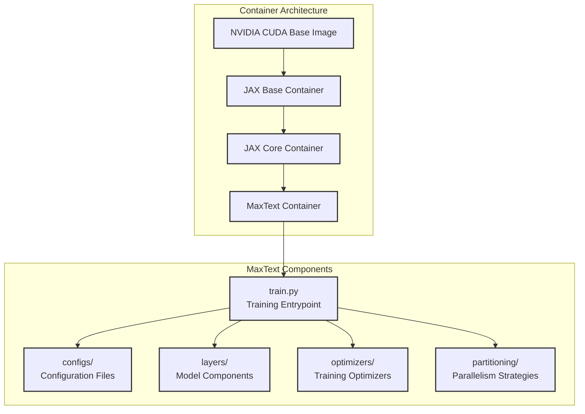
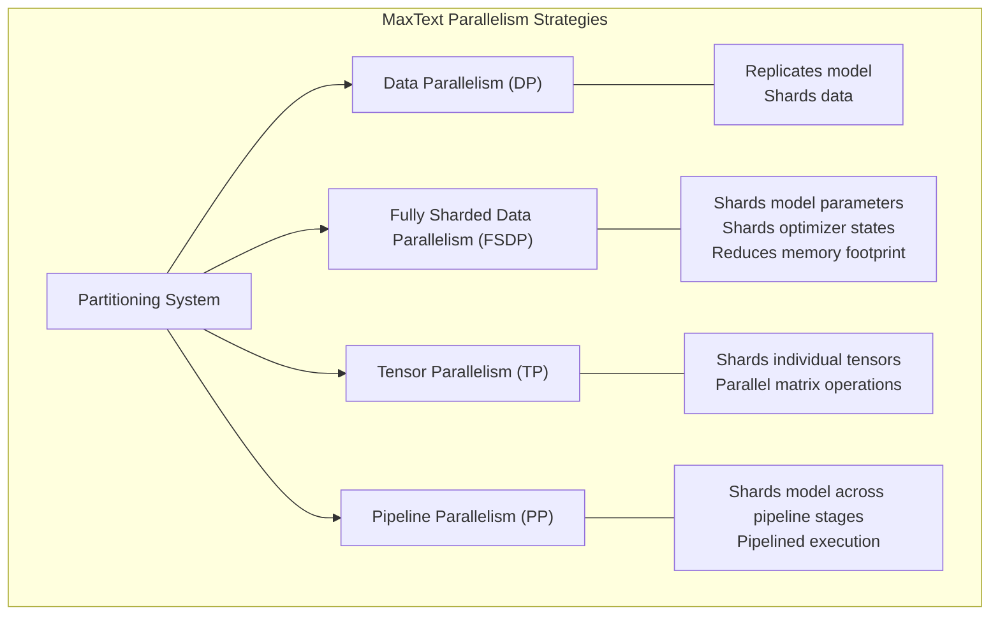
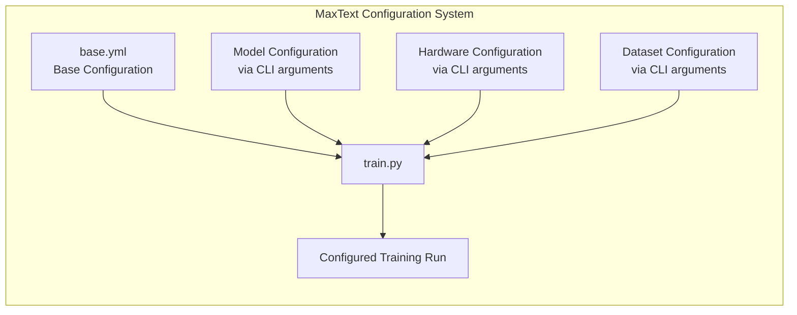

<!-- source: DeepWiki mcp.deepwiki.com · repo NVIDIA/JAX-Toolbox · page 4.2 MaxText · fetched 2026-10-26 -->

# MaxText

<details>
<summary>Relevant source files</summary>

The following files were used as context for generating this wiki page:

- [.github/container/test-maxtext.sh](.github/container/test-maxtext.sh)
- [rosetta/docs/GPU_performance.md](rosetta/docs/GPU_performance.md)
- [rosetta/docs/NATIVE_FP8.md](rosetta/docs/NATIVE_FP8.md)
- [rosetta/docs/PGLE.md](rosetta/docs/PGLE.md)
- [rosetta/rosetta/projects/maxtext/README.md](rosetta/rosetta/projects/maxtext/README.md)
- [rosetta/rosetta/projects/maxtext/scripts/example_slurm.sub](rosetta/rosetta/projects/maxtext/scripts/example_slurm.sub)
- [rosetta/rosetta/projects/pax/README.md](rosetta/rosetta/projects/pax/README.md)

</details>


This page documents MaxText, a high-performance, scalable Large Language Model (LLM) framework built by Google using Python and JAX. MaxText is designed for training large transformer-based models with optimized performance on NVIDIA GPUs. This documentation covers how to use MaxText within the JAX-Toolbox ecosystem, including container setup, running training jobs, configuration options, and performance optimizations.

For information about containers and the general architecture of JAX-Toolbox, see the [Container System Architecture](#2) page.

## Architecture and Components

MaxText is integrated as one of the key framework containers in JAX-Toolbox, built on top of the JAX core container.

### MaxText in JAX-Toolbox Ecosystem

MaxText is designed to provide a highly optimized implementation for training transformer-based language models, with particular focus on performance scaling across multiple nodes and GPUs.



Sources: [rosetta/rosetta/projects/maxtext/README.md:1-5]()

### Parallelism Strategies

MaxText provides comprehensive support for various parallelism strategies to enable efficient training of large models across multiple devices and nodes.



Sources: [.github/container/test-maxtext.sh:28-32]()

## Models and Configurations

MaxText supports a wide range of pre-configured model architectures and sizes, making it simple to train popular LLM variants.

### Supported Model Architectures

The framework provides built-in support for many common model architectures, without needing to modify code:

| Model Family | Supported Variants |
|--------------|-------------------|
| GPT-3        | 6B, 22B, 52K, 175B |
| LLaMA-2      | 7B, 13B, 70B |
| LLaMA-3      | 8B, 70B |
| Gemma        | 2B, 7B |
| Mistral      | 7B |
| Mixtral      | 8x7B |

Sources: [.github/container/test-maxtext.sh:18-19]()

### Configuration System

MaxText uses a YAML-based configuration system that allows for easy specification of model architecture, training parameters, and hardware configuration:



Sources: [.github/container/test-maxtext.sh:249-304](), [rosetta/rosetta/projects/maxtext/scripts/example_slurm.sub:79-99]()

## Parallelism Implementation

MaxText implements a sophisticated parallelism system to distribute computation across devices and nodes efficiently.

### Inter-Connect and Data-Center Network Partitioning

MaxText distinguishes between devices connected via fast interconnects (ICI - Inter-Connect Interface) and those connected via data center networks (DCN):

| Parameter | Description | Example Values |
|-----------|------------|---------------|
| `ici_fsdp_parallelism` | FSDP parallelism within a node | 8 (for 8 GPUs) |
| `dcn_fsdp_parallelism` | FSDP parallelism across nodes | 32 (for 32 nodes) |
| `ici_data_parallelism` | Data parallelism within a node | 1 |
| `dcn_data_parallelism` | Data parallelism across nodes | 1 |
| `ici_tensor_parallelism` | Tensor parallelism within a node | 2 |
| `dcn_tensor_parallelism` | Tensor parallelism across nodes | 1 |

The system automatically computes optimal partitioning based on the specified parallelism dimensions and available hardware.

Sources: [.github/container/test-maxtext.sh:175-194](), [.github/container/test-maxtext.sh:266-271]()

## Attention Mechanisms

MaxText supports different attention implementations to optimize for various hardware and model configurations:

| Attention Type | Description | Use Case |
|----------------|-------------|----------|
| `dot_product` | Standard dot product attention | Default, works for all models |
| `cudnn_flash_te` | Flash Attention via Transformer Engine | Better performance, requires setting `NVTE_FUSED_ATTN=1` |

Flash Attention provides significant speed and memory benefits but has different requirements for rematerialization policies.

Sources: [.github/container/test-maxtext.sh:21](), [rosetta/rosetta/projects/maxtext/README.md:52-53]()

## Memory Management and Performance Optimization

### Memory Fraction and Rematerialization

MaxText offers fine-grained control over memory usage through:

1. Memory fraction control via `XLA_PYTHON_CLIENT_MEM_FRACTION` (typically set to 0.90)
2. Different rematerialization policies to balance memory usage and computation:
   - `minimal`: Standard rematerialization
   - `minimal_flash`: Optimized for flash attention
   - `save_dot_except_mlp`: Saves more activations, useful for very large models

Sources: [.github/container/test-maxtext.sh:17](), [.github/container/test-maxtext.sh:22]()

### XLA Flags for Optimized Performance

MaxText performance heavily depends on properly configured XLA flags. The recommended flags include:

```
XLA_FLAGS="--xla_gpu_enable_latency_hiding_scheduler=true
          --xla_gpu_enable_triton_gemm=false
          --xla_gpu_enable_command_buffer=
          --xla_gpu_all_reduce_combine_threshold_bytes=1073741824 
          --xla_gpu_all_gather_combine_threshold_bytes=1073741824 
          --xla_gpu_reduce_scatter_combine_threshold_bytes=134217728
          --xla_gpu_enable_pipelined_all_gather=true 
          --xla_gpu_enable_pipelined_reduce_scatter=true 
          --xla_gpu_enable_pipelined_all_reduce=true 
          --xla_gpu_enable_while_loop_double_buffering=true
          --xla_gpu_enable_all_gather_combine_by_dim=false 
          --xla_gpu_enable_reduce_scatter_combine_by_dim=false 
          --xla_disable_hlo_passes=rematerialization"
```

These flags enable latency hiding, optimize collective operations, and configure the XLA compiler for LLM workloads.

Sources: [rosetta/rosetta/projects/maxtext/README.md:66-83](), [rosetta/rosetta/projects/maxtext/scripts/example_slurm.sub:55-67]()

### Profile Guided Latency Estimator (PGLE)

For further performance optimization, MaxText can leverage the Profile Guided Latency Estimator (PGLE) through XLA:

1. Run a profile pass with async collectives and latency hiding disabled
2. Generate protobuf file from profile data
3. Run performance pass with protobuf file specified

The PGLE workflow optimizes scheduling by using actual measured execution times for different operations.

Sources: [rosetta/docs/PGLE.md:1-45]()

## Data Types and Mixed Precision

MaxText supports various precision formats for training:

| Data Type | Description | Use Case |
|-----------|-------------|----------|
| `bfloat16` | BF16 format | Default precision with good numerical stability |
| `fp8` | 8-bit floating point | Faster training with reduced memory, requires extra configuration |

MaxText supports FP8 training via Transformer Engine by setting `NVTE_FUSED_ATTN=1` and specifying FP8 data type.

Sources: [.github/container/test-maxtext.sh:24](), [.github/container/test-maxtext.sh:168-170]()

## Running MaxText

### Container Setup

MaxText is available as a pre-built container image. To launch the container:

```bash
docker run -ti --gpus=all --net=host --ipc=host \
  -v <WORKSPACE_PATH>:/opt/maxtext/workspace \
  -w /opt/maxtext <CONTAINER> /bin/bash
```

Where:
- `<WORKSPACE_PATH>`: Local path for storing checkpoints and logs
- `<CONTAINER>`: Container image (e.g., `nvcr.io/nvidia/jax:24.04-maxtext-py3`)

Sources: [rosetta/rosetta/projects/maxtext/README.md:9-10](), [rosetta/rosetta/projects/maxtext/README.md:17-23]()

### Single-Node Training

To run MaxText on a single node:

```bash
python3 MaxText/train.py \
    MaxText/configs/base.yml \
    model_name=llama2-7b \
    per_device_batch_size=2 \
    max_target_length=4096 \
    scan_layers=true \
    steps=15 \
    remat_policy=minimal \
    use_iota_embed=true \
    logits_dot_in_fp32=false \
    enable_checkpointing=false \
    base_output_directory=local_train \
    dataset_path=local \
    dataset_type=synthetic \
    attention=dot_product \
    hardware=gpu \
    run_name=${YOUR_JOB_NAME}
```

This launches a training job for LLaMA-2 7B model with the specified configuration.

Sources: [rosetta/rosetta/projects/maxtext/README.md:32-50]()

### Multi-Node Training via SLURM

For multi-node training, MaxText can be launched using SLURM:

```bash
CONTAINER=<CONTAINER> BASE_WORKSPACE_DIR=<PATH_TO_WORKSPACE> \
  sbatch -N <NUM_NODES> -A <ACCOUNT> -p <PARTITION> -J <JOBNAME> scripts/example_slurm.sub
```

The SLURM script sets up the necessary environment variables, mounts required directories, and launches MaxText with the appropriate configuration.

Sources: [rosetta/rosetta/projects/maxtext/README.md:55-63](), [rosetta/rosetta/projects/maxtext/scripts/example_slurm.sub:1-110]()

## Benchmarks and Performance

MaxText has been benchmarked on NVIDIA DGX H100 80G nodes. Here's an example performance profile for LLaMA-2:

| Size | GPU | Precision | Sequence Length | #GPUs | BS / GPU | DP | FSDP | TP | GBS | Attention | Remat Policy | Scan | Step Time (s) | Sequences/Sec |
| ---- | ------------ | --------- | --------------- | ----- | -------- | -- | ---- | -- | --- | --------- | ------------ | ---- | ------------- | ------------- |
| 7B   | H100 80G SXM | BF16      | 4096            | 8     | 2        | 1  | 8    | 1  | 16  | Flash     | minimal_flash| Off  | 0.721         | 22.19         |

The table shows throughput in sequences/second, which is a key performance metric for model training.

Sources: [rosetta/rosetta/projects/maxtext/README.md:85-93]()

## Hardware Recommendations and Special Considerations

### NVIDIA Blackwell (B200) Optimizations

When running MaxText on the latest NVIDIA Blackwell (B200) GPUs, consider these specific optimizations:

1. Use `causal` mask type instead of `padding_causal` for attention since the latter is not yet fully supported on Blackwell through TransformerEngine
2. Leave `CUDA_DEVICE_MAX_CONNECTIONS` at its default value (unlike Hopper where setting it to 1 was recommended)
3. Enable CUDA Graphs only for Fusions and Custom Calls by setting `--xla_gpu_enable_command_buffer=FUSION,CUSTOM_CALL`
4. Adjust model parallelism configurations to take advantage of B200's larger 180GB memory

Sources: [rosetta/docs/GPU_performance.md:147-175]()

## FP8 Training Support

MaxText supports FP8 training through two methods:

1. **Transformer Engine FP8**: Enabled by setting `NVTE_FUSED_ATTN=1` and `dtype=fp8`
2. **Native XLA-FP8**: Provides an alternative implementation through JAX's native FP8 support

To use Native XLA-FP8, ensure Transformer Engine is disabled by setting `ENABLE_TE=0`.

Sources: [rosetta/docs/NATIVE_FP8.md:1-45](), [rosetta/docs/NATIVE_FP8.md:128-132]()

## Troubleshooting

For certain issues that may arise with MaxText:

1. If using custom fusions with XLA, turning off these flags may help resolve errors:
   ```
   --xla_gpu_enable_custom_fusions=false
   --xla_gpu_enable_address_computation_fusion=false
   ```

2. When using multiprocess mode, set `hardware=gpu_multiprocess` to enable proper multi-GPU communication

3. For multinode tests, ensure appropriate SLURM commands (sbatch and srun) are used to launch the job

Sources: [rosetta/rosetta/projects/maxtext/README.md:95-100](), [.github/container/test-maxtext.sh:45-46]()

---

