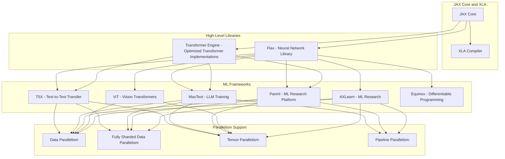
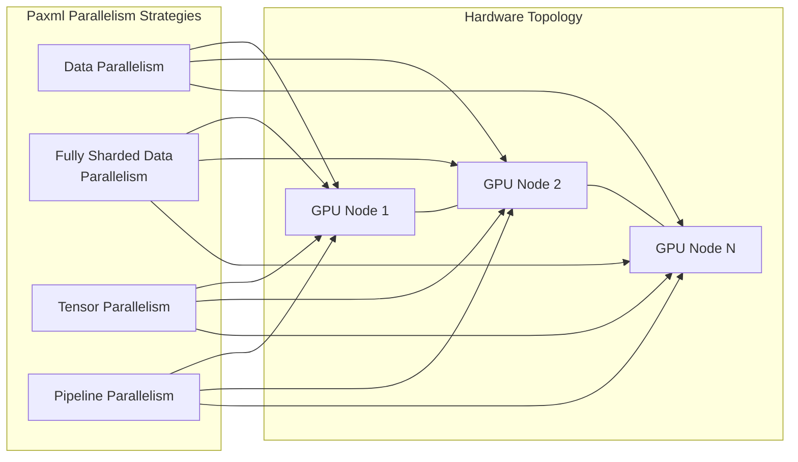
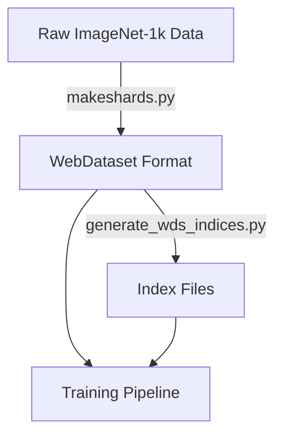
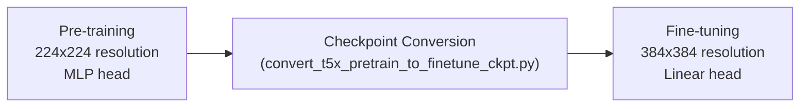
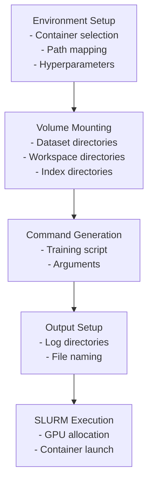

<!-- source: DeepWiki mcp.deepwiki.com · repo NVIDIA/JAX-Toolbox · page 4.3 Paxml and Other Frameworks · fetched 2026-10-26 -->

# Paxml and Other Frameworks

<details>
<summary>Relevant source files</summary>

The following files were used as context for generating this wiki page:

- [.github/container/bump.sh](.github/container/bump.sh)
- [rosetta/rosetta/data/generate_wds_indices.py](rosetta/rosetta/data/generate_wds_indices.py)
- [rosetta/rosetta/projects/t5x/README.md](rosetta/rosetta/projects/t5x/README.md)
- [rosetta/rosetta/projects/t5x/scripts/example_slurm_ft_frompile.sub](rosetta/rosetta/projects/t5x/scripts/example_slurm_ft_frompile.sub)
- [rosetta/rosetta/projects/t5x/scripts/example_slurm_pretrain_pile.sub](rosetta/rosetta/projects/t5x/scripts/example_slurm_pretrain_pile.sub)
- [rosetta/rosetta/projects/vit/README.md](rosetta/rosetta/projects/vit/README.md)
- [rosetta/rosetta/projects/vit/scripts/example_slurm_finetune.sub](rosetta/rosetta/projects/vit/scripts/example_slurm_finetune.sub)
- [rosetta/rosetta/projects/vit/scripts/example_slurm_pretrain.sub](rosetta/rosetta/projects/vit/scripts/example_slurm_pretrain.sub)
- [rosetta/tests/test-vit.sh](rosetta/tests/test-vit.sh)

</details>


This page documents the JAX-based machine learning frameworks supported in JAX-Toolbox beyond T5X and MaxText, which are covered separately in [T5X and Rosetta T5X](4.1) and [MaxText](4.2). The primary focus is on Paxml (Google's ML research framework), Vision Transformer (ViT), and other frameworks like AXLearn and Equinox. This page details how these frameworks are integrated into JAX-Toolbox, their capabilities, and how to use them for training and inference.

## Framework Overview

JAX-Toolbox supports multiple JAX-based frameworks, each with different specialties and use cases. These frameworks build on JAX's core capabilities and extend them with domain-specific functionality.



Sources: [provided system diagrams](Framework Ecosystem and Parallelism Support), [rosetta/rosetta/projects/vit/README.md:3-4]()

## Paxml

Paxml is a JAX-based machine learning research framework developed by Google. It provides flexible APIs for developing and experimenting with different model architectures and training techniques. Paxml serves as a general-purpose ML research platform with support for various parallelism strategies, making it suitable for large-scale distributed training.

### Key Features

- Support for multiple parallelism strategies:
  - Data Parallelism
  - Fully Sharded Data Parallelism (FSDP)
  - Tensor Parallelism
  - Pipeline Parallelism
- Integration with JAX ecosystem
- Extensive model architecture support
- Research-oriented design for model experimentation

### Parallelism in Paxml



Sources: [provided system diagrams](Framework Ecosystem and Parallelism Support)

## Vision Transformer (ViT)

Vision Transformer (ViT) is an implementation of the transformer architecture for computer vision tasks. JAX-Toolbox's ViT implementation is adapted from Google's original implementation and extended with model parallel support.

### Architecture and Features

- Direct adaptation of Google's original ViT implementation
- Added model parallel support
- Currently verified on ViT-B/16 configuration
- Pre-training on resolution 224 and fine-tuning on resolution 384
- Different classification heads for pre-training (two-layer MLP) and fine-tuning (single linear layer)

### Hardware Requirements

ViT training has been validated on NVIDIA DGX A100 (8x A100-SXM4-80G) nodes. Both single-node and multi-node configurations are supported for pre-training and fine-tuning.

### Data Preparation

ViT uses the ImageNet-1k dataset in WebDataset format with DALI for efficient data loading:



Sources: [rosetta/rosetta/projects/vit/README.md:20-78](), [rosetta/rosetta/data/generate_wds_indices.py:15-43]()

### Training Workflow

ViT follows a two-stage training process:

1. **Pre-training**: Train the model on ImageNet-1k with 224×224 resolution using a two-layer MLP head
2. **Checkpoint Conversion**: Convert the pre-trained checkpoint for fine-tuning using the provided script
3. **Fine-tuning**: Train from the converted checkpoint with 384×384 resolution using a single linear layer head



Sources: [rosetta/rosetta/projects/vit/README.md:80-121]()

### Performance Results

ViT has been benchmarked on NVIDIA hardware with the following results:

| Model | Training Stage | GPUs | BS/GPU | Global BS | Samples/sec | Est. Walltime | Accuracy |
|-------|---------------|------|--------|-----------|-------------|---------------|----------|
| ViT-B/16 | Pre-training | 8 | 512 | 4096 | ~7129 | 15.0 hours | N/A |
| ViT-B/16 | Fine-tuning | 8 | 64 | 512 | ~1841 | 1.5 hours | 79.4% |
| ViT-G/14 | Pre-training | 64 | 16 | 1024 | ~1787 | N/A | N/A |

Sources: [rosetta/rosetta/projects/vit/README.md:123-152]()

### Running ViT Training Jobs

ViT supports both single-process and multi-process training modes:

#### Single-Process (Interactive)

```bash
bash rosetta/projects/vit/scripts/singleprocess_pretrain.sh base bfloat16 8 512 log_dir model_dir train_idx_dir eval_idx_dir 1
```

#### Multi-Process (SLURM)

```bash
BASE_WORKSPACE_DIR=<path> BASE_WDS_DATA_DIR=<path> BASE_TRAIN_IDX_DIR=<path> BASE_EVAL_IDX_DIR=<path> \
VIT_SIZE=base PREC=bfloat16 GPUS_PER_NODE=8 BSIZE_PER_GPU=512 MODEL_DIR_LOCAL=model_dir \
sbatch -N 1 example_slurm_pretrain.sub
```

Sources: [rosetta/rosetta/projects/vit/README.md:82-101](), [rosetta/rosetta/projects/vit/scripts/example_slurm_pretrain.sub:1-74](), [rosetta/rosetta/projects/vit/scripts/example_slurm_finetune.sub:1-74]()

## AXLearn

AXLearn is another JAX-based machine learning research framework supported in JAX-Toolbox. Like Paxml, it's designed for ML research with flexible APIs for experimenting with model architectures and training techniques.

### Key Features

- Support for multiple parallelism strategies:
  - Data Parallelism
  - Fully Sharded Data Parallelism
  - Tensor Parallelism
  - Pipeline Parallelism
- Research-oriented design

Sources: [provided system diagrams](Framework Ecosystem and Parallelism Support)

## Equinox

Equinox is a JAX-based framework for differentiable programming that's included in JAX-Toolbox. It provides a pure functional approach to building neural networks and other differentiable programs.

Sources: [provided system diagrams](Container Hierarchy)

## Training with SLURM

JAX-Toolbox provides SLURM submission scripts for distributed training of these frameworks. These scripts handle resource allocation, container execution, and distributed coordination.

### Common Structure of SLURM Scripts



### Example SLURM Configuration for ViT

Here's an example of key configuration variables for ViT training:

```bash
CONTAINER="ghcr.io/nvidia/t5x:vit-2023-07-21"
BASE_WORKSPACE_DIR=<path>                    # Path for outputs
BASE_WDS_DATA_DIR=<path>                     # Path to ImageNet dataset
BASE_TRAIN_IDX_DIR=<path>                    # Path to train indices
BASE_EVAL_IDX_DIR=<path>                     # Path to eval indices
VIT_SIZE="base"                              # Model size (base, large, etc.)
PREC="bfloat16"                              # Precision (bfloat16, float32)
GPUS_PER_NODE=8                              # GPUs to use per node
BSIZE_PER_GPU=512                            # Batch size per GPU
```

Sources: [rosetta/rosetta/projects/vit/scripts/example_slurm_pretrain.sub:29-60](), [rosetta/rosetta/projects/vit/scripts/example_slurm_finetune.sub:29-60]()

## Comparative Analysis

The table below summarizes the key characteristics of the ML frameworks supported in JAX-Toolbox:

| Framework | Primary Use Case | Parallelism Support | Container Image | Hardware Tested |
|-----------|------------------|---------------------|-----------------|-----------------|
| T5X | Text-to-Text Transfer | DP, FSDP, TP | ghcr.io/nvidia/t5x | A100, H100 |
| MaxText | LLM Training | DP, FSDP, TP, PP | ghcr.io/nvidia/maxtext | A100, H100 |
| Paxml | ML Research | DP, FSDP, TP, PP | (via JAX-Toolbox) | A100 |
| ViT | Computer Vision | DP, TP | ghcr.io/nvidia/t5x:vit-* | A100 |
| AXLearn | ML Research | DP, FSDP, TP, PP | (via JAX-Toolbox) | A100 |
| Equinox | Differentiable Programming | DP | (via JAX-Toolbox) | A100 |

*DP: Data Parallelism, FSDP: Fully Sharded Data Parallelism, TP: Tensor Parallelism, PP: Pipeline Parallelism*

Sources: [provided system diagrams](Framework Ecosystem and Parallelism Support), [rosetta/rosetta/projects/t5x/README.md:23-26](), [rosetta/rosetta/projects/vit/README.md:8-11]()

## Future Improvements

Several enhancements are planned for these frameworks:

- **ViT**: Adding Transformer Engine support to further accelerate pre-training and fine-tuning
- Broader model size support for ViT beyond the currently verified B/16 configuration
- Continued performance optimization across all frameworks

Sources: [rosetta/rosetta/projects/vit/README.md:155-156]()

## Known Issues

- **ViT and Gradient Accumulation**: When using gradient accumulation with ViT, be aware that the loss is scaled up across microbatches. This works fine with scale-invariant optimizers like Adam or Adafactor, but not with SGD which is used for ViT fine-tuning.
- **T5X NCCL Crash**: There's a known sporadic NCCL crash when using the T5X container at node counts greater than or equal to 32 nodes.

Sources: [rosetta/rosetta/projects/vit/README.md:158-160](), [rosetta/rosetta/projects/t5x/README.md:200-201]()

---

