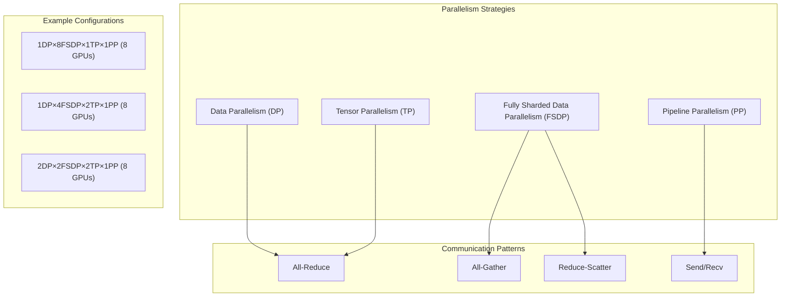
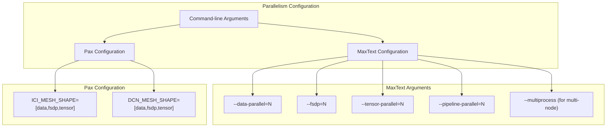
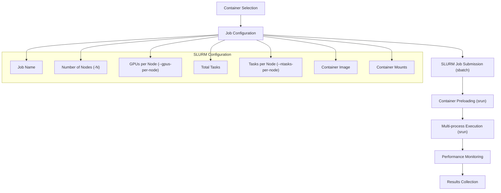
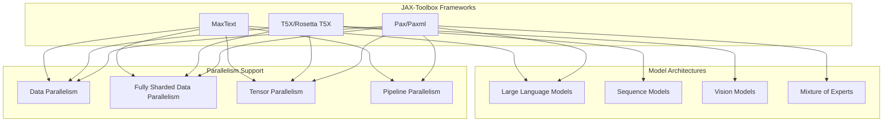
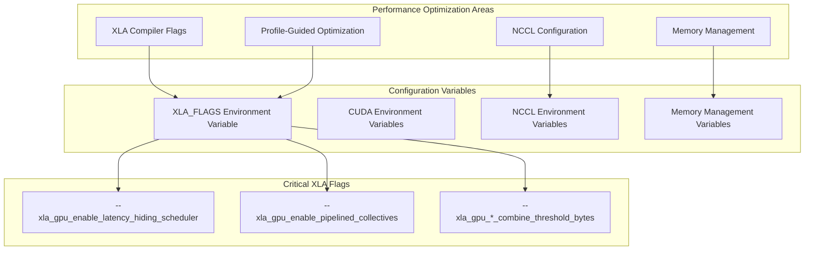

<!-- source: DeepWiki mcp.deepwiki.com · repo NVIDIA/JAX-Toolbox · page 5 Multi-Node Training · fetched 2026-10-26 -->

# Multi-Node Training

<details>
<summary>Relevant source files</summary>

The following files were used as context for generating this wiki page:

- [.github/actions/setup-ssh/action.yml](.github/actions/setup-ssh/action.yml)
- [.github/container/test-maxtext.sh](.github/container/test-maxtext.sh)
- [.github/workflows/_publish_t5x_pax_results.yaml](.github/workflows/_publish_t5x_pax_results.yaml)
- [.github/workflows/_runner_ondemand_slurm.yaml](.github/workflows/_runner_ondemand_slurm.yaml)
- [.github/workflows/_test_maxtext.yaml](.github/workflows/_test_maxtext.yaml)
- [.github/workflows/_test_slurm_pyxis.yaml](.github/workflows/_test_slurm_pyxis.yaml)
- [.github/workflows/_test_t5x_rosetta.yaml](.github/workflows/_test_t5x_rosetta.yaml)
- [.github/workflows/scripts/wait_for_slurm_job.sh](.github/workflows/scripts/wait_for_slurm_job.sh)
- [rosetta/docs/GPU_performance.md](rosetta/docs/GPU_performance.md)
- [rosetta/docs/NATIVE_FP8.md](rosetta/docs/NATIVE_FP8.md)
- [rosetta/docs/PGLE.md](rosetta/docs/PGLE.md)
- [rosetta/rosetta/projects/maxtext/README.md](rosetta/rosetta/projects/maxtext/README.md)
- [rosetta/rosetta/projects/maxtext/scripts/example_slurm.sub](rosetta/rosetta/projects/maxtext/scripts/example_slurm.sub)
- [rosetta/rosetta/projects/pax/README.md](rosetta/rosetta/projects/pax/README.md)

</details>


This document provides a comprehensive overview of the multi-node training capabilities in JAX-Toolbox, explaining how the system supports distributed training of JAX-based machine learning models across multiple compute nodes. It covers the core concepts of parallelism strategies, infrastructure components, and performance optimization techniques for efficient multi-node training.

For information about building and configuring the containers used in multi-node training, please refer to [Container System Architecture](#2).

## Parallelism Strategies for Distributed Training

JAX-Toolbox supports several parallelism strategies that can be combined to distribute model training across multiple devices:

**Parallelism Strategies in JAX-Toolbox**



Sources:
- [.github/container/test-maxtext.sh:28-46]()
- [rosetta/rosetta/projects/pax/README.md:111-113]()

### Data Parallelism (DP)

In Data Parallelism, each device has a complete copy of the model and processes different batches of data. Gradients are synchronized across devices using All-Reduce operations.

### Fully Sharded Data Parallelism (FSDP)

FSDP (also known as ZeRO-3) shards model parameters, gradients, and optimizer states across devices. This reduces memory requirements but increases communication overhead through All-Gather and Reduce-Scatter operations.

### Tensor Parallelism (TP)

In Tensor Parallelism, model tensors are split across devices, with each device responsible for a portion of the computation. This is particularly useful for large matrix operations in transformer layers.

### Pipeline Parallelism (PP)

Pipeline Parallelism assigns different layers of the model to different devices, with activations flowing between them using Send/Recv operations. This allows for efficient processing of very deep models.

## Mapping Parallelism to JAX-Toolbox Configuration

**Parallelism Configuration in JAX-Toolbox**



Sources:
- [.github/container/test-maxtext.sh:28-31]()
- [rosetta/rosetta/projects/pax/README.md:111-113]()

## Multi-Node Job Execution Workflow

**Job Submission and Execution Flow**



Sources:
- [.github/workflows/_test_slurm_pyxis.yaml:120-156]()
- [.github/workflows/_test_maxtext.yaml:237-275]()
- [.github/workflows/_test_t5x_rosetta.yaml:90-118]()
- [rosetta/rosetta/projects/maxtext/scripts/example_slurm.sub:1-10]()

## Supported Frameworks and Models

JAX-Toolbox provides multi-node training support for the following JAX-based frameworks:

**Frameworks and Parallelism Support**



Sources:
- [rosetta/rosetta/projects/maxtext/README.md:18-94]()
- [rosetta/rosetta/projects/pax/README.md:155-178]()
- [.github/workflows/_test_t5x_rosetta.yaml:1-271]()

### MaxText

MaxText supports training large language models like Llama, Gemma, and GPT variants with various parallelism strategies. Performance has been validated on NVIDIA DGX H100 nodes.

Example models and performance metrics:

| Model | GPUs | Precision | DP | FSDP | TP | Sequence/Sec |
|-------|------|-----------|----|----- |----| -------------|
| Llama2-7B | 8 H100 | BF16 | 1 | 8 | 1 | 22.19 |

### T5X and Rosetta T5X

T5X supports training sequence-to-sequence models like T5 and vision models like ViT. Multi-node support is tested through the Rosetta T5X integration tests.

### Paxml

Pax supports various model architectures including:
- GPT models (126M, 5B, 175B)
- LLaMA models (7B, 13B, 70B)
- Mixture of Experts models (GLaM)

Example models and performance metrics:

| Model | GPUs | Precision | DP | FSDP | TP | Sequence/Sec |
|-------|------|-----------|----|----- |----| -------------|
| GPT-126M | 64 H100 | TE BF16 | 64 | 1 | 1 | 4709.12 |
| GPT-5B | 256 H100 | TE BF16 | 1 | 256 | 1 | 1657.24 |
| GPT-175B | 256 H100 | TE BF16 | 1 | 256 | 1 | 51.00 |

## Performance Optimization for Multi-Node Training

**Performance Optimization Components**



Sources:
- [rosetta/docs/GPU_performance.md:10-147]()
- [rosetta/docs/PGLE.md:1-113]()
- [rosetta/rosetta/projects/maxtext/README.md:66-83]()

### XLA Flags for Multi-Node Performance

The most critical XLA flags for multi-node training performance are:

1. **Latency Hiding Scheduler**
   ```
   --xla_gpu_enable_latency_hiding_scheduler=true
   ```
   Enables overlapping computation with communication for improved performance.

2. **Pipelined Collectives**
   ```
   --xla_gpu_enable_pipelined_all_gather=true
   --xla_gpu_enable_pipelined_reduce_scatter=true
   --xla_gpu_enable_pipelined_all_reduce=true
   ```
   Optimizes collective communication operations by pipelining them.

3. **Combine Thresholds**
   ```
   --xla_gpu_all_reduce_combine_threshold_bytes=1073741824
   --xla_gpu_all_gather_combine_threshold_bytes=1073741824
   --xla_gpu_reduce_scatter_combine_threshold_bytes=134217728
   ```
   Controls when collective operations are combined for better efficiency.

4. **Double Buffering**
   ```
   --xla_gpu_enable_while_loop_double_buffering=true
   ```
   Optimizes scan loops used in FSDP implementations.

### NCCL and CUDA Configuration

Key environment variables:
- `CUDA_DEVICE_MAX_CONNECTIONS=1`: Restricts CUDA queues for better performance with latency hiding.
- `NCCL_PROTO=LL`: Selects the NCCL protocol.
- `NCCL_NVLS_ENABLE=1`: Accelerates all-reduce on NVLink4/H100 (requires more memory).

### Memory Management

- `XLA_PYTHON_CLIENT_MEM_FRACTION`: Controls the fraction of GPU memory allocated to JAX/XLA (typically 0.8-0.9).
- `remat_policy`: Activation checkpointing policy (e.g., `minimal`, `minimal_flash` for MaxText).

### Profile Guided Latency Estimator (PGLE)

PGLE optimizes execution by feeding real performance metrics back to the XLA compiler:

1. Profile run with async collectives disabled
2. Generate cost profile
3. Performance run using the profile for better scheduling

To enable PGLE:
```
--xla_gpu_pgle_profile_file_or_directory_path=<path_to_profile>
```

## Running Multi-Node Training Jobs

### MaxText on Multiple Nodes

To run MaxText on multiple nodes with SLURM:

1. **Prepare environment variables**:
   ```bash
   export XLA_PYTHON_CLIENT_MEM_FRACTION=0.90
   export CUDA_DEVICE_MAX_CONNECTIONS=1
   export NVTE_FUSED_ATTN=1
   ```

2. **Configure XLA flags**:
   ```bash
   export XLA_FLAGS="--xla_gpu_enable_latency_hiding_scheduler=true \
                    --xla_gpu_enable_triton_gemm=false \
                    --xla_gpu_enable_command_buffer= \
                    --xla_gpu_all_reduce_combine_threshold_bytes=1073741824 \
                    --xla_gpu_all_gather_combine_threshold_bytes=1073741824 \
                    --xla_gpu_reduce_scatter_combine_threshold_bytes=134217728 \
                    --xla_gpu_enable_pipelined_all_gather=true \
                    --xla_gpu_enable_pipelined_reduce_scatter=true \
                    --xla_gpu_enable_pipelined_all_reduce=true \
                    --xla_gpu_enable_while_loop_double_buffering=true \
                    --xla_gpu_enable_all_gather_combine_by_dim=false \
                    --xla_gpu_enable_reduce_scatter_combine_by_dim=false \
                    --xla_disable_hlo_passes=rematerialization"
   ```

3. **Submit SLURM job**:
   ```bash
   CONTAINER=ghcr.io/nvidia/jax:maxtext BASE_WORKSPACE_DIR=/path/to/workspace \
   sbatch -N <num_nodes> -A <account> -p <partition> scripts/example_slurm.sub
   ```

The MaxText command executed by the SLURM job is typically:
```bash
python3 MaxText/train.py \
    MaxText/configs/base.yml \
    model_name=llama2-7b \
    per_device_batch_size=2 \
    steps=15 \
    scan_layers=false \
    remat_policy=minimal_flash \
    attention=cudnn_flash_te \
    max_target_length=4096 \
    hardware=gpu_multiprocess \
    run_name=<job_name>
```

Sources:
- [rosetta/rosetta/projects/maxtext/scripts/example_slurm.sub:30-101]()
- [.github/container/test-maxtext.sh:246-307]()

### Pax on Multiple Nodes

To run Pax on multiple nodes with SLURM:

1. **Define environment variables**:
   ```bash
   CONTAINER=ghcr.io/nvidia/pax:latest
   BASE_WORKSPACE_DIR=/path/to/workspace
   BASE_TFDS_DATA_DIR=/path/to/datasets
   BASE_VOCAB_PATH=/path/to/vocab
   PREC=bfloat16
   GPUS_PER_NODE=8
   PERCORE_BATCH_SIZE=4
   ```

2. **Submit SLURM job**:
   ```bash
   CONTAINER=$CONTAINER BASE_WORKSPACE_DIR=$BASE_WORKSPACE_DIR \
   BASE_TFDS_DATA_DIR=$BASE_TFDS_DATA_DIR BASE_VOCAB_PATH=$BASE_VOCAB_PATH \
   PREC=$PREC GPUS_PER_NODE=$GPUS_PER_NODE PERCORE_BATCH_SIZE=$PERCORE_BATCH_SIZE \
   sbatch -N <num_nodes> -A <account> -p <partition> scripts/example_slurm_pile.sub
   ```

Sources:
- [rosetta/rosetta/projects/pax/README.md:85-96]()

### T5X on Multiple Nodes

To run T5X on multiple nodes with SLURM:

1. **Define variables**:
   ```bash
   CONTAINER=ghcr.io/nvidia/t5x:latest
   ```

2. **Submit SLURM job** with the appropriate parameters for nodes, GPUs, and tasks.
   
3. A typical srun command in T5X workflows looks like:
   ```bash
   srun --ntasks=$TOTAL_TASKS --ntasks-per-node=$GPUS_PER_NODE \
     --container-name=runtime --container-mounts=$OUTPUT_PATH:/output \
     --container-entrypoint test-vit.sh \
     --output /output/$TEST_CASE_NAME --dtype bfloat16 \
     --batch-size $BATCH_SIZE --multiprocess
   ```

Sources:
- [.github/workflows/_test_t5x_rosetta.yaml:108-118]()

## Troubleshooting Multi-Node Training

### Common Issues and Solutions

1. **Memory-related issues**:
   - Reduce batch size per GPU
   - Increase the number of GPUs/nodes
   - Adjust rematerialization policy (`remat_policy`)
   - Reduce `XLA_PYTHON_CLIENT_MEM_FRACTION` if using NCCL_NVLS_ENABLE=1

2. **Performance issues**:
   - Verify XLA flags are set correctly
   - Ensure NCCL/CUDA environment variables are configured
   - Consider using PGLE for optimized scheduling
   - Check for network bottlenecks between nodes

3. **Convergence issues**:
   - Flash attention can sometimes cause divergence (especially with GPT 126M)
   - If using flash attention without Transformer Engine and experiencing divergence, disable it with `--xla_gpu_enable_cudnn_fmha=false`

4. **Multi-process hangs**:
   - For 1-process-multiple-device setups, hangs can occur with process-wide synchronizing CUDA APIs
   - Set `NCCL_LAUNCH_MODE=GROUP`
   - Consider using 1 process per device instead

Sources:
- [rosetta/docs/GPU_performance.md:169-175]()
- [rosetta/rosetta/projects/pax/README.md:306-314]()

### CUDA Special Considerations for H100 vs. Blackwell

For Blackwell (B200) systems:
- No need to set `CUDA_DEVICE_MAX_CONNECTIONS=1` (unlike Hopper/H100)
- Use `--xla_gpu_enable_command_buffer=FUSION,CUSTOM_CALL` for reduced CPU launch latency overhead
- Take advantage of additional GPU memory (180GB) by adjusting model parallelism configurations or increasing batch sizes

Sources:
- [rosetta/docs/GPU_performance.md:147-168]()

## Multi-Node Testing in JAX-Toolbox

JAX-Toolbox includes a comprehensive testing infrastructure for validating multi-node training:

1. **GitHub Actions workflows** for automated testing:
   - `_test_t5x_rosetta.yaml`: Tests T5X Rosetta on multi-GPU, multi-node setups
   - `_test_maxtext.yaml`: Tests MaxText with various parallelism configurations

2. **SLURM job submission** via GitHub Actions:
   - `_runner_ondemand_slurm.yaml`: Creates on-demand SLURM runners
   - `_test_slurm_pyxis.yaml`: General workflow for SLURM+Pyxis tests

3. **Test harnesses**:
   - `test-maxtext.sh`: Script for testing MaxText with configurable parameters
   - `test-vit.sh`: Script for testing ViT models with T5X

4. **Results collection and validation**:
   - `_publish_t5x_pax_results.yaml`: Publishes test results to TensorBoard
   - Validation against performance baselines

Sources: 
- [.github/workflows/_test_t5x_rosetta.yaml:1-282]()
- [.github/workflows/_test_maxtext.yaml:1-386]()
- [.github/container/test-maxtext.sh:1-310]()
- [.github/workflows/_test_slurm_pyxis.yaml:1-240]()

## Conclusion

JAX-Toolbox provides robust support for multi-node training across various frameworks (MaxText, T5X, Pax) with different parallelism strategies. The performance can be significantly optimized using appropriate XLA flags, NCCL configurations, and memory management techniques.

By combining different parallelism strategies (DP, FSDP, TP, PP) and leveraging the infrastructure and optimization techniques described in this document, users can efficiently train large models across multiple nodes.

---

