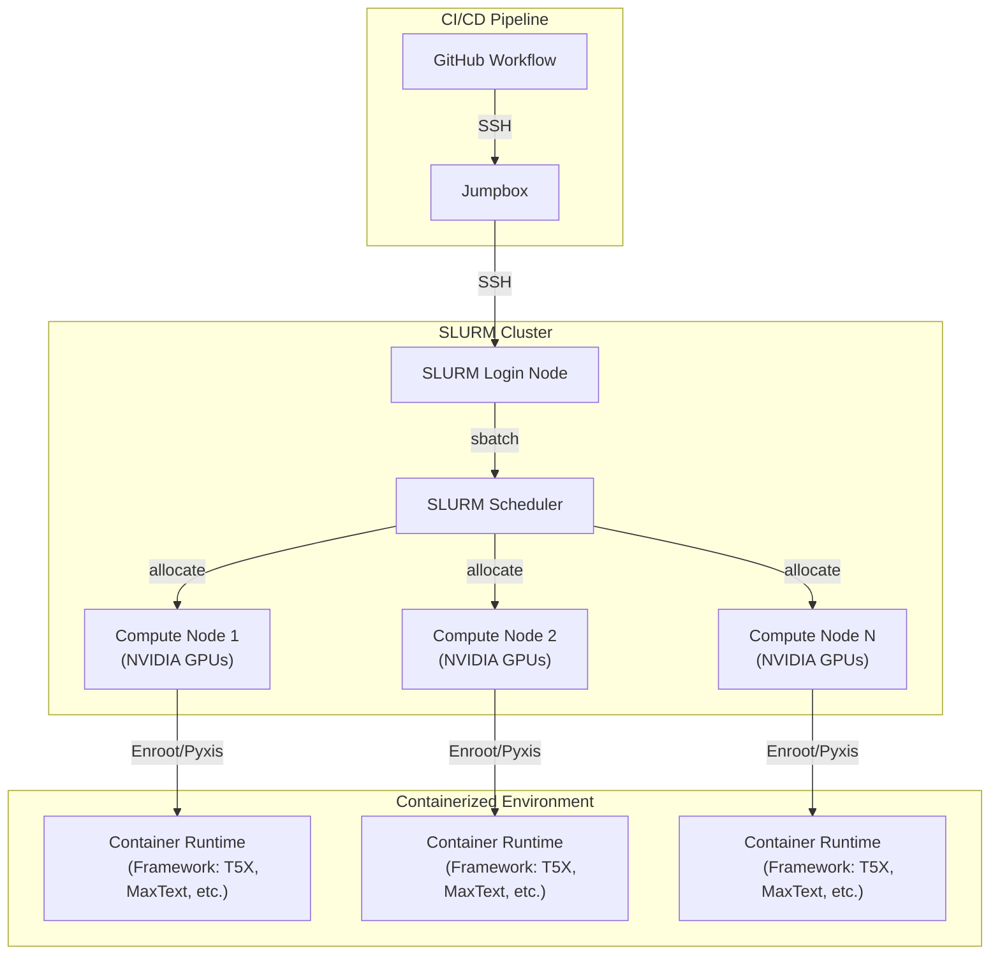
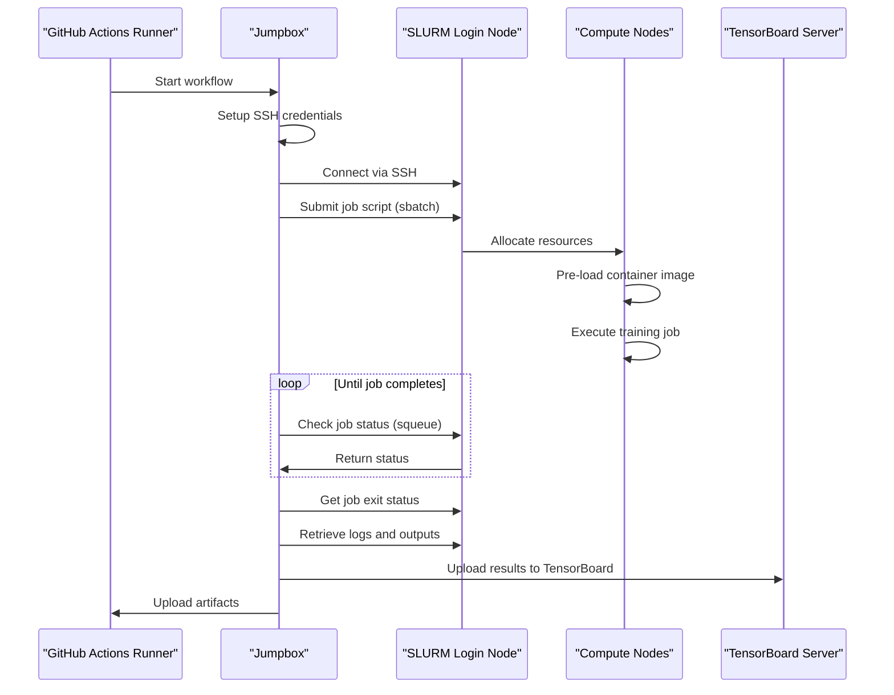
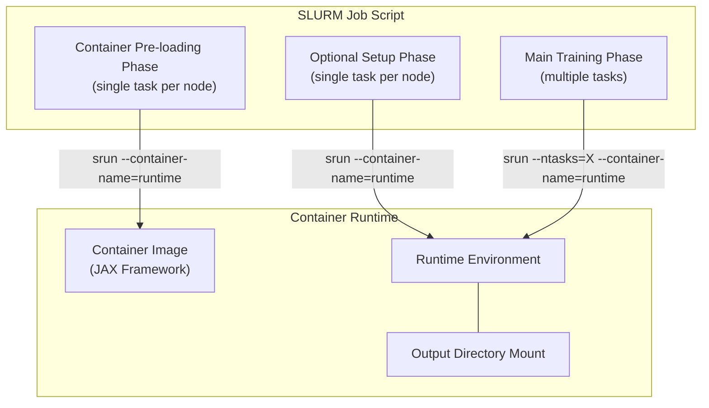

<!-- source: DeepWiki mcp.deepwiki.com · repo NVIDIA/JAX-Toolbox · page 5.1 SLURM Integration · fetched 2026-10-26 -->

# SLURM Integration

<details>
<summary>Relevant source files</summary>

The following files were used as context for generating this wiki page:

- [.github/actions/setup-ssh/action.yml](.github/actions/setup-ssh/action.yml)
- [.github/workflows/_publish_t5x_pax_results.yaml](.github/workflows/_publish_t5x_pax_results.yaml)
- [.github/workflows/_runner_ondemand_slurm.yaml](.github/workflows/_runner_ondemand_slurm.yaml)
- [.github/workflows/_test_maxtext.yaml](.github/workflows/_test_maxtext.yaml)
- [.github/workflows/_test_slurm_pyxis.yaml](.github/workflows/_test_slurm_pyxis.yaml)
- [.github/workflows/_test_t5x_rosetta.yaml](.github/workflows/_test_t5x_rosetta.yaml)
- [.github/workflows/scripts/wait_for_slurm_job.sh](.github/workflows/scripts/wait_for_slurm_job.sh)

</details>


This document explains how JAX-Toolbox integrates with SLURM (Simple Linux Utility for Resource Management) for multi-node training of JAX-based machine learning models. SLURM is a workload manager for Linux clusters that JAX-Toolbox leverages to efficiently allocate resources and run distributed training jobs across multiple nodes and GPUs.

For information on Kubernetes/EKS integration for multi-node training, see [Kubernetes/EKS Integration](#5.2).

## Overview

JAX-Toolbox uses SLURM to orchestrate multi-node, multi-GPU training jobs across a cluster of machines with NVIDIA GPUs. It handles job submission, container orchestration via Enroot/Pyxis, job monitoring, and result collection.



Sources: [.github/workflows/_test_t5x_rosetta.yaml](), [.github/workflows/_test_maxtext.yaml](), [.github/workflows/_test_slurm_pyxis.yaml]()

## Key Components

The SLURM integration consists of several key components:

1. **SSH Setup** - Establishes secure connections to the SLURM login node
2. **Job Submission** - Creates and submits SLURM batch jobs
3. **Container Execution** - Runs containerized training workloads via Enroot/Pyxis
4. **Job Monitoring** - Tracks job progress and status
5. **Artifact Collection** - Retrieves logs and training outputs



Sources: [.github/workflows/_test_t5x_rosetta.yaml:82-125](), [.github/workflows/_test_maxtext.yaml:78-137](), [.github/workflows/scripts/wait_for_slurm_job.sh]()

## SSH Configuration

JAX-Toolbox uses SSH to securely connect to SLURM login nodes. This is typically handled by a reusable GitHub Action that configures SSH credentials:

| Component | Purpose |
|-----------|---------|
| SSH Private Key | Authentication to the SLURM login node |
| Known Hosts | Verification of the login node's identity |
| Jumpbox Runner | Acts as an intermediary for SSH connections |

Sources: [.github/actions/setup-ssh/action.yml]()

## SLURM Job Submission

JAX-Toolbox submits jobs to SLURM using the `sbatch` command. Job scripts define resource requirements and execution commands:

### Job Script Structure

1. **Job Directives** - Define resource requirements and job configuration:
   - `--job-name` - Identifies the job
   - `--nodes` - Number of compute nodes
   - `--gpus-per-node` - GPUs required per node
   - `--time` - Time limit for the job
   - `--output` - Path to job output log
   - `--export` - Environment variables to expose to the job

2. **Execution Commands** - Run the training job using `srun`:
   - Container pre-loading phase
   - Optional one-time setup phase
   - Main training execution phase

Sources: [.github/workflows/_test_t5x_rosetta.yaml:82-119](), [.github/workflows/_test_maxtext.yaml:78-122]()

## Container Execution with Enroot/Pyxis

JAX-Toolbox uses the Enroot/Pyxis plugin for SLURM to run containerized applications. This approach provides a consistent environment across nodes while leveraging SLURM's resource management capabilities.



### Container Execution Phases

1. **Pre-loading Phase** - Loads the container image on each compute node: 
   ```
   srun --ntasks-per-node=1 --container-name=runtime --container-image=IMAGE true
   ```

2. **Setup Phase** (Optional) - Performs one-time setup tasks:
   ```
   srun --ntasks-per-node=1 --container-name=runtime SETUP_COMMANDS
   ```

3. **Training Phase** - Executes the main training job:
   ```
   srun --ntasks=TOTAL_TASKS --ntasks-per-node=GPUS_PER_NODE --container-name=runtime 
        --container-mounts=OUTPUT_PATH:/output --container-entrypoint TRAINING_SCRIPT
   ```

Sources: [.github/workflows/_test_t5x_rosetta.yaml:100-118](), [.github/workflows/_test_maxtext.yaml:95-120](), [.github/workflows/_test_slurm_pyxis.yaml:130-154]()

## Job Monitoring

JAX-Toolbox uses a custom script to monitor SLURM job progress. The script periodically checks job status using the `squeue` command:

1. The job ID is obtained from the `sbatch` command output
2. The `wait_for_slurm_job.sh` script polls for job status
3. Upon completion, job exit code and state are retrieved using `sacct`

Sources: [.github/workflows/scripts/wait_for_slurm_job.sh](), [.github/workflows/_test_t5x_rosetta.yaml:122-133](), [.github/workflows/_test_maxtext.yaml:124-137]()

## Artifact Collection

After job completion, JAX-Toolbox collects logs and training outputs:

1. **Log Files** - Retrieved using `rsync` from the SLURM login node
2. **Training Outputs** - Retrieved from the job output directory
3. **TensorBoard Logs** - Uploaded to a TensorBoard server for visualization
4. **GitHub Artifacts** - Uploaded as GitHub Actions artifacts

Sources: [.github/workflows/_test_t5x_rosetta.yaml:136-149](), [.github/workflows/_test_maxtext.yaml:146-158](), [.github/workflows/_publish_t5x_pax_results.yaml]()

## Framework-Specific SLURM Integration

JAX-Toolbox provides SLURM integration for several JAX-based frameworks:

### T5X/Rosetta Integration

The T5X integration tests run Vision Transformer (ViT) models in multi-GPU, multi-node configurations:

| Parameter | Description |
|-----------|-------------|
| `N_GPU` | Number of GPUs per node |
| `N_NODE` | Number of nodes to use |
| `TOTAL_TASKS` | Total number of tasks (GPUs) |
| `VIT_BATCH_SIZE_PER_GPU` | Batch size per GPU |

The test runs a ViT model with a scaled batch size proportional to the total number of GPUs.

Sources: [.github/workflows/_test_t5x_rosetta.yaml:35-207]()

### MaxText Integration

The MaxText integration includes both single-process multi-device tests and multi-node tests:

1. **Single-Process Multi-Device** - Various parallelism configurations within a single process:
   - Pipeline Parallelism
   - Data Parallelism
   - Fully Sharded Data Parallelism (FSDP)
   - Tensor Parallelism

2. **Multi-Node Tests** - Distributes training across multiple nodes with different parallelism configurations

Sources: [.github/workflows/_test_maxtext.yaml:38-329]()

## On-Demand SLURM Runners

JAX-Toolbox can create ephemeral GitHub Actions runners using SLURM jobs:

1. A SLURM job is submitted to allocate compute resources
2. The job runs a Docker container with GitHub Actions runner software
3. The runner registers with GitHub and executes workflow jobs
4. The runner terminates when the job completes or the time limit is reached

Sources: [.github/workflows/_runner_ondemand_slurm.yaml]()

## Troubleshooting SLURM Integration

When troubleshooting SLURM integration issues, consider the following:

1. **Job Status** - Check job status using `squeue` or `sacct`
2. **Job Logs** - Examine job output logs for errors
3. **Node Resources** - Ensure requested resources are available
4. **Container Issues** - Verify container image accessibility and compatibility
5. **Network Connectivity** - Check network connectivity between nodes
6. **Resource Limits** - Ensure job resource requests are within limits

For persistent issues, review the SLURM job ID and exit codes which are preserved in job artifacts.

Sources: [.github/workflows/_test_t5x_rosetta.yaml:151-169](), [.github/workflows/_test_maxtext.yaml:160-168](), [.github/workflows/_test_slurm_pyxis.yaml:169-201]()

---

