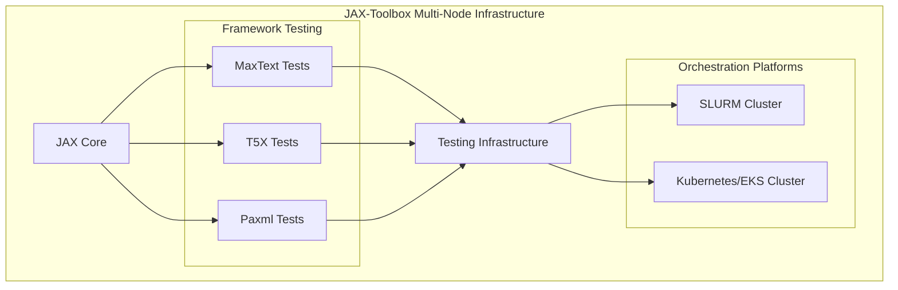
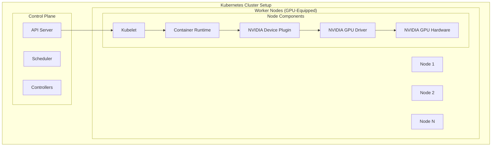
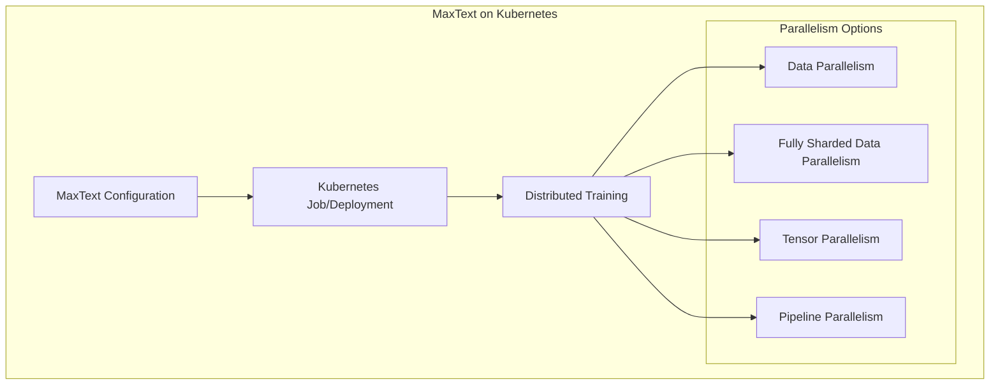
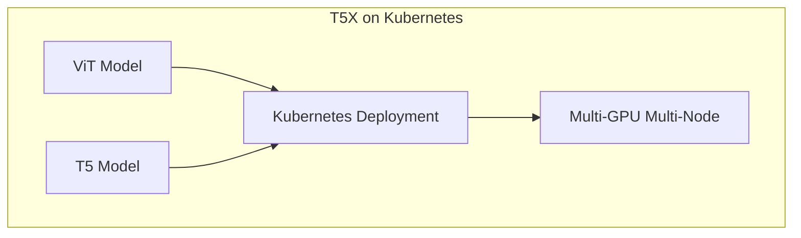
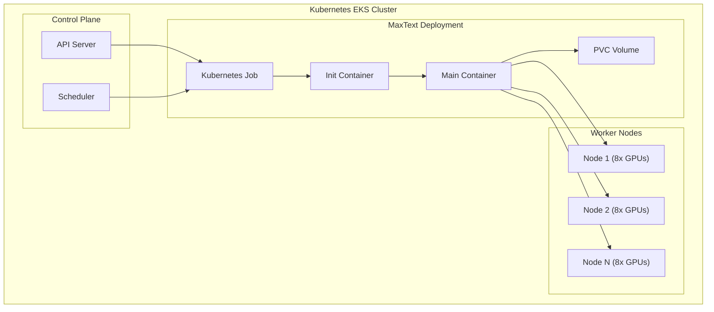
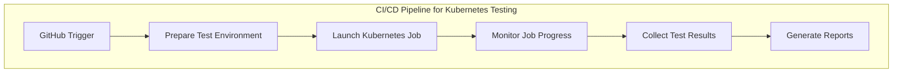
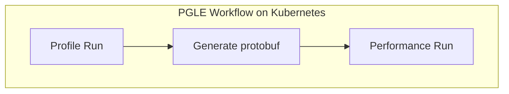

<!-- source: DeepWiki mcp.deepwiki.com · repo NVIDIA/JAX-Toolbox · page 5.2 Kubernetes/EKS Integration · fetched 2026-10-26 -->

# Kubernetes/EKS Integration

<details>
<summary>Relevant source files</summary>

The following files were used as context for generating this wiki page:

- [.github/actions/setup-ssh/action.yml](.github/actions/setup-ssh/action.yml)
- [.github/container/test-maxtext.sh](.github/container/test-maxtext.sh)
- [.github/workflows/_publish_t5x_pax_results.yaml](.github/workflows/_publish_t5x_pax_results.yaml)
- [.github/workflows/_runner_ondemand_slurm.yaml](.github/workflows/_runner_ondemand_slurm.yaml)
- [.github/workflows/_test_maxtext.yaml](.github/workflows/_test_maxtext.yaml)
- [.github/workflows/_test_slurm_pyxis.yaml](.github/workflows/_test_slurm_pyxis.yaml)
- [.github/workflows/_test_t5x_rosetta.yaml](.github/workflows/_test_t5x_rosetta.yaml)
- [.github/workflows/scripts/wait_for_slurm_job.sh](.github/workflows/scripts/wait_for_slurm_job.sh)
- [rosetta/docs/GPU_performance.md](rosetta/docs/GPU_performance.md)
- [rosetta/docs/NATIVE_FP8.md](rosetta/docs/NATIVE_FP8.md)
- [rosetta/docs/PGLE.md](rosetta/docs/PGLE.md)
- [rosetta/rosetta/projects/maxtext/README.md](rosetta/rosetta/projects/maxtext/README.md)
- [rosetta/rosetta/projects/maxtext/scripts/example_slurm.sub](rosetta/rosetta/projects/maxtext/scripts/example_slurm.sub)
- [rosetta/rosetta/projects/pax/README.md](rosetta/rosetta/projects/pax/README.md)

</details>


This document explains how JAX-Toolbox integrates with Kubernetes and Amazon Elastic Kubernetes Service (EKS) for running multi-node, multi-GPU training jobs. For information about SLURM-based multi-node training, see [SLURM Integration](#5.1).

## Overview

Kubernetes/EKS support in JAX-Toolbox enables distributed training on GPU-accelerated Kubernetes clusters. This integration powers the multi-GPU, multi-node (MGMN) training and testing infrastructure, providing an alternative to SLURM for orchestrating JAX-based workloads across GPU clusters.



Sources: `.github/workflows/_test_t5x_rosetta.yaml`, `.github/workflows/_test_maxtext.yaml`

## Kubernetes Cluster Requirements

To use JAX-Toolbox with Kubernetes/EKS, your cluster must meet the following requirements:

1. **NVIDIA GPU Support**: Nodes must have NVIDIA GPUs installed with appropriate drivers
2. **Container Runtime**: Container runtime compatible with NVIDIA GPUs (usually containerd with NVIDIA runtime)
3. **NVIDIA Device Plugin**: Properly configured Kubernetes device plugin for GPU support
4. **Network Configuration**: High-speed interconnects for efficient multi-node training



Sources: `.github/workflows/_runner_ondemand_slurm.yaml`

## Framework Integration

JAX-Toolbox supports running multiple JAX-based frameworks on Kubernetes/EKS, with specific integrations for the following frameworks:

### MaxText on Kubernetes/EKS

MaxText supports running distributed training jobs across multiple nodes in a Kubernetes cluster. The key to multi-node execution is the `--multiprocess` flag which enables GPU multiprocessing mode.



Sources: `.github/container/test-maxtext.sh`, `.github/workflows/_test_maxtext.yaml`

### T5X and Rosetta T5X on Kubernetes/EKS

T5X supports multi-node training via JAX's distributed runtime. When running on Kubernetes, the same multi-process approach is used as with MaxText.



Sources: `.github/workflows/_test_t5x_rosetta.yaml`

## Configuration and Usage

### Container Selection

JAX-Toolbox provides pre-built containers that work with Kubernetes/EKS. Choose the appropriate container based on your framework:

| Framework | Container Image |
|-----------|----------------|
| MaxText   | `ghcr.io/nvidia/jax:maxtext` or `nvcr.io/nvidia/jax:24.04-maxtext-py3` |
| T5X       | `ghcr.io/nvidia/t5x:latest` |
| Paxml     | `ghcr.io/nvidia/pax:latest` or `nvcr.io/nvidia/jax:24.04-paxml-py3` |

### Parallel Configuration

When running JAX workloads on Kubernetes, you need to specify the parallelism strategy. The key parameters are:

- `--data-parallel` (DP): Number of data parallel replicas
- `--fsdp` (FSDP): Fully sharded data parallelism dimension
- `--tensor-parallel` (TP): Tensor parallelism dimension
- `--pipeline-parallel` (PP): Pipeline parallelism dimension (for MaxText)

For MaxText, these parameters are passed directly to the `test-maxtext.sh` script:

```bash
test-maxtext.sh \
  --output /output/results \
  --dtype bfloat16 \
  --model-name llama2-7b \
  --batch-per-gpu 2 \
  --data-parallel 1 \
  --fsdp 8 \
  --tensor-parallel 1 \
  --nodes 1 \
  --multiprocess
```

Sources: `.github/container/test-maxtext.sh:26-39`, `.github/workflows/_test_maxtext.yaml:232-274`

### Performance Optimization

To achieve optimal performance on Kubernetes/EKS, set the following environment variables and XLA flags:

```bash
# Environment variables
export XLA_PYTHON_CLIENT_MEM_FRACTION=0.90
export CUDA_DEVICE_MAX_CONNECTIONS=1  # Not needed for Blackwell
export NVTE_FUSED_ATTN=1  # For flash attention
export NCCL_IB_SL=1

# XLA flags for optimal performance
export XLA_FLAGS="--xla_gpu_enable_latency_hiding_scheduler=true
                --xla_gpu_enable_triton_gemm=false
                --xla_gpu_enable_command_buffer=
                --xla_gpu_all_reduce_combine_threshold_bytes=1073741824
                --xla_gpu_all_gather_combine_threshold_bytes=1073741824
                --xla_gpu_reduce_scatter_combine_threshold_bytes=134217728
                --xla_gpu_enable_pipelined_all_gather=true
                --xla_gpu_enable_pipelined_reduce_scatter=true
                --xla_gpu_enable_pipelined_all_reduce=true
                --xla_gpu_enable_while_loop_double_buffering=true
                --xla_gpu_enable_all_gather_combine_by_dim=false
                --xla_gpu_enable_reduce_scatter_combine_by_dim=false
                --xla_disable_hlo_passes=rematerialization"
```

For Blackwell systems, additional optimizations are available; see the GPU Performance document for details.

Sources: `rosetta/docs/GPU_performance.md:10-144`, `rosetta/rosetta/projects/maxtext/scripts/example_slurm.sub:48-67`

## Kubernetes Deployment Examples

### Example: MaxText LLM Training on Kubernetes

Here's a conceptual example of how MaxText can be deployed on a Kubernetes cluster:



Sources: `.github/workflows/_test_slurm_pyxis.yaml`

### Kubernetes Job Specification

The following is a conceptual example of a Kubernetes Job specification for running MaxText:

```yaml
apiVersion: batch/v1
kind: Job
metadata:
  name: maxtext-llm-training
spec:
  parallelism: 8  # Number of pods to run in parallel
  completions: 8  # Number of successfully completed pods
  template:
    spec:
      restartPolicy: Never
      containers:
      - name: maxtext
        image: ghcr.io/nvidia/jax:maxtext
        resources:
          limits:
            nvidia.com/gpu: 1  # Request 1 GPU per pod
        env:
        - name: XLA_PYTHON_CLIENT_MEM_FRACTION
          value: "0.90"
        - name: CUDA_DEVICE_MAX_CONNECTIONS
          value: "1"
        - name: NVTE_FUSED_ATTN
          value: "1"
        - name: XLA_FLAGS
          value: "--xla_gpu_enable_latency_hiding_scheduler=true ..."
        command:
        - "test-maxtext.sh"
        args:
        - "--output"
        - "/output/results"
        - "--dtype"
        - "bfloat16"
        - "--model-name"
        - "llama2-7b"
        - "--batch-per-gpu"
        - "2"
        - "--data-parallel"
        - "8"
        - "--fsdp"
        - "1"
        - "--tensor-parallel"
        - "1"
        - "--nodes"
        - "1"
        - "--multiprocess"
        volumeMounts:
        - name: output-volume
          mountPath: /output
      volumes:
      - name: output-volume
        persistentVolumeClaim:
          claimName: maxtext-output-pvc
```

## Integration with CI/CD

JAX-Toolbox includes CI/CD workflows that can leverage Kubernetes/EKS for testing. While the GitHub Actions workflows primarily use SLURM, the same testing principles apply to Kubernetes environments.



Sources: `.github/workflows/_publish_t5x_pax_results.yaml`, `.github/workflows/_test_t5x_rosetta.yaml`

## Profile Guided Latency Estimator (PGLE) with Kubernetes

When running on Kubernetes/EKS, JAX's Profile Guided Latency Estimator (PGLE) can be used to optimize overlapping of computation and communication. The workflow consists of:

1. Running a profile step with async collectives and latency hiding disabled
2. Generating a profile with operation costs
3. Running with the profile for optimized performance



Sources: `rosetta/docs/PGLE.md`

## Comparing SLURM and Kubernetes

While both SLURM and Kubernetes/EKS can be used for multi-node training in JAX-Toolbox, there are some differences to consider:

| Feature | SLURM | Kubernetes/EKS |
|---------|-------|----------------|
| Resource Management | HPC-oriented, node-level | Container-oriented, pod-level |
| Setup Complexity | Lower (common in research) | Higher (more complex architecture) |
| Scaling | Static allocation | Dynamic scaling possible |
| Container Support | Via plugins (Pyxis) | Native |
| Cloud Integration | Requires custom setup | Native in EKS |
| Fault Tolerance | Basic job recovery | Advanced pod recovery |

## Troubleshooting

Common issues when running JAX workloads on Kubernetes/EKS include:

1. **Process Communication**: If using 1 process to manage multiple devices in a node, hangs can occur when a process-wide synchronizing CUDA API is called at the same time as a collective across multiple devices
   - Solution: Set `NCCL_LAUNCH_MODE=GROUP` in the environment
   - Or use one process per device instead of multiple devices per process

2. **Memory Issues**: If seeing out-of-memory errors:
   - Reduce `XLA_PYTHON_CLIENT_MEM_FRACTION` (e.g., to 0.85 or 0.65)
   - Decrease batch size per GPU
   - Increase model parallelism (TP/FSDP)

3. **NCCL Issues**: If seeing NCCL timeouts or failures:
   - Check network configuration
   - Verify NVIDIA device plugin is correctly installed
   - Set appropriate NCCL environment variables

Sources: `rosetta/docs/GPU_performance.md:168-175`

---

