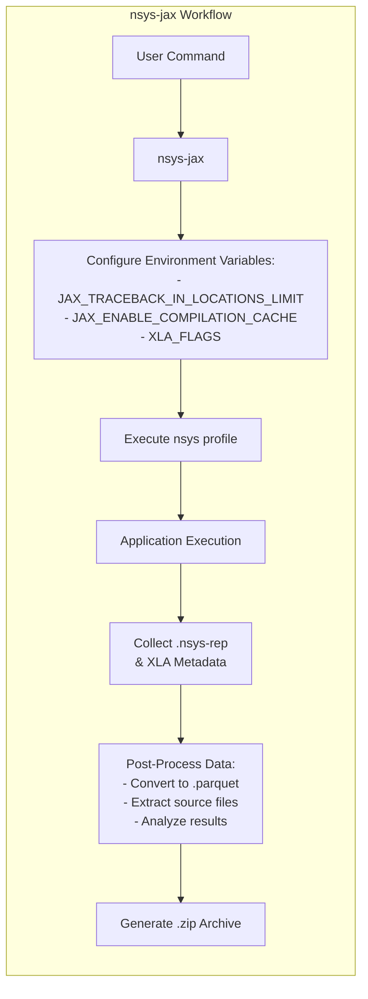
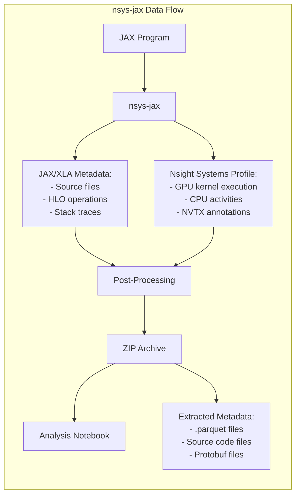
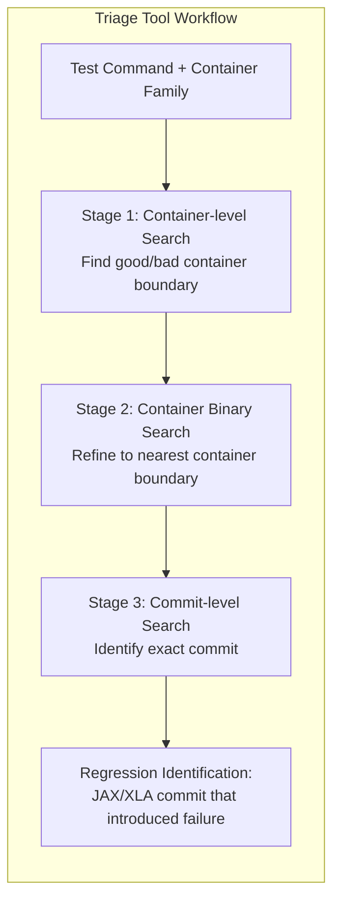
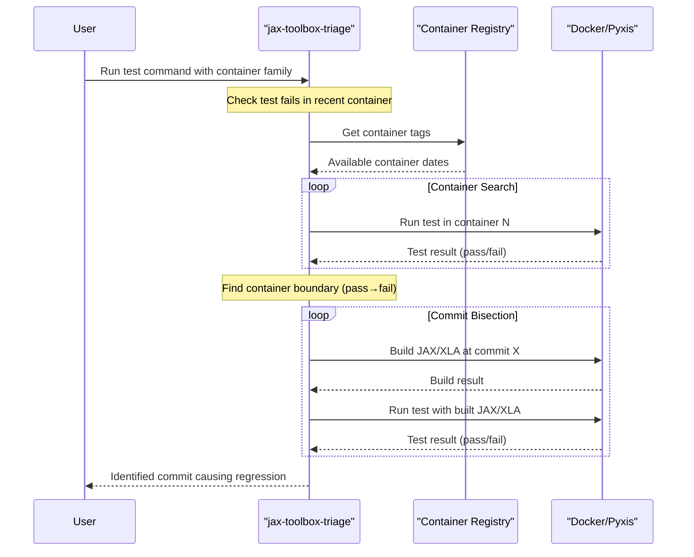
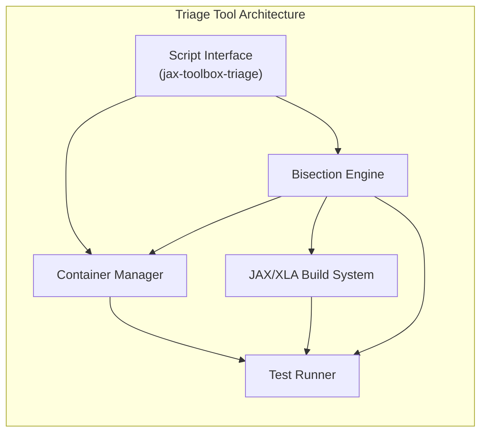
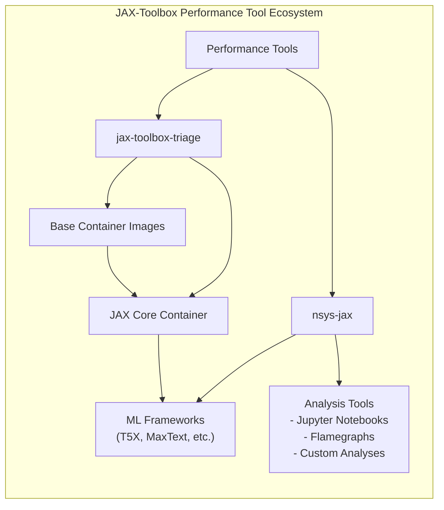

<!-- source: DeepWiki mcp.deepwiki.com · repo NVIDIA/JAX-Toolbox · page 6 Performance Tools · fetched 2026-10-26 -->

# Performance Tools

<details>
<summary>Relevant source files</summary>

The following files were used as context for generating this wiki page:

- [.github/container/nsys_jax/nsys_jax/scripts/nsys_jax.py](.github/container/nsys_jax/nsys_jax/scripts/nsys_jax.py)
- [.github/container/nsys_jax/nsys_jax/scripts/patch_nsys.py](.github/container/nsys_jax/nsys_jax/scripts/patch_nsys.py)
- [.github/container/nsys_jax/tests/cuda_profiler_api.py](.github/container/nsys_jax/tests/cuda_profiler_api.py)
- [.github/container/nsys_jax/tests/nsys_jax_test_helpers/__init__.py](.github/container/nsys_jax/tests/nsys_jax_test_helpers/__init__.py)
- [.github/container/nsys_jax/tests/overlap_program.py](.github/container/nsys_jax/tests/overlap_program.py)
- [.github/container/nsys_jax/tests/test_basics.py](.github/container/nsys_jax/tests/test_basics.py)
- [.github/container/nsys_jax/tests/test_example_program.py](.github/container/nsys_jax/tests/test_example_program.py)
- [.github/container/nsys_jax/tests/test_exit_code_handling.py](.github/container/nsys_jax/tests/test_exit_code_handling.py)
- [docs/nsys-jax.md](docs/nsys-jax.md)
- [docs/profiling.md](docs/profiling.md)
- [docs/triage-tool.md](docs/triage-tool.md)

</details>


This document provides an overview of the performance analysis and optimization tools available in JAX-Toolbox. These tools help users profile JAX applications running on NVIDIA GPUs, analyze performance, and debug regressions. The focus is on two main tools: `nsys-jax` for profiling JAX programs with enhanced metadata collection, and `jax-toolbox-triage` for debugging performance regressions.

For general information about multi-node training, refer to [Multi-Node Training](#5).

## nsys-jax

### Overview

The `nsys-jax` tool is a wrapper around NVIDIA's Nsight Systems profiler specifically designed for JAX applications. It extends the functionality of `nsys profile` by collecting additional JAX/XLA-specific metadata and performing post-processing to enable richer analysis of profile data.

The tool is part of a small ecosystem that includes:

- `nsys-jax`: The wrapper command for collecting profiles with enhanced JAX metadata
- `nsys-jax-combine`: A tool for combining multiple profile outputs (e.g., from different processes in a distributed job)
- A Python library for loading and analyzing collected profile data



Sources: [.github/container/nsys_jax/nsys_jax/scripts/nsys_jax.py:89-116](), [docs/nsys-jax.md:1-9]()

### Installation

The JAX-Toolbox containers already include `nsys-jax`. For manual installation:

```bash
pip install git+https://github.com/NVIDIA/JAX-Toolbox.git#subdirectory=.github/container/nsys_jax
```

Additional dependencies include:
- `protoc` (Protocol Buffer compiler)
- XLA `.proto` files (available in the JAX-Toolbox containers)
- Nsight Systems multi-report analysis system dependencies
- Optional: `flamegraph.pl` for flame graph visualizations

A patch for Nsight Systems 2024.5 and 2024.6 may be required, which can be applied using the `nsys-jax-patch-nsys` command.

Sources: [docs/nsys-jax.md:27-67]()

### Data Collection

To collect profile data with `nsys-jax`:

```bash
nsys-jax [nsys-jax options] [nsys profile options] -- python my_program.py
```

Key points about data collection:

- The `--` separator is required when passing nsys options
- The `-o` option specifies output path (with support for environment variable expansion)
- The tool automatically sets JAX/XLA configuration options for optimal profiling
- XLA dumps protobuf metadata for richer analysis
- The tool preserves source code paths and files for better trace attribution



Sources: [.github/container/nsys_jax/nsys_jax/scripts/nsys_jax.py:102-196](), [docs/nsys-jax.md:68-107]()

### Analysis Capabilities

There are three ways to analyze collected profile data:

1. **Immediate analysis during collection**:
   ```bash
   nsys-jax --nsys-jax-analysis ANALYSIS [--nsys-jax-analysis-arg ARG] -- python my_program.py
   ```

2. **Analysis during combination of multiple profiles**:
   ```bash
   nsys-jax-combine --analysis ANALYSIS output1.zip output2.zip ...
   ```

3. **Interactive analysis with Jupyter**:
   - Extract the ZIP archive
   - Run the included `install.sh` script
   - Open the provided Jupyter notebook for analysis

The analysis capabilities include:
- Flame graphs of execution time by Python stack trace
- Compilation time analysis
- GPU kernel performance analysis
- Memory usage tracking
- Straggler identification in multi-GPU applications

Sources: [docs/nsys-jax.md:109-124](), [.github/container/nsys_jax/nsys_jax/scripts/nsys_jax.py:127-145]()

## jax-toolbox-triage

### Overview

The triage tool (`jax-toolbox-triage`) is designed for bisecting and attributing performance regressions to specific commits in JAX or XLA. It takes a command that fails in recent containers but works in older ones and systematically narrows down the exact commit that introduced the regression.



Sources: [docs/triage-tool.md:1-27]()

### Installation

The triage tool can be installed using pip:

```bash
pip install git+https://github.com/NVIDIA/JAX-Toolbox.git#subdirectory=.github/triage
```

It's recommended to install it in a Python virtual environment on the host system:

```bash
virtualenv triage-venv
./triage-venv/bin/pip install git+https://github.com/NVIDIA/JAX-Toolbox.git#subdirectory=.github/triage
./triage-venv/bin/jax-toolbox-triage ...
```

The tool requires either Docker or Slurm with Pyxis for container execution.

Sources: [docs/triage-tool.md:31-61]()

### Operation

The triage tool follows a three-step process:

1. **Container-level Search**: Searches backward from the failing container until it finds a container where the test passes. This uses an exponential step size strategy.

2. **Container Binary Search**: Performs a binary search between the known-good and known-bad containers to find the exact container transition point.

3. **Commit-level Search**: Within the boundary containers, performs a binary search across commits to find the exact JAX or XLA commit that introduced the regression.



Sources: [docs/triage-tool.md:10-21](), [docs/triage-tool.md:121-159]()

### Usage

To use the triage tool, you need:

1. A test command that reproduces the regression
2. Specification of which containers to triage in (either `--container` family or explicit `--passing-container` and `--failing-container`)

Basic usage:

```bash
jax-toolbox-triage --container=jax test-command arg1 arg2
```

Performance optimizations:
- Use `--start-date` and `--end-date` to narrow the search range
- Use `--skip-precondition-checks` to skip verification of known passing/failing states
- Use `--threshold-days` to exit early when container boundary is sufficiently narrow
- Use `--bazel-cache` to specify a cache for faster JAX/XLA rebuilds

The tool outputs JSON status files and logs to the directory specified by `--output-prefix`.

Sources: [docs/triage-tool.md:63-159]()

### Example and Limitations

The documentation includes a detailed example of identifying a JAX unit test regression, showing the progression through container-level search and commit-level bisection.

**Limitations**:
- Focused on JAX/XLA commit regressions; may not converge if the issue is in other dependencies
- Cannot handle skipping commits that do not compile
- Requires the test to be executable within containers



Sources: [docs/triage-tool.md:160-307]()

## Relationship to Other JAX-Toolbox Components

The performance tools integrate with other components of JAX-Toolbox to provide a comprehensive environment for performance analysis and debugging.



This diagram illustrates how the performance tools fit into the broader JAX-Toolbox ecosystem, providing capabilities for both immediate analysis during development and deep debugging when issues arise.

---

