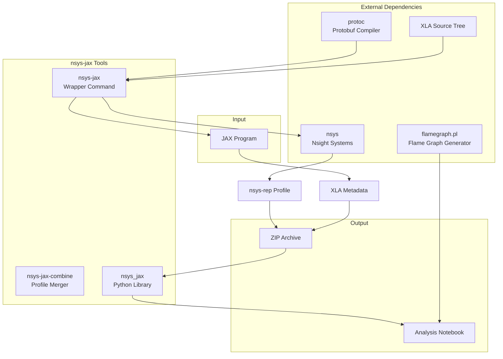
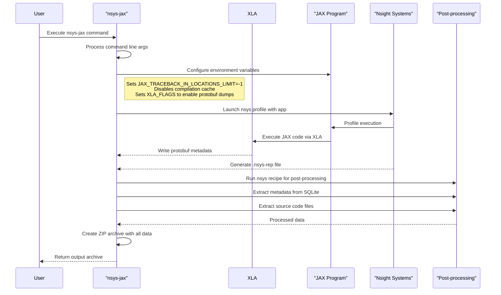
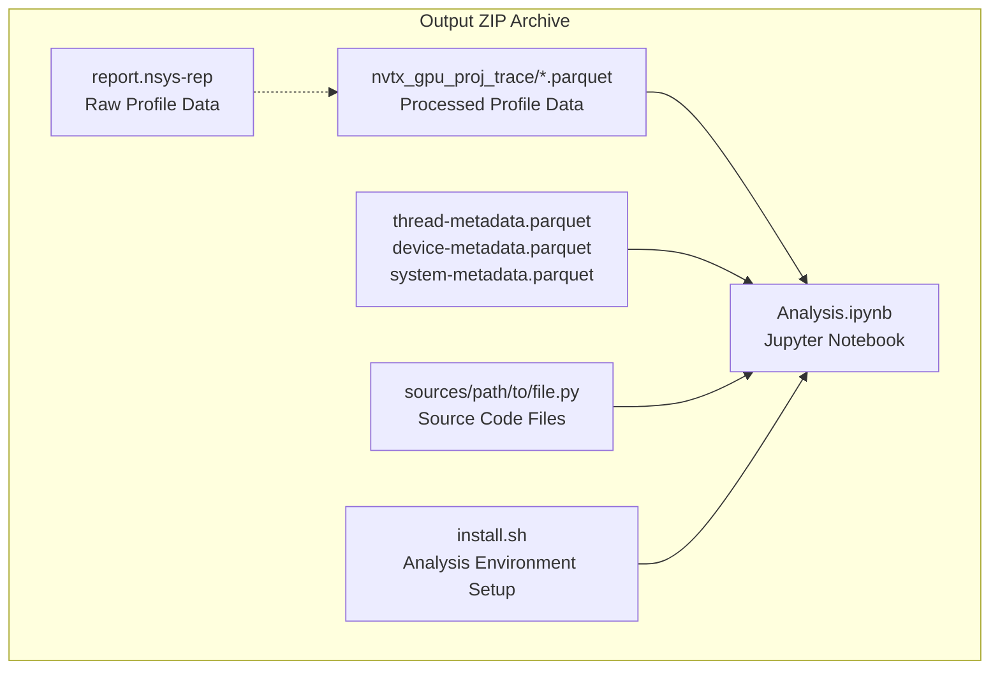

<!-- source: DeepWiki mcp.deepwiki.com · repo NVIDIA/JAX-Toolbox · page 6.1 Profiling with nsys-jax · fetched 2026-10-26 -->

# Profiling with nsys-jax

<details>
<summary>Relevant source files</summary>

The following files were used as context for generating this wiki page:

- [.github/container/nsys_jax/nsys_jax/scripts/nsys_jax.py](.github/container/nsys_jax/nsys_jax/scripts/nsys_jax.py)
- [.github/container/nsys_jax/nsys_jax/scripts/patch_nsys.py](.github/container/nsys_jax/nsys_jax/scripts/patch_nsys.py)
- [.github/container/nsys_jax/tests/cuda_profiler_api.py](.github/container/nsys_jax/tests/cuda_profiler_api.py)
- [.github/container/nsys_jax/tests/nsys_jax_test_helpers/__init__.py](.github/container/nsys_jax/tests/nsys_jax_test_helpers/__init__.py)
- [.github/container/nsys_jax/tests/overlap_program.py](.github/container/nsys_jax/tests/overlap_program.py)
- [.github/container/nsys_jax/tests/test_basics.py](.github/container/nsys_jax/tests/test_basics.py)
- [.github/container/nsys_jax/tests/test_example_program.py](.github/container/nsys_jax/tests/test_example_program.py)
- [.github/container/nsys_jax/tests/test_exit_code_handling.py](.github/container/nsys_jax/tests/test_exit_code_handling.py)
- [docs/nsys-jax.md](docs/nsys-jax.md)
- [docs/profiling.md](docs/profiling.md)
- [docs/triage-tool.md](docs/triage-tool.md)

</details>


This page documents the `nsys-jax` wrapper tool for NVIDIA Nsight Systems, which simplifies the collection, processing, and analysis of performance data from JAX programs running on NVIDIA GPUs. It enhances the standard Nsight Systems profiler by automatically collecting JAX/XLA-specific metadata and performing post-processing steps that facilitate programmatic analysis of profile data.

For general information about profiling JAX programs on NVIDIA GPUs using Nsight Systems directly, see the Profiling JAX programs on GPU documentation in [docs/profiling.md](6.0).

## System Overview

The `nsys-jax` system consists of several components working together to provide enhanced profiling capabilities for JAX applications.

### System Architecture



Sources: [docs/nsys-jax.md:1-10](), [.github/container/nsys_jax/nsys_jax/scripts/nsys_jax.py:24-26]()

### Workflow



Sources: [.github/container/nsys_jax/nsys_jax/scripts/nsys_jax.py:101-167](), [.github/container/nsys_jax/nsys_jax/scripts/nsys_jax.py:268-301]()

## Installation and Configuration

### Pre-installed in JAX-Toolbox Containers

The JAX-Toolbox containers (`ghcr.io/nvidia/jax:*`) come with `nsys-jax` pre-installed and ready to use.

### Manual Installation

For manual installation:

```bash
pip install git+https://github.com/NVIDIA/JAX-Toolbox.git#subdirectory=.github/container/nsys_jax
```

After installation, you'll need:

1. The `protoc` Protobuf compiler (required):
   ```bash
   install-protoc /usr/local
   ```

2. `flamegraph.pl` for visualization (optional):
   ```bash
   install-flamegraph /usr/local
   ```

3. Access to XLA source code (set `SRC_PATH_XLA` if not at `/opt/xla`)

4. For Nsight Systems 2024.5 and 2024.6, apply a compatibility patch:
   ```bash
   nsys-jax-patch-nsys
   ```

Sources: [docs/nsys-jax.md:27-66]()

## Usage

### Basic Usage

To profile a JAX program:

```bash
nsys-jax python my_program.py
```

To pass additional options to `nsys profile`:

```bash
nsys-jax [nsys profile options] -- python my_program.py
```

### Important Options

| Option | Description |
|--------|-------------|
| `-o, --output PATH` | Output filename with optional `%q{ENV_VAR}` expansions |
| `-f, --force-overwrite` | Allow overwriting existing output archives |
| `--nsys-jax-analysis SCRIPT` | Run post-processing analysis after collection |
| `--nsys-jax-condition EXPR` | Bash expression that determines whether profiling happens |
| `--capture-range=cudaProfilerApi` | Profile only between `cudaProfilerStart()` and `cudaProfilerStop()` calls |

Example with Slurm job orchestrator:

```bash
nsys-jax -o /out/job%q{SLURM_JOB_ID}/step%q{SLURM_STEP_ID}/rank%q{SLURM_PROCID} -- python my_program.py
```

Sources: [.github/container/nsys_jax/nsys_jax/scripts/nsys_jax.py:107-170](), [docs/nsys-jax.md:68-99]()

### Environment Variables

`nsys-jax` automatically sets these environment variables:

- `JAX_TRACEBACK_IN_LOCATIONS_LIMIT=-1`: Ensures full Python stack traces
- `JAX_ENABLE_COMPILATION_CACHE=false`: Ensures Protobuf metadata is written at compilation time
- `XLA_FLAGS`: Modified to add `--xla_dump_hlo_as_proto=true` and set `--xla_dump_to` path

> **Important**: Do not overwrite `XLA_FLAGS` in your program when using `nsys-jax`, as this may interfere with metadata collection.

Sources: [.github/container/nsys_jax/nsys_jax/scripts/nsys_jax.py:273-325]()

## Profiling Workflow Examples

### Profiling Specific Program Sections

For targeted profiling, use the CUDA profiler API:

```python
from ctypes import cdll
libcudart = cdll.LoadLibrary('libcudart.so')

# Warmup and initialization
for epoch in range(3):
    # Training code here...
    pass

# Start profiling the 4th epoch
libcudart.cudaProfilerStart()
# Only this code will be profiled
train_for_epoch(epoch=4)
# Stop profiling
libcudart.cudaProfilerStop()
```

Then run with:

```bash
nsys-jax --capture-range=cudaProfilerApi -- python my_program.py
```

Sources: [docs/profiling.md:102-124](), [.github/container/nsys_jax/tests/cuda_profiler_api.py:16-21]()

### Multi-Process/Multi-Node Profiling

When profiling distributed JAX programs, collect individual profiles from each process:

```bash
srun -N 2 --ntasks-per-node=4 nsys-jax -o output-rank%q{SLURM_PROCID} -- python distributed_program.py
```

Then combine them with `nsys-jax-combine`:

```bash
nsys-jax-combine -o combined.zip output-rank*.zip
```

Sources: [docs/nsys-jax.md:13-25]()

## Output and Analysis

### Output Archive Contents

The `nsys-jax` output archive contains:

1. `.nsys-rep`: Raw Nsight Systems profile
2. Processed data files:
   - `.parquet`: Tabular profile data
   - Various metadata files
3. Source code files referenced in the profile
4. `install.sh`: Script for creating analysis environment
5. `Analysis.ipynb`: Jupyter notebook template for analysis

Sources: [.github/container/nsys_jax/nsys_jax/scripts/nsys_jax.py:654-701]()

### Analysis Methods

Three ways to analyze profile data:

1. **Immediate Analysis**: Run analysis during collection
   ```bash
   nsys-jax --nsys-jax-analysis flamegraph -- python my_program.py
   ```

2. **Combined Analysis**: Analyze after merging multiple profiles
   ```bash
   nsys-jax-combine --analysis straggler output1.zip output2.zip ...
   ```

3. **Interactive Analysis**: Extract archive, run `install.sh`, and use Jupyter
   ```bash
   unzip profile.zip
   cd profile
   ./install.sh
   # Follow instructions to launch Jupyter notebook
   ```

The included analysis notebook provides visualization and insights including:
- Compilation time summaries
- GPU kernel execution analysis
- Python stack trace correlation
- Interactive flame graphs
- For distributed programs: straggler analysis

Sources: [docs/nsys-jax.md:109-124]()

## Implementation Details

### Processing Pipeline

The `nsys-jax` wrapper performs several post-processing steps after collecting the profile:

1. Executes the `nsys-rep` to `.parquet` conversion
2. Extracts device/thread name metadata from SQLite
3. Collects XLA Protobuf files and compiles them
4. Parses HLO modules to identify source code files
5. Copies referenced source files into the archive
6. Executes any requested analysis scripts
7. Creates the final ZIP archive with all data

This process happens in parallel threads to minimize processing time.

Sources: [.github/container/nsys_jax/nsys_jax/scripts/nsys_jax.py:745-865]()

### Output File Format



Sources: [.github/container/nsys_jax/nsys_jax/scripts/nsys_jax.py:50-88]()

## Advanced Topics

### Handling Exit Codes

`nsys-jax` handles process exit codes intelligently:

1. When using `--capture-range=cudaProfilerApi`, `nsys` may kill the application after `cudaProfilerStop()`
2. The default `--capture-range-end=stop-shutdown` tells `nsys` to terminate the program
3. Use `--capture-range-end=stop` to let the program continue after profiling
4. Error codes from the application are preserved when they differ from expected termination signals

Sources: [.github/container/nsys_jax/nsys_jax/scripts/nsys_jax.py:334-349](), [.github/container/nsys_jax/tests/test_exit_code_handling.py:22-87]()

### Conditional Profiling

Use `--nsys-jax-condition` to conditionally enable profiling based on a Bash expression, useful in distributed settings:

```bash
# Only profile the first process on each node
nsys-jax --nsys-jax-condition='$SLURM_LOCALID == 0' -- python my_program.py
```

The condition is evaluated in a Bash shell and profiling only occurs if the condition returns true.

Sources: [.github/container/nsys_jax/nsys_jax/scripts/nsys_jax.py:147-155](), [.github/container/nsys_jax/nsys_jax/scripts/nsys_jax.py:194-206]()

### Customizing Analysis

`nsys-jax` supports custom analysis scripts via the `--nsys-jax-analysis` option, which can be:

1. Path to a Python script
2. Name of a bundled analysis recipe

The analysis script receives paths to the profile data and can generate additional output files that are automatically included in the archive.

Sources: [.github/container/nsys_jax/nsys_jax/scripts/nsys_jax.py:127-139](), [.github/container/nsys_jax/nsys_jax/scripts/nsys_jax.py:622-652]()

## Debugging and Troubleshooting

### Common Issues

| Issue | Possible Cause | Solution |
|-------|---------------|----------|
| Missing XLA metadata | Compilation cache enabled | Set `JAX_ENABLE_COMPILATION_CACHE=false` |
| Incomplete stack traces | Default trace limit too low | Set `JAX_TRACEBACK_IN_LOCATIONS_LIMIT=-1` |
| Profile collection fails | `XLA_FLAGS` overwritten | Don't modify `XLA_FLAGS` in your program |
| Slow performance | Default `nsys` flags | Add `--cpuctxsw=none` and other optimizations |
| No GPU activity captured | Missing CUDA activity | Check program is actually using GPU |

Sources: [docs/nsys-jax.md:95-99](), [.github/container/nsys_jax/nsys_jax/scripts/nsys_jax.py:266-269]()

### Debug Information

`nsys-jax` prints timing information for each processing step to help identify bottlenecks:

```
profile.zip: gathered .proto files in 0.56s
profile.zip: recipe post-processing finished in 23.45s
profile.zip: extracted device/thread names in 0.89s
profile.zip: gathered source code in 3.27s
profile.zip: wrote in 1.18s
```

If you encounter issues, check these messages for hints about which step might be failing.

Sources: [.github/container/nsys_jax/nsys_jax/scripts/nsys_jax.py:384](), [.github/container/nsys_jax/nsys_jax/scripts/nsys_jax.py:412](), [.github/container/nsys_jax/nsys_jax/scripts/nsys_jax.py:467](), [.github/container/nsys_jax/nsys_jax/scripts/nsys_jax.py:567](), [.github/container/nsys_jax/nsys_jax/scripts/nsys_jax.py:619](), [.github/container/nsys_jax/nsys_jax/scripts/nsys_jax.py:698]()

---

