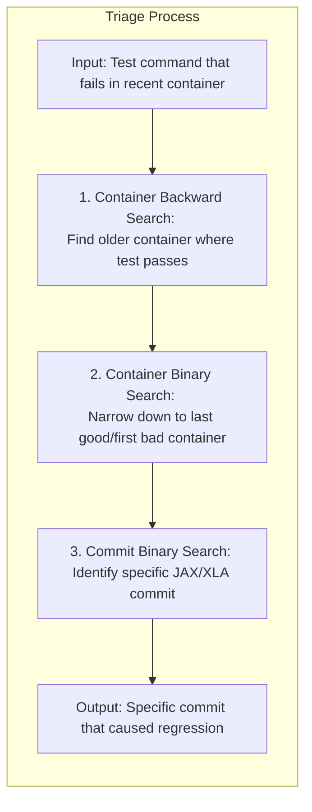
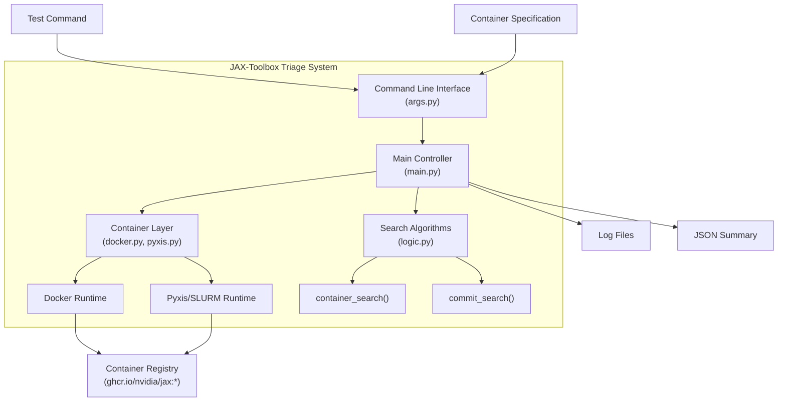
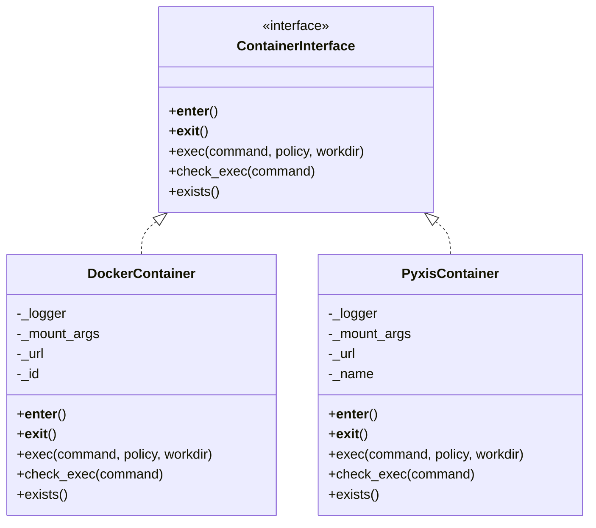
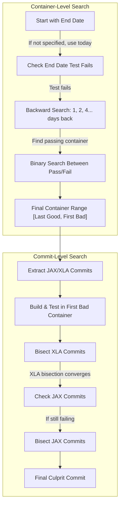
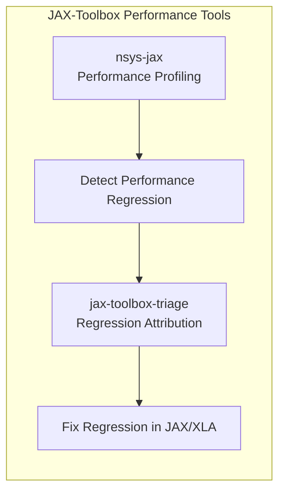

<!-- source: DeepWiki mcp.deepwiki.com · repo NVIDIA/JAX-Toolbox · page 6.2 Triage Tool · fetched 2026-10-26 -->

# Triage Tool

<details>
<summary>Relevant source files</summary>

The following files were used as context for generating this wiki page:

- [.github/triage/jax_toolbox_triage/args.py](.github/triage/jax_toolbox_triage/args.py)
- [.github/triage/jax_toolbox_triage/docker.py](.github/triage/jax_toolbox_triage/docker.py)
- [.github/triage/jax_toolbox_triage/logic.py](.github/triage/jax_toolbox_triage/logic.py)
- [.github/triage/jax_toolbox_triage/main.py](.github/triage/jax_toolbox_triage/main.py)
- [.github/triage/jax_toolbox_triage/pyxis.py](.github/triage/jax_toolbox_triage/pyxis.py)
- [.github/triage/tests/test_arg_parsing.py](.github/triage/tests/test_arg_parsing.py)
- [docs/nsys-jax.md](docs/nsys-jax.md)
- [docs/profiling.md](docs/profiling.md)
- [docs/triage-tool.md](docs/triage-tool.md)

</details>


The `jax-toolbox-triage` tool automates the process of attributing performance regressions or test failures to specific commits in JAX or XLA. It performs an intelligent bisection search through containers and commits to pinpoint exactly which change caused a regression. For information about general profiling of JAX programs, see [Profiling with nsys-jax](#6.1).

## Overview

The triage tool takes a test command that fails in recent JAX/XLA containers but passed in older versions, then performs a three-level search:

1. **Container-level backward search**: Finding a container where the test passes
2. **Container-level binary search**: Pinpointing the boundary between passing and failing containers
3. **Commit-level binary search**: Identifying the specific commit that introduced the regression

This methodology allows developers to quickly identify regressions without manually testing hundreds of commits.



Sources: [docs/triage-tool.md:10-22](), [.github/triage/jax_toolbox_triage/main.py:116-126](), [.github/triage/jax_toolbox_triage/main.py:278-286]()

## Architecture

The triage tool consists of several components that work together to perform the container and commit-level searches.



Sources: [.github/triage/jax_toolbox_triage/main.py:9-17](), [.github/triage/jax_toolbox_triage/args.py:9-19]()

### Container Layer

The tool supports two container runtimes:

1. **Docker**: For local development and testing
2. **Pyxis**: For executing on SLURM clusters

Both container handlers implement the same interface, allowing the main controller to interact with either runtime transparently.



Sources: [.github/triage/jax_toolbox_triage/docker.py:7-99](), [.github/triage/jax_toolbox_triage/pyxis.py:15-97]()

## Installation

The triage tool can be installed using pip:

```
pip install git+https://github.com/NVIDIA/JAX-Toolbox.git#subdirectory=.github/triage
```

It's recommended to install the tool in a virtual environment on the host system since it needs to orchestrate multiple containers:

```
virtualenv triage-venv
./triage-venv/bin/pip install git+https://github.com/NVIDIA/JAX-Toolbox.git#subdirectory=.github/triage
./triage-venv/bin/jax-toolbox-triage ...
```

Sources: [docs/triage-tool.md:32-54]()

## Usage

The tool requires two essential inputs:

1. **Test command**: The command that fails in newer containers but passed in older ones
2. **Container specification**: Either a container family to search through or specific container URLs

### Basic Usage

```
jax-toolbox-triage --container jax test-jax.sh //tests:nn_test_gpu
```

This command will:
1. Search backward through `ghcr.io/nvidia/jax:jax-YYYY-MM-DD` containers
2. Find a container where the test passes
3. Narrow down to the boundary between passing and failing containers
4. Identify the specific commit that caused the regression

### Options

| Option | Description |
|--------|-------------|
| `--container` | Container family to search (e.g., `jax`, `maxtext`) |
| `--passing-container` | URL of a container where the test passes |
| `--failing-container` | URL of a container where the test fails |
| `--start-date` | Initial estimate of a date when the test passed |
| `--end-date` | Initial estimate of a date when the test failed |
| `--skip-precondition-checks` | Skip checks that should pass by construction |
| `--bazel-cache` | Bazel cache to speed up rebuilds |
| `--container-mount` | Mount host directories into the container |
| `--container-runtime` | Container runtime to use (`docker` or `pyxis`) |

Sources: [docs/triage-tool.md:64-95](), [.github/triage/jax_toolbox_triage/args.py:19-175]()

## Search Workflow

The search process follows a specific pattern to efficiently locate the problematic commit.



Sources: [.github/triage/jax_toolbox_triage/logic.py:72-186](), [.github/triage/jax_toolbox_triage/logic.py:195-319](), [.github/triage/jax_toolbox_triage/main.py:278-286]()

### Container-Level Search

The tool first performs a search to find containers where the test passes and fails:

1. Start with the most recent container (or the specified `--end-date`)
2. Verify the test fails in this container
3. Search backward (1, 2, 4, 8... days) until finding a container where the test passes
4. Perform binary search to narrow down to the boundary between passing and failing containers

This process results in two containers:
- `range_start`: Latest container where the test passes
- `range_end`: Earliest container where the test fails

Sources: [.github/triage/jax_toolbox_triage/logic.py:72-186](), [.github/triage/jax_toolbox_triage/main.py:113-126]()

### Commit-Level Search

Once the tool has identified the boundary containers, it performs a commit-level search:

1. Extract JAX and XLA commits from both containers
2. Verify the test passes with the "good" commits and fails with the "bad" commits
3. Perform binary search on commits, rebuilding JAX/XLA at each step
4. First bisect XLA commits (with matching JAX commits)
5. If XLA bisection converges, verify if it's an XLA or JAX issue
6. If necessary, bisect JAX commits with fixed XLA version

The result identifies a specific commit in either JAX or XLA that causes the regression.

Sources: [.github/triage/jax_toolbox_triage/logic.py:195-319](), [.github/triage/jax_toolbox_triage/main.py:162-276]()

## Implementation Details

### Container Interaction

The triage tool interacts with containers to execute tests and build JAX/XLA. Both `DockerContainer` and `PyxisContainer` provide the same interface:

- `exists()`: Check if a container exists
- `exec()`: Run a command in the container
- `check_exec()`: Run a command and throw an exception if it fails

The `Container` context manager handles creation and cleanup of containers:

```python
with Container(container_url) as worker:
    # Execute tests and builds in the container
    result = worker.exec(args.test_command)
```

Sources: [.github/triage/jax_toolbox_triage/docker.py:7-99](), [.github/triage/jax_toolbox_triage/pyxis.py:15-97](), [.github/triage/jax_toolbox_triage/main.py:90-111]()

### Build and Test Process

During the commit-level search, the tool repeatedly:

1. Checks out specific JAX and XLA commits
2. Builds JAX using the container's `build-jax.sh` script
3. Executes the test command
4. Records the result (pass/fail)

This allows the tool to precisely identify when the behavior changed.

Sources: [.github/triage/jax_toolbox_triage/main.py:210-275]()

### Output Format

The tool produces several outputs:

1. Console logs with INFO-level messages
2. A debug log file with detailed output
3. A JSON summary file with structured results

The JSON summary includes:
- Container test results
- Commit test results
- Final attribution of the regression to specific commits

Sources: [.github/triage/jax_toolbox_triage/main.py:62-83]()

## Example Workflow

Here's a concrete example of the tool in action:

1. A JAX unit test suddenly fails in the latest container
2. Run: `jax-toolbox-triage --container jax test-jax.sh //tests:nn_test_gpu`
3. The tool automatically:
   - Finds the latest container where the test passes (e.g., 2024-09-18)
   - Identifies the earliest container where it fails (e.g., 2024-09-19)
   - Rebuilds JAX and XLA with different commits to bisect the issue
   - Determines the specific commit that caused the failure

After execution, the tool provides the exact commit range where the regression occurred, such as:

```
Bisected failure to JAX cd04d0f3..b164d67d with XLA 662eb45a
```

This means the test passes with JAX at commit `cd04d0f3` but fails when JAX includes commit `b164d67d`, with XLA at the consistent commit `662eb45a`.

Sources: [docs/triage-tool.md:160-288]()

## Limitations

The triage tool has some limitations:

1. It assumes the regression is in JAX or XLA, not in other dependencies
2. It doesn't handle commits that fail to compile
3. It requires the test command to be executable within the container

If a regression is caused by other factors (like changes in dependencies), the tool might identify the container boundary correctly but fail to find a specific commit.

Sources: [docs/triage-tool.md:289-306]()

## Integration with JAX-Toolbox

The triage tool fits into the larger JAX-Toolbox ecosystem as a performance debugging tool. It complements `nsys-jax` (see [Profiling with nsys-jax](#6.1)) by helping developers track down the source of performance regressions once they've been identified through profiling.



Sources: [docs/profiling.md:1-20]()

---

