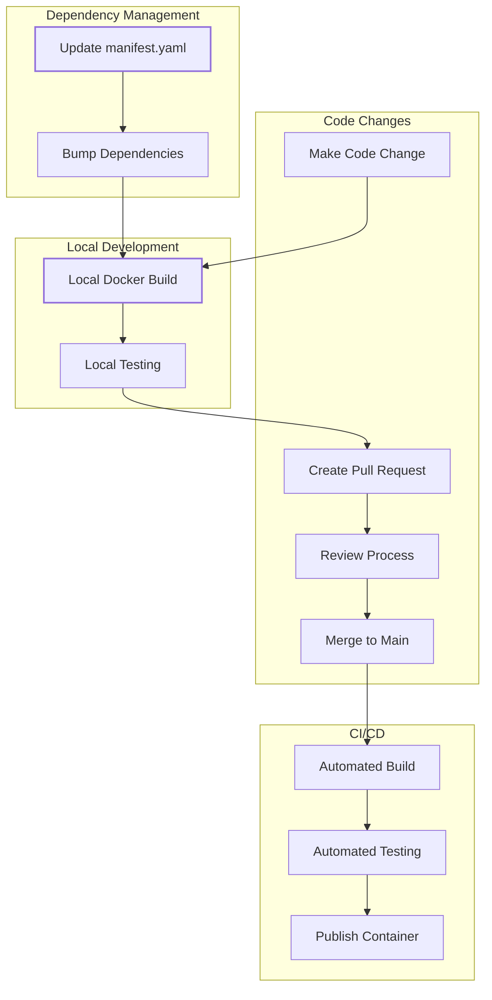
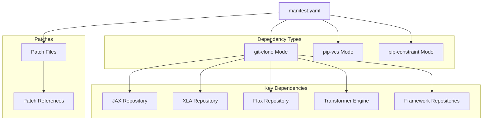
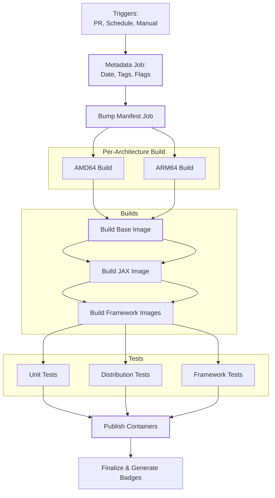
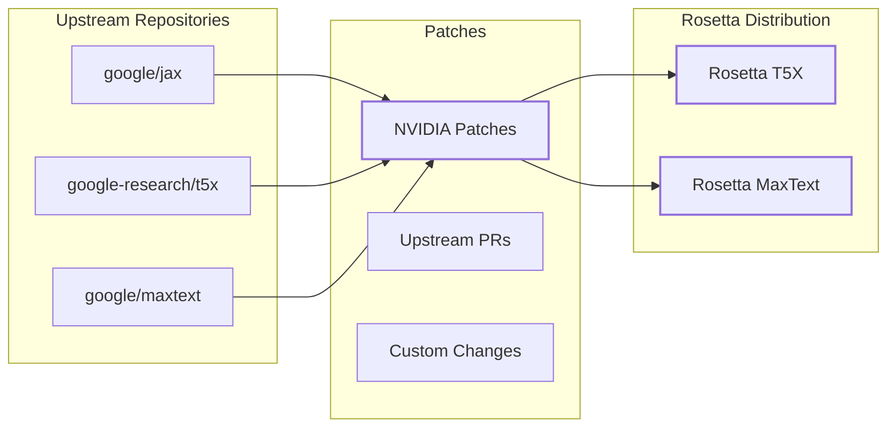
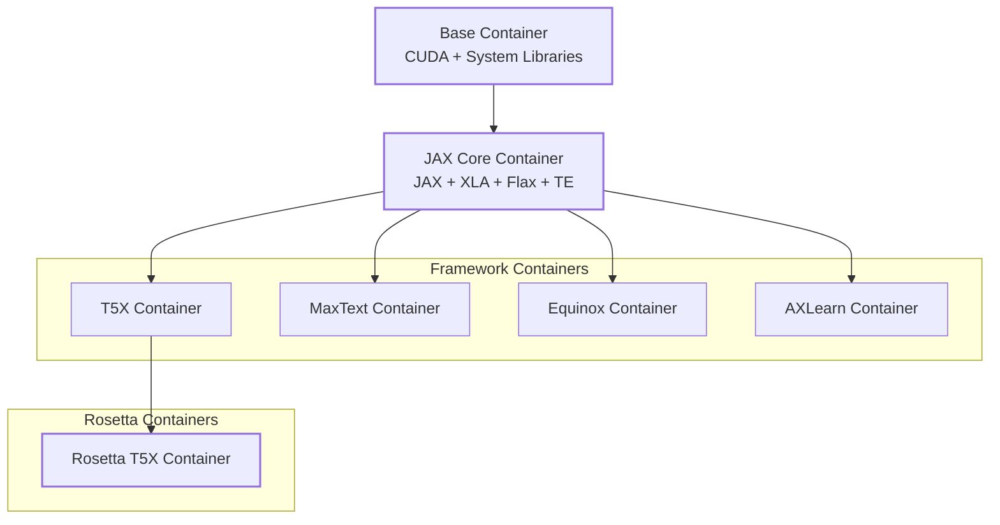

<!-- source: DeepWiki mcp.deepwiki.com · repo NVIDIA/JAX-Toolbox · page 7 Development · fetched 2026-10-26 -->

# Development

<details>
<summary>Relevant source files</summary>

The following files were used as context for generating this wiki page:

- [.github/container/manifest.yaml](.github/container/manifest.yaml)
- [.github/workflows/_ci.yaml](.github/workflows/_ci.yaml)
- [.github/workflows/_test_distribution.yaml](.github/workflows/_test_distribution.yaml)
- [.github/workflows/ci.yaml](.github/workflows/ci.yaml)
- [README.md](README.md)
- [rosetta/Dockerfile.t5x](rosetta/Dockerfile.t5x)
- [rosetta/README.md](rosetta/README.md)
- [rosetta/docs/DEVELOPMENT.md](rosetta/docs/DEVELOPMENT.md)

</details>


This document provides a guide for developers working with or contributing to JAX-Toolbox. It covers development workflows, dependency management, the patch-based distribution model, and best practices for contributing to the project. For information about using the containers or framework-specific details, see [Machine Learning Frameworks](#4).

## Development Environment Overview

JAX-Toolbox uses a container-based development workflow that enables reproducible builds and testing. The development process revolves around:

1. Managing dependencies through a centralized manifest system
2. Building and testing containers through a multi-stage CI/CD pipeline
3. Applying a patch-based distribution model for framework customization
4. Supporting multiple architectures (amd64 and arm64)

### Development Workflow



Sources: [.github/workflows/ci.yaml:3-18](), [README.md:17-30]()

## Setting Up Development Environment

To start developing for JAX-Toolbox, you need:

1. Docker with buildx support
2. Git
3. Access to NVIDIA GPUs (for testing)

### Basic Setup

```bash
# Clone the repository
git clone https://github.com/NVIDIA/JAX-Toolbox.git
cd JAX-Toolbox

# Configure git for patch operations
git config --global user.email "your-email@example.com"
git config --global user.name "Your Name"
```

Sources: [rosetta/docs/DEVELOPMENT.md:62-70]()

## Dependency Management

JAX-Toolbox centralizes dependency management through a manifest file that tracks upstream repositories, their versions, and any required patches.

### Manifest System

The manifest file (`.github/container/manifest.yaml`) defines:

- Source repositories for components 
- Tracking references (branches or tags)
- Latest verified commits
- Required patches
- Dependency mode (git-clone, pip-vcs, pip-constraint)



Sources: [.github/container/manifest.yaml:1-104]()

### Updating Dependencies

To update dependencies in JAX-Toolbox:

1. Update the `latest_verified_commit` in the manifest.yaml file
2. Optionally update patches referenced in the manifest
3. Run the bump script to verify the dependencies

```bash
# Bump dependencies and verify
bash .github/container/bump.sh -i .github/container/manifest.yaml
```

Sources: [.github/workflows/ci.yaml:134-189](), [rosetta/README.md:22-25]()

### Overriding Dependencies During Build

You can override specific dependencies during build time:

```bash
# Example: Override Transformer Engine version
docker buildx build --build-arg UPDATED_TE_REF=pull/609/head \
  --build-context jax-toolbox=. \
  --tag rosetta-t5x:latest \
  -f rosetta/Dockerfile.t5x .
```

Sources: [rosetta/README.md:27-31](), [rosetta/Dockerfile.t5x:9-11]()

## The CI/CD Pipeline

JAX-Toolbox uses a comprehensive CI/CD pipeline to automate building, testing, and publishing containers.

### Pipeline Structure



Sources: [.github/workflows/ci.yaml:57-437](), [.github/workflows/_ci.yaml:40-502]()

### Build Process

The JAX-Toolbox build process uses a two-stage container approach:

1. **Mealkit Stage**: Contains build tools and source code for compilation
2. **Final Stage**: Contains only runtime dependencies and compiled artifacts

This approach results in smaller final containers while preserving build context for reproducibility.

### Build Triggers

The CI pipeline can be triggered in several ways:

| Trigger | Description | Behavior |
|---------|-------------|----------|
| Schedule | Nightly builds | Bumps manifest, full build pipeline, publishes images |
| Pull Request | On PR creation/update | Builds and tests, but doesn't publish |
| Manual Dispatch | Via GitHub Actions UI | Configurable options for bumping, publishing |

Sources: [.github/workflows/ci.yaml:3-42]()

## Patch-Based Distribution Model (Rosetta)

JAX-Toolbox uses Rosetta as its patch-based distribution system to extend upstream JAX frameworks with NVIDIA-specific optimizations without forking the repositories.

### Distribution Model Overview



Sources: [rosetta/docs/DEVELOPMENT.md:1-21](), [rosetta/Dockerfile.t5x:1-85]()

### Creating Changes for Upstream

The workflow for contributing to upstream repositories that will be used in the distribution:

1. Create a fork of the upstream repository
2. Implement your changes and create a PR against upstream
3. Add the PR to the appropriate patchlist in JAX-Toolbox
4. Update the manifest to include your patch

This approach ensures that changes are proposed upstream while allowing immediate use within JAX-Toolbox.

Sources: [rosetta/docs/DEVELOPMENT.md:22-41]()

### Building a Distribution

You can build a Rosetta distribution in two ways:

#### Using Docker

```bash
# Build T5X distribution
docker buildx build --build-context jax-toolbox=. \
  --tag rosetta-t5x:latest \
  -f rosetta/Dockerfile.t5x .
```

#### Building Locally

```bash
# Build T5X distribution locally
INSTALLED_T5X_DIR=/tmp/t5x
git clone https://github.com/google-research/t5x.git $INSTALLED_T5X_DIR

./create-distribution.sh \
  --patchlist patchlist-t5x.txt \
  --mirror-url https://github.com/google-research/t5x.git \
  --dir $INSTALLED_T5X_DIR
```

Sources: [rosetta/docs/DEVELOPMENT.md:43-80](), [rosetta/README.md:5-17]()

## Testing

JAX-Toolbox includes several levels of testing to ensure quality and performance.

### Testing Types

| Test Type | Purpose | Infrastructure |
|-----------|---------|----------------|
| Unit Tests | Test individual components | GitHub Actions runners |
| Distribution Tests | Verify patch application | GitHub Actions runners |
| Framework Tests | Test framework functionality | Self-hosted runners with GPUs |
| Multi-Node Tests | Test distributed training | EKS and SLURM clusters |
| Performance Tests | Verify performance | Self-hosted runners with GPUs |

### Running Tests Locally

```bash
# Run distribution tests
cd JAX-Toolbox
bash rosetta/tests/local-patch-distribution.sh

# Run framework tests within a container
docker run --gpus all --shm-size=1g \
  ghcr.io/nvidia/jax:t5x test-vit.sh
```

Sources: [.github/workflows/_ci.yaml:179-200](), [.github/workflows/_test_distribution.yaml:1-27]()

## Working with Containers

JAX-Toolbox provides several container types for different use cases.

### Container Types



Sources: [README.md:11-17](), [.github/workflows/_ci.yaml:140-170]()

### Custom Builds

To create custom container builds:

```bash
# Build JAX core with custom XLA version
docker buildx build \
  --build-arg URLREF_XLA=https://github.com/openxla/xla.git#custom-commit \
  -f .github/container/Dockerfile.jax \
  --tag jax-custom:latest .

# Build Rosetta with custom patches
docker buildx build \
  --build-arg UPDATE_PATCHES=true \
  --build-context jax-toolbox=. \
  -f rosetta/Dockerfile.t5x \
  --tag rosetta-t5x-custom:latest .
```

Sources: [.github/workflows/ci.yaml:36-42](), [rosetta/Dockerfile.t5x:5-11]()

## Best Practices for Contributing

When contributing to JAX-Toolbox, consider these guidelines:

1. **Think in terms of distribution, not fork**: Ask whether your change should be submitted upstream or added directly to JAX-Toolbox

2. **Create atomic patches**: When creating patches for upstream repositories, ensure they are self-contained and don't create conflicts with other patches

3. **Test thoroughly**: Test your changes using the provided test infrastructure before submitting PRs

4. **Use the manifest system**: Update the manifest when introducing new dependencies or updating existing ones

5. **Follow container design principles**: Keep the mealkit/final container separation in mind when modifying Dockerfiles

Sources: [rosetta/docs/DEVELOPMENT.md:9-20]()

## Advanced Topics

### Multi-Architecture Support

JAX-Toolbox supports both AMD64 (x86_64) and ARM64 (aarch64) architectures. The CI pipeline builds for both architectures and creates multi-platform images.

### Environment Variables and Flags

JAX-Toolbox containers are pre-configured with performance-optimized environment variables and flags:

```
XLA_FLAGS=--xla_gpu_enable_latency_hiding_scheduler=true --xla_gpu_enable_triton_gemm=false
NCCL_NVLS_ENABLE=0
```

You can override these in your runtime environment as needed.

Sources: [README.md:213-228]()

### Versioning

JAX-Toolbox uses date-based versioning for containers:

```
ghcr.io/nvidia/jax:XXX-YYYY-MM-DD
```

Where `XXX` is the container type (base, jax, t5x, etc.) and `YYYY-MM-DD` is the build date.

Sources: [README.md:209-211]()

---

