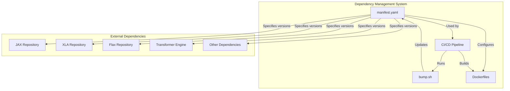
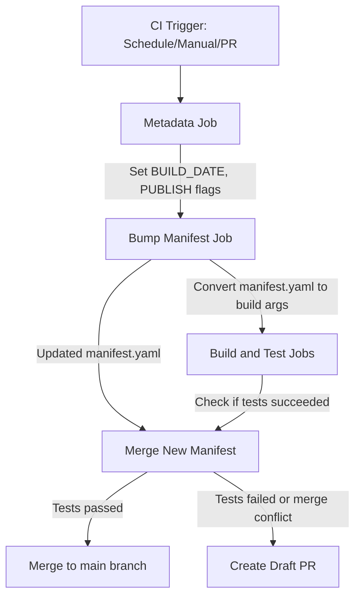
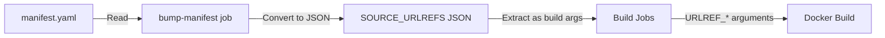

<!-- source: DeepWiki mcp.deepwiki.com · repo NVIDIA/JAX-Toolbox · page 7.1 Dependency Management · fetched 2026-10-26 -->

# Dependency Management

<details>
<summary>Relevant source files</summary>

The following files were used as context for generating this wiki page:

- [.github/container/bump.sh](.github/container/bump.sh)
- [.github/container/manifest.yaml](.github/container/manifest.yaml)
- [.github/workflows/_ci.yaml](.github/workflows/_ci.yaml)
- [.github/workflows/ci.yaml](.github/workflows/ci.yaml)
- [README.md](README.md)

</details>


This page explains the dependency management system in JAX-Toolbox, which controls how external dependencies are specified, updated, and maintained across the project. The system centers around a manifest file that defines precise versions of dependencies and a bump process that updates them consistently.

For information about how patches are applied to dependencies in the Rosetta distribution model, see [Patch-Based Distribution](#7.2).

## Overview

JAX-Toolbox manages dependencies through a centralized manifest file that specifies exact versions of all external dependencies. This approach ensures reproducible builds and controlled updates to dependencies across all components of the system.

The dependency management system in JAX-Toolbox handles:

1. **Version Specification**: Pinning dependencies to specific commit hashes
2. **Dependency Updates**: Automated workflow for updating dependencies
3. **Patch Management**: Applying patches to dependencies
4. **Build Integration**: Using dependencies in Docker builds

The system supports multiple dependency types, including Git repositories and PyPI packages, with different installation methods.



Sources: [.github/container/manifest.yaml:1-104](), [.github/container/bump.sh:1-113](), [.github/workflows/ci.yaml:1-438]()

## The Manifest File

The central component of JAX-Toolbox's dependency management is the `manifest.yaml` file, which defines all external dependencies. Each entry in the manifest specifies a dependency with its source, version, and installation method.

### Manifest Structure

The manifest file contains entries for each dependency with the following fields:

| Field | Description | Example |
|-------|-------------|---------|
| `url` | Git repository URL | `https://github.com/google/jax.git` |
| `tracking_ref` | Branch or reference to track | `main` |
| `latest_verified_commit` | Specific commit hash that's verified to work | `8f4658ecdbe40cde0c43a9ab127359347943c076` |
| `mode` | Installation method | `git-clone`, `pip-vcs`, `pip-constraint` |
| `patches` (optional) | Patches to apply | `pull/3340/head: file://patches/flax/PR-3340.patch` |
| `mirror_url` (optional) | Mirror repository URL | `https://github.com/nvjax-svc-0/flax.git` |

```mermaid
classDiagram
    class "manifest.yaml" {
        +Dictionary entries
    }
    
    class "DependencyEntry" {
        +String url
        +String tracking_ref
        +String latest_verified_commit
        +String mode
        +Dictionary patches (optional)
        +String mirror_url (optional)
    }

    "manifest.yaml" --> "DependencyEntry" : contains
```

Sources: [.github/container/manifest.yaml:1-104]()

### Dependency Modes

The manifest supports different installation methods through the `mode` field:

1. **git-clone**: Clone the repository and use it directly
   - Example: JAX, XLA, Flax, Transformer Engine
   - Allows applying patches

2. **pip-vcs**: Install via pip from a version control system source
   - Example: clu, dllogger, jestimator, optax
   - Uses pip's VCS support to install from a specific commit

3. **pip-constraint**: Apply version constraints for PyPI packages
   - Example: pydantic
   - Controls which version of a package is installed from PyPI

Example from the manifest:

```yaml
jax:
  url: https://github.com/google/jax.git
  tracking_ref: main
  latest_verified_commit: 8f4658ecdbe40cde0c43a9ab127359347943c076
  mode: git-clone
```

Sources: [.github/container/manifest.yaml:1-104]()

## The Bump Process

The bump process updates dependencies in the manifest to their latest versions based on the tracking references. This process is implemented in the `bump.sh` script and can be run manually or as part of the CI/CD pipeline.

### Bump Process Flow

```mermaid
flowchart TD
    start["Start Bump Process"]
    readManifest["Read manifest.yaml"]
    iterateDeps["Iterate through dependencies"]
    
    subgraph "For each dependency"
        checkMode["Check dependency mode"]
        fetchLatest["Fetch latest commit from tracking_ref"]
        updateManifest["Update latest_verified_commit in manifest"]
        
        checkPatches["Check if dependency has patches"]
        cloneRepo["Clone repository"]
        updatePatches["Update patch files"]
    end
    
    writeManifest["Write updated manifest.yaml"]
    end["End Bump Process"]
    
    start --> readManifest
    readManifest --> iterateDeps
    
    iterateDeps --> checkMode
    
    checkMode -->|"git-clone or pip-vcs"| fetchLatest
    fetchLatest --> updateManifest
    
    updateManifest --> checkPatches
    
    checkPatches -->|"Has patches"| cloneRepo
    cloneRepo --> updatePatches
    
    checkPatches -->|"No patches"| iterateDeps
    updatePatches --> iterateDeps
    
    iterateDeps -->|"All dependencies processed"| writeManifest
    writeManifest --> end
```

The bump process:

1. Reads the manifest file
2. For each dependency with mode `git-clone` or `pip-vcs`:
   - Fetches the latest commit from the tracking reference
   - Updates the `latest_verified_commit` field with the new commit hash
3. For dependencies with patches:
   - Clones the repository
   - Updates the patch files
4. Writes the updated manifest

Sources: [.github/container/bump.sh:1-113]()

## CI/CD Integration

The dependency management system is tightly integrated with the CI/CD pipeline. The pipeline can automatically bump dependencies, create new branches with updated dependencies, and test the changes.

### Dependency Update Workflow



The CI/CD pipeline workflow for dependency updates:

1. Triggered by a schedule, manually, or by a PR
2. A metadata job sets up build parameters
3. The bump manifest job:
   - Tests if the manifest bump is functional
   - Creates a new manifest with updated dependencies
   - Converts the manifest to build arguments for Docker builds
4. Build and test jobs use the updated dependencies
5. If tests pass and there are no conflicts, the updated manifest is merged to the main branch
6. If tests fail or there's a merge conflict, a draft PR is created with the changes

Sources: [.github/workflows/ci.yaml:1-438](), [.github/workflows/_ci.yaml:1-651]()

### Manual Overrides

The CI/CD pipeline supports manual overrides for dependencies through the `SOURCE_OVERRIDES` input parameter. This allows specifying custom URL and reference combinations for dependencies.

Example workflow dispatch with overrides:

```
SOURCE_OVERRIDES=JAX=https://github.com/user/jax.git#custom-branch,XLA=https://github.com/user/xla.git#feature-branch
```

This is converted to build arguments:

```
URLREF_JAX=https://github.com/user/jax.git#custom-branch
URLREF_XLA=https://github.com/user/xla.git#feature-branch
```

Sources: [.github/workflows/ci.yaml:36-42](), [.github/workflows/ci.yaml:172-189]()

## Dependency Usage in Builds

The dependencies specified in the manifest are used in Docker builds through build arguments. The CI/CD pipeline extracts the dependencies from the manifest and passes them to the Docker build commands.

### Manifest to Build Arguments



The process:

1. The `bump-manifest` job reads the manifest file
2. It converts the dependencies to a JSON object in the `SOURCE_URLREFS` output
3. Build jobs extract the dependencies from the JSON and convert them to build arguments
4. Docker builds use these arguments to specify which versions of dependencies to use

Example of how dependencies are passed to builds:

```yaml
EXTRA_BUILD_ARGS: |
  URLREF_JAX=${{ fromJson(inputs.SOURCE_URLREFS).JAX }}
  URLREF_XLA=${{ fromJson(inputs.SOURCE_URLREFS).XLA }}
  URLREF_FLAX=${{ fromJson(inputs.SOURCE_URLREFS).FLAX }}
  URLREF_TRANSFORMER_ENGINE=${{ fromJson(inputs.SOURCE_URLREFS).TRANSFORMER_ENGINE }}
```

Sources: [.github/workflows/_ci.yaml:62-66](), [.github/workflows/ci.yaml:172-189]()

## Scheduled Dependency Updates

JAX-Toolbox uses scheduled runs of the CI/CD pipeline to automatically update dependencies. This ensures that the project stays up-to-date with the latest versions of its dependencies.

The scheduled updates:

1. Run daily at a specified time
2. Bump all dependencies to their latest versions
3. Build and test all components with the updated dependencies
4. If tests pass, merge the updated manifest to the main branch
5. If tests fail, create a draft PR for manual review

This automated process ensures that dependency updates are regularly tested and applied, while providing a mechanism for manual intervention when needed.

Sources: [.github/workflows/ci.yaml:3-5](), [.github/workflows/ci.yaml:214-323]()

## Conclusion

JAX-Toolbox's dependency management system provides a robust and flexible way to manage external dependencies. By centralizing dependency specifications in a manifest file and automating the update process, it ensures that all components of the system use consistent and tested versions of dependencies.

Key benefits of this approach:

1. **Reproducibility**: All builds use exactly the same versions of dependencies
2. **Controlled Updates**: Dependencies are updated in a controlled and tested manner
3. **Flexibility**: Support for different types of dependencies and installation methods
4. **Automation**: Automated updates reduce manual maintenance work

This system is critical for maintaining the stability and reliability of JAX-Toolbox while allowing it to benefit from improvements in its dependencies.

---

