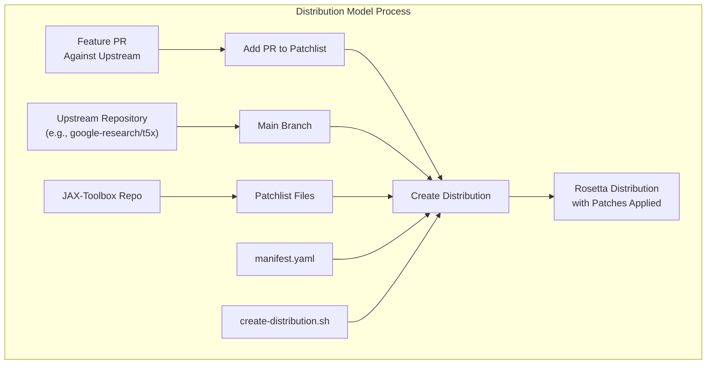
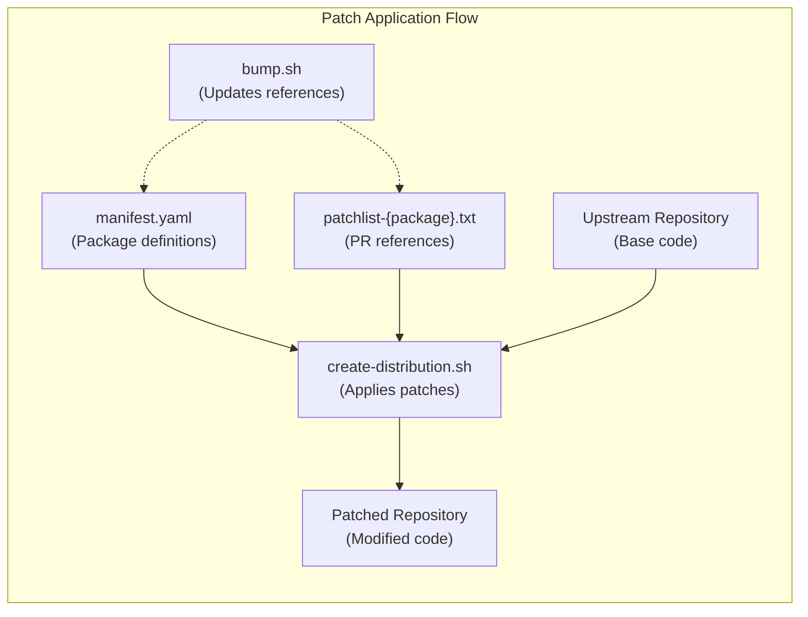
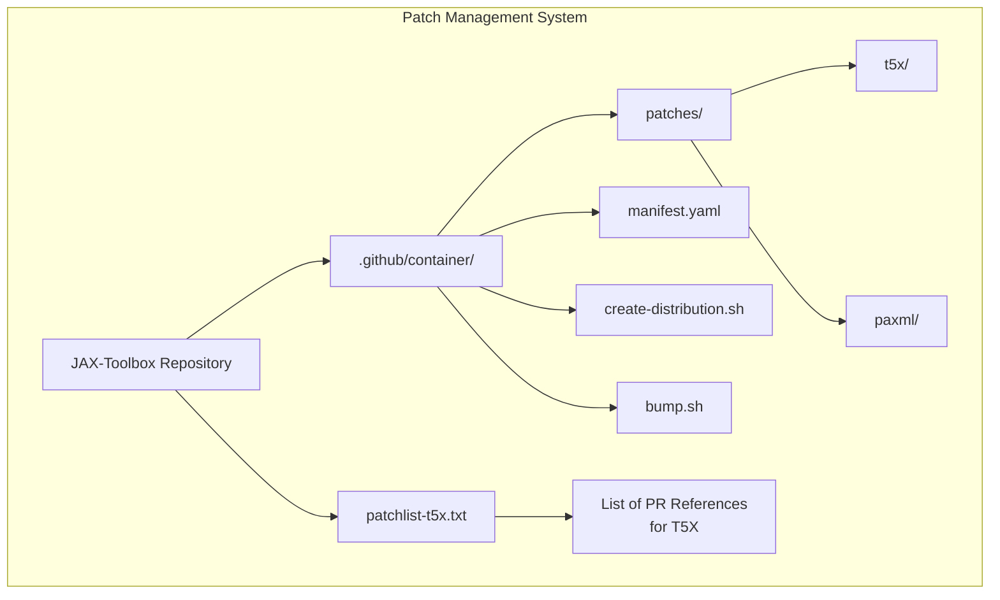
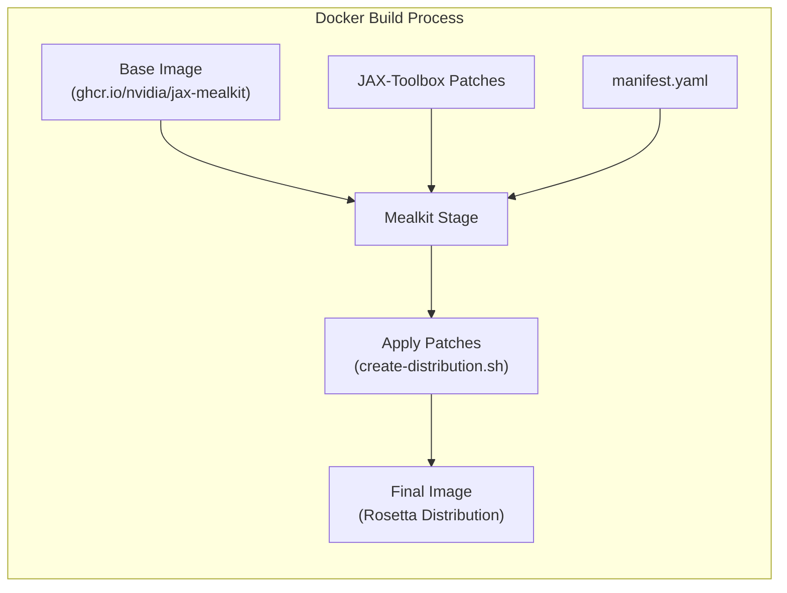
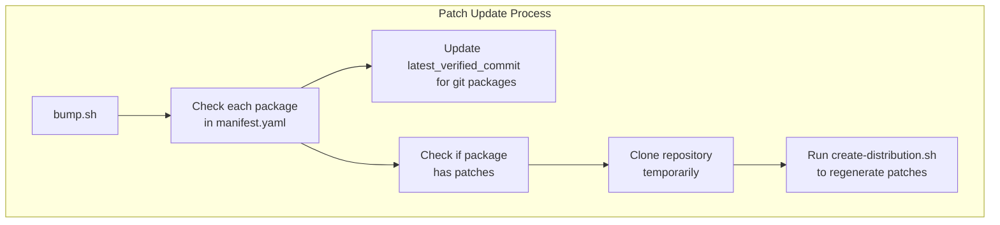
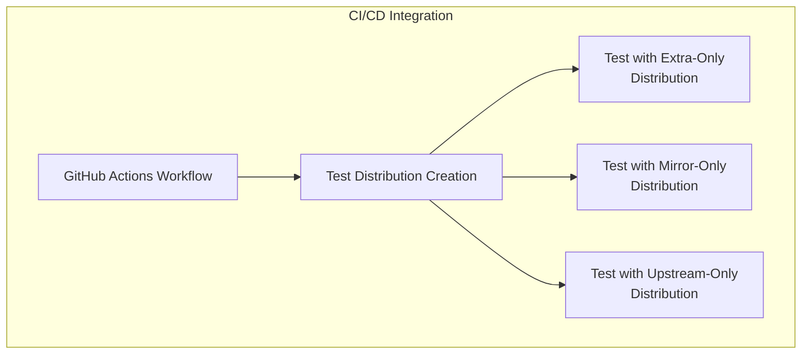

<!-- source: DeepWiki mcp.deepwiki.com · repo NVIDIA/JAX-Toolbox · page 7.2 Patch-Based Distribution · fetched 2026-10-26 -->

# Patch-Based Distribution

<details>
<summary>Relevant source files</summary>

The following files were used as context for generating this wiki page:

- [.github/container/bump.sh](.github/container/bump.sh)
- [.github/workflows/_test_distribution.yaml](.github/workflows/_test_distribution.yaml)
- [rosetta/Dockerfile.t5x](rosetta/Dockerfile.t5x)
- [rosetta/README.md](rosetta/README.md)
- [rosetta/docs/DEVELOPMENT.md](rosetta/docs/DEVELOPMENT.md)

</details>


This document explains how JAX-Toolbox manages and applies patches to create modified distributions of upstream libraries like T5X and Paxml. The patch-based approach allows JAX-Toolbox to incorporate necessary changes to upstream codebases while maintaining compatibility and easily tracking modifications.

## Overview of the Distribution Model

The JAX-Toolbox's Rosetta components follow a "distribution model" rather than a traditional fork. This means instead of maintaining a full fork of upstream repositories, specific patches are cherry-picked onto the tip of upstream's main branch to add NVIDIA-specific features and optimizations.



Sources: [rosetta/docs/DEVELOPMENT.md:1-22](), [rosetta/README.md:1-20]()

## How the Patch Model Works

Patches are managed through a process that maintains references to Pull Requests against upstream repositories. These PRs typically contain features that either:

1. May eventually be merged upstream
2. Are NVIDIA-specific optimizations that won't be merged upstream

Instead of duplicating code, the patch-based approach preserves a cleaner relationship with upstream repositories.



Sources: [rosetta/docs/DEVELOPMENT.md:23-41]()

## Feature Development Workflow

When developing a feature that needs to be added to the distribution, follow this workflow:

1. Create a fork of the upstream repository (e.g., T5X)
2. Implement the feature in your fork
3. Create a PR against the upstream repository
4. Add the PR reference to the appropriate patchlist (e.g., `patchlist-t5x.txt`)
5. Create a PR in JAX-Toolbox to update the patchlist

For example, if you create PR #1204 against T5X, you would add `pull/1204/head` to the patchlist file.

Sources: [rosetta/docs/DEVELOPMENT.md:22-41]()

## Patch Organization

Patches are managed through several key files:

| File | Purpose |
|------|---------|
| `patchlist-{package}.txt` | Lists PR references to cherry-pick for each package |
| `.github/container/patches/` | Directory containing generated patch files |
| `.github/container/manifest.yaml` | Defines package versions and patch configurations |
| `.github/container/create-distribution.sh` | Script that applies patches to create distributions |



Sources: [.github/container/bump.sh:1-30](), [rosetta/docs/DEVELOPMENT.md:42-60]()

## Creating Distributions

### Creating a Distribution with Docker

The simplest way to create a distribution is by building the Rosetta Dockerfile:



This process is automated in the Dockerfile, which fetches the necessary patches and applies them during the build process.

Sources: [rosetta/Dockerfile.t5x:1-42](), [rosetta/README.md:5-17]()

### Creating a Distribution Locally

To create a distribution locally, you can use the `create-distribution.sh` script directly:

```bash
INSTALLED_T5X_DIR=/tmp/t5x
git clone https://github.com/google-research/t5x.git $INSTALLED_T5X_DIR

./create-distribution.sh --patchlist patchlist-t5x.txt \
  --mirror-url https://github.com/google-research/t5x.git \
  --dir $INSTALLED_T5X_DIR \
  --ref 79909538d7d98a46966cc683ec7fa606b0f7cf78
```

This creates a patched version of T5X in the specified directory.

Sources: [rosetta/docs/DEVELOPMENT.md:62-79]()

## Updating Patches and References

The `bump.sh` script is used to update source references in the manifest and regenerate patch files:



To update patches:

```bash
bash .github/container/bump.sh -i .github/container/manifest.yaml
```

This updates the `latest_verified_commit` for each package in the manifest and regenerates patches.

Sources: [.github/container/bump.sh:1-112](), [rosetta/README.md:21-25]()

## Resolving Conflicts

When adding new patches, conflicts may occur with existing patches. To minimize conflicts:

1. Make changes atomic (focused on a single feature/fix)
2. Ensure changes are not dependent on other PRs
3. If conflicts occur, work with the PR author or maintainers to restructure the change

To troubleshoot merge conflicts, recreate the distribution locally and examine the conflicts.

Sources: [rosetta/docs/DEVELOPMENT.md:30-41]()

## Special Use Cases

### Build with Updated Patches

To build with the latest patches:

```bash
bash .github/container/bump.sh -i .github/container/manifest.yaml
docker buildx build --build-context jax-toolbox=. \
  --tag rosetta-${ROSETTA_BASE}:latest \
  -f rosetta/Dockerfile.${ROSETTA_BASE} \
  --build-arg UPDATE_PATCHES=true .
```

### Build with Specific Transformer Engine Version

To test a different Transformer Engine version against the LLM application:

```bash
docker buildx build --build-arg UPDATED_TE_REF=pull/609/head \
  --build-context jax-toolbox=. \
  --tag rosetta-${ROSETTA_BASE}:latest \
  -f rosetta/Dockerfile.${ROSETTA_BASE} .
```

Sources: [rosetta/README.md:19-31](), [rosetta/Dockerfile.t5x:5-11]()

## Integration with CI/CD

The patch-based distribution system integrates with the JAX-Toolbox CI/CD pipeline, which tests the distribution creation process with different configurations:



These tests ensure that the patch application process works correctly in various scenarios.

Sources: [.github/workflows/_test_distribution.yaml:1-27]()

## Conclusion

The patch-based distribution approach allows JAX-Toolbox to maintain a clean relationship with upstream libraries while adding necessary features. This model provides several advantages:

1. Changes can be tracked back to specific PRs
2. Easier to incorporate upstream changes
3. Clearer separation between NVIDIA-specific features and upstream code
4. Simplified management of patches across multiple repositories

For more information on developing with JAX-Toolbox, see the [Development section](#7).