# Page: Overview

# Overview

<details>
<summary>Relevant source files</summary>

The following files were used as context for generating this wiki page:

- [.github/container/manifest.yaml](.github/container/manifest.yaml)
- [.github/workflows/_ci.yaml](.github/workflows/_ci.yaml)
- [.github/workflows/ci.yaml](.github/workflows/ci.yaml)
- [README.md](README.md)

</details>


This page provides a high-level overview of JAX-Toolbox, a comprehensive system that delivers optimized Docker containers, a robust CI/CD pipeline, and performance-tuned examples for JAX-based deep learning frameworks on NVIDIA GPUs. 

JAX-Toolbox simplifies the development and deployment experience of JAX applications on NVIDIA hardware through containerization, automated testing, and performance optimization. For specific details about container architecture, see [Container System Architecture](#2), and for CI/CD pipeline details, refer to [CI/CD Pipeline](#3).

Sources: [README.md:1-6]()

## Core Components

JAX-Toolbox consists of the following core components:

1. **Container System**: A hierarchical set of Docker containers from base CUDA images to framework-specific containers
2. **CI/CD Pipeline**: Automated workflows for building, testing, and publishing containers
3. **Framework Support**: Integration with popular JAX-based ML frameworks
4. **Testing Infrastructure**: Comprehensive testing across different hardware configurations
5. **Performance Tools**: Utilities for profiling and optimizing JAX applications

Sources: [README.md:6-17](), [.github/workflows/ci.yaml:1-47]()

## Container Architecture

JAX-Toolbox uses a layered container architecture that builds from NVIDIA CUDA base images up to specialized framework containers.

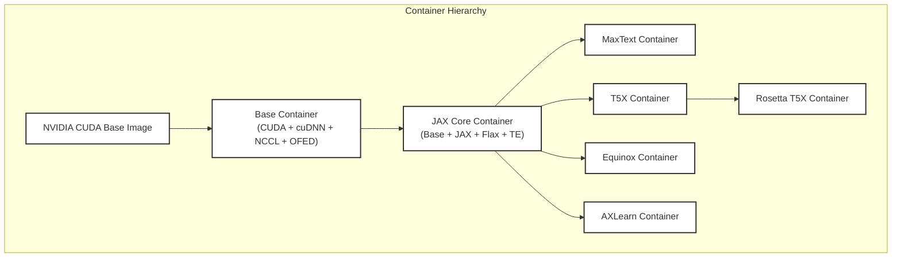

Each container serves a specific purpose:

| Container | Purpose | Image |
|-----------|---------|-------|
| Base | Foundation with CUDA, cuDNN, NCCL, and networking libraries | `ghcr.io/nvidia/jax:base` |
| JAX Core | JAX, Flax, and Transformer Engine | `ghcr.io/nvidia/jax:jax` |
| MaxText | Large language model training | `ghcr.io/nvidia/jax:maxtext` |
| T5X | Text-to-text and vision transformers | `ghcr.io/nvidia/jax:t5x` |
| Equinox | Scientific machine learning | `ghcr.io/nvidia/jax:equinox` |
| AXLearn | Advanced ML research | `ghcr.io/nvidia/jax:axlearn` |

Sources: [README.md:11-16](), [.github/workflows/_ci.yaml:40-139]()

## Build and CI/CD System

JAX-Toolbox employs a sophisticated CI/CD pipeline to build, test, and publish Docker containers. The pipeline is triggered by pull requests, scheduled events, or manual dispatch.

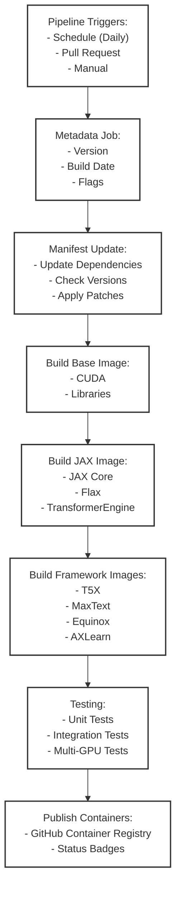

The build process consists of several stages:

1. **Metadata Collection**: Determines build date, version tags, and publication settings
2. **Manifest Update**: Ensures all dependencies are at their latest verified commits
3. **Base Image Build**: Creates the foundation CUDA container
4. **JAX Core Build**: Builds JAX with GPU optimizations
5. **Framework-Specific Builds**: Builds containers for each supported framework
6. **Testing**: Runs various test suites on different hardware configurations
7. **Publication**: Publishes containers to GitHub Container Registry

Sources: [.github/workflows/ci.yaml:57-437](), [.github/workflows/_ci.yaml:1-39]()

## Dependency Management

JAX-Toolbox manages dependencies through a manifest system that tracks specific commits of various components to ensure compatibility and reproducibility.

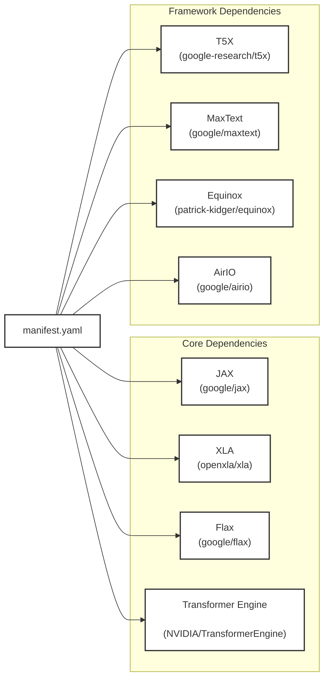

The manifest system:
- Tracks specific git commits for each dependency
- Supports patching through the patch distribution system
- Enables reproducible builds with consistent dependencies
- Simplifies updating dependencies across the entire system

Sources: [.github/container/manifest.yaml:1-104](), [.github/workflows/ci.yaml:134-190]()

## Supported Frameworks and Models

JAX-Toolbox supports several key JAX-based machine learning frameworks:

| Framework | Supported Models | Use Cases | Container |
|-----------|-----------------|-----------|-----------|
| MaxText | GPT, LLaMA, Gemma, Mistral, Mixtral | Pre-training | `ghcr.io/nvidia/jax:maxtext` |
| T5X | T5, ViT | Pre-training, fine-tuning | `ghcr.io/nvidia/jax:t5x` |
| T5X (Imagen) | Imagen | Pre-training | `ghcr.io/nvidia/jax:t5x-imagen` |
| AXLearn | Fuji | Pre-training | `ghcr.io/nvidia/jax:axlearn` |
| Equinox | Various | Scientific ML | `ghcr.io/nvidia/jax:equinox` |

These frameworks support different parallelism strategies for efficient multi-GPU, multi-node training:

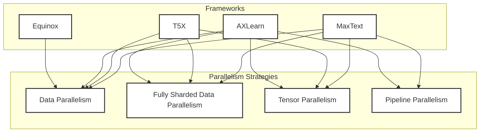

Sources: [README.md:8-16](), [.github/workflows/_ci.yaml:84-138]()

## Testing Infrastructure

JAX-Toolbox employs a comprehensive testing infrastructure to ensure quality and performance across different hardware configurations.

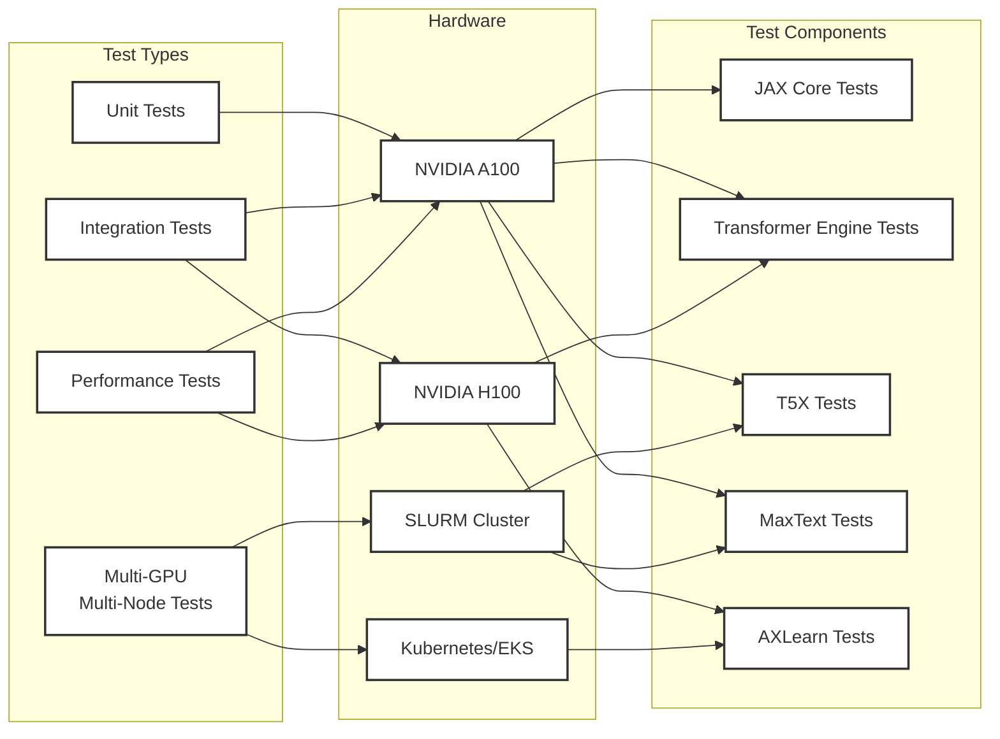

The testing system verifies:
- Core JAX functionality on GPUs
- Framework-specific components
- Multi-GPU and multi-node scaling
- Performance characteristics
- Integration with various cluster management systems

Sources: [.github/workflows/_ci.yaml:179-570](), [README.md:18-205]()

## Performance Optimization

JAX-Toolbox includes performance optimizations for NVIDIA GPUs through environment variables and XLA flags:

| XLA Flag | Purpose |
|----------|---------|
| `--xla_gpu_enable_latency_hiding_scheduler` | Improves communication/compute overlap |
| `--xla_gpu_enable_triton_gemm` | Controls GEMM kernel selection |

| Environment Variable | Purpose |
|---------------------|---------|
| `NCCL_NVLS_ENABLE` | Controls NVLink SHARP for multi-GPU communication |

The repository also provides profiling tools like `nsys-jax` for performance analysis and optimization.

Sources: [README.md:213-226](), [.github/workflows/_ci.yaml:233-337]()

## Usage and Access

JAX-Toolbox containers are publicly available via GitHub Container Registry:

```
ghcr.io/nvidia/jax:<framework>       # Latest build
ghcr.io/nvidia/jax:<framework>-YYYY-MM-DD  # Specific date
```

For example:
```bash
docker pull ghcr.io/nvidia/jax:maxtext
docker run --gpus all --shm-size=1g ghcr.io/nvidia/jax:maxtext
```

Special considerations:
- Docker containers require `--gpus all` flag for GPU access
- Shared memory size should be increased with `--shm-size=1g` to avoid bus errors
- Multi-node deployments can leverage SLURM or Kubernetes integration

Sources: [README.md:209-211](), [README.md:249-279]()

---

# Page: Container System Architecture

# Container System Architecture

<details>
<summary>Relevant source files</summary>

The following files were used as context for generating this wiki page:

- [.github/container/Dockerfile.base](.github/container/Dockerfile.base)
- [.github/container/Dockerfile.jax](.github/container/Dockerfile.jax)
- [.github/container/build-jax.sh](.github/container/build-jax.sh)
- [.github/container/manifest.yaml](.github/container/manifest.yaml)
- [.github/container/test-jax.sh](.github/container/test-jax.sh)
- [.github/workflows/_build_base.yaml](.github/workflows/_build_base.yaml)
- [.github/workflows/_ci.yaml](.github/workflows/_ci.yaml)
- [.github/workflows/ci.yaml](.github/workflows/ci.yaml)
- [README.md](README.md)

</details>


This page describes the architecture of the JAX-Toolbox container system, including the hierarchy, build process, and container organization. For information about CI/CD pipelines that build these containers, see [CI/CD Pipeline](#3).

## Overview

JAX-Toolbox provides a comprehensive container system for building, testing, and deploying JAX-based machine learning frameworks on NVIDIA GPUs. The container system follows a hierarchical architecture with three main layers - base images, JAX core images, and framework-specific images - each building upon the previous layer.

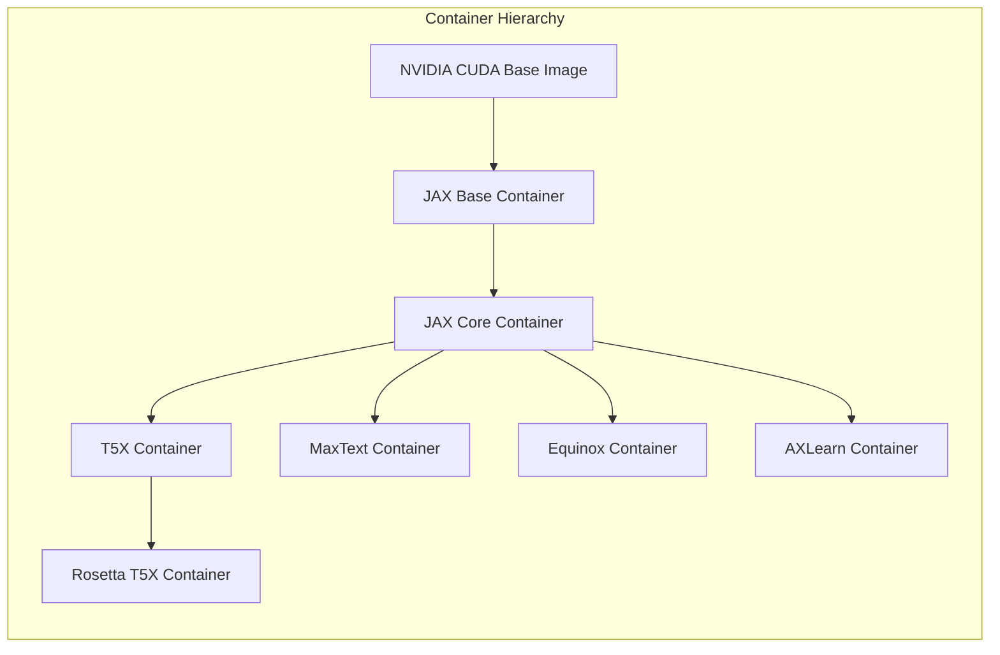

Sources: [README.md:11-17](), [.github/workflows/_ci.yaml:153-170]()

## Container Hierarchy

### Base Image

The base image is built from an NVIDIA CUDA base image and provides the foundation for all other containers. It includes Python, essential development tools, and utilities needed for building JAX and related libraries.

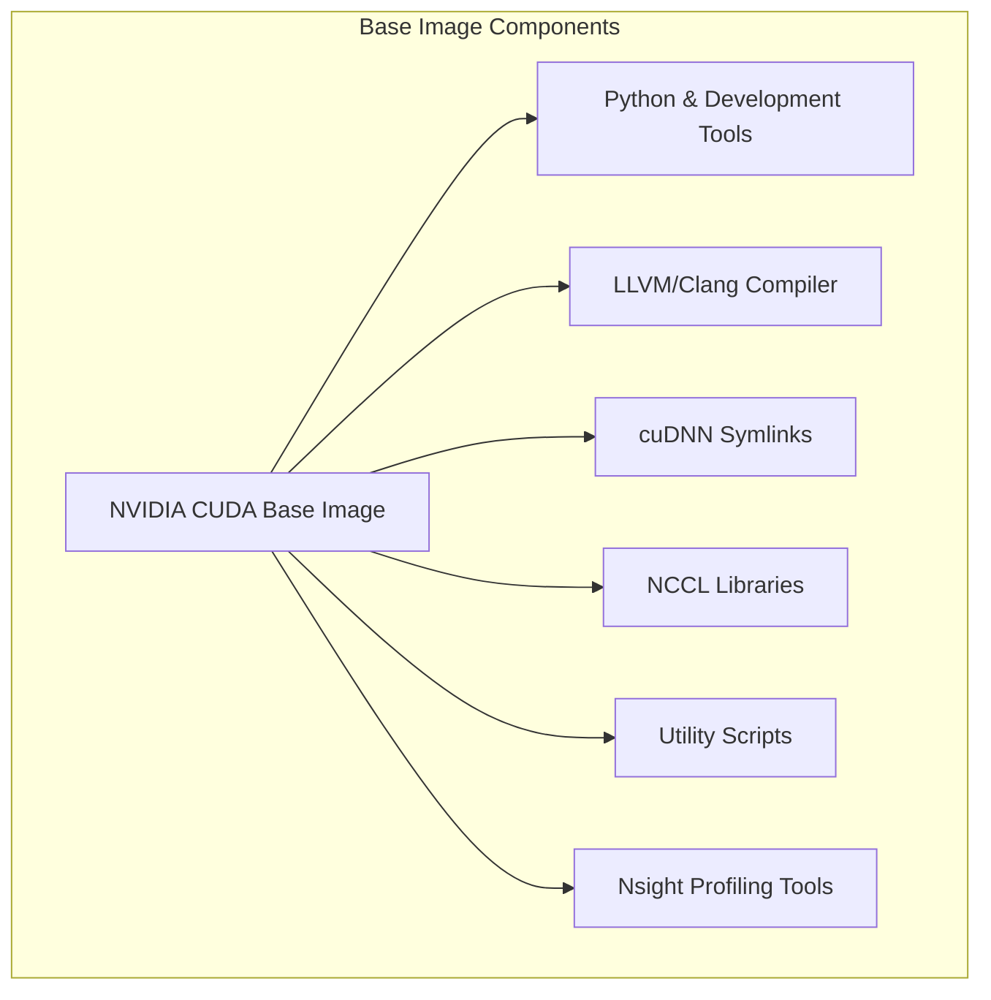

Key components of the base image include:

- Python and essential development tools
- LLVM/Clang compiler for building JAX
- cuDNN and NCCL libraries for GPU acceleration
- JAX-specific profiling tools (nsys-jax)
- Dependency manifest system for reproducibility

The base image is defined in the `Dockerfile.base` file and is tagged as `ghcr.io/nvidia/jax:base`.

Sources: [.github/container/Dockerfile.base:1-178](), [README.md:42-47]()

### JAX Core Container

The JAX Core container extends the base image and includes JAX, Flax, and Transformer Engine. This container serves as the foundation for all framework-specific containers.

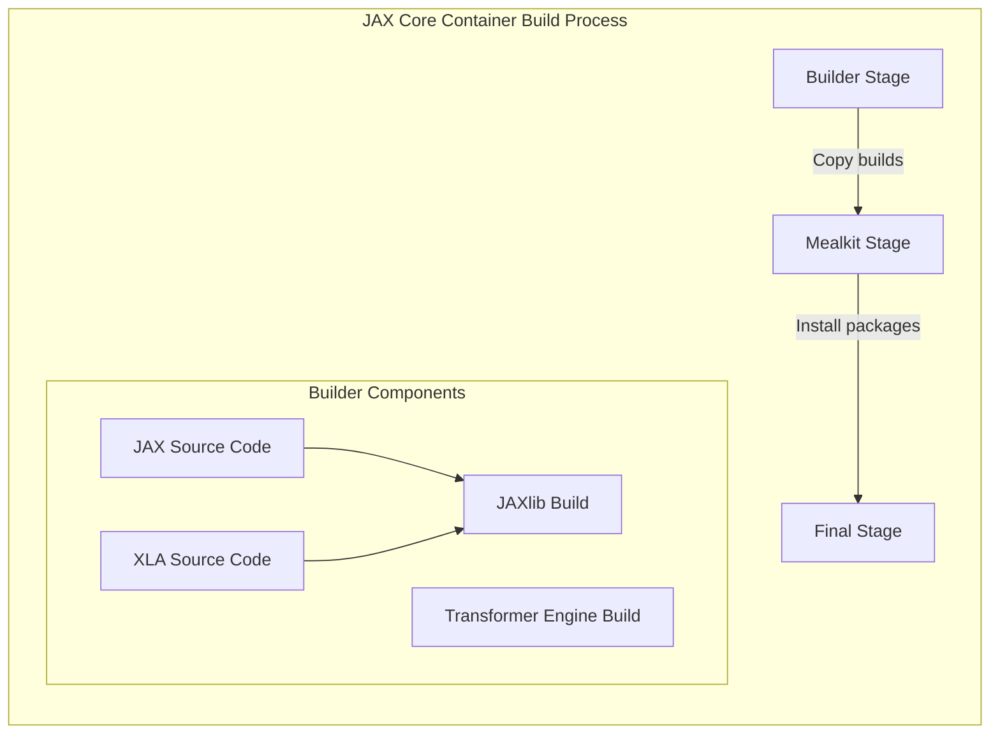

Key components of the JAX Core container include:

- JAX library built from source
- XLA compiler for hardware acceleration
- Flax neural network library
- NVIDIA Transformer Engine for optimized transformer models
- Environment variables for performance tuning

The JAX Core container uses a two-stage build process:
1. **Builder Stage**: Compiles JAX, jaxlib, and Transformer Engine
2. **Mealkit Stage**: Packages source code and build artifacts
3. **Final Stage**: Installs libraries from the mealkit stage

The JAX Core container is defined in the `Dockerfile.jax` file and is tagged as `ghcr.io/nvidia/jax:jax`.

Sources: [.github/container/Dockerfile.jax:1-137](), [README.md:60-65]()

### Framework-Specific Containers

Framework-specific containers extend the JAX Core container and add specific machine learning frameworks. Each framework container is built to support specific use cases and model architectures.

| Framework | Container Tag | Use Cases | Models |
|-----------|---------------|-----------|--------|
| MaxText | `ghcr.io/nvidia/jax:maxtext` | Pre-training LLMs | GPT, LLaMA, Gemma, Mistral, Mixtral |
| T5X | `ghcr.io/nvidia/jax:t5x` | Pre-training, fine-tuning | T5, ViT |
| Imagen | `ghcr.io/nvidia/t5x:imagen-*` | Pre-training | Imagen |
| AXLearn | `ghcr.io/nvidia/jax:axlearn` | Pre-training | Fuji |
| Equinox | `ghcr.io/nvidia/jax:equinox` | Scientific computing | Various |

Some frameworks, like T5X, have both upstream and "Rosetta" variants:
- **Upstream**: Direct integration of the original framework
- **Rosetta**: NVIDIA-optimized version with additional patches for performance

Sources: [README.md:11-17](), [.github/workflows/_ci.yaml:84-137]()

## Build Process

The container build process follows a CI/CD pipeline that builds images for multiple architectures (amd64 and arm64) in a specific order.

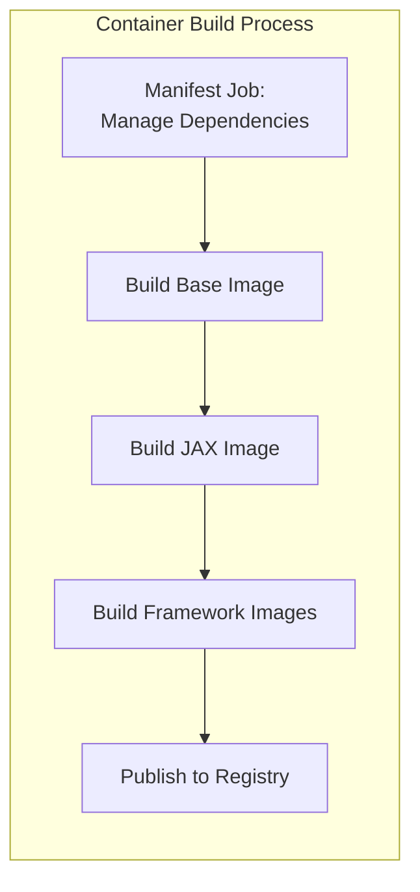

Key aspects of the build process:

1. **Dependency Management**: Uses a manifest file (`manifest.yaml`) to track and update dependencies
2. **Two-Stage Builds**: Uses "mealkit" and "final" stages for efficient builds
3. **Architecture Support**: Builds for both amd64 and arm64 architectures
4. **Caching**: Uses Bazel caching for efficient rebuilds
5. **Testing**: Includes unit and integration tests for each container

The build process is orchestrated by GitHub Actions workflows and produces both dated tags (e.g., `jax-2023-05-01`) and the "latest" tag for each container type.

Sources: [.github/workflows/ci.yaml:57-180](), [.github/workflows/_ci.yaml:40-178]()

## Container Registry and Tagging

All containers are published to the GitHub Container Registry under the `ghcr.io/nvidia/jax` namespace. The containers follow a consistent tagging convention:

- **Latest tag**: `ghcr.io/nvidia/jax:<container-name>`
- **Dated tag**: `ghcr.io/nvidia/jax:<container-name>-YYYY-MM-DD`

For example:
- `ghcr.io/nvidia/jax:jax` (latest JAX Core container)
- `ghcr.io/nvidia/jax:jax-2023-05-01` (specific dated version)

In addition to the final containers, mealkit (intermediate) containers are also published to the registry under `ghcr.io/nvidia/jax-mealkit`.

Sources: [README.md:209-211](), [.github/workflows/ci.yaml:412-429]()

## Environment Variables and Configuration

The JAX-Toolbox containers include environment variables that tune JAX and XLA performance for NVIDIA GPUs.

| Environment Variable | Value | Purpose |
|---------------------|-------|---------|
| `XLA_FLAGS` | `--xla_gpu_enable_latency_hiding_scheduler=true` | Enables XLA's latency hiding scheduler |
| `XLA_FLAGS` | `--xla_gpu_enable_triton_gemm=false` | Uses cuBLAS instead of Triton GEMM |
| `NCCL_NVLS_ENABLE` | `0` | Disables NVLink SHARP |

These environment variables are set in the JAX Core container and are inherited by all framework containers. Additional framework-specific environment variables may be set in individual framework containers.

Sources: [README.md:215-226](), [.github/container/Dockerfile.jax:93-96]()

## Dependency Management

JAX-Toolbox uses a manifest-based system to manage dependencies. The manifest file (`manifest.yaml`) specifies the exact versions of dependencies used in the build process, ensuring reproducibility.

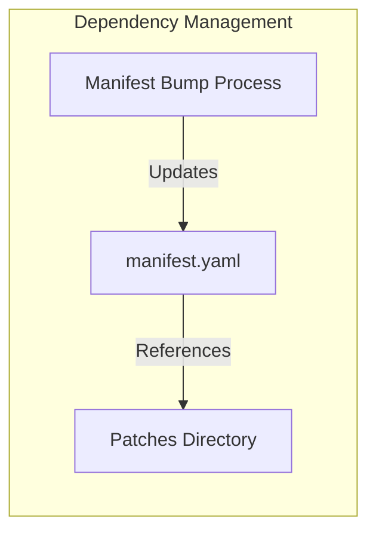

The manifest file includes:
- Git repository URLs
- Commit hashes for pinned versions
- Patches to apply during the build process

This system allows for consistent, reproducible builds and simplifies updating dependencies through a "bump manifest" process.

Sources: [.github/container/manifest.yaml:1-104](), [.github/workflows/ci.yaml:134-189]()

## Multi-Architecture Support

JAX-Toolbox containers support both amd64 (x86_64) and arm64 (aarch64) architectures, allowing them to run on a variety of hardware platforms.

The build process includes architecture-specific optimizations:
- For amd64: Optimized for Intel Sandy Bridge and newer processors
- For arm64: Optimized for ARMv8-A architecture

The architecture-specific builds are coordinated by the CI/CD pipeline, which builds containers for both architectures in parallel and combines them into multi-arch manifests.

Sources: [.github/container/build-jax.sh:202-211](), [.github/workflows/ci.yaml:191-211]()

---

# Page: Base Image

# Base Image

<details>
<summary>Relevant source files</summary>

The following files were used as context for generating this wiki page:

- [.github/container/Dockerfile.base](.github/container/Dockerfile.base)
- [.github/workflows/_build_base.yaml](.github/workflows/_build_base.yaml)

</details>


## Purpose and Scope

The Base Image serves as the foundational layer in the JAX-Toolbox container hierarchy. It provides the essential CUDA environment, system dependencies, development tools, and Python infrastructure necessary for building and running JAX and JAX-based machine learning frameworks on NVIDIA GPUs.

This page documents the structure, components, and build process of the Base Image. For information about the JAX Core Container that builds upon this base, see [JAX Core Container](#2.2).

## Container Hierarchy Overview

The Base Image is the first layer in the JAX-Toolbox container architecture, providing the foundation upon which all other containers are built.

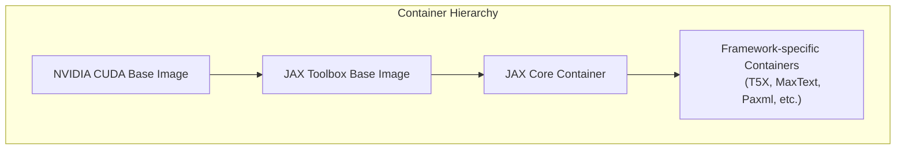

Sources: [.github/container/Dockerfile.base:1-12]()

## Base Image Components

The Base Image is constructed from a NVIDIA CUDA base image, to which key components are added to support JAX and machine learning workloads.

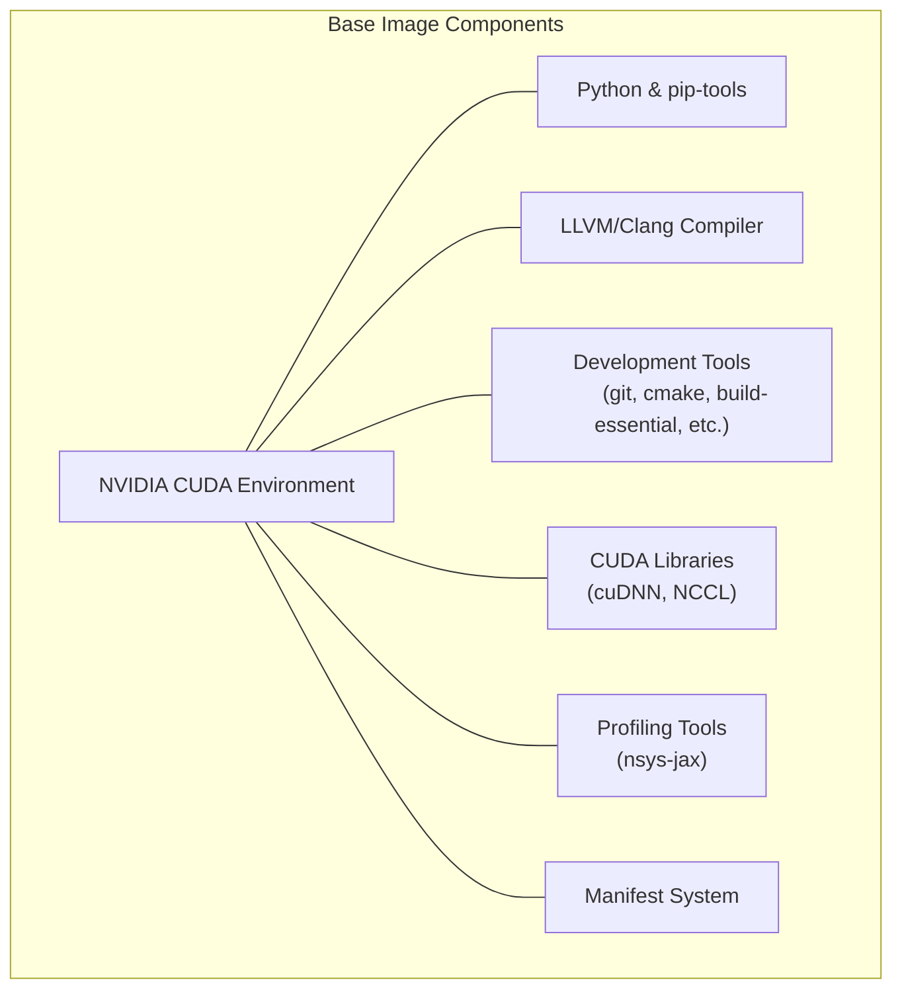

Sources: [.github/container/Dockerfile.base:20-176]()

## Key Components

### Foundational Image and Environment

The Base Image is built upon NVIDIA's CUDA deep learning container, specifically designed for development environments:

```
nvcr.io/nvidia/cuda-dl-base:25.03-cuda12.8-devel-ubuntu24.04
```

This provides the foundational CUDA runtime, libraries, and development tools upon which the JAX ecosystem is built.

Sources: [.github/container/Dockerfile.base:1-18]()

### Development Tools and Python Environment

The Base Image installs a comprehensive set of development tools and Python packages to support the build and execution of JAX and JAX-based frameworks.

| Category | Components |
|----------|------------|
| Build Tools | build-essential, cmake, checkinstall |
| Source Control | git |
| Utilities | curl, wget, vim, jq, zip, rsync |
| Compiler | LLVM/Clang (version 18) |
| Python | Python 3, pip, pip-tools |

Sources: [.github/container/Dockerfile.base:20-137]()

### CUDA Libraries and Utilities

The Base Image ensures proper configuration of critical CUDA libraries:

#### cuDNN Symlinks

The container includes script to create symbolic links for cuDNN libraries, ensuring they are properly discovered by the JAX runtime.

Sources: [.github/container/Dockerfile.base:139-144]()

#### NCCL Configuration

NVIDIA Collective Communications Library (NCCL) is essential for multi-GPU training. The Base Image:
- Creates symbolic links for NCCL libraries
- Installs NCCL sanity check utility
- Provides jax-nccl-test and parallel-launch utilities

Sources: [.github/container/Dockerfile.base:146-161]()

### Profiling Support

The Base Image includes nsys-jax, a JAX/XLA-aware profiling tool that extends NVIDIA Nsight Systems to better support JAX workloads.

Sources: [.github/container/Dockerfile.base:163-168]()

### Manifest System

The Base Image includes the manifest system that manages dependencies and patches across the JAX-Toolbox containers:

- `/opt/manifest.d/manifest.yaml` - Defines versions and dependencies
- Support scripts for distribution creation and version bumping
- Patch directory for applying fixes to dependencies

Sources: [.github/container/Dockerfile.base:170-177]()

## Build Process

The Base Image is built as part of the JAX-Toolbox CI/CD pipeline using GitHub Actions.

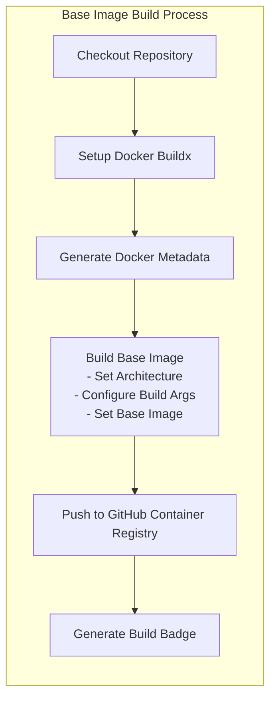

Sources: [.github/workflows/_build_base.yaml:67-181]()

### Build Configuration

The Base Image build supports the following key configuration options:

| Configuration | Description |
|---------------|-------------|
| `ARCHITECTURE` | CPU architecture to build for (amd64, arm64) |
| `BASE_IMAGE` | Base CUDA image to use (default: latest) |
| `BUILD_DATE` | Build date in YYYY-MM-DD format |
| `GIT_USER_NAME` | Git username for container configuration |
| `GIT_USER_EMAIL` | Git email for container configuration |
| `JAX_TOOLBOX_REF` | JAX-Toolbox reference to use (default: current branch or SHA) |

Sources: [.github/workflows/_build_base.yaml:6-45](), [.github/container/Dockerfile.base:2-6]()

### Multi-Architecture Support

The Base Image build process supports multiple CPU architectures:

- `amd64` (x86_64): Standard architecture for most server deployments
- `arm64` (aarch64): Used for ARM-based deployments

Special handling is incorporated for ARM architecture, particularly with libraries like h5py that may require additional dependencies.

Sources: [.github/container/Dockerfile.base:52-57](), [.github/workflows/_build_base.yaml:8-9]()

## Docker Image Tagging and Storage

Completed Base Images are:

1. Tagged using the GitHub run ID and architecture (e.g., `{run_id}-base-{architecture}`)
2. Pushed to GitHub Container Registry as `ghcr.io/nvidia/jax-toolbox-internal`
3. Used as the foundation for building the JAX Core container

This tagging scheme ensures traceability between built artifacts and the GitHub Actions workflow that produced them.

Sources: [.github/workflows/_build_base.yaml:51-131]()

## Conclusion

The Base Image provides the foundation for the entire JAX-Toolbox container ecosystem. It combines:

1. NVIDIA's CUDA development environment
2. Essential system libraries and development tools
3. Python environment with pip-tools
4. CUDA libraries (cuDNN, NCCL) with proper configurations
5. Profiling support for JAX workloads

This unified foundation ensures consistent build and runtime environments across all layers of the JAX-Toolbox container hierarchy.

---

# Page: JAX Core Container

# JAX Core Container

<details>
<summary>Relevant source files</summary>

The following files were used as context for generating this wiki page:

- [.github/container/Dockerfile.jax](.github/container/Dockerfile.jax)
- [.github/container/build-jax.sh](.github/container/build-jax.sh)
- [.github/container/local_cuda_arch](.github/container/local_cuda_arch)
- [.github/container/test-jax.sh](.github/container/test-jax.sh)

</details>


This document describes the JAX Core Container within JAX-Toolbox, which provides the foundation for all JAX-based machine learning framework containers. For information about framework-specific containers that build upon this image, see [Framework Containers](#2.3).

## Overview

The JAX Core Container is a Docker container that packages JAX, XLA, Flax, and Transformer Engine into a single, optimized environment for NVIDIA GPUs. It serves as the base image for all framework-specific containers in JAX-Toolbox, providing consistent JAX functionality across the ecosystem.

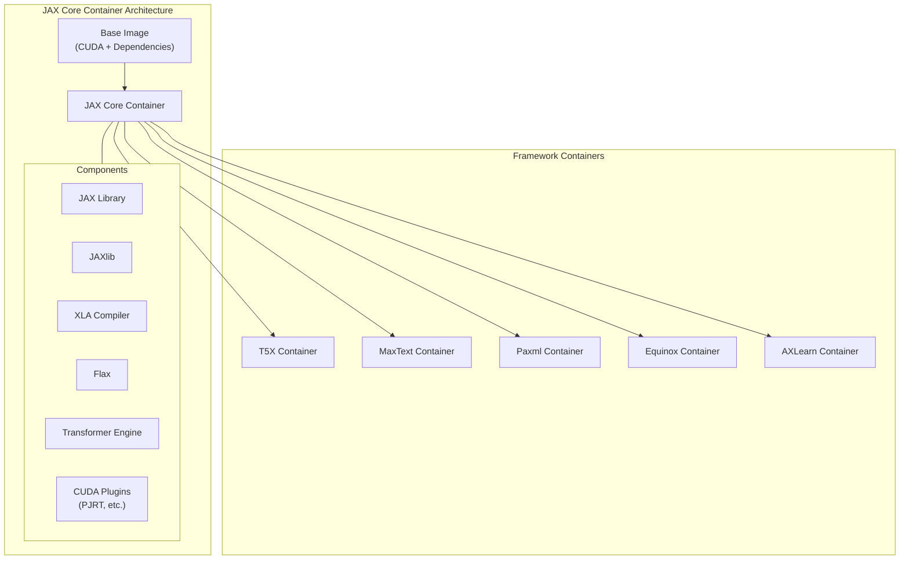

Sources: [.github/container/Dockerfile.jax:1-136]()

## Multi-Stage Build Process

The JAX Core Container uses a multi-stage build process to optimize the final image size and build caching. The build process consists of three main stages:

1. **Builder Stage** - Compiles JAX, JAXlib, and CUDA plugins from source
2. **Mealkit Stage** - Packs built components for installation
3. **Final Stage** - Installs all components and finalizes the container

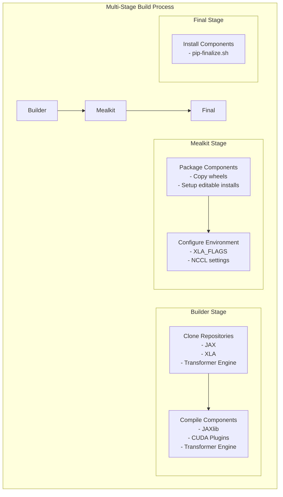

Sources: [.github/container/Dockerfile.jax:18-136]()

## Core Components

The JAX Core Container includes the following key components:

| Component | Description | Source |
|-----------|-------------|--------|
| JAX | The main JAX library providing automatic differentiation and XLA compilation | Cloned from GitHub |
| JAXlib | The compiled JAX backend libraries | Built from source |
| XLA | The Accelerated Linear Algebra compiler | Cloned from GitHub |
| Flax | Neural network library for JAX | Cloned from GitHub |
| Transformer Engine | NVIDIA's library for accelerating Transformer models | Built from source |
| CUDA Plugins | JAX CUDA plugins for GPU acceleration | Built from source |

Sources: [.github/container/Dockerfile.jax:22-57](), [.github/container/Dockerfile.jax:81-129]()

## Build Configuration

The JAX Core Container build is highly configurable through build arguments in the Dockerfile and options in the build scripts. Key configuration points include:

### Source Repositories and Versions

The container builds components directly from source repositories. The repositories and versions can be configured via build arguments:

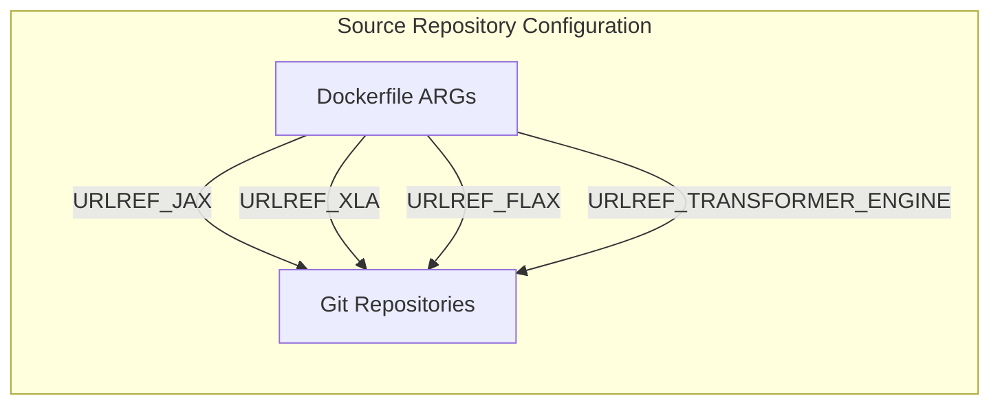

Sources: [.github/container/Dockerfile.jax:3-11]()

### CUDA Compute Capabilities

The build can be configured for specific NVIDIA GPU architectures:

1. **Local Detection**: Automatically detects the GPU architecture of the build machine
2. **All Architectures**: Builds for all supported architectures
3. **Specific Architectures**: Builds for user-specified architectures

Sources: [.github/container/build-jax.sh:213-222](), [.github/container/local_cuda_arch:1-2]()

## Building JAXlib

The core of the build process is compiling JAXlib with the appropriate CUDA support. This is handled by the `build-jax.sh` script, which:

1. Configures build parameters based on the CUDA environment
2. Applies architecture-specific optimizations and patches
3. Builds JAXlib and CUDA plugins using Bazel
4. Creates editable installations for development

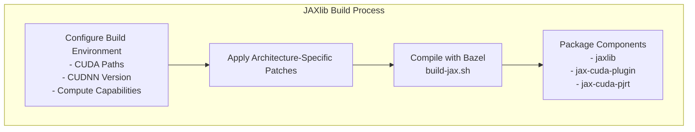

Sources: [.github/container/build-jax.sh:309-319](), [.github/container/build-jax.sh:169-307]()

## Performance Optimizations

The JAX Core Container includes several performance optimizations for NVIDIA GPUs:

1. **XLA Flags**: Optimized XLA configuration for GPU performance
2. **NCCL Settings**: Configuration for optimal multi-GPU communication
3. **Bazel Cache**: Support for local and remote Bazel caching to speed up builds

Sources: [.github/container/Dockerfile.jax:92-96](), [.github/container/build-jax.sh:224-232]()

## Testing Capabilities

The container includes comprehensive testing infrastructure for validating JAX functionality:

### Test Batteries

The test system supports different predefined test batteries:

| Battery | Description |
|---------|-------------|
| `large` | Large-scale tests that require significant GPU memory |
| `gpu` | GPU-specific tests |
| `backend-independent` | Tests that are independent of the backend |

### Multi-GPU Testing

The testing infrastructure automatically scales to the available GPUs, with configurable parallelism:

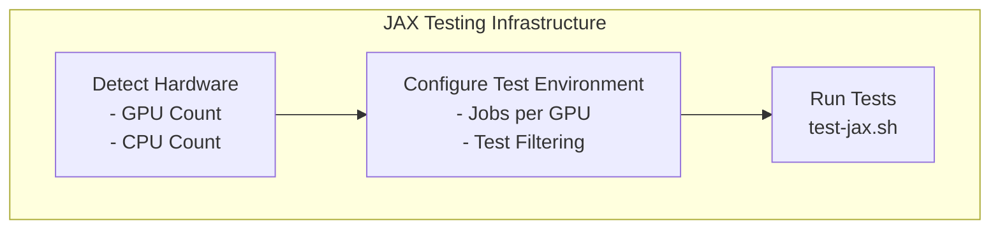

Sources: [.github/container/test-jax.sh:100-107](), [.github/container/test-jax.sh:135-167]()

## Usage Examples

The JAX Core Container serves two primary purposes:

1. As a development environment for JAX and JAXlib
2. As a base image for framework-specific containers

### Using as a Development Environment

```bash
# Pull the container
docker pull ghcr.io/nvidia/jax:latest

# Run with GPU access
docker run --gpus all -it ghcr.io/nvidia/jax:latest

# Run Python with JAX
python -c "import jax; print(jax.devices())"
```

### Using as a Base Image

Framework containers extend the JAX Core Container with additional libraries and configurations:

```Dockerfile
FROM ghcr.io/nvidia/jax:latest

# Add framework-specific components
RUN pip install t5x
```

Sources: [.github/container/Dockerfile.jax:2]()

## Conclusion

The JAX Core Container provides a robust, optimized foundation for JAX-based machine learning on NVIDIA GPUs. By packaging JAX, XLA, Flax, and Transformer Engine in a single, well-tested container, it enables consistent development and deployment across the JAX ecosystem.

---

# Page: Framework Containers

# Framework Containers

<details>
<summary>Relevant source files</summary>

The following files were used as context for generating this wiki page:

- [.github/container/Dockerfile.maxtext](.github/container/Dockerfile.maxtext)
- [.github/container/Dockerfile.t5x](.github/container/Dockerfile.t5x)
- [.github/container/bump.sh](.github/container/bump.sh)
- [.github/workflows/_build.yaml](.github/workflows/_build.yaml)

</details>


## Purpose and Scope

Framework Containers in JAX-Toolbox are specialized Docker images that extend the JAX Core Container to provide pre-configured environments for specific JAX-based machine learning frameworks such as T5X, MaxText, Paxml, and others. This document describes how these framework-specific containers are structured, built, and integrated into the JAX-Toolbox ecosystem.

For information about the JAX Core Container that serves as the foundation for these framework containers, see [JAX Core Container](#2.2).

## Container Architecture

Framework containers follow a layered architecture pattern where each container builds upon the previous layer.

### Framework Container Hierarchy

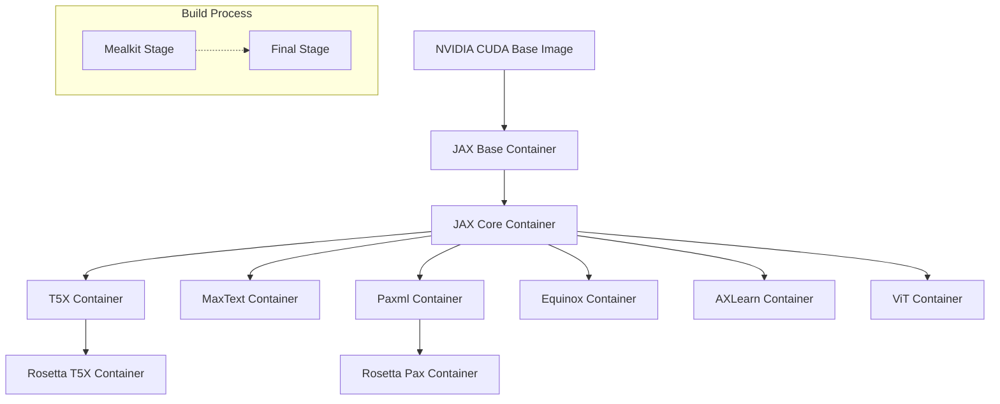

Sources: [.github/container/Dockerfile.t5x:11-69](), [.github/container/Dockerfile.maxtext:11-55]()

### Two-Stage Build Process

Framework containers use a two-stage build process:

1. **Mealkit Stage**: Prepares the build environment, fetches source code, and configures dependencies
2. **Final Stage**: Installs packages and finalizes the container

This approach optimizes image size and improves build caching.

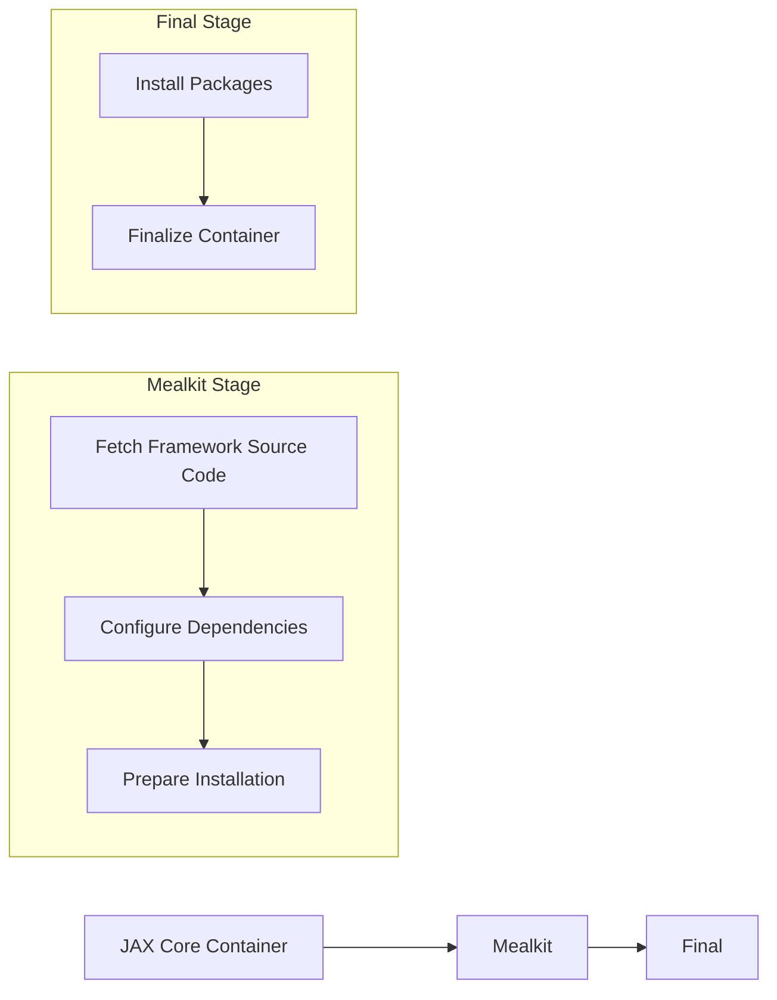

Sources: [.github/container/Dockerfile.t5x:11-21](), [.github/container/Dockerfile.t5x:68-75](), [.github/container/Dockerfile.maxtext:11-50](), [.github/container/Dockerfile.maxtext:50-56]()

## Framework Container Build Process

### Common Build Arguments

Each framework container uses several build arguments:

| Build Argument | Description | Example |
|----------------|-------------|---------|
| BASE_IMAGE | Base JAX container to build from | ghcr.io/nvidia/jax:mealkit |
| URLREF_* | Git repository URL and reference | https://github.com/google-research/t5x.git#main |
| SRC_PATH_* | Path where source code is placed | /opt/t5x |
| BUILD_DATE | Build timestamp for versioning | 2024-01-22 |
| BAZEL_CACHE | URL for Bazel remote cache | (Internal cache URL) |

Sources: [.github/container/Dockerfile.t5x:5-9](), [.github/container/Dockerfile.maxtext:3-5](), [.github/workflows/_build.yaml:130-134](), [.github/workflows/_build.yaml:164-167]()

### Framework Source Code Management

The framework containers fetch their source code directly from Git repositories. The specific commit or branch is determined by the `URLREF_*` build argument.

```mermaid
flowchart TD
    subgraph "Source Management"
        url_ref["URLREF_* Build Argument"] --> git_clone["git-clone.sh"]
        git_clone --> src_path["SRC_PATH_* Directory"]
        src_path --> pip_install["Added to pip Requirements"]
    end
    
    subgraph "Dependency Resolution"
        src_path --> req_file["requirements.txt or setup.py"]
        req_file --> pip_tools["pip-tools.d Directory"]
        pip_tools --> pip_finalize["pip-finalize.sh"]
    end
```

Sources: [.github/container/Dockerfile.t5x:18-60](), [.github/container/Dockerfile.maxtext:15-39](), [.github/container/bump.sh:86-112]()

### CI/CD Integration

Framework containers are built as part of the JAX-Toolbox CI/CD pipeline. The `_build.yaml` workflow defines the build process for all containers.

```mermaid
flowchart TB
    trigger["GitHub Trigger"] --> metadata["Set Metadata"]
    metadata --> mealkit_build["Build Mealkit Image"]
    mealkit_build --> final_build["Build Final Image"]
    final_build --> push["Push to Registry"]
    push --> badge["Generate Badge"]
    push --> artifacts["Upload Artifacts"]
```

Sources: [.github/workflows/_build.yaml:71-211]()

## Supported Framework Containers

Each framework container extends the JAX Core container with specific machine learning frameworks:

### T5X Container

T5X is Google Research's framework for training and evaluating sequence models (particularly T5 models). The T5X container includes:

- T5X framework source code
- AirIO library for input/output processing
- TensorFlow dependencies for data processing

```mermaid
flowchart TD
    jax_core["JAX Core Container"] --> t5x_container["T5X Container"]
    
    subgraph "T5X Container Contents"
        t5x_src["/opt/t5x"]
        airio_src["/opt/airio"]
        tf_deps["TensorFlow Dependencies"]
        test_script["/usr/local/bin/test-t5x.sh"]
    end
```

Sources: [.github/container/Dockerfile.t5x:18-61](), [.github/container/Dockerfile.t5x:63]()

### MaxText Container

MaxText is an open source LLM reference implementation focused on performance. The MaxText container includes:

- MaxText framework source code
- Machine learning dependencies (absl, protobuf, etc.)
- TensorFlow and SeqIO dependencies

```mermaid
flowchart TD
    jax_core["JAX Core Container"] --> maxtext_container["MaxText Container"]
    
    subgraph "MaxText Container Contents"
        maxtext_src["/opt/maxtext"]
        tf_deps["TensorFlow Dependencies"]
        seqio["SeqIO Library"]
        test_script["/usr/local/bin/test-maxtext.sh"]
    end
```

Sources: [.github/container/Dockerfile.maxtext:15-39](), [.github/container/Dockerfile.maxtext:45]()

## Dependency Management

Framework containers use a structured approach to manage dependencies through the build process.

### Requirements Management

Dependencies are managed through:

1. Requirements files (`requirements.txt`)
2. Direct setup.py modifications
3. Additional pip requirements files in `/opt/pip-tools.d/`

When dependencies conflict or need modifications, the build process patches the requirements files during the mealkit stage.

```mermaid
flowchart TD
    source_req["Framework requirements.txt"] --> pip_tools["Generated /opt/pip-tools.d/requirements-*.in"]
    setup_py["Framework setup.py"] --> modify["Modified Dependencies"]
    modify --> pip_tools
    pip_tools --> pip_finalize["pip-finalize.sh"]
    pip_finalize --> installed["Installed Packages"]
```

Sources: [.github/container/Dockerfile.t5x:21-60](), [.github/container/Dockerfile.maxtext:17-39]()

### Architecture-Specific Modifications

The build process includes logic to handle different CPU architectures (AMD64, ARM64):

- For ARM64 builds, specific patches are applied to handle compatibility issues
- Some dependencies have architecture-specific requirements or alternatives

Sources: [.github/container/Dockerfile.t5x:34-51]()

## Relationship to Manifest System

Framework containers integrate with JAX-Toolbox's manifest system for version management:

1. The `bump.sh` script updates framework versions in the manifest
2. The manifest controls which versions of frameworks are built
3. Patches can be applied to framework sources during the build process

```mermaid
flowchart TD
    manifest["manifest.yaml"] --> bump["bump.sh"]
    bump --> updated_manifest["Updated manifest.yaml"]
    updated_manifest --> build["Container Build Process"]
    updated_manifest --> patches["Framework Patches"]
    patches --> build
```

Sources: [.github/container/bump.sh:1-113]()

## Testing Integration

Each framework container includes a test script (`test-*.sh`) that verifies the container's functionality. These tests are executed as part of the CI/CD pipeline to ensure each framework container works as expected.

Sources: [.github/container/Dockerfile.t5x:63](), [.github/container/Dockerfile.maxtext:45]()

---

# Page: CI/CD Pipeline

# CI/CD Pipeline

<details>
<summary>Relevant source files</summary>

The following files were used as context for generating this wiki page:

- [.github/container/local_cuda_arch](.github/container/local_cuda_arch)
- [.github/container/manifest.yaml](.github/container/manifest.yaml)
- [.github/workflows/__copy_gist.yaml](.github/workflows/__copy_gist.yaml)
- [.github/workflows/_ci.yaml](.github/workflows/_ci.yaml)
- [.github/workflows/_finalize.yaml](.github/workflows/_finalize.yaml)
- [.github/workflows/_sitrep_mgmn.yaml](.github/workflows/_sitrep_mgmn.yaml)
- [.github/workflows/assistant.yaml](.github/workflows/assistant.yaml)
- [.github/workflows/ci.yaml](.github/workflows/ci.yaml)
- [README.md](README.md)

</details>


This document describes the continuous integration and continuous deployment (CI/CD) pipeline used in JAX-Toolbox. It explains the workflow architecture, build processes, testing infrastructure, and image publishing mechanisms. For information about the container system architecture itself, see [Container System Architecture](#2).

## Overview

The JAX-Toolbox CI/CD pipeline automates the building, testing, and publishing of Docker containers for JAX and related ML frameworks optimized for NVIDIA GPUs. It ensures containers are properly tested across various hardware configurations and publishes verified images to GitHub Container Registry (GHCR).

**Title: JAX-Toolbox CI/CD Pipeline Overview**
```mermaid
flowchart TD
    subgraph "Triggers"
        pr["Pull Request"]
        cron["Scheduled Run\n(Daily 9:30 UTC)"]
        manual["Manual Execution\n(workflow_dispatch)"]
    end

    subgraph "Build Pipeline"
        metadata["metadata job"]
        bump["bump-manifest job"]
        amd64["amd64 architecture jobs"]
        arm64["arm64 architecture jobs"]
        publish["publish-containers job"]
        finalize["finalize job"]
    end

    subgraph "Testing"
        unit["Unit Tests"]
        integration["Integration Tests"]
        perf["Performance Tests"]
        mgmn["Multi-GPU Multi-Node Tests"]
    end

    subgraph "Outputs"
        images["Docker Images in GHCR"]
        badges["Status Badges"]
        reports["Test Reports"]
    end

    pr --> metadata
    cron --> metadata
    manual --> metadata
    
    metadata --> bump
    bump --> amd64
    bump --> arm64
    
    amd64 --> unit
    amd64 --> integration
    amd64 --> perf
    amd64 --> mgmn
    
    arm64 --> publish
    amd64 --> publish
    
    unit --> publish
    integration --> publish
    perf --> publish
    mgmn --> publish
    
    publish --> images
    publish --> finalize
    finalize --> badges
    finalize --> reports
```

Sources: [.github/workflows/ci.yaml:1-438](), [README.md:18-207]()

## Workflow Triggers

The CI/CD pipeline can be initiated through three different mechanisms:

1. **Scheduled Runs**: Daily builds run at 9:30 UTC via CRON trigger
2. **Pull Requests**: Triggered when PRs are opened, reopened, or synchronized (except for markdown-only changes)
3. **Manual Execution**: Can be manually triggered with custom parameters via GitHub Actions UI

When manually triggered, the workflow accepts the following input parameters:

| Parameter | Description | Default |
|-----------|-------------|---------|
| `PUBLISH` | Push dated images and update 'latest' tag | `false` |
| `BUMP_MANIFEST` | Update Git repos in manifest.yaml to head of tree | `true` |
| `MERGE_BUMPED_MANIFEST` | Attempt to PR/merge manifest branch | `false` |
| `CUDA_IMAGE` | CUDA image to use as base | `'latest'` |
| `SOURCE_OVERRIDES` | Comma-separated PACKAGE=URL#REF overrides | `''` |

Sources: [.github/workflows/ci.yaml:3-42]()

## Core Pipeline Components

**Title: CI/CD Pipeline Component Workflow**
```mermaid
flowchart TD
    subgraph "workflow_jobs"
        metadata["metadata\nSet build date, environment vars"]
        bump_manifest["bump-manifest\nUpdate dependency versions"]
        amd64["amd64\nBuild for x86_64 architecture"]
        arm64["arm64\nBuild for AArch64 architecture"]
        merge_manifest["merge-new-manifest\nMerge updated dependencies"]
        make_configs["make-publish-configs\nPrepare image publishing"]
        publish["publish-containers\nPush images to GHCR"]
        finalize["finalize\nGenerate reports and badges"]
    end

    metadata -->|"BUILD_DATE\nPUBLISH=true/false"| bump_manifest
    metadata -->|"BUILD_DATE"| amd64
    metadata -->|"BUILD_DATE"| arm64
    
    bump_manifest -->|"SOURCE_URLREFS"| amd64
    bump_manifest -->|"SOURCE_URLREFS"| arm64
    
    amd64 --> merge_manifest
    arm64 --> merge_manifest
    
    amd64 -->|"DOCKER_TAGS"| make_configs
    arm64 -->|"DOCKER_TAGS"| make_configs
    
    make_configs -->|"PUBLISH_CONFIGS"| publish
    
    amd64 --> finalize
    arm64 --> finalize
    publish --> finalize
```

Sources: [.github/workflows/ci.yaml:57-437]()

### Metadata Job

The `metadata` job runs first and performs essential setup:

1. Cancels workflow if triggered by a draft PR
2. Sets build date in format `YYYY-MM-DD`
3. Determines if images should be published
4. Configures manifest branch name
5. Sets CUDA image to use

Sources: [.github/workflows/ci.yaml:59-132]()

### Dependency Management

The CI/CD pipeline uses a manifest file to track dependency versions. The `bump-manifest` job:

1. Checks out the repository
2. Tests the manifest bumping functionality
3. Updates `manifest.yaml` with latest dependencies (if enabled)
4. Generates build arguments for source code URLs and references

The manifest file specifies Git repositories, commit hashes, and patches for each dependency.

**Example manifest entry:**
```yaml
jax:
  url: https://github.com/google/jax.git
  tracking_ref: main
  latest_verified_commit: 8f4658ecdbe40cde0c43a9ab127359347943c076
  mode: git-clone
```

Sources: [.github/workflows/ci.yaml:134-189](), [.github/container/manifest.yaml:1-104]()

## Build Process

The build process constructs a hierarchy of Docker images across multiple architectures.

**Title: Container Build Hierarchy**
```mermaid
flowchart TD
    subgraph "Base Layer"
        cuda_image["CUDA Base Image"]
        base_build["_build_base.yaml workflow"]
        cuda_image -->|"Input"| base_build
        base_build -->|"Output"| base_image["ghcr.io/nvidia/jax:base"]
    end

    subgraph "Core Layer"
        jax_build["_build.yaml workflow (jax)"]
        base_image -->|"Input"| jax_build
        jax_build -->|"Output"| jax_image["ghcr.io/nvidia/jax:jax"]
    end

    subgraph "Framework Layer"
        base_image -->|"Used by"| build_processes
        
        subgraph "build_processes"
            direction LR
            t5x_build["t5x build job"]
            maxtext_build["maxtext build job"]
            equinox_build["equinox build job"]
            axlearn_build["axlearn build job"]
        end
        
        build_processes -->|"Output"| framework_images
        
        subgraph "framework_images"
            direction LR
            t5x["ghcr.io/nvidia/jax:t5x"]
            maxtext["ghcr.io/nvidia/jax:maxtext"]
            equinox["ghcr.io/nvidia/jax:equinox"]
            axlearn["ghcr.io/nvidia/jax:axlearn"]
        end
    end
```

Sources: [.github/workflows/_ci.yaml:41-170]()

### Architecture Support

The pipeline builds images for two architectures in parallel:

1. **amd64** (x86_64): Standard architecture for server and desktop systems
2. **arm64** (AArch64): Architecture for ARM-based systems

The build processes for both architectures are nearly identical but run independently.

Sources: [.github/workflows/ci.yaml:191-211]()

### Build Stages

Each container is built using a two-stage process:

1. **Mealkit Stage**: Contains build tools and development dependencies 
2. **Final Stage**: Contains only runtime dependencies for smaller image size

The CI pipeline keeps track of both stages as they may be useful for different purposes.

Sources: [.github/workflows/_ci.yaml:140-170]()

## Testing Infrastructure

The pipeline employs a comprehensive testing strategy across multiple dimensions:

**Title: Testing Infrastructure Map**
```mermaid
flowchart TD
    subgraph "Test Types"
        unit["Unit Tests"]
        integration["Integration Tests"]
        perf["Performance Tests"]
        mgmn["Multi-GPU\nMulti-Node Tests"]
    end

    subgraph "Test Infrastructure"
        github["GitHub-hosted Runners"]
        self_hosted["Self-hosted Runners"]
        eks["Kubernetes/EKS"]
    end

    subgraph "Test Targets"
        jax_core["JAX Core Tests"]
        te["Transformer Engine Tests"]
        nsys["nsys-jax Tests"]
        t5x_tests["T5X Tests"]
        maxtext_tests["MaxText Tests"]
        axlearn_tests["AXLearn Tests"]
    end

    unit --> github
    unit --> self_hosted
    integration --> self_hosted
    perf --> self_hosted
    mgmn --> eks

    jax_core --> unit
    te --> unit
    nsys --> unit
    t5x_tests --> mgmn
    maxtext_tests --> mgmn
    axlearn_tests --> mgmn
```

Sources: [.github/workflows/_ci.yaml:179-649](), [.github/workflows/_sitrep_mgmn.yaml:1-168]()

### Unit Tests

Unit tests verify the functionality of individual components:

- **JAX Core**: Tests JAX basic functionality and GPU backend
- **Transformer Engine**: Tests the NVIDIA Transformer Engine integration
- **nsys-jax**: Tests the NVIDIA profiling tool integration

Sources: [.github/workflows/_ci.yaml:201-331]()

### Integration Tests

The pipeline includes distribution tests that verify:

- Extra-only distribution
- Mirror-only distribution
- Upstream-only distribution
- Local patch distribution

Sources: [.github/workflows/_ci.yaml:179-199]()

### Multi-GPU Multi-Node Tests

The pipeline runs advanced distributed tests on Kubernetes/EKS infrastructure:

- **T5X**: Tests distributed model training
- **MaxText**: Tests large language model training
- **AXLearn**: Tests Fuji model distributed training

These tests verify that the frameworks can properly utilize multiple GPUs across multiple nodes.

Sources: [.github/workflows/_ci.yaml:503-648](), [.github/workflows/_sitrep_mgmn.yaml:1-168]()

## Image Publishing

After successful testing, images are published to GitHub Container Registry (GHCR).

**Title: Image Publishing Process**
```mermaid
flowchart TD
    subgraph "Pre-Publishing"
        collect["collect-docker-tags job"]
        make_config["make-publish-configs job"]
        matrices["Matrix of container configs"]
    end

    subgraph "Publishing Process"
        architecture_images["Architecture-specific images\n(amd64, arm64)"]
        manifest["Multi-architecture manifest"]
        push["Push to GHCR"]
    end

    subgraph "Tag Strategy"
        dated["Dated Tags:\nXXX-YYYY-MM-DD"]
        latest["Latest Tags:\nXXX"]
    end

    collect --> make_config
    make_config --> matrices
    matrices --> architecture_images
    
    architecture_images --> manifest
    manifest --> push
    
    push --> dated
    push --> latest
```

Sources: [.github/workflows/ci.yaml:412-437]()

### Publishing Configuration

The `make-publish-configs` job:

1. Collects Docker tags from all builds
2. Creates a configuration matrix for publishing
3. Determines which images should be published

When publishing is enabled, images are pushed with:
- Dated tags (e.g., `ghcr.io/nvidia/jax:maxtext-2023-10-15`)
- Latest tags (e.g., `ghcr.io/nvidia/jax:maxtext`)

Sources: [.github/workflows/ci.yaml:325-411]()

## Status Reporting and Badges

The pipeline generates status badges and comprehensive reports to provide visibility into build and test status.

**Title: Status Badge Generation**
```mermaid
flowchart TD
    subgraph "Input Sources"
        test_results["Test Results"]
        build_results["Build Results"]
    end

    subgraph "_finalize.yaml workflow"
        workflow_badge["workflow-badge job"]
        upload["upload-badge job"]
        report["report job"]
        publish["publish-badge job"]
    end

    subgraph "Destinations"
        gist["GitHub Gist\n(Badge Endpoint)"]
        readme["README.md Status Table"]
    end

    test_results --> workflow_badge
    build_results --> workflow_badge
    
    workflow_badge --> upload
    upload -->|"Gist ID"| publish
    
    test_results --> report
    build_results --> report
    
    publish --> gist
    gist --> readme
```

The badge system shows:
- Build status for each component and architecture
- Test status for various test suites
- Overall workflow metadata

These badges are displayed in the repository's README.md to provide at-a-glance status information.

Sources: [.github/workflows/_finalize.yaml:1-274](), [README.md:18-207]()

## Custom Workflow Parameters

The CI/CD pipeline can be manually triggered with custom parameters to control its behavior:

| Parameter | Purpose |
|-----------|---------|
| `PUBLISH` | When `true`, push images to GHCR and update 'latest' tags |
| `BUMP_MANIFEST` | When `true`, update dependencies in manifest.yaml |
| `MERGE_BUMPED_MANIFEST` | When `true`, create PR to merge updated manifest |
| `CUDA_IMAGE` | Specify a custom CUDA base image |
| `SOURCE_OVERRIDES` | Override specific package sources with custom URLs/refs |

Sources: [.github/workflows/ci.yaml:16-42]()

## Conclusion

The JAX-Toolbox CI/CD pipeline provides a robust system for building, testing, and publishing optimized JAX containers for NVIDIA GPUs. Through automated testing across multiple architectures and hardware configurations, it ensures that the published images are reliable and performant.

The pipeline's modular design allows for flexibility in building different components, while its comprehensive testing strategy validates functionality across various scenarios. The status reporting system provides visibility into the pipeline's health and the quality of the published images.

---

# Page: Build Workflows

# Build Workflows

<details>
<summary>Relevant source files</summary>

The following files were used as context for generating this wiki page:

- [.github/container/local_cuda_arch](.github/container/local_cuda_arch)
- [.github/workflows/_build_rosetta.yaml](.github/workflows/_build_rosetta.yaml)
- [.github/workflows/_test_rosetta.yaml](.github/workflows/_test_rosetta.yaml)
- [rosetta/rosetta/projects/vit/integration_test.py](rosetta/rosetta/projects/vit/integration_test.py)

</details>


This page documents the GitHub Actions workflows used in JAX-Toolbox to build container images for JAX and various ML frameworks. These workflows form the core build infrastructure of the CI/CD pipeline. For information about the testing infrastructure, see [Test Infrastructure](#3.2), and for reporting systems, see [Badges and Reporting](#3.3).

## Build Workflow Architecture

The JAX-Toolbox build system uses modular, reusable GitHub Actions workflows to build container images. These workflows follow a hierarchical pattern that mirrors the container architecture described in the [Container System Architecture](#2) section.

```mermaid
flowchart TD
    subgraph "Trigger Sources"
        pr["Pull Request"]
        schedule["Scheduled Build"]
        manual["Manual Trigger"]
    end

    subgraph "Reusable Workflows"
        build_base["_build_base.yaml"]
        build_jax["_build_jax.yaml"]
        build_framework["_build_framework.yaml"]
        build_rosetta["_build_rosetta.yaml"]
    end

    subgraph "Build Process"
        metadata["Set Image Metadata"]
        mealkit["Build Mealkit Stage"]
        final["Build Final Stage"]
        push["Push to Registry"]
    end

    pr --> build_base
    schedule --> build_base
    manual --> build_base
    
    build_base --> build_jax
    build_jax --> build_framework
    build_framework --> build_rosetta
    
    build_base --> metadata --> mealkit --> final --> push
    build_jax --> metadata --> mealkit --> final --> push
    build_framework --> metadata --> mealkit --> final --> push
    build_rosetta --> metadata --> mealkit --> final --> push
```

Sources: [.github/workflows/_build_rosetta.yaml:1-186]()

## Rosetta Build Workflow

The Rosetta build workflow is representative of how JAX-Toolbox builds container images. This workflow is defined in the `_build_rosetta.yaml` file and is called by parent workflows.

```mermaid
flowchart TD
    subgraph "Workflow Inputs"
        arch["ARCHITECTURE\n(e.g. amd64, arm64)"]
        base_lib["BASE_LIBRARY\n(default: t5x)"]
        base_img["BASE_IMAGE\n(optional)"]
        build_date["BUILD_DATE\n(YYYY-MM-DD)"]
    end

    subgraph "Build Process"
        defaults["Set Default BASE_IMAGE"]
        login["Login to GitHub Container Registry"]
        buildx["Setup Docker Buildx"]
        
        subgraph "Mealkit Stage"
            mealkit_meta["Set Docker Metadata"]
            mealkit_build["Build Docker Images"]
        end
        
        subgraph "Final Stage"
            final_meta["Set Docker Metadata"]
            final_build["Build Final Image"]
        end
        
        sitrep["Generate Sitrep"]
        upload["Upload Sitrep and Badge"]
    end

    arch --> defaults
    base_lib --> defaults
    base_img --> defaults
    
    defaults --> login --> buildx
    buildx --> mealkit_meta --> mealkit_build
    mealkit_build --> final_meta --> final_build
    final_build --> sitrep --> upload
    
    build_date --> mealkit_meta
    build_date --> final_meta
```

Sources: [.github/workflows/_build_rosetta.yaml:1-186]()

## Two-Stage Build Process

JAX-Toolbox uses a two-stage build process to optimize container size and build caching. This approach is evident in the Rosetta build workflow and is a common pattern across all build workflows in the system.

```mermaid
flowchart LR
    subgraph "Mealkit Stage"
        mealkit_context["Build Context"]
        mealkit_deps["Install Dependencies"]
        mealkit_build["Build Tools"]
    end

    subgraph "Final Stage"
        final_deps["Copy Necessary Dependencies"]
        final_config["Configure Environment"]
        final_cleanup["Clean Up"]
    end

    mealkit_context --> mealkit_deps --> mealkit_build
    mealkit_build --> final_deps --> final_config --> final_cleanup
```

Sources: [.github/workflows/_build_rosetta.yaml:90-141]()

The mealkit stage is named after the meal-kit delivery service concept—it contains all ingredients and tools needed to build the software but may include components that aren't needed in the final runtime environment. The final stage creates a streamlined image with only the necessary components for running the software.

## Workflow Inputs and Parameters

The build workflows accept various inputs to customize the build process. Taking the Rosetta build workflow as an example:

| Input | Description | Default |
|-------|-------------|---------|
| `ARCHITECTURE` | CPU architecture to build for (e.g., amd64, arm64) | *Required* |
| `BASE_LIBRARY` | Choice of base library (e.g., t5x, paxml) | `t5x` |
| `BASE_IMAGE` | Base docker image | `ghcr.io/nvidia/upstream-{BASE_LIBRARY}:latest` |
| `BUILD_DATE` | Build date in YYYY-MM-DD format | `NOT SPECIFIED` |
| `ARTIFACT_NAME` | Name of the artifact zip file | `artifact-rosetta-build` |
| `BADGE_FILENAME_PREFIX` | Name prefix for the badge JSON file | `badge-rosetta-build` |

Sources: [.github/workflows/_build_rosetta.yaml:3-33]()

## Workflow Outputs

The build workflows produce several outputs that can be consumed by downstream workflows:

| Output | Description |
|--------|-------------|
| `DOCKER_TAG_MEALKIT` | Tags of the mealkit image build |
| `DOCKER_TAG_FINAL` | Tags of the complete image built |

Sources: [.github/workflows/_build_rosetta.yaml:34-40]()

These outputs enable other workflows to reference the built images for testing or deployment.

## Build Artifacts and Badges

Each build workflow generates artifacts that provide information about the build process:

1. **Sitrep JSON** - Contains summary information about the build, including tags, digest, and outcome
2. **Badge JSON** - Used to generate status badges for display in the repository

```mermaid
flowchart TD
    subgraph "Build Process"
        build["Docker Build"]
    end
    
    subgraph "Artifact Generation"
        sitrep["Generate Sitrep\n(sitrep.json)"]
        badge["Generate Badge JSON\n({PREFIX}-{LIBRARY}-{ARCH}.json)"]
    end
    
    subgraph "Artifact Upload"
        upload["Upload to GitHub Actions"]
    end
    
    build -->|"success/failure"| sitrep
    build -->|"tags, digest"| sitrep
    sitrep --> badge
    sitrep --> upload
    badge --> upload
```

Sources: [.github/workflows/_build_rosetta.yaml:144-185]()

## Integration with Testing

After container images are built, they are often passed to testing workflows. For example, the Rosetta build workflow outputs image tags that can be used as inputs to the Rosetta test workflow.

```mermaid
flowchart LR
    subgraph "Build Workflow"
        build["_build_rosetta.yaml"]
        outputs["DOCKER_TAG_FINAL"]
    end
    
    subgraph "Test Workflow"
        test["_test_rosetta.yaml"]
        inputs["ROSETTA_IMAGE"]
    end
    
    build --> outputs
    outputs -->|"Used as input"| inputs
    inputs --> test
```

Sources: [.github/workflows/_build_rosetta.yaml:34-40](), [.github/workflows/_test_rosetta.yaml:1-112]()

The test workflow pulls the specified image, runs tests, and generates reports that can be used to determine the quality of the build.

## GPU Architecture Detection

When building for specific GPU architectures, JAX-Toolbox includes utilities to detect and configure the build for the available hardware:

```mermaid
flowchart LR
    subgraph "GPU Architecture Detection"
        script["local_cuda_arch\nScript"]
        nvidia_smi["nvidia-smi\nCommand"]
        cuda_caps["CUDA Compute\nCapabilities"]
    end
    
    subgraph "Build System"
        build_args["Build Arguments"]
        docker_build["Docker Build\nProcess"]
    end
    
    script --> nvidia_smi
    nvidia_smi --> cuda_caps
    cuda_caps --> build_args
    build_args --> docker_build
```

Sources: [.github/container/local_cuda_arch:1-2]()

This detection allows the build process to optimize for the specific GPU hardware available in the build environment.

## Runner Requirements

The build workflows typically run on GitHub-hosted or self-hosted runners with specific requirements:

```mermaid
flowchart TD
    subgraph "Runner Types"
        gh_hosted["GitHub-hosted\nRunners"]
        self_hosted["Self-hosted\nRunners"]
    end
    
    subgraph "Runner Requirements"
        architecture["Architecture\n(amd64, arm64)"]
        size["Runner Size\n(small, medium, large)"]
        gpu["GPU\n(for framework builds)"]
    end
    
    gh_hosted --> architecture
    self_hosted --> architecture
    self_hosted --> size
    self_hosted --> gpu
```

Sources: [.github/workflows/_build_rosetta.yaml:54](), [.github/workflows/_test_rosetta.yaml:37-41]()

The Rosetta build workflow, for example, runs on self-hosted runners with the specified architecture and size.

---

# Page: Test Infrastructure

# Test Infrastructure

<details>
<summary>Relevant source files</summary>

The following files were used as context for generating this wiki page:

- [.github/actions/setup-ssh/action.yml](.github/actions/setup-ssh/action.yml)
- [.github/container/nsys_jax/nsys_jax/analyses/Analysis.ipynb](.github/container/nsys_jax/nsys_jax/analyses/Analysis.ipynb)
- [.github/container/nsys_jax/nsys_jax/analyses/communication.py](.github/container/nsys_jax/nsys_jax/analyses/communication.py)
- [.github/container/nsys_jax/nsys_jax/analyses/summary.py](.github/container/nsys_jax/nsys_jax/analyses/summary.py)
- [.github/container/nsys_jax/nsys_jax/analysis.py](.github/container/nsys_jax/nsys_jax/analysis.py)
- [.github/container/nsys_jax/nsys_jax/data_loaders.py](.github/container/nsys_jax/nsys_jax/data_loaders.py)
- [.github/container/nsys_jax/nsys_jax/scripts/utils.py](.github/container/nsys_jax/nsys_jax/scripts/utils.py)
- [.github/container/nsys_jax/pyproject.toml](.github/container/nsys_jax/pyproject.toml)
- [.github/container/nsys_jax/tests/test_overlap_program.py](.github/container/nsys_jax/tests/test_overlap_program.py)
- [.github/container/test-t5x.sh](.github/container/test-t5x.sh)
- [.github/workflows/_publish_badge.yaml](.github/workflows/_publish_badge.yaml)
- [.github/workflows/_publish_t5x_pax_results.yaml](.github/workflows/_publish_t5x_pax_results.yaml)
- [.github/workflows/_runner_ondemand_slurm.yaml](.github/workflows/_runner_ondemand_slurm.yaml)
- [.github/workflows/_sandbox.yaml](.github/workflows/_sandbox.yaml)
- [.github/workflows/_test_maxtext.yaml](.github/workflows/_test_maxtext.yaml)
- [.github/workflows/_test_slurm_pyxis.yaml](.github/workflows/_test_slurm_pyxis.yaml)
- [.github/workflows/_test_t5x_rosetta.yaml](.github/workflows/_test_t5x_rosetta.yaml)
- [.github/workflows/_test_unit.yaml](.github/workflows/_test_unit.yaml)
- [.github/workflows/scripts/wait_for_slurm_job.sh](.github/workflows/scripts/wait_for_slurm_job.sh)

</details>


This document describes the testing infrastructure used in JAX-Toolbox, including the types of tests, testing environments, workflow execution, and reporting mechanisms. For information about the CI/CD pipeline architecture and build processes, see [CI/CD Pipeline](#3).

## Overview

JAX-Toolbox implements a comprehensive testing system that validates functionality, performance, and compatibility across various JAX-based machine learning frameworks. The testing infrastructure spans multiple execution environments, from local GitHub runners to distributed SLURM clusters, enabling coverage of single-GPU unit tests through multi-node distributed training.

```mermaid
flowchart TD
    subgraph "Test Types"
        unit["Unit Tests"]
        integration["Integration Tests"]
        performance["Performance Tests"]
        mgmn["Multi-GPU Multi-Node Tests"]
    end
    
    subgraph "Testing Infrastructure"
        github_runner["GitHub-hosted Runners"]
        self_hosted["Self-hosted Runners"]
        slurm_cluster["SLURM Cluster"]
        jumpbox["Jumpbox Node"]
    end
    
    subgraph "Test Frameworks"
        jax["JAX Core"]
        t5x["T5X / Rosetta T5X"]
        maxtext["MaxText"]
        pax["Paxml / Rosetta Pax"]
    end
    
    github_runner --> unit
    self_hosted --> unit
    self_hosted --> integration
    self_hosted --> performance
    slurm_cluster --> integration
    slurm_cluster --> performance
    slurm_cluster --> mgmn
    
    jumpbox --> slurm_cluster
    
    unit --> jax
    unit --> t5x
    unit --> maxtext
    unit --> pax
    
    integration --> jax
    integration --> t5x
    integration --> maxtext
    integration --> pax
    
    performance --> jax
    performance --> t5x
    performance --> maxtext
    performance --> pax
    
    mgmn --> t5x
    mgmn --> maxtext
    mgmn --> pax
```

Sources:
- [.github/workflows/_test_unit.yaml:1-151]()
- [.github/workflows/_test_t5x_rosetta.yaml:1-282]()
- [.github/workflows/_test_maxtext.yaml:1-387]()
- [.github/workflows/_test_slurm_pyxis.yaml:1-240]()

## Test Types

JAX-Toolbox implements several types of tests to ensure reliability and performance:

### Unit Tests

Unit tests verify the functionality of individual components in isolation. These tests run on GitHub-hosted runners or self-hosted runners and target core functionality of JAX and the ML frameworks.

The unit test workflow is implemented in [.github/workflows/_test_unit.yaml](), which sets up appropriate runners and executes tests within containerized environments.

### Integration Tests

Integration tests verify that framework components work together correctly. These tests typically involve running small models on synthetic data to ensure end-to-end functionality.

### Performance Tests

Performance tests measure throughput, latency, and resource utilization of models and training pipelines. These tests track performance metrics over time to catch regressions.

### Multi-GPU Multi-Node Tests

These specialized tests verify distributed training capabilities across multiple GPUs and compute nodes, ensuring frameworks can scale properly. They validate:

- Data Parallelism
- Fully Sharded Data Parallelism (FSDP)
- Tensor Parallelism
- Pipeline Parallelism

Sources:
- [.github/workflows/_test_t5x_rosetta.yaml:35-152]()
- [.github/workflows/_test_maxtext.yaml:38-329]()

## Testing Environments

### SLURM Cluster

The SLURM cluster is a multi-node environment used for running distributed training tests. It's accessed via a jumpbox node that manages job submission and monitoring.

```mermaid
flowchart LR
    subgraph "GitHub Actions"
        trigger["Workflow Trigger"]
        jumpbox_job["Jumpbox Job"]
    end
    
    subgraph "External Infrastructure"
        jumpbox["Jumpbox Node"]
        slurm_login["SLURM Login Node"]
        
        subgraph "SLURM Cluster"
            sched["SLURM Scheduler"]
            node1["Compute Node 1"]
            node2["Compute Node 2"]
            nodeN["Compute Node N"]
        end
        
        tensorboard["TensorBoard Server"]
    end
    
    trigger --> jumpbox_job
    jumpbox_job --> jumpbox
    jumpbox --> slurm_login
    slurm_login --> sched
    sched --> node1
    sched --> node2
    sched --> nodeN
    
    jumpbox --> tensorboard
    node1 -.-> tensorboard
    node2 -.-> tensorboard
    nodeN -.-> tensorboard
```

SLURM jobs are managed through a series of scripts that handle job submission, monitoring, and result collection:

1. Job submission using [.github/workflows/_test_slurm_pyxis.yaml]()
2. Job monitoring with [.github/workflows/scripts/wait_for_slurm_job.sh]()
3. Result collection and metrics analysis

Sources:
- [.github/workflows/_test_slurm_pyxis.yaml:1-240]()
- [.github/workflows/scripts/wait_for_slurm_job.sh:1-26]()
- [.github/workflows/_runner_ondemand_slurm.yaml:1-114]()

### Self-hosted Runners

JAX-Toolbox uses self-hosted runners for tests requiring specific hardware configurations like NVIDIA GPUs. These runners can be:

- Persistent self-hosted runners for regular testing
- On-demand runners provisioned via SLURM for specific test jobs

The on-demand runner system creates ephemeral GitHub Actions runners from SLURM jobs, providing flexibility and resource optimization:

```mermaid
sequenceDiagram
    participant GH as GitHub Actions
    participant JB as Jumpbox
    participant SL as SLURM Login
    participant CN as Compute Node
    
    GH->>JB: Trigger _runner_ondemand_slurm.yaml
    JB->>SL: Submit SLURM job
    SL->>CN: Allocate compute node
    CN->>CN: Start runner container
    CN->>GH: Register as ephemeral runner
    GH->>CN: Send job to runner
    CN->>CN: Execute test job
    CN->>GH: Report results
    CN->>GH: De-register runner
    CN->>SL: Release resources
```

Sources:
- [.github/workflows/_runner_ondemand_slurm.yaml:1-114]()
- [.github/workflows/_test_unit.yaml:28-35]()

### GitHub-hosted Runners

Standard GitHub-hosted runners are used for lightweight tests that don't require specialized hardware.

## Test Workflow Execution

JAX-Toolbox uses a structured approach to test execution, with framework-specific workflows that handle different test scenarios.

### T5X/Rosetta T5X Testing

The T5X testing workflow validates both standard T5X and the Rosetta T5X variant:

```mermaid
flowchart TD
    subgraph "T5X Test Workflow"
        vit_mgmn["ViT Multi-GPU Multi-Node Tests"]
        metrics["Metrics Collection"]
        sitrep["Test Summary Report"]
        summary["TensorBoard Summary"]
        outcome["Test Outcome"]
    end
    
    vit_mgmn --> metrics
    metrics --> sitrep
    vit_mgmn --> summary
    sitrep --> outcome
```

Sources:
- [.github/workflows/_test_t5x_rosetta.yaml:35-282]()
- [.github/container/test-t5x.sh:1-260]()

### MaxText Testing

The MaxText testing workflow validates single-process multi-device configurations and multi-node distributed training:

```mermaid
flowchart TD
    subgraph "MaxText Test Workflow"
        single_process["Single-Process Multi-Device Tests"]
        multi_node["Multi-Node Tests"]
        metrics["Metrics Collection"]
        sitrep["Test Summary Report"]
        outcome["Test Outcome"]
    end
    
    single_process --> metrics
    multi_node --> metrics
    metrics --> sitrep
    sitrep --> outcome
```

Sources:
- [.github/workflows/_test_maxtext.yaml:38-386]()

### Generic SLURM Testing

The generic SLURM testing workflow can be used for running any containerized test on the SLURM cluster:

```mermaid
sequenceDiagram
    participant CI as CI Workflow
    participant SP as SLURM Pyxis Workflow
    participant SL as SLURM Login
    participant CN as Compute Nodes
    
    CI->>SP: Invoke with test parameters
    SP->>SL: Submit job
    SL->>CN: Allocate resources
    CN->>CN: Preload container image
    CN->>CN: Run preamble script
    CN->>CN: Run test script
    CN-->>SP: Job completion status
    SP->>SP: Collect results
    SP->>CI: Return test status
```

Sources:
- [.github/workflows/_test_slurm_pyxis.yaml:1-240]()

## Test Analysis and Profiling

JAX-Toolbox includes advanced tools for analyzing test performance and profiling JAX applications.

### nsys-jax

`nsys-jax` is a specialized profiling tool that extends NVIDIA Nsight Systems for JAX. It collects detailed information about:

- GPU kernel execution
- Communication operations (NCCL collectives)
- Host-device synchronization
- XLA compilation

The tool provides several analysis capabilities:

1. Compilation time analysis
2. Communication bandwidth analysis
3. Overlap analysis (compute/communication)
4. Thunk execution profiling

```mermaid
flowchart TD
    subgraph "nsys-jax Workflow"
        profiling["Program Profiling"]
        data_processing["Data Processing"]
        analysis["Analysis Modules"]
        visualization["Result Visualization"]
    end
    
    subgraph "Analysis Types"
        comp_time["Compilation Time Analysis"]
        comm_bw["Communication Bandwidth Analysis"]
        overlap["Compute/Communication Overlap"]
        thunk["Thunk Execution Profile"]
    end
    
    profiling --> data_processing
    data_processing --> analysis
    analysis --> visualization
    
    analysis --> comp_time
    analysis --> comm_bw
    analysis --> overlap
    analysis --> thunk
```

Sources:
- [.github/container/nsys_jax/nsys_jax/analysis.py:1-428]()
- [.github/container/nsys_jax/nsys_jax/data_loaders.py:1-467]()
- [.github/container/nsys_jax/nsys_jax/analyses/communication.py:1-299]()
- [.github/container/nsys_jax/nsys_jax/analyses/summary.py:1-149]()
- [.github/container/nsys_jax/nsys_jax/analyses/Analysis.ipynb:1-506]()

## Test Reporting and Visualization

### Test Result Badges

Test results are published as badges using a shield.io endpoint JSON format:

```mermaid
flowchart LR
    subgraph "Test Job"
        test_run["Test Execution"]
        test_status["Status Generation"]
    end
    
    subgraph "Badge Publishing"
        publish_badge["_publish_badge.yaml"]
        badge_endpoint["Badge JSON Endpoint"]
        gist["GitHub Gist Storage"]
    end
    
    subgraph "Display"
        readme["Repository README"]
        badge["Status Badge"]
    end
    
    test_run --> test_status
    test_status --> publish_badge
    publish_badge --> badge_endpoint
    badge_endpoint --> gist
    gist --> badge
    readme --> badge
```

The badge publishing workflow ([.github/workflows/_publish_badge.yaml]()) processes test results into a standardized format and publishes them to a GitHub Gist, which serves as the endpoint for shield.io badges.

Sources:
- [.github/workflows/_publish_badge.yaml:1-94]()
- [.github/workflows/_test_t5x_rosetta.yaml:242-272]()
- [.github/workflows/_test_maxtext.yaml:365-386]()

### TensorBoard Integration

Performance metrics from tests are uploaded to a TensorBoard server for visualization:

```mermaid
flowchart TD
    subgraph "Test Execution"
        test["SLURM Test Job"]
        metrics["Metrics Collection"]
    end
    
    subgraph "Result Processing"
        collect["Collect Test Logs"]
        upload["Upload to TensorBoard"]
        publish["Publish TensorBoard URL"]
    end
    
    subgraph "Visualization"
        tb_server["TensorBoard Server"]
        tb_ui["TensorBoard UI"]
    end
    
    test --> metrics
    metrics --> collect
    collect --> upload
    upload --> tb_server
    publish --> tb_ui
    tb_server --> tb_ui
```

The test workflows include steps to upload metrics to a TensorBoard server and generate URLs for easy access to visualizations.

Sources:
- [.github/workflows/_test_t5x_rosetta.yaml:136-149]()
- [.github/workflows/_test_maxtext.yaml:146-158]()
- [.github/workflows/_publish_t5x_pax_results.yaml:1-50]()

## Testing Utility Components

### SSH Setup Action

Many testing workflows require SSH access to external resources like SLURM clusters. The SSH setup action ([.github/actions/setup-ssh/action.yml]()) provides a reusable component for configuring SSH keys and known hosts.

### SLURM Job Management

The SLURM job management script ([.github/workflows/scripts/wait_for_slurm_job.sh]()) provides utilities for monitoring SLURM jobs, handling a key part of the testing infrastructure for distributed tests.

### Test Metrics Analysis

JAX-Toolbox includes tools for analyzing test metrics, identifying performance regressions, and generating reports. These tools are crucial for maintaining performance standards across framework versions.

Sources:
- [.github/actions/setup-ssh/action.yml:1-32]()
- [.github/workflows/scripts/wait_for_slurm_job.sh:1-26]()

## Sandbox Environment

JAX-Toolbox includes a sandbox workflow ([.github/workflows/_sandbox.yaml]()) for testing new GitHub Actions features in development branches before merging them into the main workflow files.

Sources:
- [.github/workflows/_sandbox.yaml:1-42]()

---

# Page: Badges and Reporting

# Badges and Reporting

<details>
<summary>Relevant source files</summary>

The following files were used as context for generating this wiki page:

- [.github/workflows/__copy_gist.yaml](.github/workflows/__copy_gist.yaml)
- [.github/workflows/_finalize.yaml](.github/workflows/_finalize.yaml)
- [.github/workflows/_publish_badge.yaml](.github/workflows/_publish_badge.yaml)
- [.github/workflows/_sitrep_mgmn.yaml](.github/workflows/_sitrep_mgmn.yaml)
- [.github/workflows/assistant.yaml](.github/workflows/assistant.yaml)

</details>


## Purpose and Overview

The JAX-Toolbox Badges and Reporting system provides automated status visualization and result tracking for the CI/CD pipeline. It generates status badges that reflect build health, test results, and workflow execution status, which are displayed in the repository README and documentation. The system also compiles detailed reports (situation reports or "sitreps") to help developers quickly assess the state of the codebase and identify potential issues.

This page focuses on the technical implementation of badges and reporting in the CI/CD pipeline. For information about build workflows, see [Build Workflows](#3.1), and for details on the test infrastructure, see [Test Infrastructure](#3.2).

Sources: [.github/workflows/_publish_badge.yaml:1-94](), [.github/workflows/_finalize.yaml:1-19]()

## Badge System Architecture

The badge system follows a multi-stage process where test results are processed, formatted into shield.io-compatible JSON, and published to GitHub Gists for display.

```mermaid
flowchart TD
    subgraph "Test Execution"
        Jobs["CI/CD Jobs"]
        TestResults["Test Results"]
        BuildResults["Build Results"]
        MGMNResults["Multi-GPU Multi-Node Results"]
    end

    subgraph "Badge Generation"
        PublishBadge["_publish_badge workflow"]
        SitrepMGMN["_sitrep_mgmn workflow"]
        ShieldJSON["Shield.io JSON Format"]
    end

    subgraph "Publishing"
        TempGist["Temporary Gist"]
        PersistentGist["Badge Endpoint Gist"]
        CopyGist["__copy_gist workflow"]
    end

    subgraph "Finalization"
        Finalize["_finalize workflow"]
        CollectBadges["Collect Badge Files"]
        CombineReports["Combine Sitrep Reports"]
    end

    Jobs --> TestResults
    Jobs --> BuildResults
    Jobs --> MGMNResults

    TestResults --> PublishBadge
    BuildResults --> PublishBadge
    MGMNResults --> SitrepMGMN

    SitrepMGMN --> ShieldJSON
    PublishBadge --> ShieldJSON

    ShieldJSON --> TempGist
    TempGist --> CopyGist
    CopyGist --> PersistentGist

    TestResults --> Finalize
    BuildResults --> Finalize
    MGMNResults --> Finalize

    Finalize --> CollectBadges
    Finalize --> CombineReports
    CollectBadges --> TempGist
```

Sources: [.github/workflows/_publish_badge.yaml:1-94](), [.github/workflows/_finalize.yaml:25-93](), [.github/workflows/__copy_gist.yaml:1-54]()

## Badge Generation Process

The badge generation process converts test and build results into standardized shield.io-compatible JSON files. There are two primary workflows for badge generation:

1. **General Badge Publishing** (`_publish_badge.yaml`): A reusable workflow that executes a script and converts its output into a shield.io JSON badge.

2. **MGMN Test Reporting** (`_sitrep_mgmn.yaml`): Specifically processes Multi-GPU Multi-Node test results to generate badges.

### Shield.io Badge Format

All badges follow the shield.io schema:

```json
{
  "schemaVersion": 1,
  "label": "LABEL_TEXT",
  "message": "MESSAGE_TEXT",
  "color": "COLOR_CODE"
}
```

The `_publish_badge` workflow expects scripts to set outputs for `LABEL`, `MESSAGE`, and `COLOR`, which are then formatted into this JSON structure.

```mermaid
flowchart TD
    subgraph "_publish_badge Workflow"
        StartScript["Execute Data Processing Script"]
        CheckOutputs["Validate Script Outputs"]
        CreateJSON["Create Badge JSON"]
        PublishGist["Update GitHub Gist"]
    end

    StartScript --> |"Sets LABEL, MESSAGE, COLOR"| CheckOutputs
    CheckOutputs --> |"Valid outputs"| CreateJSON
    CreateJSON --> |"If PUBLISH=true"| PublishGist

    subgraph "JSON Structure"
        label["label: Test status name"]
        message["message: Results summary"]
        color["color: Status indicator color"]
    end

    CreateJSON --> label
    CreateJSON --> message
    CreateJSON --> color
```

Sources: [.github/workflows/_publish_badge.yaml:34-64]()

## Situation Reports (Sitreps)

Situation Reports (sitreps) are detailed summaries of test executions that include:

1. Overall test status (pass/fail)
2. Test count statistics
3. Metrics collected during test execution
4. Detailed error information when relevant

The MGMN sitrep generation workflow (`_sitrep_mgmn.yaml`) specifically handles Multi-GPU Multi-Node test results by:

1. Collecting exit status information
2. Compiling metrics data 
3. Generating summary statistics
4. Creating both a human-readable markdown report and a JSON sitrep

### Sitrep Components

A typical sitrep includes:

- **Summary**: Brief status overview
- **Test Statistics**: Counts of passed/failed tests
- **Badge Information**: Label, message, and color for the badge
- **Full Results**: Detailed markdown of all test outcomes

The sitrep format is consistent across different test types to enable standardized processing in the finalization step.

```mermaid
flowchart TD
    subgraph "_sitrep_mgmn Workflow"
        CheckoutRepo["Check out repository"]
        DownloadArtifacts["Download artifacts"]
        ExitStatus["Process exit status"]
        MetricsSummary["Generate metrics summary"]
        GenSitrep["Generate sitrep"]
        UploadResults["Upload artifacts"]
    end

    subgraph "Sitrep Components"
        StatusTable["Exit Status Table"]
        MetricsTable["Metrics Table"]
        SitrepJSON["sitrep.json"]
        BadgeJSON["badge-*.json"]
    end

    CheckoutRepo --> DownloadArtifacts
    DownloadArtifacts --> ExitStatus
    ExitStatus --> StatusTable
    DownloadArtifacts --> MetricsSummary
    MetricsSummary --> MetricsTable
    StatusTable --> GenSitrep
    MetricsTable --> GenSitrep
    GenSitrep --> SitrepJSON
    GenSitrep --> BadgeJSON
    SitrepJSON --> UploadResults
    BadgeJSON --> UploadResults
```

Sources: [.github/workflows/_sitrep_mgmn.yaml:24-168]()

## Badge and Report Publishing

Once badges and reports are generated, they need to be published to make them visible. This involves:

1. **Temporary Storage**: Badges and reports are first uploaded as GitHub Actions artifacts
2. **Gist Creation**: A temporary GitHub Gist is created containing these files
3. **Persistent Publishing**: Selected files are copied to a persistent Gist that serves as the badge endpoint

The `_finalize.yaml` workflow handles this process, collecting artifacts from previous jobs and publishing them to the appropriate Gist.

```mermaid
flowchart TD
    subgraph "Badge Publishing"
        DownloadArtifacts["Download workflow artifacts"]
        CollectBadgeFiles["Collect badge files"]
        CreateTempGist["Create temporary Gist"]
        PublishBadge["Copy to permanent Gist"]
    end

    subgraph "Report Publishing"
        DownloadReports["Download sitrep artifacts"]
        CombineSitreps["Combine all sitreps"]
        WriteStepSummary["Write job summary"]
        UploadFinalReport["Upload final report"]
    end

    DownloadArtifacts --> CollectBadgeFiles
    CollectBadgeFiles --> CreateTempGist
    CreateTempGist -- "upload-badge job" --> PublishBadge

    DownloadReports --> WriteStepSummary
    DownloadReports --> CombineSitreps
    CombineSitreps --> UploadFinalReport
```

### GitHub Gists as Badge Endpoints

The system uses GitHub Gists as shield.io badge endpoints because:

1. They are accessible without authentication
2. They provide version history
3. They support multiple files in a single endpoint
4. They can be updated programmatically through the GitHub API

The badge endpoint Gist ID is stored as a repository variable (`BADGE_ENDPOINT_GIST_ID`), with a separate mock ID (`MOCK_BADGE_ENDPOINT_GIST_ID`) used for testing.

Sources: [.github/workflows/_finalize.yaml:59-274](), [.github/workflows/__copy_gist.yaml:21-54]()

## Integration with CI/CD Workflow

The badge and reporting system integrates with the overall CI/CD pipeline in several key places:

1. **Test Completion**: Each test job generates result artifacts
2. **Build Completion**: Build jobs create status artifacts
3. **Workflow Finalization**: The `_finalize.yaml` workflow runs after all other jobs to collect and publish results

### Workflow Metadata Badge

A special badge is generated for each workflow run containing metadata about the run itself:

```json
{
  "schemaVersion": 1,
  "label": "workflow metadata",
  "message": "YYYY-MM-DD: run #1234567",
  "color": "bisque"
}
```

This provides easy access to when a particular set of badges was generated and links back to the specific workflow run.

### Final Report Generation

The finalization process also creates a comprehensive report by combining all individual sitreps:

1. All sitrep.json files are collected
2. A consolidated JSON is created containing all test results
3. A human-readable summary is written to the GitHub Actions job summary
4. The complete report is uploaded as an artifact

This consolidated report provides a single source of truth for the status of all components tested in the workflow run.

```mermaid
flowchart TD
    subgraph "Workflow Finalization"
        Trigger["CI/CD Workflow Completion"]
        WorkflowBadge["Generate workflow metadata badge"]
        UploadBadge["Upload badge to Gist"]
        Report["Consolidate reports"]
        PublishBadge["Publish badges to permanent endpoint"]
    end

    subgraph "Badge Endpoints"
        TempGist["Temporary Run-specific Gist"]
        PermanentGist["BADGE_ENDPOINT_GIST_ID Gist"]
    end

    Trigger --> WorkflowBadge
    WorkflowBadge --> UploadBadge
    UploadBadge --> TempGist
    Trigger --> Report
    Report --> UploadBadge
    TempGist --> PublishBadge
    PublishBadge --> PermanentGist
```

Sources: [.github/workflows/_finalize.yaml:21-224]()

## Usage in Repository Documentation

The published badges are typically embedded in the repository's README.md and documentation using Markdown image links pointing to shield.io, which in turn references the GitHub Gist:

```markdown

```

This allows for real-time status updates in the repository documentation without needing to update the documentation files themselves. The badges serve as a quick visual indicator of the repository's health, including:

- Build status
- Test pass rates
- Performance metrics
- Compatibility information

Sources: [.github/workflows/_finalize.yaml:225-274]()

---

# Page: Machine Learning Frameworks

# Machine Learning Frameworks

<details>
<summary>Relevant source files</summary>

The following files were used as context for generating this wiki page:

- [.github/container/manifest.yaml](.github/container/manifest.yaml)
- [.github/workflows/_ci.yaml](.github/workflows/_ci.yaml)
- [.github/workflows/ci.yaml](.github/workflows/ci.yaml)
- [README.md](README.md)
- [rosetta/rosetta/data/generate_wds_indices.py](rosetta/rosetta/data/generate_wds_indices.py)
- [rosetta/rosetta/projects/t5x/README.md](rosetta/rosetta/projects/t5x/README.md)
- [rosetta/rosetta/projects/t5x/scripts/example_slurm_ft_frompile.sub](rosetta/rosetta/projects/t5x/scripts/example_slurm_ft_frompile.sub)
- [rosetta/rosetta/projects/t5x/scripts/example_slurm_pretrain_pile.sub](rosetta/rosetta/projects/t5x/scripts/example_slurm_pretrain_pile.sub)
- [rosetta/rosetta/projects/vit/README.md](rosetta/rosetta/projects/vit/README.md)
- [rosetta/rosetta/projects/vit/scripts/example_slurm_finetune.sub](rosetta/rosetta/projects/vit/scripts/example_slurm_finetune.sub)
- [rosetta/rosetta/projects/vit/scripts/example_slurm_pretrain.sub](rosetta/rosetta/projects/vit/scripts/example_slurm_pretrain.sub)

</details>


This document provides a comprehensive overview of the JAX-based machine learning frameworks supported in JAX-Toolbox. It covers the framework architecture, supported models, use cases, performance characteristics, and integration with NVIDIA GPU hardware.

For information about the container system architecture that houses these frameworks, see [Container System Architecture](#2).

## Overview of Supported Frameworks

JAX-Toolbox provides support for several popular JAX-based machine learning frameworks, each with its own specialties and supported model architectures:

| Framework | Models | Use cases | Container |
| :--- | :---: | :---: | :---: |
| MaxText | GPT, LLaMA, Gemma, Mistral, Mixtral | pre-training | `ghcr.io/nvidia/jax:maxtext` |
| T5X | T5, ViT | pre-training, fine-tuning | `ghcr.io/nvidia/jax:t5x` |
| T5X (Imagen) | Imagen | pre-training | `ghcr.io/nvidia/t5x:imagen-2023-10-02.v3` |
| AXLearn | Fuji | pre-training | `ghcr.io/nvidia/jax:axlearn` |
| Equinox | - | research, scientific computing | `ghcr.io/nvidia/jax:equinox` |
| ViT | Vision Transformer | pre-training, fine-tuning | (via T5X container) |

Sources: [README.md:11-16]()

## Framework Architecture

The JAX-Toolbox frameworks are built on a common foundation consisting of JAX core and various optimization libraries. Each framework extends this foundation with specialized capabilities for different types of models and training tasks.

### Framework Ecosystem and Dependencies

Framework Dependency Structure

```mermaid
graph TD
    subgraph "JAX Ecosystem"
        jax["JAX Core"]
        xla["XLA Compiler"]
        flax["Flax Library"]
        te["Transformer Engine"]
    end
    
    subgraph "Frameworks"
        t5x["T5X"]
        maxtext["MaxText"]
        axlearn["AXLearn"]
        vit["ViT"]
        equinox["Equinox"]
    end
    
    subgraph "Models"
        t5["T5 Models"]
        gpt["GPT Models"]
        llama["LLaMA Models"]
        mixtral["Mixtral Models"]
        gemma["Gemma Models"]
        fuji["Fuji Models"]
        vitr["Vision Transformers"]
    end
    
    jax --> xla
    jax --> flax
    
    flax --> t5x
    flax --> maxtext
    flax --> vit
    flax --> axlearn
    jax --> equinox
    
    te --> t5x
    te --> maxtext
    
    t5x --> t5
    t5x --> vitr
    maxtext --> gpt
    maxtext --> llama
    maxtext --> mixtral
    maxtext --> gemma
    axlearn --> fuji
    vit --> vitr
```

Sources: [README.md:6-16](), [.github/container/manifest.yaml:1-103]()

### Manifest and Build System Integration

Source Code to Container Mapping

```mermaid
graph TD
    subgraph "manifest.yaml Dependencies"
        jax_repo["jax: 
        github.com/google/jax"]
        xla_repo["xla: 
        github.com/openxla/xla"]
        flax_repo["flax: 
        github.com/google/flax"]
        te_repo["transformer-engine: 
        github.com/NVIDIA/TransformerEngine"]
        t5x_repo["t5x: 
        github.com/google-research/t5x"]
        maxtext_repo["maxtext: 
        github.com/google/maxtext"]
        equinox_repo["equinox: 
        github.com/patrick-kidger/equinox"]
    end
    
    subgraph "CI Build Jobs"
        build_jax["build-jax job"]
        build_t5x["build-upstream-t5x job"]
        build_rosetta_t5x["build-rosetta-t5x job"]
        build_maxtext["build-maxtext job"]
        build_equinox["build-equinox job"]
    end
    
    subgraph "Container Images"
        jax_image["jax:jax
        (jax, flax, TE)"]
        t5x_image["jax:upstream-t5x"]
        rosetta_t5x_image["jax:t5x"]
        maxtext_image["jax:maxtext"]
        equinox_image["jax:equinox"]
    end
    
    jax_repo --> build_jax
    xla_repo --> build_jax
    flax_repo --> build_jax
    te_repo --> build_jax
    
    t5x_repo --> build_t5x
    maxtext_repo --> build_maxtext
    equinox_repo --> build_equinox
    
    build_jax --> jax_image
    build_t5x --> t5x_image
    build_rosetta_t5x --> rosetta_t5x_image
    build_maxtext --> maxtext_image
    build_equinox --> equinox_image
    
    build_t5x --> build_rosetta_t5x
```

Sources: [.github/workflows/_ci.yaml:69-137](), [.github/container/manifest.yaml:1-103]()

### Parallelism Support by Framework

Different frameworks support different types of parallelism strategies, enabling efficient training of large models across multiple GPUs and nodes.

Framework Parallelism Support

```mermaid
graph LR
    subgraph "Parallelism Types"
        dp["Data Parallelism"]
        fsdp["Fully Sharded Data Parallelism"]
        tp["Tensor Parallelism"]
        pp["Pipeline Parallelism"]
    end
    
    subgraph "Frameworks"
        t5x["T5X"]
        maxtext["MaxText"]
        vit["ViT"]
        axlearn["AXLearn"]
        equinox["Equinox"]
    end
    
    t5x --> dp & fsdp & tp
    maxtext --> dp & fsdp & tp & pp
    vit --> dp
    axlearn --> dp & fsdp & tp & pp
    equinox --> dp
```

Sources: [README.md:11-16](), [rosetta/rosetta/projects/t5x/README.md:82-94](), [rosetta/rosetta/projects/vit/README.md:126-129]()

## Framework Container System

The JAX-Toolbox container system follows a hierarchical structure, where framework-specific containers build upon the JAX core container.

Container Hierarchy

```mermaid
flowchart TD
    subgraph "Container Hierarchy"
        base["NVIDIA CUDA Base Image"]
        jax_core["JAX Core Container
        with JAX, Flax, Transformer Engine"]
        
        base --> jax_core
        
        jax_core --> t5x["T5X Container"]
        jax_core --> maxtext["MaxText Container"]
        jax_core --> equinox["Equinox Container"]
        jax_core --> axlearn["AXLearn Container"]
        
        t5x --> rosetta_t5x["Rosetta T5X Container"]
        t5x -.-> vit["ViT (supported in T5X Container)"]
    end
```

Sources: [README.md:38-205](), [.github/workflows/_ci.yaml:69-137]()

## Framework-Specific Details

### T5X and Rosetta T5X

T5X is a framework for training and evaluating sequence models, particularly the T5 family of encoder-decoder transformer models. Rosetta T5X is an enhanced version maintained within JAX-Toolbox that includes additional optimizations.

#### Supported Models and Hardware

- **Models**: T5, ViT
- **Use cases**: pre-training, fine-tuning
- **Hardware**: Validated on NVIDIA DGX A100 and H100 nodes
- **Container**: `ghcr.io/nvidia/jax:t5x`

#### Key Features

- FP8 support via Transformer Engine (requires H100)
- Multi-node training support via SLURM and Kubernetes
- Optimizations for NVIDIA GPUs
- Support for single-node and multi-node configurations

#### Convergence and Performance

T5X can train models from small to very large scales with strong scaling efficiency:

| Size | GPU | Precision | #GPUs | TP | BS / GPU | Sequences/Sec | GPU-days | MNLI 2.0 - matched | SQuAD v1.1 (EM/F1) |
| ---- | --- | --------- | ----- | -- | -------- | ------------- | -------- | ------------------ | ------------------ |
| T5-v1.1-small | A100 80G SXM | bf16 | 8 | 1 | 256 | ~5712 | 33 | 83.06% | 78.33 / 86.63 |
| T5-v1.1-large | A100 80G SXM | bf16 | 64 | 1 | 32 | ~4853 | 309 | 89.23% | 86.12 / 93.21 |
| T5-v1.1-xl | A100 80G SXM | bf16 | 256 | 1 | 8 | ~4322 | 1,408 | 91.15% | 89.36 / 95.29 |
| T5-v1.1-large | H100 80G SXM | TE-fp8 | 64 | 1 | 32 | ~11139 | 134 | 89.1% | 86.36 / 93.5 |

Sources: [rosetta/rosetta/projects/t5x/README.md:82-94]()

### MaxText

MaxText is a framework for training large language models (LLMs) optimized for NVIDIA GPUs.

#### Supported Models and Hardware

- **Models**: GPT, LLaMA, Gemma, Mistral, Mixtral
- **Use cases**: pre-training
- **Hardware**: Validated on NVIDIA GPUs
- **Container**: `ghcr.io/nvidia/jax:maxtext`

#### Key Features

- Support for various parallelism strategies: Data Parallelism, Fully Sharded Data Parallelism, Tensor Parallelism, and Pipeline Parallelism
- Optimized for training large language models
- FP8 support via Transformer Engine

Sources: [README.md:13](), [.github/workflows/_ci.yaml:84-97]()

### Vision Transformer (ViT)

ViT is an implementation of the Vision Transformer model with model parallel support, included within the T5X container.

#### Supported Models and Hardware

- **Models**: Vision Transformer (ViT-B/16)
- **Use cases**: pre-training, fine-tuning
- **Hardware**: Validated on NVIDIA DGX A100 (8x A100 80G) nodes
- **Container**: Available via T5X container

#### Key Features

- Model parallel support
- Support for single-node and multi-node training
- DALI integration for performant data loading via WebDataset

#### Convergence and Performance

| Size | pre-training/fine-tuning | #GPUs | BS / GPU | Samples/sec | Estimated Walltime (hours) | Imagenet Accuracy |
| ---- | ------------------------ | ----- | -------- | ----------- | -------------------------- | ----------------- |
| ViT/B-16 | pre-training | 8 | 512 | ~7129.27 | 15.01 | N/A |
| ViT/B-16 | fine-tuning | 8 | 64 | ~1841.43 | 1.54 | 0.794 |

Sources: [rosetta/rosetta/projects/vit/README.md:126-129]()

### AXLearn

AXLearn is a machine learning framework used for research and pre-training the Fuji model.

#### Supported Models and Hardware

- **Models**: Fuji
- **Use cases**: pre-training
- **Hardware**: Validated on NVIDIA GPUs including H100
- **Container**: `ghcr.io/nvidia/jax:axlearn`

#### Key Features

- Support for multiple parallelism strategies including Data Parallelism, Fully Sharded Data Parallelism, Tensor Parallelism, and Pipeline Parallelism
- Optimized for large-scale model training

Sources: [README.md:16](), [.github/workflows/_ci.yaml:125-137](), [.github/workflows/_ci.yaml:616-648]()

### Equinox

Equinox is a JAX-based framework focused on scientific computing and machine learning research.

#### Supported Models and Hardware

- **Use cases**: research, scientific computing
- **Hardware**: Validated on NVIDIA GPUs
- **Container**: `ghcr.io/nvidia/jax:equinox`

Sources: [README.md:92](), [.github/workflows/_ci.yaml:69-82]()

## Performance Optimizations

JAX-Toolbox includes several performance optimizations for efficient training on NVIDIA GPUs:

### XLA Flags and Environment Variables

| XLA Flags | Value | Explanation |
| --------- | ----- | ----------- |
| `--xla_gpu_enable_latency_hiding_scheduler` | `true` | allows XLA to move communication collectives to increase overlap with compute kernels |
| `--xla_gpu_enable_triton_gemm` | `false` | use cuBLAS instead of Trition GeMM kernels |

| Environment Variable | Value | Explanation |
| -------------------- | ----- | ----------- |
| `NCCL_NVLS_ENABLE` | `0` | Disables NVLink SHARP |

Sources: [README.md:217-225]()

### Transformer Engine and FP8

For frameworks that support it (like T5X and MaxText), Transformer Engine provides FP8 precision which can significantly accelerate training, especially on H100 GPUs:

- 2.08x faster for T5-large (FP8 on H100 vs BF16 on A100)
- 2.24x faster for T5-xl (FP8 on H100 vs BF16 on A100)

Sources: [rosetta/rosetta/projects/t5x/README.md:211-213]()

## Distributed Training Support

JAX-Toolbox frameworks support distributed training across multiple nodes using various infrastructure:

Distributed Training Infrastructure

```mermaid
graph TD
    subgraph "Frameworks"
        t5x["T5X"]
        maxtext["MaxText"]
        vit["ViT"]
        axlearn["AXLearn"]
    end
    
    subgraph "Infrastructure"
        slurm["SLURM Cluster"]
        k8s["Kubernetes/EKS"]
        mp["JAX MultiProcess API"]
    end
    
    t5x --> slurm & k8s & mp
    maxtext --> slurm & k8s & mp
    vit --> slurm
    axlearn --> k8s
```

Sources: [rosetta/rosetta/projects/t5x/scripts/example_slurm_pretrain_pile.sub:1-94](), [.github/workflows/_ci.yaml:467-552]()

### SLURM Integration

For HPC environments, frameworks provide SLURM submit scripts for launching distributed training jobs. These scripts handle:

- Node configuration
- GPU allocation and binding
- Environment setup
- Container launch

Example scripts:
- T5X: `example_slurm_pretrain_pile.sub` and `example_slurm_ft_frompile.sub`
- ViT: `example_slurm_pretrain.sub` and `example_slurm_finetune.sub`

Sources: [rosetta/rosetta/projects/t5x/scripts/example_slurm_pretrain_pile.sub:1-94](), [rosetta/rosetta/projects/t5x/scripts/example_slurm_ft_frompile.sub:1-96](), [rosetta/rosetta/projects/vit/scripts/example_slurm_pretrain.sub:1-74](), [rosetta/rosetta/projects/vit/scripts/example_slurm_finetune.sub:1-74]()

### Kubernetes/EKS Integration

For cloud environments, frameworks can be deployed on Kubernetes or Amazon EKS, with support for:

- Multi-node training
- GPU resource allocation
- Container orchestration
- S3 integration for logging and checkpoint storage

Sources: [.github/workflows/_ci.yaml:467-552](), [.github/workflows/_ci.yaml:616-648]()

## Data Handling and Preprocessing

Frameworks support different data processing approaches optimized for GPU training:

### WebDataset for Vision Models

ViT uses NVIDIA DALI with WebDataset for efficient data loading:

1. Dataset preparation: Convert to WebDataset format (tar files)
2. Index generation: Create index files for performant loading
3. DALI data pipeline: Efficiently load and preprocess data on CPU

Sources: [rosetta/rosetta/projects/vit/README.md:64-76](), [rosetta/rosetta/data/generate_wds_indices.py:1-44]()

### Text Dataset Integration

T5X integrates with common text datasets like The Pile and supports standard NLP benchmarks:

- MNLI v2 for natural language inference
- SQuAD v1.1 for question answering

MaxText similarly supports text datasets for LLM pretraining.

Sources: [rosetta/rosetta/projects/t5x/README.md:32-38](), [rosetta/rosetta/projects/t5x/README.md:142-152]()

---

# Page: T5X and Rosetta T5X

# T5X and Rosetta T5X

<details>
<summary>Relevant source files</summary>

The following files were used as context for generating this wiki page:

- [.github/container/test-t5x.sh](.github/container/test-t5x.sh)
- [.github/workflows/_sandbox.yaml](.github/workflows/_sandbox.yaml)
- [.github/workflows/_test_distribution.yaml](.github/workflows/_test_distribution.yaml)
- [rosetta/Dockerfile.t5x](rosetta/Dockerfile.t5x)
- [rosetta/README.md](rosetta/README.md)
- [rosetta/docs/DEVELOPMENT.md](rosetta/docs/DEVELOPMENT.md)
- [rosetta/rosetta/data/generate_wds_indices.py](rosetta/rosetta/data/generate_wds_indices.py)
- [rosetta/rosetta/projects/t5x/README.md](rosetta/rosetta/projects/t5x/README.md)
- [rosetta/rosetta/projects/t5x/scripts/example_slurm_ft_frompile.sub](rosetta/rosetta/projects/t5x/scripts/example_slurm_ft_frompile.sub)
- [rosetta/rosetta/projects/t5x/scripts/example_slurm_pretrain_pile.sub](rosetta/rosetta/projects/t5x/scripts/example_slurm_pretrain_pile.sub)
- [rosetta/rosetta/projects/vit/README.md](rosetta/rosetta/projects/vit/README.md)
- [rosetta/rosetta/projects/vit/scripts/example_slurm_finetune.sub](rosetta/rosetta/projects/vit/scripts/example_slurm_finetune.sub)
- [rosetta/rosetta/projects/vit/scripts/example_slurm_pretrain.sub](rosetta/rosetta/projects/vit/scripts/example_slurm_pretrain.sub)

</details>


## Overview

This document provides detailed information about T5X and Rosetta T5X within the JAX-Toolbox ecosystem. T5X is a JAX-based implementation of the Text-to-Text Transfer Transformer (T5) models developed by Google Research. Rosetta T5X is NVIDIA's distribution of T5X with additional performance optimizations, particularly for NVIDIA GPUs, including Transformer Engine integration and FP8 support.

For information about container architecture, see [Container System Architecture](#2). For information about other frameworks like MaxText, see [MaxText](#4.2).

Sources: [rosetta/rosetta/projects/t5x/README.md:1-14](), [rosetta/docs/DEVELOPMENT.md:1-22]()

## System Architecture

T5X and Rosetta T5X are structured as a hierarchical system where Rosetta extends the base T5X framework with performance optimizations for NVIDIA GPUs.

```mermaid
graph TD
    subgraph "Framework Architecture"
        t5x["Google T5X"] --> rosetta_t5x["Rosetta T5X"]
        
        subgraph "Core Components"
            jax_core["JAX Core"] --> flax["Flax"]
            flax --> t5x
            transformer_engine["Transformer Engine"] --> rosetta_t5x
        end
        
        subgraph "Optimization Features"
            fp8["FP8 Precision"] --> transformer_engine
            tensor_parallel["Tensor Parallelism"] --> rosetta_t5x
            fused_qkv["Fused QKV"] --> rosetta_t5x
            transpose_bs["Transpose Optimization"] --> rosetta_t5x
        end
    end

    subgraph "Training Features"
        pretrain["Pretraining"] --> rosetta_t5x
        finetune["Finetuning"] --> rosetta_t5x
        multi_node["Multi-node Training"] --> rosetta_t5x
    end
```

Sources: [rosetta/rosetta/projects/t5x/README.md:12-19](), [rosetta/Dockerfile.t5x:1-85]()

### Distribution Model

Rosetta T5X follows a distribution model, where NVIDIA cherry-picks necessary changes on top of Google's upstream T5X implementation. This approach allows Rosetta to stay up-to-date with the upstream repository while adding NVIDIA-specific optimizations.

```mermaid
flowchart LR
    subgraph "Rosetta Distribution Creation"
        upstream["Upstream T5X Repository"] --> patchlist["Patchlist-t5x.txt"]
        patchlist --> cherry_pick["Cherry-pick Process"]
        cherry_pick --> distribution["Rosetta T5X Distribution"]
        optimizations["NVIDIA-specific Optimizations"] --> cherry_pick
    end
    
    subgraph "Container Building"
        distribution --> container["Rosetta T5X Container"]
    end
```

Sources: [rosetta/docs/DEVELOPMENT.md:1-42](), [rosetta/Dockerfile.t5x:1-85]()

## Performance Features

Rosetta T5X includes several performance optimizations specifically designed for NVIDIA GPUs that enhance training speed and efficiency.

### Transformer Engine and FP8 Support

One of the key features of Rosetta T5X is the integration with Transformer Engine, which enables FP8 precision training on H100 GPUs. This provides substantial performance improvements compared to standard BF16 precision.

```mermaid
flowchart TD
    subgraph "Precision Options"
        bf16["BFloat16 Precision"] --> t5x_training["T5X Training"]
        fp8["FP8 Precision via Transformer Engine"] --> t5x_training
    end
    
    subgraph "Hardware Support"
        a100["A100 GPU"] --> bf16
        h100["H100 GPU"] --> bf16
        h100 --> fp8
    end
    
    subgraph "Performance Impact"
        fp8 --> h100_perf["H100 Performance: 2.0-2.2x faster than A100"]
    end
```

Sources: [rosetta/rosetta/projects/t5x/README.md:204-213](), [rosetta/rosetta/projects/t5x/README.md:156-157]()

### Additional Optimizations

Rosetta T5X includes several other optimizations:

1. **Fused QKV**: Fuses query, key, and value projections for better performance when using FP8
2. **Transpose Batch Size**: An optimization for GPUs that improves memory access patterns
3. **Tensor Parallelism**: Allows model distribution across multiple GPUs

These optimizations can be controlled via environment variables in the training scripts.

Sources: [rosetta/rosetta/projects/t5x/README.md:155-158](), [rosetta/rosetta/projects/t5x/README.md:175-178]()

## Supported Hardware

Rosetta T5X is optimized for NVIDIA's high-performance GPUs and has been validated on specific hardware configurations:

| Hardware | Supported Features | Notes |
|----------|-------------------|-------|
| NVIDIA DGX A100 (8x A100-SXM4-80G) | BF16 precision, Tensor Parallelism | Base hardware configuration |
| NVIDIA H100-SXM-80G | BF16 precision, FP8 precision, Tensor Parallelism | Up to 2.2x faster with FP8 |

For smaller models (like T5-small and T5-large), single-node training is sufficient. Larger models (T5-xl, T5-xxl) benefit from multi-node training.

Sources: [rosetta/rosetta/projects/t5x/README.md:8-9](), [rosetta/rosetta/projects/t5x/README.md:87-93]()

## Container System

Rosetta T5X is distributed as part of the JAX-Toolbox container system. The containers are built in a hierarchical manner.

```mermaid
flowchart TD
    base["NVIDIA CUDA Base Image"] --> jax_mealkit["JAX Mealkit"]
    jax_mealkit --> t5x_mealkit["T5X Mealkit"]
    t5x_mealkit --> rosetta_mealkit["Rosetta T5X Mealkit"]
    rosetta_mealkit --> final["Rosetta T5X Final Container"]
    
    subgraph "Container Building Process"
        rosetta_source["Rosetta Source Code"] --> patch_process["Patch Application Process"]
        patch_process --> rosetta_mealkit
        transformer_engine["Transformer Engine"] --> rosetta_mealkit
    end
```

The container building process involves:
1. Starting with a base NVIDIA CUDA image
2. Adding JAX and its dependencies
3. Adding T5X and its dependencies
4. Applying Rosetta patches to create the distribution
5. Adding Transformer Engine for FP8 support

Containers are available at `ghcr.io/nvidia/t5x:latest-verified` for stable usage and `ghcr.io/nvidia/t5x:latest` for the latest updates.

Sources: [rosetta/Dockerfile.t5x:1-85](), [rosetta/rosetta/projects/t5x/README.md:24-30]()

## Training Workflows

Rosetta T5X supports various training workflows, including pretraining and finetuning, in both single-node and multi-node configurations.

### Pretraining

Pretraining uses The Pile dataset (note: as of October 2023, The Pile is no longer accessible) and can be performed with various model sizes:

| Model Size | Parameters | Recommended Setup | Global Batch Size |
|------------|------------|-------------------|-------------------|
| T5-v1.1-small | 60M | 8 GPUs (single node) | 2048 |
| T5-v1.1-large | 770M | 64 GPUs (8 nodes) | 2048 |
| T5-v1.1-xl | 3B | 256 GPUs (32 nodes) | 2048 |
| T5-v1.1-xxl | 11B | 512 GPUs (64 nodes) | 2304 |

Sources: [rosetta/rosetta/projects/t5x/README.md:83-95](), [rosetta/rosetta/projects/t5x/README.md:123-136]()

### Finetuning

Finetuning is supported for various tasks, particularly:
- MNLI v2 for natural language inference
- SQuAD v1.1 for question answering

Finetuning typically uses a smaller global batch size (256) than pretraining.

Sources: [rosetta/rosetta/projects/t5x/README.md:142-163](), [rosetta/rosetta/projects/t5x/README.md:160-162]()

## Training Scripts and Usage

Rosetta T5X provides both single-process scripts for interactive use and multi-process scripts for use with SLURM clusters.

### Single Node Usage

For interactive single-node usage, the following scripts are provided:

```bash
# Pretraining
bash t5x/contrib/gpu/scripts_gpu/singlenode_pretrain_pile.sh

# Finetuning
bash t5x/contrib/gpu/scripts_gpu/singlenode_ft_frompile.sh
```

These scripts accept parameters like model size, precision, batch size, and other training configurations.

Sources: [rosetta/rosetta/projects/t5x/README.md:60-76](), [rosetta/rosetta/projects/t5x/README.md:165-197]()

### Multi-Node with SLURM

For multi-node training, example SLURM submit files are provided:

```bash
# Pretraining
PREC=bfloat16 T5_SIZE=large BSIZE_PER_GPU=32 TRAIN_STEPS=1000000 NUM_MICROBATCHES=1 ENABLE_FP8=1 TP_SIZE=1 \
sbatch -N8 scripts/example_slurm_pretrain_pile.sub

# Finetuning
FT_TASK=mnli2 PREC=bfloat16 T5_SIZE=large BSIZE_PER_GPU=32 NUM_MICROBATCHES=1 ENABLE_FP8=1 TP_SIZE=1 \
sbatch -N8 scripts/example_slurm_ft_frompile.sub
```

These scripts handle the necessary environment setup and job distribution across multiple nodes.

Sources: [rosetta/rosetta/projects/t5x/scripts/example_slurm_pretrain_pile.sub:1-95](), [rosetta/rosetta/projects/t5x/scripts/example_slurm_ft_frompile.sub:1-97]()

### Testing and Benchmarking

JAX-Toolbox includes a test script for T5X that can be used to validate installation and measure throughput:

```bash
test-t5x.sh --batch-size <BATCH_SIZE> --enable-te <0|1> --dtype bfloat16
```

This script runs a fake-data Wikipedia benchmark to assess performance without requiring a large dataset.

Sources: [.github/container/test-t5x.sh:1-259]()

## Performance Benchmarks

Extensive performance benchmarks have been conducted across different model sizes, hardware configurations, and precision types:

| Model Size | GPU Type | Precision | #GPUs | Sequences/Sec | Sequences/Sec/GPU | Est. Walltime | GPU-days |
|------------|----------|-----------|-------|---------------|-------------------|---------------|----------|
| T5-v1.1-small | A100 80G | BF16 | 8 | ~5712 | 714 | 4.2 days | 33 |
| T5-v1.1-large | A100 80G | BF16 | 64 | ~4853 | 75.8 | 4.8 days | 309 |
| T5-v1.1-xl | A100 80G | BF16 | 256 | ~4322 | 16.9 | 5.5 days | 1,408 |
| T5-v1.1-large | H100 80G | FP8 | 64 | ~11139 | 174.1 | 2.1 days | 134 |
| T5-v1.1-xl | H100 80G | FP8 | 144 | ~7257 | 50.4 | 3.3 days | 475 |

Notable performance improvements with H100 and FP8:
- T5-large: 2.08x faster
- T5-xl: 2.24x faster

Sources: [rosetta/rosetta/projects/t5x/README.md:86-95](), [rosetta/rosetta/projects/t5x/README.md:204-213]()

## Building Rosetta T5X

While using pre-built containers is recommended, it's also possible to build Rosetta T5X containers manually:

```bash
# From JAX-Toolbox repository root
docker buildx build --build-context jax-toolbox=. --tag rosetta-t5x:latest -f rosetta/Dockerfile.t5x .

# With specific base image
docker buildx build --build-context jax-toolbox=. --tag rosetta-t5x:latest -f rosetta/Dockerfile.t5x --build-arg BASE_IMAGE=ghcr.io/nvidia/upstream-t5x:mealkit-YYYY-MM-DD .
```

For development purposes, there are additional options:

```bash
# Build with updated patches
bash .github/container/bump.sh -i .github/container/manifest.yaml
docker buildx build --build-context jax-toolbox=. --tag rosetta-t5x:latest -f rosetta/Dockerfile.t5x --build-arg UPDATE_PATCHES=true .

# Build with specific Transformer Engine version
docker buildx build --build-arg UPDATED_TE_REF=pull/609/head --build-context jax-toolbox=. --tag rosetta-t5x:latest -f rosetta/Dockerfile.t5x .
```

Sources: [rosetta/README.md:6-31](), [rosetta/Dockerfile.t5x:1-85]()

## Known Issues

As of the time of documentation, there is a known sporadic NCCL crash that can occur when using the T5X container at node counts greater than or equal to 32 nodes. This issue is being tracked and will be fixed in a future release.

Sources: [rosetta/rosetta/projects/t5x/README.md:200-201]()

---

# Page: MaxText

# MaxText

<details>
<summary>Relevant source files</summary>

The following files were used as context for generating this wiki page:

- [.github/container/test-maxtext.sh](.github/container/test-maxtext.sh)
- [rosetta/docs/GPU_performance.md](rosetta/docs/GPU_performance.md)
- [rosetta/docs/NATIVE_FP8.md](rosetta/docs/NATIVE_FP8.md)
- [rosetta/docs/PGLE.md](rosetta/docs/PGLE.md)
- [rosetta/rosetta/projects/maxtext/README.md](rosetta/rosetta/projects/maxtext/README.md)
- [rosetta/rosetta/projects/maxtext/scripts/example_slurm.sub](rosetta/rosetta/projects/maxtext/scripts/example_slurm.sub)
- [rosetta/rosetta/projects/pax/README.md](rosetta/rosetta/projects/pax/README.md)

</details>


This page documents MaxText, a high-performance, scalable Large Language Model (LLM) framework built by Google using Python and JAX. MaxText is designed for training large transformer-based models with optimized performance on NVIDIA GPUs. This documentation covers how to use MaxText within the JAX-Toolbox ecosystem, including container setup, running training jobs, configuration options, and performance optimizations.

For information about containers and the general architecture of JAX-Toolbox, see the [Container System Architecture](#2) page.

## Architecture and Components

MaxText is integrated as one of the key framework containers in JAX-Toolbox, built on top of the JAX core container.

### MaxText in JAX-Toolbox Ecosystem

MaxText is designed to provide a highly optimized implementation for training transformer-based language models, with particular focus on performance scaling across multiple nodes and GPUs.

```mermaid
flowchart TD
    subgraph "Container Architecture"
        base["NVIDIA CUDA Base Image"]
        jax_base["JAX Base Container"]
        jax_core["JAX Core Container"]
        
        base --> jax_base
        jax_base --> jax_core
        
        jax_core --> maxtext["MaxText Container"]
        
        classDef container fill:#white,stroke:#333,stroke-width:2px
        class base,jax_base,jax_core,maxtext container
    end

    subgraph "MaxText Components"
        train_module["train.py\nTraining Entrypoint"]
        configs["configs/\nConfiguration Files"]
        layers["layers/\nModel Components"]
        optimizers["optimizers/\nTraining Optimizers"]
        partitioning["partitioning/\nParallelism Strategies"]
        
        train_module --> configs
        train_module --> layers
        train_module --> optimizers
        train_module --> partitioning
        
        classDef component fill:#white,stroke:#333,stroke-width:2px
        class train_module,configs,layers,optimizers,partitioning component
    end
    
    maxtext --> train_module
```

Sources: [rosetta/rosetta/projects/maxtext/README.md:1-5]()

### Parallelism Strategies

MaxText provides comprehensive support for various parallelism strategies to enable efficient training of large models across multiple devices and nodes.

```mermaid
flowchart TD
    subgraph "MaxText Parallelism Strategies"
        dp["Data Parallelism (DP)"]
        fsdp["Fully Sharded Data Parallelism (FSDP)"]
        tp["Tensor Parallelism (TP)"]
        pp["Pipeline Parallelism (PP)"]
        
        partitioning["Partitioning System"]
        
        partitioning --> dp
        partitioning --> fsdp
        partitioning --> tp
        partitioning --> pp
        
        dp --- dp_desc["Replicates model\nShards data"]
        fsdp --- fsdp_desc["Shards model parameters\nShards optimizer states\nReduces memory footprint"]
        tp --- tp_desc["Shards individual tensors\nParallel matrix operations"]
        pp --- pp_desc["Shards model across pipeline stages\nPipelined execution"]
    end
```

Sources: [.github/container/test-maxtext.sh:28-32]()

## Models and Configurations

MaxText supports a wide range of pre-configured model architectures and sizes, making it simple to train popular LLM variants.

### Supported Model Architectures

The framework provides built-in support for many common model architectures, without needing to modify code:

| Model Family | Supported Variants |
|--------------|-------------------|
| GPT-3        | 6B, 22B, 52K, 175B |
| LLaMA-2      | 7B, 13B, 70B |
| LLaMA-3      | 8B, 70B |
| Gemma        | 2B, 7B |
| Mistral      | 7B |
| Mixtral      | 8x7B |

Sources: [.github/container/test-maxtext.sh:18-19]()

### Configuration System

MaxText uses a YAML-based configuration system that allows for easy specification of model architecture, training parameters, and hardware configuration:

```mermaid
flowchart LR
    subgraph "MaxText Configuration System"
        base_config["base.yml\nBase Configuration"]
        model_config["Model Configuration\nvia CLI arguments"]
        hardware_config["Hardware Configuration\nvia CLI arguments"]
        dataset_config["Dataset Configuration\nvia CLI arguments"]
        
        base_config --> train["train.py"]
        model_config --> train
        hardware_config --> train
        dataset_config --> train
        
        train --> configured_run["Configured Training Run"]
    end
```

Sources: [.github/container/test-maxtext.sh:249-304](), [rosetta/rosetta/projects/maxtext/scripts/example_slurm.sub:79-99]()

## Parallelism Implementation

MaxText implements a sophisticated parallelism system to distribute computation across devices and nodes efficiently.

### Inter-Connect and Data-Center Network Partitioning

MaxText distinguishes between devices connected via fast interconnects (ICI - Inter-Connect Interface) and those connected via data center networks (DCN):

| Parameter | Description | Example Values |
|-----------|------------|---------------|
| `ici_fsdp_parallelism` | FSDP parallelism within a node | 8 (for 8 GPUs) |
| `dcn_fsdp_parallelism` | FSDP parallelism across nodes | 32 (for 32 nodes) |
| `ici_data_parallelism` | Data parallelism within a node | 1 |
| `dcn_data_parallelism` | Data parallelism across nodes | 1 |
| `ici_tensor_parallelism` | Tensor parallelism within a node | 2 |
| `dcn_tensor_parallelism` | Tensor parallelism across nodes | 1 |

The system automatically computes optimal partitioning based on the specified parallelism dimensions and available hardware.

Sources: [.github/container/test-maxtext.sh:175-194](), [.github/container/test-maxtext.sh:266-271]()

## Attention Mechanisms

MaxText supports different attention implementations to optimize for various hardware and model configurations:

| Attention Type | Description | Use Case |
|----------------|-------------|----------|
| `dot_product` | Standard dot product attention | Default, works for all models |
| `cudnn_flash_te` | Flash Attention via Transformer Engine | Better performance, requires setting `NVTE_FUSED_ATTN=1` |

Flash Attention provides significant speed and memory benefits but has different requirements for rematerialization policies.

Sources: [.github/container/test-maxtext.sh:21](), [rosetta/rosetta/projects/maxtext/README.md:52-53]()

## Memory Management and Performance Optimization

### Memory Fraction and Rematerialization

MaxText offers fine-grained control over memory usage through:

1. Memory fraction control via `XLA_PYTHON_CLIENT_MEM_FRACTION` (typically set to 0.90)
2. Different rematerialization policies to balance memory usage and computation:
   - `minimal`: Standard rematerialization
   - `minimal_flash`: Optimized for flash attention
   - `save_dot_except_mlp`: Saves more activations, useful for very large models

Sources: [.github/container/test-maxtext.sh:17](), [.github/container/test-maxtext.sh:22]()

### XLA Flags for Optimized Performance

MaxText performance heavily depends on properly configured XLA flags. The recommended flags include:

```
XLA_FLAGS="--xla_gpu_enable_latency_hiding_scheduler=true
          --xla_gpu_enable_triton_gemm=false
          --xla_gpu_enable_command_buffer=
          --xla_gpu_all_reduce_combine_threshold_bytes=1073741824 
          --xla_gpu_all_gather_combine_threshold_bytes=1073741824 
          --xla_gpu_reduce_scatter_combine_threshold_bytes=134217728
          --xla_gpu_enable_pipelined_all_gather=true 
          --xla_gpu_enable_pipelined_reduce_scatter=true 
          --xla_gpu_enable_pipelined_all_reduce=true 
          --xla_gpu_enable_while_loop_double_buffering=true
          --xla_gpu_enable_all_gather_combine_by_dim=false 
          --xla_gpu_enable_reduce_scatter_combine_by_dim=false 
          --xla_disable_hlo_passes=rematerialization"
```

These flags enable latency hiding, optimize collective operations, and configure the XLA compiler for LLM workloads.

Sources: [rosetta/rosetta/projects/maxtext/README.md:66-83](), [rosetta/rosetta/projects/maxtext/scripts/example_slurm.sub:55-67]()

### Profile Guided Latency Estimator (PGLE)

For further performance optimization, MaxText can leverage the Profile Guided Latency Estimator (PGLE) through XLA:

1. Run a profile pass with async collectives and latency hiding disabled
2. Generate protobuf file from profile data
3. Run performance pass with protobuf file specified

The PGLE workflow optimizes scheduling by using actual measured execution times for different operations.

Sources: [rosetta/docs/PGLE.md:1-45]()

## Data Types and Mixed Precision

MaxText supports various precision formats for training:

| Data Type | Description | Use Case |
|-----------|-------------|----------|
| `bfloat16` | BF16 format | Default precision with good numerical stability |
| `fp8` | 8-bit floating point | Faster training with reduced memory, requires extra configuration |

MaxText supports FP8 training via Transformer Engine by setting `NVTE_FUSED_ATTN=1` and specifying FP8 data type.

Sources: [.github/container/test-maxtext.sh:24](), [.github/container/test-maxtext.sh:168-170]()

## Running MaxText

### Container Setup

MaxText is available as a pre-built container image. To launch the container:

```bash
docker run -ti --gpus=all --net=host --ipc=host \
  -v <WORKSPACE_PATH>:/opt/maxtext/workspace \
  -w /opt/maxtext <CONTAINER> /bin/bash
```

Where:
- `<WORKSPACE_PATH>`: Local path for storing checkpoints and logs
- `<CONTAINER>`: Container image (e.g., `nvcr.io/nvidia/jax:24.04-maxtext-py3`)

Sources: [rosetta/rosetta/projects/maxtext/README.md:9-10](), [rosetta/rosetta/projects/maxtext/README.md:17-23]()

### Single-Node Training

To run MaxText on a single node:

```bash
python3 MaxText/train.py \
    MaxText/configs/base.yml \
    model_name=llama2-7b \
    per_device_batch_size=2 \
    max_target_length=4096 \
    scan_layers=true \
    steps=15 \
    remat_policy=minimal \
    use_iota_embed=true \
    logits_dot_in_fp32=false \
    enable_checkpointing=false \
    base_output_directory=local_train \
    dataset_path=local \
    dataset_type=synthetic \
    attention=dot_product \
    hardware=gpu \
    run_name=${YOUR_JOB_NAME}
```

This launches a training job for LLaMA-2 7B model with the specified configuration.

Sources: [rosetta/rosetta/projects/maxtext/README.md:32-50]()

### Multi-Node Training via SLURM

For multi-node training, MaxText can be launched using SLURM:

```bash
CONTAINER=<CONTAINER> BASE_WORKSPACE_DIR=<PATH_TO_WORKSPACE> \
  sbatch -N <NUM_NODES> -A <ACCOUNT> -p <PARTITION> -J <JOBNAME> scripts/example_slurm.sub
```

The SLURM script sets up the necessary environment variables, mounts required directories, and launches MaxText with the appropriate configuration.

Sources: [rosetta/rosetta/projects/maxtext/README.md:55-63](), [rosetta/rosetta/projects/maxtext/scripts/example_slurm.sub:1-110]()

## Benchmarks and Performance

MaxText has been benchmarked on NVIDIA DGX H100 80G nodes. Here's an example performance profile for LLaMA-2:

| Size | GPU | Precision | Sequence Length | #GPUs | BS / GPU | DP | FSDP | TP | GBS | Attention | Remat Policy | Scan | Step Time (s) | Sequences/Sec |
| ---- | ------------ | --------- | --------------- | ----- | -------- | -- | ---- | -- | --- | --------- | ------------ | ---- | ------------- | ------------- |
| 7B   | H100 80G SXM | BF16      | 4096            | 8     | 2        | 1  | 8    | 1  | 16  | Flash     | minimal_flash| Off  | 0.721         | 22.19         |

The table shows throughput in sequences/second, which is a key performance metric for model training.

Sources: [rosetta/rosetta/projects/maxtext/README.md:85-93]()

## Hardware Recommendations and Special Considerations

### NVIDIA Blackwell (B200) Optimizations

When running MaxText on the latest NVIDIA Blackwell (B200) GPUs, consider these specific optimizations:

1. Use `causal` mask type instead of `padding_causal` for attention since the latter is not yet fully supported on Blackwell through TransformerEngine
2. Leave `CUDA_DEVICE_MAX_CONNECTIONS` at its default value (unlike Hopper where setting it to 1 was recommended)
3. Enable CUDA Graphs only for Fusions and Custom Calls by setting `--xla_gpu_enable_command_buffer=FUSION,CUSTOM_CALL`
4. Adjust model parallelism configurations to take advantage of B200's larger 180GB memory

Sources: [rosetta/docs/GPU_performance.md:147-175]()

## FP8 Training Support

MaxText supports FP8 training through two methods:

1. **Transformer Engine FP8**: Enabled by setting `NVTE_FUSED_ATTN=1` and `dtype=fp8`
2. **Native XLA-FP8**: Provides an alternative implementation through JAX's native FP8 support

To use Native XLA-FP8, ensure Transformer Engine is disabled by setting `ENABLE_TE=0`.

Sources: [rosetta/docs/NATIVE_FP8.md:1-45](), [rosetta/docs/NATIVE_FP8.md:128-132]()

## Troubleshooting

For certain issues that may arise with MaxText:

1. If using custom fusions with XLA, turning off these flags may help resolve errors:
   ```
   --xla_gpu_enable_custom_fusions=false
   --xla_gpu_enable_address_computation_fusion=false
   ```

2. When using multiprocess mode, set `hardware=gpu_multiprocess` to enable proper multi-GPU communication

3. For multinode tests, ensure appropriate SLURM commands (sbatch and srun) are used to launch the job

Sources: [rosetta/rosetta/projects/maxtext/README.md:95-100](), [.github/container/test-maxtext.sh:45-46]()

---

# Page: Paxml and Other Frameworks

# Paxml and Other Frameworks

<details>
<summary>Relevant source files</summary>

The following files were used as context for generating this wiki page:

- [.github/container/bump.sh](.github/container/bump.sh)
- [rosetta/rosetta/data/generate_wds_indices.py](rosetta/rosetta/data/generate_wds_indices.py)
- [rosetta/rosetta/projects/t5x/README.md](rosetta/rosetta/projects/t5x/README.md)
- [rosetta/rosetta/projects/t5x/scripts/example_slurm_ft_frompile.sub](rosetta/rosetta/projects/t5x/scripts/example_slurm_ft_frompile.sub)
- [rosetta/rosetta/projects/t5x/scripts/example_slurm_pretrain_pile.sub](rosetta/rosetta/projects/t5x/scripts/example_slurm_pretrain_pile.sub)
- [rosetta/rosetta/projects/vit/README.md](rosetta/rosetta/projects/vit/README.md)
- [rosetta/rosetta/projects/vit/scripts/example_slurm_finetune.sub](rosetta/rosetta/projects/vit/scripts/example_slurm_finetune.sub)
- [rosetta/rosetta/projects/vit/scripts/example_slurm_pretrain.sub](rosetta/rosetta/projects/vit/scripts/example_slurm_pretrain.sub)
- [rosetta/tests/test-vit.sh](rosetta/tests/test-vit.sh)

</details>


This page documents the JAX-based machine learning frameworks supported in JAX-Toolbox beyond T5X and MaxText, which are covered separately in [T5X and Rosetta T5X](4.1) and [MaxText](4.2). The primary focus is on Paxml (Google's ML research framework), Vision Transformer (ViT), and other frameworks like AXLearn and Equinox. This page details how these frameworks are integrated into JAX-Toolbox, their capabilities, and how to use them for training and inference.

## Framework Overview

JAX-Toolbox supports multiple JAX-based frameworks, each with different specialties and use cases. These frameworks build on JAX's core capabilities and extend them with domain-specific functionality.

```mermaid
flowchart TD
    subgraph "JAX Core and XLA"
        jax["JAX Core"]
        xla["XLA Compiler"]
        jax --> xla
    end
    
    subgraph "High-Level Libraries"
        flax["Flax - Neural Network Library"]
        te["Transformer Engine - Optimized Transformer Implementations"]
        jax --> flax
        jax --> te
    end
    
    subgraph "ML Frameworks"
        t5x["T5X - Text-to-Text Transfer"]
        maxtext["MaxText - LLM Training"]
        paxml["Paxml - ML Research Platform"]
        vit["ViT - Vision Transformers"]
        axlearn["AXLearn - ML Research"]
        equinox["Equinox - Differentiable Programming"]
        
        flax --> t5x
        flax --> maxtext
        flax --> paxml
        flax --> vit
        flax --> axlearn
        flax --> equinox
        
        te --> t5x
        te --> maxtext
        te --> paxml
    end
    
    subgraph "Parallelism Support"
        dp["Data Parallelism"]
        fsdp["Fully Sharded Data Parallelism"]
        tp["Tensor Parallelism"]
        pp["Pipeline Parallelism"]
        
        t5x --> dp & fsdp & tp
        maxtext --> dp & fsdp & tp & pp
        paxml --> dp & fsdp & tp & pp
        vit --> dp & tp
        axlearn --> dp & fsdp & tp & pp
    end
```

Sources: [provided system diagrams](Framework Ecosystem and Parallelism Support), [rosetta/rosetta/projects/vit/README.md:3-4]()

## Paxml

Paxml is a JAX-based machine learning research framework developed by Google. It provides flexible APIs for developing and experimenting with different model architectures and training techniques. Paxml serves as a general-purpose ML research platform with support for various parallelism strategies, making it suitable for large-scale distributed training.

### Key Features

- Support for multiple parallelism strategies:
  - Data Parallelism
  - Fully Sharded Data Parallelism (FSDP)
  - Tensor Parallelism
  - Pipeline Parallelism
- Integration with JAX ecosystem
- Extensive model architecture support
- Research-oriented design for model experimentation

### Parallelism in Paxml

```mermaid
flowchart LR
    subgraph "Paxml Parallelism Strategies"
        dp["Data Parallelism"]
        fsdp["Fully Sharded Data\nParallelism"]
        tp["Tensor Parallelism"]
        pp["Pipeline Parallelism"]
    end
    
    subgraph "Hardware Topology"
        n1["GPU Node 1"]
        n2["GPU Node 2"]
        n3["GPU Node N"]
        
        n1 --- n2 --- n3
    end
    
    dp --> n1 & n2 & n3
    fsdp --> n1 & n2 & n3
    tp --> n1 & n2 & n3
    pp --> n1 & n2 & n3
```

Sources: [provided system diagrams](Framework Ecosystem and Parallelism Support)

## Vision Transformer (ViT)

Vision Transformer (ViT) is an implementation of the transformer architecture for computer vision tasks. JAX-Toolbox's ViT implementation is adapted from Google's original implementation and extended with model parallel support.

### Architecture and Features

- Direct adaptation of Google's original ViT implementation
- Added model parallel support
- Currently verified on ViT-B/16 configuration
- Pre-training on resolution 224 and fine-tuning on resolution 384
- Different classification heads for pre-training (two-layer MLP) and fine-tuning (single linear layer)

### Hardware Requirements

ViT training has been validated on NVIDIA DGX A100 (8x A100-SXM4-80G) nodes. Both single-node and multi-node configurations are supported for pre-training and fine-tuning.

### Data Preparation

ViT uses the ImageNet-1k dataset in WebDataset format with DALI for efficient data loading:

```mermaid
flowchart TD
    raw["Raw ImageNet-1k Data"]
    wds["WebDataset Format"]
    idx["Index Files"]
    train["Training Pipeline"]
    
    raw -->|"makeshards.py"| wds
    wds -->|"generate_wds_indices.py"| idx
    wds --> train
    idx --> train
```

Sources: [rosetta/rosetta/projects/vit/README.md:20-78](), [rosetta/rosetta/data/generate_wds_indices.py:15-43]()

### Training Workflow

ViT follows a two-stage training process:

1. **Pre-training**: Train the model on ImageNet-1k with 224×224 resolution using a two-layer MLP head
2. **Checkpoint Conversion**: Convert the pre-trained checkpoint for fine-tuning using the provided script
3. **Fine-tuning**: Train from the converted checkpoint with 384×384 resolution using a single linear layer head

```mermaid
flowchart LR
    pretrain["Pre-training\n224x224 resolution\nMLP head"]
    convert["Checkpoint Conversion\n(convert_t5x_pretrain_to_finetune_ckpt.py)"]
    finetune["Fine-tuning\n384x384 resolution\nLinear head"]
    
    pretrain --> convert --> finetune
```

Sources: [rosetta/rosetta/projects/vit/README.md:80-121]()

### Performance Results

ViT has been benchmarked on NVIDIA hardware with the following results:

| Model | Training Stage | GPUs | BS/GPU | Global BS | Samples/sec | Est. Walltime | Accuracy |
|-------|---------------|------|--------|-----------|-------------|---------------|----------|
| ViT-B/16 | Pre-training | 8 | 512 | 4096 | ~7129 | 15.0 hours | N/A |
| ViT-B/16 | Fine-tuning | 8 | 64 | 512 | ~1841 | 1.5 hours | 79.4% |
| ViT-G/14 | Pre-training | 64 | 16 | 1024 | ~1787 | N/A | N/A |

Sources: [rosetta/rosetta/projects/vit/README.md:123-152]()

### Running ViT Training Jobs

ViT supports both single-process and multi-process training modes:

#### Single-Process (Interactive)

```bash
bash rosetta/projects/vit/scripts/singleprocess_pretrain.sh base bfloat16 8 512 log_dir model_dir train_idx_dir eval_idx_dir 1
```

#### Multi-Process (SLURM)

```bash
BASE_WORKSPACE_DIR=<path> BASE_WDS_DATA_DIR=<path> BASE_TRAIN_IDX_DIR=<path> BASE_EVAL_IDX_DIR=<path> \
VIT_SIZE=base PREC=bfloat16 GPUS_PER_NODE=8 BSIZE_PER_GPU=512 MODEL_DIR_LOCAL=model_dir \
sbatch -N 1 example_slurm_pretrain.sub
```

Sources: [rosetta/rosetta/projects/vit/README.md:82-101](), [rosetta/rosetta/projects/vit/scripts/example_slurm_pretrain.sub:1-74](), [rosetta/rosetta/projects/vit/scripts/example_slurm_finetune.sub:1-74]()

## AXLearn

AXLearn is another JAX-based machine learning research framework supported in JAX-Toolbox. Like Paxml, it's designed for ML research with flexible APIs for experimenting with model architectures and training techniques.

### Key Features

- Support for multiple parallelism strategies:
  - Data Parallelism
  - Fully Sharded Data Parallelism
  - Tensor Parallelism
  - Pipeline Parallelism
- Research-oriented design

Sources: [provided system diagrams](Framework Ecosystem and Parallelism Support)

## Equinox

Equinox is a JAX-based framework for differentiable programming that's included in JAX-Toolbox. It provides a pure functional approach to building neural networks and other differentiable programs.

Sources: [provided system diagrams](Container Hierarchy)

## Training with SLURM

JAX-Toolbox provides SLURM submission scripts for distributed training of these frameworks. These scripts handle resource allocation, container execution, and distributed coordination.

### Common Structure of SLURM Scripts

```mermaid
flowchart TD
    env["Environment Setup\n- Container selection\n- Path mapping\n- Hyperparameters"]
    mounts["Volume Mounting\n- Dataset directories\n- Workspace directories\n- Index directories"]
    cmd["Command Generation\n- Training script\n- Arguments"]
    output["Output Setup\n- Log directories\n- File naming"]
    srun["SLURM Execution\n- GPU allocation\n- Container launch"]
    
    env --> mounts --> cmd --> output --> srun
```

### Example SLURM Configuration for ViT

Here's an example of key configuration variables for ViT training:

```bash
CONTAINER="ghcr.io/nvidia/t5x:vit-2023-07-21"
BASE_WORKSPACE_DIR=<path>                    # Path for outputs
BASE_WDS_DATA_DIR=<path>                     # Path to ImageNet dataset
BASE_TRAIN_IDX_DIR=<path>                    # Path to train indices
BASE_EVAL_IDX_DIR=<path>                     # Path to eval indices
VIT_SIZE="base"                              # Model size (base, large, etc.)
PREC="bfloat16"                              # Precision (bfloat16, float32)
GPUS_PER_NODE=8                              # GPUs to use per node
BSIZE_PER_GPU=512                            # Batch size per GPU
```

Sources: [rosetta/rosetta/projects/vit/scripts/example_slurm_pretrain.sub:29-60](), [rosetta/rosetta/projects/vit/scripts/example_slurm_finetune.sub:29-60]()

## Comparative Analysis

The table below summarizes the key characteristics of the ML frameworks supported in JAX-Toolbox:

| Framework | Primary Use Case | Parallelism Support | Container Image | Hardware Tested |
|-----------|------------------|---------------------|-----------------|-----------------|
| T5X | Text-to-Text Transfer | DP, FSDP, TP | ghcr.io/nvidia/t5x | A100, H100 |
| MaxText | LLM Training | DP, FSDP, TP, PP | ghcr.io/nvidia/maxtext | A100, H100 |
| Paxml | ML Research | DP, FSDP, TP, PP | (via JAX-Toolbox) | A100 |
| ViT | Computer Vision | DP, TP | ghcr.io/nvidia/t5x:vit-* | A100 |
| AXLearn | ML Research | DP, FSDP, TP, PP | (via JAX-Toolbox) | A100 |
| Equinox | Differentiable Programming | DP | (via JAX-Toolbox) | A100 |

*DP: Data Parallelism, FSDP: Fully Sharded Data Parallelism, TP: Tensor Parallelism, PP: Pipeline Parallelism*

Sources: [provided system diagrams](Framework Ecosystem and Parallelism Support), [rosetta/rosetta/projects/t5x/README.md:23-26](), [rosetta/rosetta/projects/vit/README.md:8-11]()

## Future Improvements

Several enhancements are planned for these frameworks:

- **ViT**: Adding Transformer Engine support to further accelerate pre-training and fine-tuning
- Broader model size support for ViT beyond the currently verified B/16 configuration
- Continued performance optimization across all frameworks

Sources: [rosetta/rosetta/projects/vit/README.md:155-156]()

## Known Issues

- **ViT and Gradient Accumulation**: When using gradient accumulation with ViT, be aware that the loss is scaled up across microbatches. This works fine with scale-invariant optimizers like Adam or Adafactor, but not with SGD which is used for ViT fine-tuning.
- **T5X NCCL Crash**: There's a known sporadic NCCL crash when using the T5X container at node counts greater than or equal to 32 nodes.

Sources: [rosetta/rosetta/projects/vit/README.md:158-160](), [rosetta/rosetta/projects/t5x/README.md:200-201]()

---

# Page: Multi-Node Training

# Multi-Node Training

<details>
<summary>Relevant source files</summary>

The following files were used as context for generating this wiki page:

- [.github/actions/setup-ssh/action.yml](.github/actions/setup-ssh/action.yml)
- [.github/container/test-maxtext.sh](.github/container/test-maxtext.sh)
- [.github/workflows/_publish_t5x_pax_results.yaml](.github/workflows/_publish_t5x_pax_results.yaml)
- [.github/workflows/_runner_ondemand_slurm.yaml](.github/workflows/_runner_ondemand_slurm.yaml)
- [.github/workflows/_test_maxtext.yaml](.github/workflows/_test_maxtext.yaml)
- [.github/workflows/_test_slurm_pyxis.yaml](.github/workflows/_test_slurm_pyxis.yaml)
- [.github/workflows/_test_t5x_rosetta.yaml](.github/workflows/_test_t5x_rosetta.yaml)
- [.github/workflows/scripts/wait_for_slurm_job.sh](.github/workflows/scripts/wait_for_slurm_job.sh)
- [rosetta/docs/GPU_performance.md](rosetta/docs/GPU_performance.md)
- [rosetta/docs/NATIVE_FP8.md](rosetta/docs/NATIVE_FP8.md)
- [rosetta/docs/PGLE.md](rosetta/docs/PGLE.md)
- [rosetta/rosetta/projects/maxtext/README.md](rosetta/rosetta/projects/maxtext/README.md)
- [rosetta/rosetta/projects/maxtext/scripts/example_slurm.sub](rosetta/rosetta/projects/maxtext/scripts/example_slurm.sub)
- [rosetta/rosetta/projects/pax/README.md](rosetta/rosetta/projects/pax/README.md)

</details>


This document provides a comprehensive overview of the multi-node training capabilities in JAX-Toolbox, explaining how the system supports distributed training of JAX-based machine learning models across multiple compute nodes. It covers the core concepts of parallelism strategies, infrastructure components, and performance optimization techniques for efficient multi-node training.

For information about building and configuring the containers used in multi-node training, please refer to [Container System Architecture](#2).

## Parallelism Strategies for Distributed Training

JAX-Toolbox supports several parallelism strategies that can be combined to distribute model training across multiple devices:

**Parallelism Strategies in JAX-Toolbox**

```mermaid
graph TD
    subgraph "Parallelism Strategies"
        DP["Data Parallelism (DP)"]
        FSDP["Fully Sharded Data Parallelism (FSDP)"]
        TP["Tensor Parallelism (TP)"]
        PP["Pipeline Parallelism (PP)"]
    end
    
    subgraph "Communication Patterns"
        AR["All-Reduce"]
        AG["All-Gather"]
        RS["Reduce-Scatter"]
        SR["Send/Recv"]
    end
    
    DP --> AR
    FSDP --> AG
    FSDP --> RS
    TP --> AR
    PP --> SR
    
    subgraph "Example Configurations"
        C1["1DP×8FSDP×1TP×1PP (8 GPUs)"]
        C2["1DP×4FSDP×2TP×1PP (8 GPUs)"]
        C3["2DP×2FSDP×2TP×1PP (8 GPUs)"]
    end
```

Sources:
- [.github/container/test-maxtext.sh:28-46]()
- [rosetta/rosetta/projects/pax/README.md:111-113]()

### Data Parallelism (DP)

In Data Parallelism, each device has a complete copy of the model and processes different batches of data. Gradients are synchronized across devices using All-Reduce operations.

### Fully Sharded Data Parallelism (FSDP)

FSDP (also known as ZeRO-3) shards model parameters, gradients, and optimizer states across devices. This reduces memory requirements but increases communication overhead through All-Gather and Reduce-Scatter operations.

### Tensor Parallelism (TP)

In Tensor Parallelism, model tensors are split across devices, with each device responsible for a portion of the computation. This is particularly useful for large matrix operations in transformer layers.

### Pipeline Parallelism (PP)

Pipeline Parallelism assigns different layers of the model to different devices, with activations flowing between them using Send/Recv operations. This allows for efficient processing of very deep models.

## Mapping Parallelism to JAX-Toolbox Configuration

**Parallelism Configuration in JAX-Toolbox**

```mermaid
graph TD
    subgraph "Parallelism Configuration"
        CMD["Command-line Arguments"]
        PAX["Pax Configuration"]
        MAX["MaxText Configuration"]
    end
    
    subgraph "MaxText Arguments"
        MAXDP["--data-parallel=N"]
        MAXFSDP["--fsdp=N"]
        MAXTP["--tensor-parallel=N"]
        MAXPP["--pipeline-parallel=N"]
        MAXMP["--multiprocess (for multi-node)"]
    end
    
    subgraph "Pax Configuration"
        PAXICI["ICI_MESH_SHAPE=[data,fsdp,tensor]"]
        PAXDCN["DCN_MESH_SHAPE=[data,fsdp,tensor]"]
    end
    
    CMD --> MAX
    CMD --> PAX
    
    MAX --> MAXDP & MAXFSDP & MAXTP & MAXPP & MAXMP
    PAX --> PAXICI & PAXDCN
```

Sources:
- [.github/container/test-maxtext.sh:28-31]()
- [rosetta/rosetta/projects/pax/README.md:111-113]()

## Multi-Node Job Execution Workflow

**Job Submission and Execution Flow**

```mermaid
flowchart TD
    A["Container Selection"] --> B["Job Configuration"]
    B --> C["SLURM Job Submission (sbatch)"]
    C --> D["Container Preloading (srun)"]
    D --> E["Multi-process Execution (srun)"]
    E --> F["Performance Monitoring"]
    F --> G["Results Collection"]
    
    subgraph "SLURM Configuration"
        JOB_NAME["Job Name"]
        NODES["Number of Nodes (-N)"]
        GPUS["GPUs per Node (--gpus-per-node)"]
        TASKS["Total Tasks"]
        TASKS_PER_NODE["Tasks per Node (--ntasks-per-node)"]
        CONTAINER["Container Image"]
        MOUNTS["Container Mounts"]
    end
    
    B --> JOB_NAME & NODES & GPUS & TASKS & TASKS_PER_NODE & CONTAINER & MOUNTS
```

Sources:
- [.github/workflows/_test_slurm_pyxis.yaml:120-156]()
- [.github/workflows/_test_maxtext.yaml:237-275]()
- [.github/workflows/_test_t5x_rosetta.yaml:90-118]()
- [rosetta/rosetta/projects/maxtext/scripts/example_slurm.sub:1-10]()

## Supported Frameworks and Models

JAX-Toolbox provides multi-node training support for the following JAX-based frameworks:

**Frameworks and Parallelism Support**

```mermaid
graph TD
    subgraph "JAX-Toolbox Frameworks"
        MT["MaxText"]
        T5X["T5X/Rosetta T5X"]
        PAX["Pax/Paxml"]
    end
    
    subgraph "Model Architectures"
        LLM["Large Language Models"]
        SEQ["Sequence Models"]
        VIS["Vision Models"]
        MOE["Mixture of Experts"]
    end
    
    MT --> LLM
    T5X --> SEQ
    T5X --> VIS
    PAX --> LLM
    PAX --> MOE
    
    subgraph "Parallelism Support"
        DP["Data Parallelism"]
        FSDP["Fully Sharded Data Parallelism"]
        TP["Tensor Parallelism"]
        PP["Pipeline Parallelism"]
    end
    
    MT --> DP & FSDP & TP & PP
    T5X --> DP & FSDP & TP
    PAX --> DP & FSDP & TP & PP
```

Sources:
- [rosetta/rosetta/projects/maxtext/README.md:18-94]()
- [rosetta/rosetta/projects/pax/README.md:155-178]()
- [.github/workflows/_test_t5x_rosetta.yaml:1-271]()

### MaxText

MaxText supports training large language models like Llama, Gemma, and GPT variants with various parallelism strategies. Performance has been validated on NVIDIA DGX H100 nodes.

Example models and performance metrics:

| Model | GPUs | Precision | DP | FSDP | TP | Sequence/Sec |
|-------|------|-----------|----|----- |----| -------------|
| Llama2-7B | 8 H100 | BF16 | 1 | 8 | 1 | 22.19 |

### T5X and Rosetta T5X

T5X supports training sequence-to-sequence models like T5 and vision models like ViT. Multi-node support is tested through the Rosetta T5X integration tests.

### Paxml

Pax supports various model architectures including:
- GPT models (126M, 5B, 175B)
- LLaMA models (7B, 13B, 70B)
- Mixture of Experts models (GLaM)

Example models and performance metrics:

| Model | GPUs | Precision | DP | FSDP | TP | Sequence/Sec |
|-------|------|-----------|----|----- |----| -------------|
| GPT-126M | 64 H100 | TE BF16 | 64 | 1 | 1 | 4709.12 |
| GPT-5B | 256 H100 | TE BF16 | 1 | 256 | 1 | 1657.24 |
| GPT-175B | 256 H100 | TE BF16 | 1 | 256 | 1 | 51.00 |

## Performance Optimization for Multi-Node Training

**Performance Optimization Components**

```mermaid
graph TD
    subgraph "Performance Optimization Areas"
        XLA["XLA Compiler Flags"]
        NCCL["NCCL Configuration"]
        MEM["Memory Management"]
        PGLE["Profile-Guided Optimization"]
    end
    
    subgraph "Configuration Variables"
        XLA_FLAGS["XLA_FLAGS Environment Variable"]
        CUDA_VARS["CUDA Environment Variables"]
        NCCL_VARS["NCCL Environment Variables"]
        MEM_VARS["Memory Management Variables"]
    end
    
    XLA --> XLA_FLAGS
    NCCL --> NCCL_VARS
    MEM --> MEM_VARS
    PGLE --> XLA_FLAGS
    
    subgraph "Critical XLA Flags"
        LHS["--xla_gpu_enable_latency_hiding_scheduler"]
        PIPE_COLL["--xla_gpu_enable_pipelined_collectives"]
        THRESHOLDS["--xla_gpu_*_combine_threshold_bytes"]
    end
    
    XLA_FLAGS --> LHS & PIPE_COLL & THRESHOLDS
```

Sources:
- [rosetta/docs/GPU_performance.md:10-147]()
- [rosetta/docs/PGLE.md:1-113]()
- [rosetta/rosetta/projects/maxtext/README.md:66-83]()

### XLA Flags for Multi-Node Performance

The most critical XLA flags for multi-node training performance are:

1. **Latency Hiding Scheduler**
   ```
   --xla_gpu_enable_latency_hiding_scheduler=true
   ```
   Enables overlapping computation with communication for improved performance.

2. **Pipelined Collectives**
   ```
   --xla_gpu_enable_pipelined_all_gather=true
   --xla_gpu_enable_pipelined_reduce_scatter=true
   --xla_gpu_enable_pipelined_all_reduce=true
   ```
   Optimizes collective communication operations by pipelining them.

3. **Combine Thresholds**
   ```
   --xla_gpu_all_reduce_combine_threshold_bytes=1073741824
   --xla_gpu_all_gather_combine_threshold_bytes=1073741824
   --xla_gpu_reduce_scatter_combine_threshold_bytes=134217728
   ```
   Controls when collective operations are combined for better efficiency.

4. **Double Buffering**
   ```
   --xla_gpu_enable_while_loop_double_buffering=true
   ```
   Optimizes scan loops used in FSDP implementations.

### NCCL and CUDA Configuration

Key environment variables:
- `CUDA_DEVICE_MAX_CONNECTIONS=1`: Restricts CUDA queues for better performance with latency hiding.
- `NCCL_PROTO=LL`: Selects the NCCL protocol.
- `NCCL_NVLS_ENABLE=1`: Accelerates all-reduce on NVLink4/H100 (requires more memory).

### Memory Management

- `XLA_PYTHON_CLIENT_MEM_FRACTION`: Controls the fraction of GPU memory allocated to JAX/XLA (typically 0.8-0.9).
- `remat_policy`: Activation checkpointing policy (e.g., `minimal`, `minimal_flash` for MaxText).

### Profile Guided Latency Estimator (PGLE)

PGLE optimizes execution by feeding real performance metrics back to the XLA compiler:

1. Profile run with async collectives disabled
2. Generate cost profile
3. Performance run using the profile for better scheduling

To enable PGLE:
```
--xla_gpu_pgle_profile_file_or_directory_path=<path_to_profile>
```

## Running Multi-Node Training Jobs

### MaxText on Multiple Nodes

To run MaxText on multiple nodes with SLURM:

1. **Prepare environment variables**:
   ```bash
   export XLA_PYTHON_CLIENT_MEM_FRACTION=0.90
   export CUDA_DEVICE_MAX_CONNECTIONS=1
   export NVTE_FUSED_ATTN=1
   ```

2. **Configure XLA flags**:
   ```bash
   export XLA_FLAGS="--xla_gpu_enable_latency_hiding_scheduler=true \
                    --xla_gpu_enable_triton_gemm=false \
                    --xla_gpu_enable_command_buffer= \
                    --xla_gpu_all_reduce_combine_threshold_bytes=1073741824 \
                    --xla_gpu_all_gather_combine_threshold_bytes=1073741824 \
                    --xla_gpu_reduce_scatter_combine_threshold_bytes=134217728 \
                    --xla_gpu_enable_pipelined_all_gather=true \
                    --xla_gpu_enable_pipelined_reduce_scatter=true \
                    --xla_gpu_enable_pipelined_all_reduce=true \
                    --xla_gpu_enable_while_loop_double_buffering=true \
                    --xla_gpu_enable_all_gather_combine_by_dim=false \
                    --xla_gpu_enable_reduce_scatter_combine_by_dim=false \
                    --xla_disable_hlo_passes=rematerialization"
   ```

3. **Submit SLURM job**:
   ```bash
   CONTAINER=ghcr.io/nvidia/jax:maxtext BASE_WORKSPACE_DIR=/path/to/workspace \
   sbatch -N <num_nodes> -A <account> -p <partition> scripts/example_slurm.sub
   ```

The MaxText command executed by the SLURM job is typically:
```bash
python3 MaxText/train.py \
    MaxText/configs/base.yml \
    model_name=llama2-7b \
    per_device_batch_size=2 \
    steps=15 \
    scan_layers=false \
    remat_policy=minimal_flash \
    attention=cudnn_flash_te \
    max_target_length=4096 \
    hardware=gpu_multiprocess \
    run_name=<job_name>
```

Sources:
- [rosetta/rosetta/projects/maxtext/scripts/example_slurm.sub:30-101]()
- [.github/container/test-maxtext.sh:246-307]()

### Pax on Multiple Nodes

To run Pax on multiple nodes with SLURM:

1. **Define environment variables**:
   ```bash
   CONTAINER=ghcr.io/nvidia/pax:latest
   BASE_WORKSPACE_DIR=/path/to/workspace
   BASE_TFDS_DATA_DIR=/path/to/datasets
   BASE_VOCAB_PATH=/path/to/vocab
   PREC=bfloat16
   GPUS_PER_NODE=8
   PERCORE_BATCH_SIZE=4
   ```

2. **Submit SLURM job**:
   ```bash
   CONTAINER=$CONTAINER BASE_WORKSPACE_DIR=$BASE_WORKSPACE_DIR \
   BASE_TFDS_DATA_DIR=$BASE_TFDS_DATA_DIR BASE_VOCAB_PATH=$BASE_VOCAB_PATH \
   PREC=$PREC GPUS_PER_NODE=$GPUS_PER_NODE PERCORE_BATCH_SIZE=$PERCORE_BATCH_SIZE \
   sbatch -N <num_nodes> -A <account> -p <partition> scripts/example_slurm_pile.sub
   ```

Sources:
- [rosetta/rosetta/projects/pax/README.md:85-96]()

### T5X on Multiple Nodes

To run T5X on multiple nodes with SLURM:

1. **Define variables**:
   ```bash
   CONTAINER=ghcr.io/nvidia/t5x:latest
   ```

2. **Submit SLURM job** with the appropriate parameters for nodes, GPUs, and tasks.
   
3. A typical srun command in T5X workflows looks like:
   ```bash
   srun --ntasks=$TOTAL_TASKS --ntasks-per-node=$GPUS_PER_NODE \
     --container-name=runtime --container-mounts=$OUTPUT_PATH:/output \
     --container-entrypoint test-vit.sh \
     --output /output/$TEST_CASE_NAME --dtype bfloat16 \
     --batch-size $BATCH_SIZE --multiprocess
   ```

Sources:
- [.github/workflows/_test_t5x_rosetta.yaml:108-118]()

## Troubleshooting Multi-Node Training

### Common Issues and Solutions

1. **Memory-related issues**:
   - Reduce batch size per GPU
   - Increase the number of GPUs/nodes
   - Adjust rematerialization policy (`remat_policy`)
   - Reduce `XLA_PYTHON_CLIENT_MEM_FRACTION` if using NCCL_NVLS_ENABLE=1

2. **Performance issues**:
   - Verify XLA flags are set correctly
   - Ensure NCCL/CUDA environment variables are configured
   - Consider using PGLE for optimized scheduling
   - Check for network bottlenecks between nodes

3. **Convergence issues**:
   - Flash attention can sometimes cause divergence (especially with GPT 126M)
   - If using flash attention without Transformer Engine and experiencing divergence, disable it with `--xla_gpu_enable_cudnn_fmha=false`

4. **Multi-process hangs**:
   - For 1-process-multiple-device setups, hangs can occur with process-wide synchronizing CUDA APIs
   - Set `NCCL_LAUNCH_MODE=GROUP`
   - Consider using 1 process per device instead

Sources:
- [rosetta/docs/GPU_performance.md:169-175]()
- [rosetta/rosetta/projects/pax/README.md:306-314]()

### CUDA Special Considerations for H100 vs. Blackwell

For Blackwell (B200) systems:
- No need to set `CUDA_DEVICE_MAX_CONNECTIONS=1` (unlike Hopper/H100)
- Use `--xla_gpu_enable_command_buffer=FUSION,CUSTOM_CALL` for reduced CPU launch latency overhead
- Take advantage of additional GPU memory (180GB) by adjusting model parallelism configurations or increasing batch sizes

Sources:
- [rosetta/docs/GPU_performance.md:147-168]()

## Multi-Node Testing in JAX-Toolbox

JAX-Toolbox includes a comprehensive testing infrastructure for validating multi-node training:

1. **GitHub Actions workflows** for automated testing:
   - `_test_t5x_rosetta.yaml`: Tests T5X Rosetta on multi-GPU, multi-node setups
   - `_test_maxtext.yaml`: Tests MaxText with various parallelism configurations

2. **SLURM job submission** via GitHub Actions:
   - `_runner_ondemand_slurm.yaml`: Creates on-demand SLURM runners
   - `_test_slurm_pyxis.yaml`: General workflow for SLURM+Pyxis tests

3. **Test harnesses**:
   - `test-maxtext.sh`: Script for testing MaxText with configurable parameters
   - `test-vit.sh`: Script for testing ViT models with T5X

4. **Results collection and validation**:
   - `_publish_t5x_pax_results.yaml`: Publishes test results to TensorBoard
   - Validation against performance baselines

Sources: 
- [.github/workflows/_test_t5x_rosetta.yaml:1-282]()
- [.github/workflows/_test_maxtext.yaml:1-386]()
- [.github/container/test-maxtext.sh:1-310]()
- [.github/workflows/_test_slurm_pyxis.yaml:1-240]()

## Conclusion

JAX-Toolbox provides robust support for multi-node training across various frameworks (MaxText, T5X, Pax) with different parallelism strategies. The performance can be significantly optimized using appropriate XLA flags, NCCL configurations, and memory management techniques.

By combining different parallelism strategies (DP, FSDP, TP, PP) and leveraging the infrastructure and optimization techniques described in this document, users can efficiently train large models across multiple nodes.

---

# Page: SLURM Integration

# SLURM Integration

<details>
<summary>Relevant source files</summary>

The following files were used as context for generating this wiki page:

- [.github/actions/setup-ssh/action.yml](.github/actions/setup-ssh/action.yml)
- [.github/workflows/_publish_t5x_pax_results.yaml](.github/workflows/_publish_t5x_pax_results.yaml)
- [.github/workflows/_runner_ondemand_slurm.yaml](.github/workflows/_runner_ondemand_slurm.yaml)
- [.github/workflows/_test_maxtext.yaml](.github/workflows/_test_maxtext.yaml)
- [.github/workflows/_test_slurm_pyxis.yaml](.github/workflows/_test_slurm_pyxis.yaml)
- [.github/workflows/_test_t5x_rosetta.yaml](.github/workflows/_test_t5x_rosetta.yaml)
- [.github/workflows/scripts/wait_for_slurm_job.sh](.github/workflows/scripts/wait_for_slurm_job.sh)

</details>


This document explains how JAX-Toolbox integrates with SLURM (Simple Linux Utility for Resource Management) for multi-node training of JAX-based machine learning models. SLURM is a workload manager for Linux clusters that JAX-Toolbox leverages to efficiently allocate resources and run distributed training jobs across multiple nodes and GPUs.

For information on Kubernetes/EKS integration for multi-node training, see [Kubernetes/EKS Integration](#5.2).

## Overview

JAX-Toolbox uses SLURM to orchestrate multi-node, multi-GPU training jobs across a cluster of machines with NVIDIA GPUs. It handles job submission, container orchestration via Enroot/Pyxis, job monitoring, and result collection.

```mermaid
flowchart TD
    subgraph "CI/CD Pipeline"
        workflow["GitHub Workflow"]
        jumpbox["Jumpbox"]
    end

    subgraph "SLURM Cluster"
        login["SLURM Login Node"]
        scheduler["SLURM Scheduler"]
        node1["Compute Node 1
        (NVIDIA GPUs)"]
        node2["Compute Node 2
        (NVIDIA GPUs)"]
        nodeN["Compute Node N
        (NVIDIA GPUs)"]
    end
    
    subgraph "Containerized Environment"
        container1["Container Runtime
        (Framework: T5X, MaxText, etc.)"]
        container2["Container Runtime
        (Framework: T5X, MaxText, etc.)"]
        containerN["Container Runtime
        (Framework: T5X, MaxText, etc.)"]
    end
    
    workflow -->|"SSH"| jumpbox
    jumpbox -->|"SSH"| login
    login -->|"sbatch"| scheduler
    scheduler -->|"allocate"| node1
    scheduler -->|"allocate"| node2
    scheduler -->|"allocate"| nodeN
    node1 -->|"Enroot/Pyxis"| container1
    node2 -->|"Enroot/Pyxis"| container2
    nodeN -->|"Enroot/Pyxis"| containerN
```

Sources: [.github/workflows/_test_t5x_rosetta.yaml](), [.github/workflows/_test_maxtext.yaml](), [.github/workflows/_test_slurm_pyxis.yaml]()

## Key Components

The SLURM integration consists of several key components:

1. **SSH Setup** - Establishes secure connections to the SLURM login node
2. **Job Submission** - Creates and submits SLURM batch jobs
3. **Container Execution** - Runs containerized training workloads via Enroot/Pyxis
4. **Job Monitoring** - Tracks job progress and status
5. **Artifact Collection** - Retrieves logs and training outputs

```mermaid
sequenceDiagram
    participant GH as "GitHub Actions Runner"
    participant JB as "Jumpbox"
    participant SL as "SLURM Login Node"
    participant CN as "Compute Nodes"
    participant TB as "TensorBoard Server"
    
    GH->>JB: Start workflow
    JB->>JB: Setup SSH credentials
    JB->>SL: Connect via SSH
    JB->>SL: Submit job script (sbatch)
    SL->>CN: Allocate resources
    
    CN->>CN: Pre-load container image
    CN->>CN: Execute training job
    
    loop Until job completes
        JB->>SL: Check job status (squeue)
        SL->>JB: Return status
    end
    
    JB->>SL: Get job exit status
    JB->>SL: Retrieve logs and outputs
    JB->>TB: Upload results to TensorBoard
    JB->>GH: Upload artifacts
```

Sources: [.github/workflows/_test_t5x_rosetta.yaml:82-125](), [.github/workflows/_test_maxtext.yaml:78-137](), [.github/workflows/scripts/wait_for_slurm_job.sh]()

## SSH Configuration

JAX-Toolbox uses SSH to securely connect to SLURM login nodes. This is typically handled by a reusable GitHub Action that configures SSH credentials:

| Component | Purpose |
|-----------|---------|
| SSH Private Key | Authentication to the SLURM login node |
| Known Hosts | Verification of the login node's identity |
| Jumpbox Runner | Acts as an intermediary for SSH connections |

Sources: [.github/actions/setup-ssh/action.yml]()

## SLURM Job Submission

JAX-Toolbox submits jobs to SLURM using the `sbatch` command. Job scripts define resource requirements and execution commands:

### Job Script Structure

1. **Job Directives** - Define resource requirements and job configuration:
   - `--job-name` - Identifies the job
   - `--nodes` - Number of compute nodes
   - `--gpus-per-node` - GPUs required per node
   - `--time` - Time limit for the job
   - `--output` - Path to job output log
   - `--export` - Environment variables to expose to the job

2. **Execution Commands** - Run the training job using `srun`:
   - Container pre-loading phase
   - Optional one-time setup phase
   - Main training execution phase

Sources: [.github/workflows/_test_t5x_rosetta.yaml:82-119](), [.github/workflows/_test_maxtext.yaml:78-122]()

## Container Execution with Enroot/Pyxis

JAX-Toolbox uses the Enroot/Pyxis plugin for SLURM to run containerized applications. This approach provides a consistent environment across nodes while leveraging SLURM's resource management capabilities.

```mermaid
flowchart TD
    subgraph "SLURM Job Script"
        preload["Container Pre-loading Phase
        (single task per node)"]
        preamble["Optional Setup Phase
        (single task per node)"]
        training["Main Training Phase
        (multiple tasks)"]
    end
    
    subgraph "Container Runtime"
        image["Container Image 
        (JAX Framework)"]
        env["Runtime Environment"]
        output["Output Directory Mount"]
    end
    
    preload -->|"srun --container-name=runtime"| image
    preamble -->|"srun --container-name=runtime"| env
    training -->|"srun --ntasks=X --container-name=runtime"| env
    env --- output
```

### Container Execution Phases

1. **Pre-loading Phase** - Loads the container image on each compute node: 
   ```
   srun --ntasks-per-node=1 --container-name=runtime --container-image=IMAGE true
   ```

2. **Setup Phase** (Optional) - Performs one-time setup tasks:
   ```
   srun --ntasks-per-node=1 --container-name=runtime SETUP_COMMANDS
   ```

3. **Training Phase** - Executes the main training job:
   ```
   srun --ntasks=TOTAL_TASKS --ntasks-per-node=GPUS_PER_NODE --container-name=runtime 
        --container-mounts=OUTPUT_PATH:/output --container-entrypoint TRAINING_SCRIPT
   ```

Sources: [.github/workflows/_test_t5x_rosetta.yaml:100-118](), [.github/workflows/_test_maxtext.yaml:95-120](), [.github/workflows/_test_slurm_pyxis.yaml:130-154]()

## Job Monitoring

JAX-Toolbox uses a custom script to monitor SLURM job progress. The script periodically checks job status using the `squeue` command:

1. The job ID is obtained from the `sbatch` command output
2. The `wait_for_slurm_job.sh` script polls for job status
3. Upon completion, job exit code and state are retrieved using `sacct`

Sources: [.github/workflows/scripts/wait_for_slurm_job.sh](), [.github/workflows/_test_t5x_rosetta.yaml:122-133](), [.github/workflows/_test_maxtext.yaml:124-137]()

## Artifact Collection

After job completion, JAX-Toolbox collects logs and training outputs:

1. **Log Files** - Retrieved using `rsync` from the SLURM login node
2. **Training Outputs** - Retrieved from the job output directory
3. **TensorBoard Logs** - Uploaded to a TensorBoard server for visualization
4. **GitHub Artifacts** - Uploaded as GitHub Actions artifacts

Sources: [.github/workflows/_test_t5x_rosetta.yaml:136-149](), [.github/workflows/_test_maxtext.yaml:146-158](), [.github/workflows/_publish_t5x_pax_results.yaml]()

## Framework-Specific SLURM Integration

JAX-Toolbox provides SLURM integration for several JAX-based frameworks:

### T5X/Rosetta Integration

The T5X integration tests run Vision Transformer (ViT) models in multi-GPU, multi-node configurations:

| Parameter | Description |
|-----------|-------------|
| `N_GPU` | Number of GPUs per node |
| `N_NODE` | Number of nodes to use |
| `TOTAL_TASKS` | Total number of tasks (GPUs) |
| `VIT_BATCH_SIZE_PER_GPU` | Batch size per GPU |

The test runs a ViT model with a scaled batch size proportional to the total number of GPUs.

Sources: [.github/workflows/_test_t5x_rosetta.yaml:35-207]()

### MaxText Integration

The MaxText integration includes both single-process multi-device tests and multi-node tests:

1. **Single-Process Multi-Device** - Various parallelism configurations within a single process:
   - Pipeline Parallelism
   - Data Parallelism
   - Fully Sharded Data Parallelism (FSDP)
   - Tensor Parallelism

2. **Multi-Node Tests** - Distributes training across multiple nodes with different parallelism configurations

Sources: [.github/workflows/_test_maxtext.yaml:38-329]()

## On-Demand SLURM Runners

JAX-Toolbox can create ephemeral GitHub Actions runners using SLURM jobs:

1. A SLURM job is submitted to allocate compute resources
2. The job runs a Docker container with GitHub Actions runner software
3. The runner registers with GitHub and executes workflow jobs
4. The runner terminates when the job completes or the time limit is reached

Sources: [.github/workflows/_runner_ondemand_slurm.yaml]()

## Troubleshooting SLURM Integration

When troubleshooting SLURM integration issues, consider the following:

1. **Job Status** - Check job status using `squeue` or `sacct`
2. **Job Logs** - Examine job output logs for errors
3. **Node Resources** - Ensure requested resources are available
4. **Container Issues** - Verify container image accessibility and compatibility
5. **Network Connectivity** - Check network connectivity between nodes
6. **Resource Limits** - Ensure job resource requests are within limits

For persistent issues, review the SLURM job ID and exit codes which are preserved in job artifacts.

Sources: [.github/workflows/_test_t5x_rosetta.yaml:151-169](), [.github/workflows/_test_maxtext.yaml:160-168](), [.github/workflows/_test_slurm_pyxis.yaml:169-201]()

---

# Page: Kubernetes/EKS Integration

# Kubernetes/EKS Integration

<details>
<summary>Relevant source files</summary>

The following files were used as context for generating this wiki page:

- [.github/actions/setup-ssh/action.yml](.github/actions/setup-ssh/action.yml)
- [.github/container/test-maxtext.sh](.github/container/test-maxtext.sh)
- [.github/workflows/_publish_t5x_pax_results.yaml](.github/workflows/_publish_t5x_pax_results.yaml)
- [.github/workflows/_runner_ondemand_slurm.yaml](.github/workflows/_runner_ondemand_slurm.yaml)
- [.github/workflows/_test_maxtext.yaml](.github/workflows/_test_maxtext.yaml)
- [.github/workflows/_test_slurm_pyxis.yaml](.github/workflows/_test_slurm_pyxis.yaml)
- [.github/workflows/_test_t5x_rosetta.yaml](.github/workflows/_test_t5x_rosetta.yaml)
- [.github/workflows/scripts/wait_for_slurm_job.sh](.github/workflows/scripts/wait_for_slurm_job.sh)
- [rosetta/docs/GPU_performance.md](rosetta/docs/GPU_performance.md)
- [rosetta/docs/NATIVE_FP8.md](rosetta/docs/NATIVE_FP8.md)
- [rosetta/docs/PGLE.md](rosetta/docs/PGLE.md)
- [rosetta/rosetta/projects/maxtext/README.md](rosetta/rosetta/projects/maxtext/README.md)
- [rosetta/rosetta/projects/maxtext/scripts/example_slurm.sub](rosetta/rosetta/projects/maxtext/scripts/example_slurm.sub)
- [rosetta/rosetta/projects/pax/README.md](rosetta/rosetta/projects/pax/README.md)

</details>


This document explains how JAX-Toolbox integrates with Kubernetes and Amazon Elastic Kubernetes Service (EKS) for running multi-node, multi-GPU training jobs. For information about SLURM-based multi-node training, see [SLURM Integration](#5.1).

## Overview

Kubernetes/EKS support in JAX-Toolbox enables distributed training on GPU-accelerated Kubernetes clusters. This integration powers the multi-GPU, multi-node (MGMN) training and testing infrastructure, providing an alternative to SLURM for orchestrating JAX-based workloads across GPU clusters.

```mermaid
flowchart TD
    subgraph "JAX-Toolbox Multi-Node Infrastructure"
        jax["JAX Core"]
        infra["Testing Infrastructure"]
        
        subgraph "Orchestration Platforms"
            slurm["SLURM Cluster"]
            k8s["Kubernetes/EKS Cluster"]
        end
        
        subgraph "Framework Testing"
            maxtext["MaxText Tests"]
            t5x["T5X Tests"]
            pax["Paxml Tests"]
        end
        
        jax --> maxtext & t5x & pax
        maxtext & t5x & pax --> infra
        infra --> slurm
        infra --> k8s
    end
```

Sources: `.github/workflows/_test_t5x_rosetta.yaml`, `.github/workflows/_test_maxtext.yaml`

## Kubernetes Cluster Requirements

To use JAX-Toolbox with Kubernetes/EKS, your cluster must meet the following requirements:

1. **NVIDIA GPU Support**: Nodes must have NVIDIA GPUs installed with appropriate drivers
2. **Container Runtime**: Container runtime compatible with NVIDIA GPUs (usually containerd with NVIDIA runtime)
3. **NVIDIA Device Plugin**: Properly configured Kubernetes device plugin for GPU support
4. **Network Configuration**: High-speed interconnects for efficient multi-node training

```mermaid
flowchart TD
    subgraph "Kubernetes Cluster Setup"
        subgraph "Control Plane"
            kapi["API Server"]
            ksched["Scheduler"]
            kctrl["Controllers"]
        end
        
        subgraph "Worker Nodes (GPU-Equipped)"
            node1["Node 1"]
            node2["Node 2"]
            nodeN["Node N"]
            
            subgraph "Node Components"
                kubelet["Kubelet"]
                container["Container Runtime"]
                nvidia["NVIDIA Device Plugin"]
                driver["NVIDIA GPU Driver"]
                hardware["NVIDIA GPU Hardware"]
            end
        end
        
        kapi --> kubelet
        kubelet --> container
        container --> nvidia
        nvidia --> driver
        driver --> hardware
    end
```

Sources: `.github/workflows/_runner_ondemand_slurm.yaml`

## Framework Integration

JAX-Toolbox supports running multiple JAX-based frameworks on Kubernetes/EKS, with specific integrations for the following frameworks:

### MaxText on Kubernetes/EKS

MaxText supports running distributed training jobs across multiple nodes in a Kubernetes cluster. The key to multi-node execution is the `--multiprocess` flag which enables GPU multiprocessing mode.

```mermaid
flowchart TD
    subgraph "MaxText on Kubernetes"
        config["MaxText Configuration"]
        launch["Kubernetes Job/Deployment"]
        distr["Distributed Training"]
        
        subgraph "Parallelism Options"
            dp["Data Parallelism"]
            fsdp["Fully Sharded Data Parallelism"]
            tp["Tensor Parallelism"]
            pp["Pipeline Parallelism"]
        end
        
        config --> launch
        launch --> distr
        distr --> dp & fsdp & tp & pp
    end
```

Sources: `.github/container/test-maxtext.sh`, `.github/workflows/_test_maxtext.yaml`

### T5X and Rosetta T5X on Kubernetes/EKS

T5X supports multi-node training via JAX's distributed runtime. When running on Kubernetes, the same multi-process approach is used as with MaxText.

```mermaid
flowchart TD
    subgraph "T5X on Kubernetes"
        vit["ViT Model"]
        t5["T5 Model"]
        launch["Kubernetes Deployment"]
        mgmn["Multi-GPU Multi-Node"]
    end
    
    vit & t5 --> launch
    launch --> mgmn
```

Sources: `.github/workflows/_test_t5x_rosetta.yaml`

## Configuration and Usage

### Container Selection

JAX-Toolbox provides pre-built containers that work with Kubernetes/EKS. Choose the appropriate container based on your framework:

| Framework | Container Image |
|-----------|----------------|
| MaxText   | `ghcr.io/nvidia/jax:maxtext` or `nvcr.io/nvidia/jax:24.04-maxtext-py3` |
| T5X       | `ghcr.io/nvidia/t5x:latest` |
| Paxml     | `ghcr.io/nvidia/pax:latest` or `nvcr.io/nvidia/jax:24.04-paxml-py3` |

### Parallel Configuration

When running JAX workloads on Kubernetes, you need to specify the parallelism strategy. The key parameters are:

- `--data-parallel` (DP): Number of data parallel replicas
- `--fsdp` (FSDP): Fully sharded data parallelism dimension
- `--tensor-parallel` (TP): Tensor parallelism dimension
- `--pipeline-parallel` (PP): Pipeline parallelism dimension (for MaxText)

For MaxText, these parameters are passed directly to the `test-maxtext.sh` script:

```bash
test-maxtext.sh \
  --output /output/results \
  --dtype bfloat16 \
  --model-name llama2-7b \
  --batch-per-gpu 2 \
  --data-parallel 1 \
  --fsdp 8 \
  --tensor-parallel 1 \
  --nodes 1 \
  --multiprocess
```

Sources: `.github/container/test-maxtext.sh:26-39`, `.github/workflows/_test_maxtext.yaml:232-274`

### Performance Optimization

To achieve optimal performance on Kubernetes/EKS, set the following environment variables and XLA flags:

```bash
# Environment variables
export XLA_PYTHON_CLIENT_MEM_FRACTION=0.90
export CUDA_DEVICE_MAX_CONNECTIONS=1  # Not needed for Blackwell
export NVTE_FUSED_ATTN=1  # For flash attention
export NCCL_IB_SL=1

# XLA flags for optimal performance
export XLA_FLAGS="--xla_gpu_enable_latency_hiding_scheduler=true
                --xla_gpu_enable_triton_gemm=false
                --xla_gpu_enable_command_buffer=
                --xla_gpu_all_reduce_combine_threshold_bytes=1073741824
                --xla_gpu_all_gather_combine_threshold_bytes=1073741824
                --xla_gpu_reduce_scatter_combine_threshold_bytes=134217728
                --xla_gpu_enable_pipelined_all_gather=true
                --xla_gpu_enable_pipelined_reduce_scatter=true
                --xla_gpu_enable_pipelined_all_reduce=true
                --xla_gpu_enable_while_loop_double_buffering=true
                --xla_gpu_enable_all_gather_combine_by_dim=false
                --xla_gpu_enable_reduce_scatter_combine_by_dim=false
                --xla_disable_hlo_passes=rematerialization"
```

For Blackwell systems, additional optimizations are available; see the GPU Performance document for details.

Sources: `rosetta/docs/GPU_performance.md:10-144`, `rosetta/rosetta/projects/maxtext/scripts/example_slurm.sub:48-67`

## Kubernetes Deployment Examples

### Example: MaxText LLM Training on Kubernetes

Here's a conceptual example of how MaxText can be deployed on a Kubernetes cluster:

```mermaid
flowchart TD
    subgraph "Kubernetes EKS Cluster"
        subgraph "Control Plane"
            apiserver["API Server"]
            scheduler["Scheduler"]
        end
        
        subgraph "Worker Nodes"
            node1["Node 1 (8x GPUs)"]
            node2["Node 2 (8x GPUs)"]
            nodeN["Node N (8x GPUs)"]
        end
        
        subgraph "MaxText Deployment"
            job["Kubernetes Job"]
            init["Init Container"]
            main["Main Container"]
            vol["PVC Volume"]
        end
        
        apiserver --> job
        scheduler --> job
        job --> init
        init --> main
        main --> node1 & node2 & nodeN
        main --> vol
    end
```

Sources: `.github/workflows/_test_slurm_pyxis.yaml`

### Kubernetes Job Specification

The following is a conceptual example of a Kubernetes Job specification for running MaxText:

```yaml
apiVersion: batch/v1
kind: Job
metadata:
  name: maxtext-llm-training
spec:
  parallelism: 8  # Number of pods to run in parallel
  completions: 8  # Number of successfully completed pods
  template:
    spec:
      restartPolicy: Never
      containers:
      - name: maxtext
        image: ghcr.io/nvidia/jax:maxtext
        resources:
          limits:
            nvidia.com/gpu: 1  # Request 1 GPU per pod
        env:
        - name: XLA_PYTHON_CLIENT_MEM_FRACTION
          value: "0.90"
        - name: CUDA_DEVICE_MAX_CONNECTIONS
          value: "1"
        - name: NVTE_FUSED_ATTN
          value: "1"
        - name: XLA_FLAGS
          value: "--xla_gpu_enable_latency_hiding_scheduler=true ..."
        command:
        - "test-maxtext.sh"
        args:
        - "--output"
        - "/output/results"
        - "--dtype"
        - "bfloat16"
        - "--model-name"
        - "llama2-7b"
        - "--batch-per-gpu"
        - "2"
        - "--data-parallel"
        - "8"
        - "--fsdp"
        - "1"
        - "--tensor-parallel"
        - "1"
        - "--nodes"
        - "1"
        - "--multiprocess"
        volumeMounts:
        - name: output-volume
          mountPath: /output
      volumes:
      - name: output-volume
        persistentVolumeClaim:
          claimName: maxtext-output-pvc
```

## Integration with CI/CD

JAX-Toolbox includes CI/CD workflows that can leverage Kubernetes/EKS for testing. While the GitHub Actions workflows primarily use SLURM, the same testing principles apply to Kubernetes environments.

```mermaid
flowchart TD
    subgraph "CI/CD Pipeline for Kubernetes Testing"
        trigger["GitHub Trigger"]
        prep["Prepare Test Environment"]
        launch["Launch Kubernetes Job"]
        monitor["Monitor Job Progress"]
        collect["Collect Test Results"]
        report["Generate Reports"]
    end
    
    trigger --> prep
    prep --> launch
    launch --> monitor
    monitor --> collect
    collect --> report
```

Sources: `.github/workflows/_publish_t5x_pax_results.yaml`, `.github/workflows/_test_t5x_rosetta.yaml`

## Profile Guided Latency Estimator (PGLE) with Kubernetes

When running on Kubernetes/EKS, JAX's Profile Guided Latency Estimator (PGLE) can be used to optimize overlapping of computation and communication. The workflow consists of:

1. Running a profile step with async collectives and latency hiding disabled
2. Generating a profile with operation costs
3. Running with the profile for optimized performance

```mermaid
flowchart TD
    subgraph "PGLE Workflow on Kubernetes"
        profile["Profile Run"]
        convert["Generate protobuf"]
        perf["Performance Run"]
        
        profile --> convert
        convert --> perf
    end
```

Sources: `rosetta/docs/PGLE.md`

## Comparing SLURM and Kubernetes

While both SLURM and Kubernetes/EKS can be used for multi-node training in JAX-Toolbox, there are some differences to consider:

| Feature | SLURM | Kubernetes/EKS |
|---------|-------|----------------|
| Resource Management | HPC-oriented, node-level | Container-oriented, pod-level |
| Setup Complexity | Lower (common in research) | Higher (more complex architecture) |
| Scaling | Static allocation | Dynamic scaling possible |
| Container Support | Via plugins (Pyxis) | Native |
| Cloud Integration | Requires custom setup | Native in EKS |
| Fault Tolerance | Basic job recovery | Advanced pod recovery |

## Troubleshooting

Common issues when running JAX workloads on Kubernetes/EKS include:

1. **Process Communication**: If using 1 process to manage multiple devices in a node, hangs can occur when a process-wide synchronizing CUDA API is called at the same time as a collective across multiple devices
   - Solution: Set `NCCL_LAUNCH_MODE=GROUP` in the environment
   - Or use one process per device instead of multiple devices per process

2. **Memory Issues**: If seeing out-of-memory errors:
   - Reduce `XLA_PYTHON_CLIENT_MEM_FRACTION` (e.g., to 0.85 or 0.65)
   - Decrease batch size per GPU
   - Increase model parallelism (TP/FSDP)

3. **NCCL Issues**: If seeing NCCL timeouts or failures:
   - Check network configuration
   - Verify NVIDIA device plugin is correctly installed
   - Set appropriate NCCL environment variables

Sources: `rosetta/docs/GPU_performance.md:168-175`

---

# Page: Performance Tools

# Performance Tools

<details>
<summary>Relevant source files</summary>

The following files were used as context for generating this wiki page:

- [.github/container/nsys_jax/nsys_jax/scripts/nsys_jax.py](.github/container/nsys_jax/nsys_jax/scripts/nsys_jax.py)
- [.github/container/nsys_jax/nsys_jax/scripts/patch_nsys.py](.github/container/nsys_jax/nsys_jax/scripts/patch_nsys.py)
- [.github/container/nsys_jax/tests/cuda_profiler_api.py](.github/container/nsys_jax/tests/cuda_profiler_api.py)
- [.github/container/nsys_jax/tests/nsys_jax_test_helpers/__init__.py](.github/container/nsys_jax/tests/nsys_jax_test_helpers/__init__.py)
- [.github/container/nsys_jax/tests/overlap_program.py](.github/container/nsys_jax/tests/overlap_program.py)
- [.github/container/nsys_jax/tests/test_basics.py](.github/container/nsys_jax/tests/test_basics.py)
- [.github/container/nsys_jax/tests/test_example_program.py](.github/container/nsys_jax/tests/test_example_program.py)
- [.github/container/nsys_jax/tests/test_exit_code_handling.py](.github/container/nsys_jax/tests/test_exit_code_handling.py)
- [docs/nsys-jax.md](docs/nsys-jax.md)
- [docs/profiling.md](docs/profiling.md)
- [docs/triage-tool.md](docs/triage-tool.md)

</details>


This document provides an overview of the performance analysis and optimization tools available in JAX-Toolbox. These tools help users profile JAX applications running on NVIDIA GPUs, analyze performance, and debug regressions. The focus is on two main tools: `nsys-jax` for profiling JAX programs with enhanced metadata collection, and `jax-toolbox-triage` for debugging performance regressions.

For general information about multi-node training, refer to [Multi-Node Training](#5).

## nsys-jax

### Overview

The `nsys-jax` tool is a wrapper around NVIDIA's Nsight Systems profiler specifically designed for JAX applications. It extends the functionality of `nsys profile` by collecting additional JAX/XLA-specific metadata and performing post-processing to enable richer analysis of profile data.

The tool is part of a small ecosystem that includes:

- `nsys-jax`: The wrapper command for collecting profiles with enhanced JAX metadata
- `nsys-jax-combine`: A tool for combining multiple profile outputs (e.g., from different processes in a distributed job)
- A Python library for loading and analyzing collected profile data

```mermaid
flowchart TB
    subgraph "nsys-jax Workflow"
        direction TB
        user["User Command"] --> nsys_jax["nsys-jax"]
        nsys_jax --> envsetup["Configure Environment Variables:<br>- JAX_TRACEBACK_IN_LOCATIONS_LIMIT<br>- JAX_ENABLE_COMPILATION_CACHE<br>- XLA_FLAGS"]
        envsetup --> nsysprofile["Execute nsys profile"]
        
        nsysprofile --> appexec["Application Execution"]
        appexec --> datacollect["Collect .nsys-rep<br>& XLA Metadata"]
        
        datacollect --> postproc["Post-Process Data:<br>- Convert to .parquet<br>- Extract source files<br>- Analyze results"]
        
        postproc --> output["Generate .zip Archive"]
    end
```

Sources: [.github/container/nsys_jax/nsys_jax/scripts/nsys_jax.py:89-116](), [docs/nsys-jax.md:1-9]()

### Installation

The JAX-Toolbox containers already include `nsys-jax`. For manual installation:

```bash
pip install git+https://github.com/NVIDIA/JAX-Toolbox.git#subdirectory=.github/container/nsys_jax
```

Additional dependencies include:
- `protoc` (Protocol Buffer compiler)
- XLA `.proto` files (available in the JAX-Toolbox containers)
- Nsight Systems multi-report analysis system dependencies
- Optional: `flamegraph.pl` for flame graph visualizations

A patch for Nsight Systems 2024.5 and 2024.6 may be required, which can be applied using the `nsys-jax-patch-nsys` command.

Sources: [docs/nsys-jax.md:27-67]()

### Data Collection

To collect profile data with `nsys-jax`:

```bash
nsys-jax [nsys-jax options] [nsys profile options] -- python my_program.py
```

Key points about data collection:

- The `--` separator is required when passing nsys options
- The `-o` option specifies output path (with support for environment variable expansion)
- The tool automatically sets JAX/XLA configuration options for optimal profiling
- XLA dumps protobuf metadata for richer analysis
- The tool preserves source code paths and files for better trace attribution

```mermaid
flowchart TD
    subgraph "nsys-jax Data Flow"
        direction TB
        input["JAX Program"] --> nsysjax["nsys-jax"]
        nsysjax --> metadata["JAX/XLA Metadata:<br>- Source files<br>- HLO operations<br>- Stack traces"]
        nsysjax --> profilerdata["Nsight Systems Profile:<br>- GPU kernel execution<br>- CPU activities<br>- NVTX annotations"]
        
        metadata --> postproc["Post-Processing"]
        profilerdata --> postproc
        
        postproc --> archive["ZIP Archive"]
        
        archive --> notebook["Analysis Notebook"]
        archive --> metadata_files["Extracted Metadata:<br>- .parquet files<br>- Source code files<br>- Protobuf files"]
    end
```

Sources: [.github/container/nsys_jax/nsys_jax/scripts/nsys_jax.py:102-196](), [docs/nsys-jax.md:68-107]()

### Analysis Capabilities

There are three ways to analyze collected profile data:

1. **Immediate analysis during collection**:
   ```bash
   nsys-jax --nsys-jax-analysis ANALYSIS [--nsys-jax-analysis-arg ARG] -- python my_program.py
   ```

2. **Analysis during combination of multiple profiles**:
   ```bash
   nsys-jax-combine --analysis ANALYSIS output1.zip output2.zip ...
   ```

3. **Interactive analysis with Jupyter**:
   - Extract the ZIP archive
   - Run the included `install.sh` script
   - Open the provided Jupyter notebook for analysis

The analysis capabilities include:
- Flame graphs of execution time by Python stack trace
- Compilation time analysis
- GPU kernel performance analysis
- Memory usage tracking
- Straggler identification in multi-GPU applications

Sources: [docs/nsys-jax.md:109-124](), [.github/container/nsys_jax/nsys_jax/scripts/nsys_jax.py:127-145]()

## jax-toolbox-triage

### Overview

The triage tool (`jax-toolbox-triage`) is designed for bisecting and attributing performance regressions to specific commits in JAX or XLA. It takes a command that fails in recent containers but works in older ones and systematically narrows down the exact commit that introduced the regression.

```mermaid
flowchart TB
    subgraph "Triage Tool Workflow"
        direction TB
        input["Test Command + Container Family"] --> stage1["Stage 1: Container-level Search<br>Find good/bad container boundary"]
        stage1 --> stage2["Stage 2: Container Binary Search<br>Refine to nearest container boundary"]
        stage2 --> stage3["Stage 3: Commit-level Search<br>Identify exact commit"]
        stage3 --> output["Regression Identification:<br>JAX/XLA commit that introduced failure"]
    end
```

Sources: [docs/triage-tool.md:1-27]()

### Installation

The triage tool can be installed using pip:

```bash
pip install git+https://github.com/NVIDIA/JAX-Toolbox.git#subdirectory=.github/triage
```

It's recommended to install it in a Python virtual environment on the host system:

```bash
virtualenv triage-venv
./triage-venv/bin/pip install git+https://github.com/NVIDIA/JAX-Toolbox.git#subdirectory=.github/triage
./triage-venv/bin/jax-toolbox-triage ...
```

The tool requires either Docker or Slurm with Pyxis for container execution.

Sources: [docs/triage-tool.md:31-61]()

### Operation

The triage tool follows a three-step process:

1. **Container-level Search**: Searches backward from the failing container until it finds a container where the test passes. This uses an exponential step size strategy.

2. **Container Binary Search**: Performs a binary search between the known-good and known-bad containers to find the exact container transition point.

3. **Commit-level Search**: Within the boundary containers, performs a binary search across commits to find the exact JAX or XLA commit that introduced the regression.

```mermaid
sequenceDiagram
    participant User
    participant Triage as "jax-toolbox-triage"
    participant Containers as "Container Registry"
    participant Docker as "Docker/Pyxis"
    
    User->>Triage: Run test command with container family
    Note over Triage: Check test fails in recent container
    
    Triage->>Containers: Get container tags
    Containers-->>Triage: Available container dates
    
    loop Container Search
        Triage->>Docker: Run test in container N
        Docker-->>Triage: Test result (pass/fail)
    end
    
    Note over Triage: Find container boundary (pass→fail)
    
    loop Commit Bisection
        Triage->>Docker: Build JAX/XLA at commit X
        Docker-->>Triage: Build result
        Triage->>Docker: Run test with built JAX/XLA
        Docker-->>Triage: Test result (pass/fail)
    end
    
    Triage-->>User: Identified commit causing regression
```

Sources: [docs/triage-tool.md:10-21](), [docs/triage-tool.md:121-159]()

### Usage

To use the triage tool, you need:

1. A test command that reproduces the regression
2. Specification of which containers to triage in (either `--container` family or explicit `--passing-container` and `--failing-container`)

Basic usage:

```bash
jax-toolbox-triage --container=jax test-command arg1 arg2
```

Performance optimizations:
- Use `--start-date` and `--end-date` to narrow the search range
- Use `--skip-precondition-checks` to skip verification of known passing/failing states
- Use `--threshold-days` to exit early when container boundary is sufficiently narrow
- Use `--bazel-cache` to specify a cache for faster JAX/XLA rebuilds

The tool outputs JSON status files and logs to the directory specified by `--output-prefix`.

Sources: [docs/triage-tool.md:63-159]()

### Example and Limitations

The documentation includes a detailed example of identifying a JAX unit test regression, showing the progression through container-level search and commit-level bisection.

**Limitations**:
- Focused on JAX/XLA commit regressions; may not converge if the issue is in other dependencies
- Cannot handle skipping commits that do not compile
- Requires the test to be executable within containers

```mermaid
graph TB
    subgraph "Triage Tool Architecture"
        direction TB
        scriptInterface["Script Interface<br>(jax-toolbox-triage)"]
        containerManager["Container Manager"]
        bisectionEngine["Bisection Engine"]
        buildSystem["JAX/XLA Build System"]
        testRunner["Test Runner"]
        
        scriptInterface --> containerManager
        scriptInterface --> bisectionEngine
        bisectionEngine --> containerManager
        bisectionEngine --> buildSystem
        bisectionEngine --> testRunner
        containerManager --> testRunner
        buildSystem --> testRunner
    end
```

Sources: [docs/triage-tool.md:160-307]()

## Relationship to Other JAX-Toolbox Components

The performance tools integrate with other components of JAX-Toolbox to provide a comprehensive environment for performance analysis and debugging.

```mermaid
graph TB
    subgraph "JAX-Toolbox Performance Tool Ecosystem"
        direction TB
        
        baseImages["Base Container Images"] --> jaxCore["JAX Core Container"]
        jaxCore --> frameworks["ML Frameworks<br>(T5X, MaxText, etc.)"]
        
        perfTools["Performance Tools"]
        
        perfTools --> nsysJax["nsys-jax"]
        perfTools --> triageTool["jax-toolbox-triage"]
        
        nsysJax --> frameworks
        triageTool --> jaxCore
        triageTool --> baseImages
        
        nsysJax --> analysisTool["Analysis Tools<br>- Jupyter Notebooks<br>- Flamegraphs<br>- Custom Analyses"]
    end
```

This diagram illustrates how the performance tools fit into the broader JAX-Toolbox ecosystem, providing capabilities for both immediate analysis during development and deep debugging when issues arise.

---

# Page: Profiling with nsys-jax

# Profiling with nsys-jax

<details>
<summary>Relevant source files</summary>

The following files were used as context for generating this wiki page:

- [.github/container/nsys_jax/nsys_jax/scripts/nsys_jax.py](.github/container/nsys_jax/nsys_jax/scripts/nsys_jax.py)
- [.github/container/nsys_jax/nsys_jax/scripts/patch_nsys.py](.github/container/nsys_jax/nsys_jax/scripts/patch_nsys.py)
- [.github/container/nsys_jax/tests/cuda_profiler_api.py](.github/container/nsys_jax/tests/cuda_profiler_api.py)
- [.github/container/nsys_jax/tests/nsys_jax_test_helpers/__init__.py](.github/container/nsys_jax/tests/nsys_jax_test_helpers/__init__.py)
- [.github/container/nsys_jax/tests/overlap_program.py](.github/container/nsys_jax/tests/overlap_program.py)
- [.github/container/nsys_jax/tests/test_basics.py](.github/container/nsys_jax/tests/test_basics.py)
- [.github/container/nsys_jax/tests/test_example_program.py](.github/container/nsys_jax/tests/test_example_program.py)
- [.github/container/nsys_jax/tests/test_exit_code_handling.py](.github/container/nsys_jax/tests/test_exit_code_handling.py)
- [docs/nsys-jax.md](docs/nsys-jax.md)
- [docs/profiling.md](docs/profiling.md)
- [docs/triage-tool.md](docs/triage-tool.md)

</details>


This page documents the `nsys-jax` wrapper tool for NVIDIA Nsight Systems, which simplifies the collection, processing, and analysis of performance data from JAX programs running on NVIDIA GPUs. It enhances the standard Nsight Systems profiler by automatically collecting JAX/XLA-specific metadata and performing post-processing steps that facilitate programmatic analysis of profile data.

For general information about profiling JAX programs on NVIDIA GPUs using Nsight Systems directly, see the Profiling JAX programs on GPU documentation in [docs/profiling.md](6.0).

## System Overview

The `nsys-jax` system consists of several components working together to provide enhanced profiling capabilities for JAX applications.

### System Architecture

```mermaid
flowchart TD
    subgraph "nsys_jax_tools" ["nsys-jax Tools"]
        nsys_jax_wrapper["nsys-jax\nWrapper Command"]
        nsys_jax_combine["nsys-jax-combine\nProfile Merger"]
        nsys_jax_lib["nsys_jax\nPython Library"]
    end
    
    subgraph "external_dependencies" ["External Dependencies"]
        nsys["nsys\nNsight Systems"]
        protoc["protoc\nProtobuf Compiler"]
        flamegraph["flamegraph.pl\nFlame Graph Generator"]
        xla_src["XLA Source Tree"]
    end
    
    subgraph "inputs" ["Input"]
        jax_program["JAX Program"]
    end
    
    subgraph "outputs" ["Output"]
        zip_archive["ZIP Archive"]
        jupyter["Analysis Notebook"]
    end
    
    nsys_jax_wrapper --> nsys
    nsys_jax_wrapper --> jax_program
    nsys --> nsys_data["nsys-rep Profile"]
    jax_program --> xla_metadata["XLA Metadata"]
    
    nsys_data --> zip_archive
    xla_metadata --> zip_archive
    
    protoc --> nsys_jax_wrapper
    xla_src --> nsys_jax_wrapper
    
    zip_archive --> nsys_jax_lib
    nsys_jax_lib --> jupyter
    flamegraph --> jupyter
```

Sources: [docs/nsys-jax.md:1-10](), [.github/container/nsys_jax/nsys_jax/scripts/nsys_jax.py:24-26]()

### Workflow

```mermaid
sequenceDiagram
    participant User
    participant nsys_jax as "nsys-jax"
    participant XLA
    participant JAX_Program as "JAX Program"
    participant nsys as "Nsight Systems"
    participant Processing as "Post-processing"
    
    User->>nsys_jax: Execute nsys-jax command
    nsys_jax->>nsys_jax: Process command line args
    nsys_jax->>JAX_Program: Configure environment variables
    Note right of nsys_jax: Sets JAX_TRACEBACK_IN_LOCATIONS_LIMIT=-1<br>Disables compilation cache<br>Sets XLA_FLAGS to enable protobuf dumps
    nsys_jax->>nsys: Launch nsys profile with app
    nsys->>JAX_Program: Profile execution
    JAX_Program->>XLA: Execute JAX code via XLA
    XLA-->>nsys_jax: Write protobuf metadata
    nsys-->>nsys_jax: Generate .nsys-rep file
    nsys_jax->>Processing: Run nsys recipe for post-processing
    nsys_jax->>Processing: Extract metadata from SQLite
    nsys_jax->>Processing: Extract source code files
    Processing-->>nsys_jax: Processed data
    nsys_jax->>nsys_jax: Create ZIP archive with all data
    nsys_jax-->>User: Return output archive
```

Sources: [.github/container/nsys_jax/nsys_jax/scripts/nsys_jax.py:101-167](), [.github/container/nsys_jax/nsys_jax/scripts/nsys_jax.py:268-301]()

## Installation and Configuration

### Pre-installed in JAX-Toolbox Containers

The JAX-Toolbox containers (`ghcr.io/nvidia/jax:*`) come with `nsys-jax` pre-installed and ready to use.

### Manual Installation

For manual installation:

```bash
pip install git+https://github.com/NVIDIA/JAX-Toolbox.git#subdirectory=.github/container/nsys_jax
```

After installation, you'll need:

1. The `protoc` Protobuf compiler (required):
   ```bash
   install-protoc /usr/local
   ```

2. `flamegraph.pl` for visualization (optional):
   ```bash
   install-flamegraph /usr/local
   ```

3. Access to XLA source code (set `SRC_PATH_XLA` if not at `/opt/xla`)

4. For Nsight Systems 2024.5 and 2024.6, apply a compatibility patch:
   ```bash
   nsys-jax-patch-nsys
   ```

Sources: [docs/nsys-jax.md:27-66]()

## Usage

### Basic Usage

To profile a JAX program:

```bash
nsys-jax python my_program.py
```

To pass additional options to `nsys profile`:

```bash
nsys-jax [nsys profile options] -- python my_program.py
```

### Important Options

| Option | Description |
|--------|-------------|
| `-o, --output PATH` | Output filename with optional `%q{ENV_VAR}` expansions |
| `-f, --force-overwrite` | Allow overwriting existing output archives |
| `--nsys-jax-analysis SCRIPT` | Run post-processing analysis after collection |
| `--nsys-jax-condition EXPR` | Bash expression that determines whether profiling happens |
| `--capture-range=cudaProfilerApi` | Profile only between `cudaProfilerStart()` and `cudaProfilerStop()` calls |

Example with Slurm job orchestrator:

```bash
nsys-jax -o /out/job%q{SLURM_JOB_ID}/step%q{SLURM_STEP_ID}/rank%q{SLURM_PROCID} -- python my_program.py
```

Sources: [.github/container/nsys_jax/nsys_jax/scripts/nsys_jax.py:107-170](), [docs/nsys-jax.md:68-99]()

### Environment Variables

`nsys-jax` automatically sets these environment variables:

- `JAX_TRACEBACK_IN_LOCATIONS_LIMIT=-1`: Ensures full Python stack traces
- `JAX_ENABLE_COMPILATION_CACHE=false`: Ensures Protobuf metadata is written at compilation time
- `XLA_FLAGS`: Modified to add `--xla_dump_hlo_as_proto=true` and set `--xla_dump_to` path

> **Important**: Do not overwrite `XLA_FLAGS` in your program when using `nsys-jax`, as this may interfere with metadata collection.

Sources: [.github/container/nsys_jax/nsys_jax/scripts/nsys_jax.py:273-325]()

## Profiling Workflow Examples

### Profiling Specific Program Sections

For targeted profiling, use the CUDA profiler API:

```python
from ctypes import cdll
libcudart = cdll.LoadLibrary('libcudart.so')

# Warmup and initialization
for epoch in range(3):
    # Training code here...
    pass

# Start profiling the 4th epoch
libcudart.cudaProfilerStart()
# Only this code will be profiled
train_for_epoch(epoch=4)
# Stop profiling
libcudart.cudaProfilerStop()
```

Then run with:

```bash
nsys-jax --capture-range=cudaProfilerApi -- python my_program.py
```

Sources: [docs/profiling.md:102-124](), [.github/container/nsys_jax/tests/cuda_profiler_api.py:16-21]()

### Multi-Process/Multi-Node Profiling

When profiling distributed JAX programs, collect individual profiles from each process:

```bash
srun -N 2 --ntasks-per-node=4 nsys-jax -o output-rank%q{SLURM_PROCID} -- python distributed_program.py
```

Then combine them with `nsys-jax-combine`:

```bash
nsys-jax-combine -o combined.zip output-rank*.zip
```

Sources: [docs/nsys-jax.md:13-25]()

## Output and Analysis

### Output Archive Contents

The `nsys-jax` output archive contains:

1. `.nsys-rep`: Raw Nsight Systems profile
2. Processed data files:
   - `.parquet`: Tabular profile data
   - Various metadata files
3. Source code files referenced in the profile
4. `install.sh`: Script for creating analysis environment
5. `Analysis.ipynb`: Jupyter notebook template for analysis

Sources: [.github/container/nsys_jax/nsys_jax/scripts/nsys_jax.py:654-701]()

### Analysis Methods

Three ways to analyze profile data:

1. **Immediate Analysis**: Run analysis during collection
   ```bash
   nsys-jax --nsys-jax-analysis flamegraph -- python my_program.py
   ```

2. **Combined Analysis**: Analyze after merging multiple profiles
   ```bash
   nsys-jax-combine --analysis straggler output1.zip output2.zip ...
   ```

3. **Interactive Analysis**: Extract archive, run `install.sh`, and use Jupyter
   ```bash
   unzip profile.zip
   cd profile
   ./install.sh
   # Follow instructions to launch Jupyter notebook
   ```

The included analysis notebook provides visualization and insights including:
- Compilation time summaries
- GPU kernel execution analysis
- Python stack trace correlation
- Interactive flame graphs
- For distributed programs: straggler analysis

Sources: [docs/nsys-jax.md:109-124]()

## Implementation Details

### Processing Pipeline

The `nsys-jax` wrapper performs several post-processing steps after collecting the profile:

1. Executes the `nsys-rep` to `.parquet` conversion
2. Extracts device/thread name metadata from SQLite
3. Collects XLA Protobuf files and compiles them
4. Parses HLO modules to identify source code files
5. Copies referenced source files into the archive
6. Executes any requested analysis scripts
7. Creates the final ZIP archive with all data

This process happens in parallel threads to minimize processing time.

Sources: [.github/container/nsys_jax/nsys_jax/scripts/nsys_jax.py:745-865]()

### Output File Format

```mermaid
flowchart TD
    subgraph "nsys_jax_archive" ["Output ZIP Archive"]
        nsys_rep["report.nsys-rep\nRaw Profile Data"]
        parquet["nvtx_gpu_proj_trace/*.parquet\nProcessed Profile Data"]
        metadata["thread-metadata.parquet\ndevice-metadata.parquet\nsystem-metadata.parquet"]
        source_files["sources/path/to/file.py\nSource Code Files"]
        install_script["install.sh\nAnalysis Environment Setup"]
        notebook["Analysis.ipynb\nJupyter Notebook"]
    end
    
    nsys_rep -.-> parquet
    parquet --> notebook
    metadata --> notebook
    source_files --> notebook
    install_script --> notebook
```

Sources: [.github/container/nsys_jax/nsys_jax/scripts/nsys_jax.py:50-88]()

## Advanced Topics

### Handling Exit Codes

`nsys-jax` handles process exit codes intelligently:

1. When using `--capture-range=cudaProfilerApi`, `nsys` may kill the application after `cudaProfilerStop()`
2. The default `--capture-range-end=stop-shutdown` tells `nsys` to terminate the program
3. Use `--capture-range-end=stop` to let the program continue after profiling
4. Error codes from the application are preserved when they differ from expected termination signals

Sources: [.github/container/nsys_jax/nsys_jax/scripts/nsys_jax.py:334-349](), [.github/container/nsys_jax/tests/test_exit_code_handling.py:22-87]()

### Conditional Profiling

Use `--nsys-jax-condition` to conditionally enable profiling based on a Bash expression, useful in distributed settings:

```bash
# Only profile the first process on each node
nsys-jax --nsys-jax-condition='$SLURM_LOCALID == 0' -- python my_program.py
```

The condition is evaluated in a Bash shell and profiling only occurs if the condition returns true.

Sources: [.github/container/nsys_jax/nsys_jax/scripts/nsys_jax.py:147-155](), [.github/container/nsys_jax/nsys_jax/scripts/nsys_jax.py:194-206]()

### Customizing Analysis

`nsys-jax` supports custom analysis scripts via the `--nsys-jax-analysis` option, which can be:

1. Path to a Python script
2. Name of a bundled analysis recipe

The analysis script receives paths to the profile data and can generate additional output files that are automatically included in the archive.

Sources: [.github/container/nsys_jax/nsys_jax/scripts/nsys_jax.py:127-139](), [.github/container/nsys_jax/nsys_jax/scripts/nsys_jax.py:622-652]()

## Debugging and Troubleshooting

### Common Issues

| Issue | Possible Cause | Solution |
|-------|---------------|----------|
| Missing XLA metadata | Compilation cache enabled | Set `JAX_ENABLE_COMPILATION_CACHE=false` |
| Incomplete stack traces | Default trace limit too low | Set `JAX_TRACEBACK_IN_LOCATIONS_LIMIT=-1` |
| Profile collection fails | `XLA_FLAGS` overwritten | Don't modify `XLA_FLAGS` in your program |
| Slow performance | Default `nsys` flags | Add `--cpuctxsw=none` and other optimizations |
| No GPU activity captured | Missing CUDA activity | Check program is actually using GPU |

Sources: [docs/nsys-jax.md:95-99](), [.github/container/nsys_jax/nsys_jax/scripts/nsys_jax.py:266-269]()

### Debug Information

`nsys-jax` prints timing information for each processing step to help identify bottlenecks:

```
profile.zip: gathered .proto files in 0.56s
profile.zip: recipe post-processing finished in 23.45s
profile.zip: extracted device/thread names in 0.89s
profile.zip: gathered source code in 3.27s
profile.zip: wrote in 1.18s
```

If you encounter issues, check these messages for hints about which step might be failing.

Sources: [.github/container/nsys_jax/nsys_jax/scripts/nsys_jax.py:384](), [.github/container/nsys_jax/nsys_jax/scripts/nsys_jax.py:412](), [.github/container/nsys_jax/nsys_jax/scripts/nsys_jax.py:467](), [.github/container/nsys_jax/nsys_jax/scripts/nsys_jax.py:567](), [.github/container/nsys_jax/nsys_jax/scripts/nsys_jax.py:619](), [.github/container/nsys_jax/nsys_jax/scripts/nsys_jax.py:698]()

---

# Page: Triage Tool

# Triage Tool

<details>
<summary>Relevant source files</summary>

The following files were used as context for generating this wiki page:

- [.github/triage/jax_toolbox_triage/args.py](.github/triage/jax_toolbox_triage/args.py)
- [.github/triage/jax_toolbox_triage/docker.py](.github/triage/jax_toolbox_triage/docker.py)
- [.github/triage/jax_toolbox_triage/logic.py](.github/triage/jax_toolbox_triage/logic.py)
- [.github/triage/jax_toolbox_triage/main.py](.github/triage/jax_toolbox_triage/main.py)
- [.github/triage/jax_toolbox_triage/pyxis.py](.github/triage/jax_toolbox_triage/pyxis.py)
- [.github/triage/tests/test_arg_parsing.py](.github/triage/tests/test_arg_parsing.py)
- [docs/nsys-jax.md](docs/nsys-jax.md)
- [docs/profiling.md](docs/profiling.md)
- [docs/triage-tool.md](docs/triage-tool.md)

</details>


The `jax-toolbox-triage` tool automates the process of attributing performance regressions or test failures to specific commits in JAX or XLA. It performs an intelligent bisection search through containers and commits to pinpoint exactly which change caused a regression. For information about general profiling of JAX programs, see [Profiling with nsys-jax](#6.1).

## Overview

The triage tool takes a test command that fails in recent JAX/XLA containers but passed in older versions, then performs a three-level search:

1. **Container-level backward search**: Finding a container where the test passes
2. **Container-level binary search**: Pinpointing the boundary between passing and failing containers
3. **Commit-level binary search**: Identifying the specific commit that introduced the regression

This methodology allows developers to quickly identify regressions without manually testing hundreds of commits.

```mermaid
flowchart TB
    subgraph "Triage Process"
        direction TB
        A["Input: Test command that fails in recent container"] --> B["1. Container Backward Search: \nFind older container where test passes"]
        B --> C["2. Container Binary Search: \nNarrow down to last good/first bad container"]
        C --> D["3. Commit Binary Search: \nIdentify specific JAX/XLA commit"]
        D --> E["Output: Specific commit that caused regression"]
    end
```

Sources: [docs/triage-tool.md:10-22](), [.github/triage/jax_toolbox_triage/main.py:116-126](), [.github/triage/jax_toolbox_triage/main.py:278-286]()

## Architecture

The triage tool consists of several components that work together to perform the container and commit-level searches.

```mermaid
flowchart TB
    subgraph "JAX-Toolbox Triage System"
        direction TB
        CLI["Command Line Interface\n(args.py)"] --> Main["Main Controller\n(main.py)"]
        Main --> ContainerLayer["Container Layer\n(docker.py, pyxis.py)"]
        Main --> SearchLogic["Search Algorithms\n(logic.py)"]
        ContainerLayer --> DockerRuntime["Docker Runtime"]
        ContainerLayer --> PyxisRuntime["Pyxis/SLURM Runtime"]
        SearchLogic --> ContainerSearch["container_search()"]
        SearchLogic --> CommitSearch["commit_search()"]
    end

    TestCommand["Test Command"] --> CLI
    ContainerSpec["Container Specification"] --> CLI
    DockerRuntime --> Containers["Container Registry\n(ghcr.io/nvidia/jax:*)"]
    PyxisRuntime --> Containers
    Main --> OutputLogs["Log Files"]
    Main --> OutputJSON["JSON Summary"]
```

Sources: [.github/triage/jax_toolbox_triage/main.py:9-17](), [.github/triage/jax_toolbox_triage/args.py:9-19]()

### Container Layer

The tool supports two container runtimes:

1. **Docker**: For local development and testing
2. **Pyxis**: For executing on SLURM clusters

Both container handlers implement the same interface, allowing the main controller to interact with either runtime transparently.

```mermaid
classDiagram
    class ContainerInterface {
        <<interface>>
        +__enter__()
        +__exit__()
        +exec(command, policy, workdir)
        +check_exec(command)
        +exists()
    }
    
    class DockerContainer {
        -_logger
        -_mount_args
        -_url
        -_id
        +__enter__()
        +__exit__()
        +exec(command, policy, workdir)
        +check_exec(command)
        +exists()
    }
    
    class PyxisContainer {
        -_logger
        -_mount_args
        -_url
        -_name
        +__enter__()
        +__exit__()
        +exec(command, policy, workdir)
        +check_exec(command)
        +exists()
    }
    
    ContainerInterface <|.. DockerContainer
    ContainerInterface <|.. PyxisContainer
```

Sources: [.github/triage/jax_toolbox_triage/docker.py:7-99](), [.github/triage/jax_toolbox_triage/pyxis.py:15-97]()

## Installation

The triage tool can be installed using pip:

```
pip install git+https://github.com/NVIDIA/JAX-Toolbox.git#subdirectory=.github/triage
```

It's recommended to install the tool in a virtual environment on the host system since it needs to orchestrate multiple containers:

```
virtualenv triage-venv
./triage-venv/bin/pip install git+https://github.com/NVIDIA/JAX-Toolbox.git#subdirectory=.github/triage
./triage-venv/bin/jax-toolbox-triage ...
```

Sources: [docs/triage-tool.md:32-54]()

## Usage

The tool requires two essential inputs:

1. **Test command**: The command that fails in newer containers but passed in older ones
2. **Container specification**: Either a container family to search through or specific container URLs

### Basic Usage

```
jax-toolbox-triage --container jax test-jax.sh //tests:nn_test_gpu
```

This command will:
1. Search backward through `ghcr.io/nvidia/jax:jax-YYYY-MM-DD` containers
2. Find a container where the test passes
3. Narrow down to the boundary between passing and failing containers
4. Identify the specific commit that caused the regression

### Options

| Option | Description |
|--------|-------------|
| `--container` | Container family to search (e.g., `jax`, `maxtext`) |
| `--passing-container` | URL of a container where the test passes |
| `--failing-container` | URL of a container where the test fails |
| `--start-date` | Initial estimate of a date when the test passed |
| `--end-date` | Initial estimate of a date when the test failed |
| `--skip-precondition-checks` | Skip checks that should pass by construction |
| `--bazel-cache` | Bazel cache to speed up rebuilds |
| `--container-mount` | Mount host directories into the container |
| `--container-runtime` | Container runtime to use (`docker` or `pyxis`) |

Sources: [docs/triage-tool.md:64-95](), [.github/triage/jax_toolbox_triage/args.py:19-175]()

## Search Workflow

The search process follows a specific pattern to efficiently locate the problematic commit.

```mermaid
flowchart TB
    subgraph "Container-Level Search"
        direction TB
        Start["Start with End Date"] -->|"If not specified, use today"| CheckEndDate["Check End Date Test Fails"]
        CheckEndDate -->|"Test fails"| BackwardSearch["Backward Search: 1, 2, 4... days back"]
        BackwardSearch -->|"Find passing container"| BinarySearch["Binary Search Between Pass/Fail"]
        BinarySearch --> FinalRange["Final Container Range [Last Good, First Bad]"]
    end

    subgraph "Commit-Level Search"
        direction TB
        FinalRange --> GetCommits["Extract JAX/XLA Commits"]
        GetCommits --> BuildTest["Build & Test in First Bad Container"]
        BuildTest --> BisectXLA["Bisect XLA Commits"]
        BisectXLA -->|"XLA bisection converges"| CheckJAX["Check JAX Commits"]
        CheckJAX -->|"If still failing"| BisectJAX["Bisect JAX Commits"]
        BisectJAX --> FinalCommit["Final Culprit Commit"]
    end
```

Sources: [.github/triage/jax_toolbox_triage/logic.py:72-186](), [.github/triage/jax_toolbox_triage/logic.py:195-319](), [.github/triage/jax_toolbox_triage/main.py:278-286]()

### Container-Level Search

The tool first performs a search to find containers where the test passes and fails:

1. Start with the most recent container (or the specified `--end-date`)
2. Verify the test fails in this container
3. Search backward (1, 2, 4, 8... days) until finding a container where the test passes
4. Perform binary search to narrow down to the boundary between passing and failing containers

This process results in two containers:
- `range_start`: Latest container where the test passes
- `range_end`: Earliest container where the test fails

Sources: [.github/triage/jax_toolbox_triage/logic.py:72-186](), [.github/triage/jax_toolbox_triage/main.py:113-126]()

### Commit-Level Search

Once the tool has identified the boundary containers, it performs a commit-level search:

1. Extract JAX and XLA commits from both containers
2. Verify the test passes with the "good" commits and fails with the "bad" commits
3. Perform binary search on commits, rebuilding JAX/XLA at each step
4. First bisect XLA commits (with matching JAX commits)
5. If XLA bisection converges, verify if it's an XLA or JAX issue
6. If necessary, bisect JAX commits with fixed XLA version

The result identifies a specific commit in either JAX or XLA that causes the regression.

Sources: [.github/triage/jax_toolbox_triage/logic.py:195-319](), [.github/triage/jax_toolbox_triage/main.py:162-276]()

## Implementation Details

### Container Interaction

The triage tool interacts with containers to execute tests and build JAX/XLA. Both `DockerContainer` and `PyxisContainer` provide the same interface:

- `exists()`: Check if a container exists
- `exec()`: Run a command in the container
- `check_exec()`: Run a command and throw an exception if it fails

The `Container` context manager handles creation and cleanup of containers:

```python
with Container(container_url) as worker:
    # Execute tests and builds in the container
    result = worker.exec(args.test_command)
```

Sources: [.github/triage/jax_toolbox_triage/docker.py:7-99](), [.github/triage/jax_toolbox_triage/pyxis.py:15-97](), [.github/triage/jax_toolbox_triage/main.py:90-111]()

### Build and Test Process

During the commit-level search, the tool repeatedly:

1. Checks out specific JAX and XLA commits
2. Builds JAX using the container's `build-jax.sh` script
3. Executes the test command
4. Records the result (pass/fail)

This allows the tool to precisely identify when the behavior changed.

Sources: [.github/triage/jax_toolbox_triage/main.py:210-275]()

### Output Format

The tool produces several outputs:

1. Console logs with INFO-level messages
2. A debug log file with detailed output
3. A JSON summary file with structured results

The JSON summary includes:
- Container test results
- Commit test results
- Final attribution of the regression to specific commits

Sources: [.github/triage/jax_toolbox_triage/main.py:62-83]()

## Example Workflow

Here's a concrete example of the tool in action:

1. A JAX unit test suddenly fails in the latest container
2. Run: `jax-toolbox-triage --container jax test-jax.sh //tests:nn_test_gpu`
3. The tool automatically:
   - Finds the latest container where the test passes (e.g., 2024-09-18)
   - Identifies the earliest container where it fails (e.g., 2024-09-19)
   - Rebuilds JAX and XLA with different commits to bisect the issue
   - Determines the specific commit that caused the failure

After execution, the tool provides the exact commit range where the regression occurred, such as:

```
Bisected failure to JAX cd04d0f3..b164d67d with XLA 662eb45a
```

This means the test passes with JAX at commit `cd04d0f3` but fails when JAX includes commit `b164d67d`, with XLA at the consistent commit `662eb45a`.

Sources: [docs/triage-tool.md:160-288]()

## Limitations

The triage tool has some limitations:

1. It assumes the regression is in JAX or XLA, not in other dependencies
2. It doesn't handle commits that fail to compile
3. It requires the test command to be executable within the container

If a regression is caused by other factors (like changes in dependencies), the tool might identify the container boundary correctly but fail to find a specific commit.

Sources: [docs/triage-tool.md:289-306]()

## Integration with JAX-Toolbox

The triage tool fits into the larger JAX-Toolbox ecosystem as a performance debugging tool. It complements `nsys-jax` (see [Profiling with nsys-jax](#6.1)) by helping developers track down the source of performance regressions once they've been identified through profiling.

```mermaid
flowchart TB
    subgraph "JAX-Toolbox Performance Tools"
        direction TB
        Profiling["nsys-jax\nPerformance Profiling"] --> Detect["Detect Performance Regression"]
        Detect --> Triage["jax-toolbox-triage\nRegression Attribution"]
        Triage --> Fix["Fix Regression in JAX/XLA"]
    end
```

Sources: [docs/profiling.md:1-20]()

---

# Page: Development

# Development

<details>
<summary>Relevant source files</summary>

The following files were used as context for generating this wiki page:

- [.github/container/manifest.yaml](.github/container/manifest.yaml)
- [.github/workflows/_ci.yaml](.github/workflows/_ci.yaml)
- [.github/workflows/_test_distribution.yaml](.github/workflows/_test_distribution.yaml)
- [.github/workflows/ci.yaml](.github/workflows/ci.yaml)
- [README.md](README.md)
- [rosetta/Dockerfile.t5x](rosetta/Dockerfile.t5x)
- [rosetta/README.md](rosetta/README.md)
- [rosetta/docs/DEVELOPMENT.md](rosetta/docs/DEVELOPMENT.md)

</details>


This document provides a guide for developers working with or contributing to JAX-Toolbox. It covers development workflows, dependency management, the patch-based distribution model, and best practices for contributing to the project. For information about using the containers or framework-specific details, see [Machine Learning Frameworks](#4).

## Development Environment Overview

JAX-Toolbox uses a container-based development workflow that enables reproducible builds and testing. The development process revolves around:

1. Managing dependencies through a centralized manifest system
2. Building and testing containers through a multi-stage CI/CD pipeline
3. Applying a patch-based distribution model for framework customization
4. Supporting multiple architectures (amd64 and arm64)

### Development Workflow

```mermaid
flowchart TD
    subgraph "Code Changes"
        code_change["Make Code Change"]
        pr["Create Pull Request"]
        review["Review Process"]
        merge["Merge to Main"]
    end

    subgraph "Local Development"
        local_build["Local Docker Build"]
        local_test["Local Testing"]
    end

    subgraph "CI/CD"
        ci_build["Automated Build"]
        ci_test["Automated Testing"]
        publish["Publish Container"]
    end

    subgraph "Dependency Management"
        update_manifest["Update manifest.yaml"]
        bump_deps["Bump Dependencies"]
    end

    code_change --> local_build
    local_build --> local_test
    local_test --> pr
    pr --> review
    review --> merge
    
    update_manifest --> bump_deps
    bump_deps --> local_build
    
    merge --> ci_build
    ci_build --> ci_test
    ci_test --> publish

    style local_build stroke-width:2px
    style update_manifest stroke-width:2px
```

Sources: [.github/workflows/ci.yaml:3-18](), [README.md:17-30]()

## Setting Up Development Environment

To start developing for JAX-Toolbox, you need:

1. Docker with buildx support
2. Git
3. Access to NVIDIA GPUs (for testing)

### Basic Setup

```bash
# Clone the repository
git clone https://github.com/NVIDIA/JAX-Toolbox.git
cd JAX-Toolbox

# Configure git for patch operations
git config --global user.email "your-email@example.com"
git config --global user.name "Your Name"
```

Sources: [rosetta/docs/DEVELOPMENT.md:62-70]()

## Dependency Management

JAX-Toolbox centralizes dependency management through a manifest file that tracks upstream repositories, their versions, and any required patches.

### Manifest System

The manifest file (`.github/container/manifest.yaml`) defines:

- Source repositories for components 
- Tracking references (branches or tags)
- Latest verified commits
- Required patches
- Dependency mode (git-clone, pip-vcs, pip-constraint)

```mermaid
flowchart TD
    manifest["manifest.yaml"]
    
    subgraph "Dependency Types"
        git_clone["git-clone Mode"]
        pip_vcs["pip-vcs Mode"]  
        pip_constraint["pip-constraint Mode"]
    end
    
    subgraph "Key Dependencies"
        jax["JAX Repository"]
        xla["XLA Repository"]
        flax["Flax Repository"]
        te["Transformer Engine"]
        fw["Framework Repositories"]
    end
    
    subgraph "Patches"
        patches["Patch Files"]
        patch_refs["Patch References"]
    end
    
    manifest --> git_clone & pip_vcs & pip_constraint
    git_clone --> jax & xla & flax & te & fw
    manifest --> patches
    patches --> patch_refs
    
    style manifest stroke-width:2px
```

Sources: [.github/container/manifest.yaml:1-104]()

### Updating Dependencies

To update dependencies in JAX-Toolbox:

1. Update the `latest_verified_commit` in the manifest.yaml file
2. Optionally update patches referenced in the manifest
3. Run the bump script to verify the dependencies

```bash
# Bump dependencies and verify
bash .github/container/bump.sh -i .github/container/manifest.yaml
```

Sources: [.github/workflows/ci.yaml:134-189](), [rosetta/README.md:22-25]()

### Overriding Dependencies During Build

You can override specific dependencies during build time:

```bash
# Example: Override Transformer Engine version
docker buildx build --build-arg UPDATED_TE_REF=pull/609/head \
  --build-context jax-toolbox=. \
  --tag rosetta-t5x:latest \
  -f rosetta/Dockerfile.t5x .
```

Sources: [rosetta/README.md:27-31](), [rosetta/Dockerfile.t5x:9-11]()

## The CI/CD Pipeline

JAX-Toolbox uses a comprehensive CI/CD pipeline to automate building, testing, and publishing containers.

### Pipeline Structure

```mermaid
flowchart TD
    trigger["Triggers: 
    PR, Schedule, Manual"]
    
    metadata["Metadata Job:
    Date, Tags, Flags"]
    
    bump["Bump Manifest Job"]
    
    subgraph "Per-Architecture Build"
        amd64["AMD64 Build"]
        arm64["ARM64 Build"]
    end
    
    subgraph "Builds"
        base["Build Base Image"]
        jax["Build JAX Image"]
        fw["Build Framework Images"]
    end
    
    subgraph "Tests"
        unit["Unit Tests"]
        distribution["Distribution Tests"]
        fw_tests["Framework Tests"]
    end
    
    publish["Publish Containers"]
    finalize["Finalize & Generate Badges"]
    
    trigger --> metadata
    metadata --> bump
    
    bump --> amd64
    bump --> arm64
    
    amd64 --> base --> jax --> fw
    arm64 --> base --> jax --> fw
    
    fw --> unit
    fw --> distribution
    fw --> fw_tests
    
    unit --> publish
    distribution --> publish
    fw_tests --> publish
    
    publish --> finalize
    
    style metadata stroke-width:2px
    style bump stroke-width:2px
    style base stroke-width:2px
    style publish stroke-width:2px
```

Sources: [.github/workflows/ci.yaml:57-437](), [.github/workflows/_ci.yaml:40-502]()

### Build Process

The JAX-Toolbox build process uses a two-stage container approach:

1. **Mealkit Stage**: Contains build tools and source code for compilation
2. **Final Stage**: Contains only runtime dependencies and compiled artifacts

This approach results in smaller final containers while preserving build context for reproducibility.

### Build Triggers

The CI pipeline can be triggered in several ways:

| Trigger | Description | Behavior |
|---------|-------------|----------|
| Schedule | Nightly builds | Bumps manifest, full build pipeline, publishes images |
| Pull Request | On PR creation/update | Builds and tests, but doesn't publish |
| Manual Dispatch | Via GitHub Actions UI | Configurable options for bumping, publishing |

Sources: [.github/workflows/ci.yaml:3-42]()

## Patch-Based Distribution Model (Rosetta)

JAX-Toolbox uses Rosetta as its patch-based distribution system to extend upstream JAX frameworks with NVIDIA-specific optimizations without forking the repositories.

### Distribution Model Overview

```mermaid
flowchart LR
    subgraph "Upstream Repositories"
        up_jax["google/jax"]
        up_t5x["google-research/t5x"]
        up_maxtext["google/maxtext"]
    end
    
    subgraph "Patches"
        patches["NVIDIA Patches"]
        prs["Upstream PRs"]
        custom["Custom Changes"]
    end
    
    subgraph "Rosetta Distribution"
        dist_t5x["Rosetta T5X"]
        dist_maxtext["Rosetta MaxText"]
    end
    
    up_jax --> patches
    up_t5x --> patches
    up_maxtext --> patches
    
    patches --> dist_t5x
    patches --> dist_maxtext
    
    style patches stroke-width:2px
    style dist_t5x stroke-width:2px
    style dist_maxtext stroke-width:2px
```

Sources: [rosetta/docs/DEVELOPMENT.md:1-21](), [rosetta/Dockerfile.t5x:1-85]()

### Creating Changes for Upstream

The workflow for contributing to upstream repositories that will be used in the distribution:

1. Create a fork of the upstream repository
2. Implement your changes and create a PR against upstream
3. Add the PR to the appropriate patchlist in JAX-Toolbox
4. Update the manifest to include your patch

This approach ensures that changes are proposed upstream while allowing immediate use within JAX-Toolbox.

Sources: [rosetta/docs/DEVELOPMENT.md:22-41]()

### Building a Distribution

You can build a Rosetta distribution in two ways:

#### Using Docker

```bash
# Build T5X distribution
docker buildx build --build-context jax-toolbox=. \
  --tag rosetta-t5x:latest \
  -f rosetta/Dockerfile.t5x .
```

#### Building Locally

```bash
# Build T5X distribution locally
INSTALLED_T5X_DIR=/tmp/t5x
git clone https://github.com/google-research/t5x.git $INSTALLED_T5X_DIR

./create-distribution.sh \
  --patchlist patchlist-t5x.txt \
  --mirror-url https://github.com/google-research/t5x.git \
  --dir $INSTALLED_T5X_DIR
```

Sources: [rosetta/docs/DEVELOPMENT.md:43-80](), [rosetta/README.md:5-17]()

## Testing

JAX-Toolbox includes several levels of testing to ensure quality and performance.

### Testing Types

| Test Type | Purpose | Infrastructure |
|-----------|---------|----------------|
| Unit Tests | Test individual components | GitHub Actions runners |
| Distribution Tests | Verify patch application | GitHub Actions runners |
| Framework Tests | Test framework functionality | Self-hosted runners with GPUs |
| Multi-Node Tests | Test distributed training | EKS and SLURM clusters |
| Performance Tests | Verify performance | Self-hosted runners with GPUs |

### Running Tests Locally

```bash
# Run distribution tests
cd JAX-Toolbox
bash rosetta/tests/local-patch-distribution.sh

# Run framework tests within a container
docker run --gpus all --shm-size=1g \
  ghcr.io/nvidia/jax:t5x test-vit.sh
```

Sources: [.github/workflows/_ci.yaml:179-200](), [.github/workflows/_test_distribution.yaml:1-27]()

## Working with Containers

JAX-Toolbox provides several container types for different use cases.

### Container Types

```mermaid
flowchart TD
    base["Base Container
    CUDA + System Libraries"]
    
    jax["JAX Core Container
    JAX + XLA + Flax + TE"]
    
    subgraph "Framework Containers"
        t5x["T5X Container"]
        maxtext["MaxText Container"]
        equinox["Equinox Container"]
        axlearn["AXLearn Container"]
    end
    
    subgraph "Rosetta Containers"
        rosetta_t5x["Rosetta T5X Container"]
    end
    
    base --> jax
    jax --> t5x & maxtext & equinox & axlearn
    t5x --> rosetta_t5x
    
    style base stroke-width:2px
    style jax stroke-width:2px
    style rosetta_t5x stroke-width:2px
```

Sources: [README.md:11-17](), [.github/workflows/_ci.yaml:140-170]()

### Custom Builds

To create custom container builds:

```bash
# Build JAX core with custom XLA version
docker buildx build \
  --build-arg URLREF_XLA=https://github.com/openxla/xla.git#custom-commit \
  -f .github/container/Dockerfile.jax \
  --tag jax-custom:latest .

# Build Rosetta with custom patches
docker buildx build \
  --build-arg UPDATE_PATCHES=true \
  --build-context jax-toolbox=. \
  -f rosetta/Dockerfile.t5x \
  --tag rosetta-t5x-custom:latest .
```

Sources: [.github/workflows/ci.yaml:36-42](), [rosetta/Dockerfile.t5x:5-11]()

## Best Practices for Contributing

When contributing to JAX-Toolbox, consider these guidelines:

1. **Think in terms of distribution, not fork**: Ask whether your change should be submitted upstream or added directly to JAX-Toolbox

2. **Create atomic patches**: When creating patches for upstream repositories, ensure they are self-contained and don't create conflicts with other patches

3. **Test thoroughly**: Test your changes using the provided test infrastructure before submitting PRs

4. **Use the manifest system**: Update the manifest when introducing new dependencies or updating existing ones

5. **Follow container design principles**: Keep the mealkit/final container separation in mind when modifying Dockerfiles

Sources: [rosetta/docs/DEVELOPMENT.md:9-20]()

## Advanced Topics

### Multi-Architecture Support

JAX-Toolbox supports both AMD64 (x86_64) and ARM64 (aarch64) architectures. The CI pipeline builds for both architectures and creates multi-platform images.

### Environment Variables and Flags

JAX-Toolbox containers are pre-configured with performance-optimized environment variables and flags:

```
XLA_FLAGS=--xla_gpu_enable_latency_hiding_scheduler=true --xla_gpu_enable_triton_gemm=false
NCCL_NVLS_ENABLE=0
```

You can override these in your runtime environment as needed.

Sources: [README.md:213-228]()

### Versioning

JAX-Toolbox uses date-based versioning for containers:

```
ghcr.io/nvidia/jax:XXX-YYYY-MM-DD
```

Where `XXX` is the container type (base, jax, t5x, etc.) and `YYYY-MM-DD` is the build date.

Sources: [README.md:209-211]()

---

# Page: Dependency Management

# Dependency Management

<details>
<summary>Relevant source files</summary>

The following files were used as context for generating this wiki page:

- [.github/container/bump.sh](.github/container/bump.sh)
- [.github/container/manifest.yaml](.github/container/manifest.yaml)
- [.github/workflows/_ci.yaml](.github/workflows/_ci.yaml)
- [.github/workflows/ci.yaml](.github/workflows/ci.yaml)
- [README.md](README.md)

</details>


This page explains the dependency management system in JAX-Toolbox, which controls how external dependencies are specified, updated, and maintained across the project. The system centers around a manifest file that defines precise versions of dependencies and a bump process that updates them consistently.

For information about how patches are applied to dependencies in the Rosetta distribution model, see [Patch-Based Distribution](#7.2).

## Overview

JAX-Toolbox manages dependencies through a centralized manifest file that specifies exact versions of all external dependencies. This approach ensures reproducible builds and controlled updates to dependencies across all components of the system.

The dependency management system in JAX-Toolbox handles:

1. **Version Specification**: Pinning dependencies to specific commit hashes
2. **Dependency Updates**: Automated workflow for updating dependencies
3. **Patch Management**: Applying patches to dependencies
4. **Build Integration**: Using dependencies in Docker builds

The system supports multiple dependency types, including Git repositories and PyPI packages, with different installation methods.

```mermaid
flowchart TD
    subgraph "Dependency Management System"
        manifest["manifest.yaml"]
        bumper["bump.sh"]
        ci["CI/CD Pipeline"]
        dockerfiles["Dockerfiles"]
    end

    subgraph "External Dependencies"
        jax["JAX Repository"]
        xla["XLA Repository"]
        flax["Flax Repository"]
        te["Transformer Engine"]
        other["Other Dependencies"]
    end

    manifest --> |"Specifies versions"| jax
    manifest --> |"Specifies versions"| xla
    manifest --> |"Specifies versions"| flax
    manifest --> |"Specifies versions"| te
    manifest --> |"Specifies versions"| other
    
    bumper --> |"Updates"| manifest
    manifest --> |"Configures"| dockerfiles
    manifest --> |"Used by"| ci
    ci --> |"Runs"| bumper
    ci --> |"Builds"| dockerfiles
```

Sources: [.github/container/manifest.yaml:1-104](), [.github/container/bump.sh:1-113](), [.github/workflows/ci.yaml:1-438]()

## The Manifest File

The central component of JAX-Toolbox's dependency management is the `manifest.yaml` file, which defines all external dependencies. Each entry in the manifest specifies a dependency with its source, version, and installation method.

### Manifest Structure

The manifest file contains entries for each dependency with the following fields:

| Field | Description | Example |
|-------|-------------|---------|
| `url` | Git repository URL | `https://github.com/google/jax.git` |
| `tracking_ref` | Branch or reference to track | `main` |
| `latest_verified_commit` | Specific commit hash that's verified to work | `8f4658ecdbe40cde0c43a9ab127359347943c076` |
| `mode` | Installation method | `git-clone`, `pip-vcs`, `pip-constraint` |
| `patches` (optional) | Patches to apply | `pull/3340/head: file://patches/flax/PR-3340.patch` |
| `mirror_url` (optional) | Mirror repository URL | `https://github.com/nvjax-svc-0/flax.git` |

```mermaid
classDiagram
    class "manifest.yaml" {
        +Dictionary entries
    }
    
    class "DependencyEntry" {
        +String url
        +String tracking_ref
        +String latest_verified_commit
        +String mode
        +Dictionary patches (optional)
        +String mirror_url (optional)
    }

    "manifest.yaml" --> "DependencyEntry" : contains
```

Sources: [.github/container/manifest.yaml:1-104]()

### Dependency Modes

The manifest supports different installation methods through the `mode` field:

1. **git-clone**: Clone the repository and use it directly
   - Example: JAX, XLA, Flax, Transformer Engine
   - Allows applying patches

2. **pip-vcs**: Install via pip from a version control system source
   - Example: clu, dllogger, jestimator, optax
   - Uses pip's VCS support to install from a specific commit

3. **pip-constraint**: Apply version constraints for PyPI packages
   - Example: pydantic
   - Controls which version of a package is installed from PyPI

Example from the manifest:

```yaml
jax:
  url: https://github.com/google/jax.git
  tracking_ref: main
  latest_verified_commit: 8f4658ecdbe40cde0c43a9ab127359347943c076
  mode: git-clone
```

Sources: [.github/container/manifest.yaml:1-104]()

## The Bump Process

The bump process updates dependencies in the manifest to their latest versions based on the tracking references. This process is implemented in the `bump.sh` script and can be run manually or as part of the CI/CD pipeline.

### Bump Process Flow

```mermaid
flowchart TD
    start["Start Bump Process"]
    readManifest["Read manifest.yaml"]
    iterateDeps["Iterate through dependencies"]
    
    subgraph "For each dependency"
        checkMode["Check dependency mode"]
        fetchLatest["Fetch latest commit from tracking_ref"]
        updateManifest["Update latest_verified_commit in manifest"]
        
        checkPatches["Check if dependency has patches"]
        cloneRepo["Clone repository"]
        updatePatches["Update patch files"]
    end
    
    writeManifest["Write updated manifest.yaml"]
    end["End Bump Process"]
    
    start --> readManifest
    readManifest --> iterateDeps
    
    iterateDeps --> checkMode
    
    checkMode -->|"git-clone or pip-vcs"| fetchLatest
    fetchLatest --> updateManifest
    
    updateManifest --> checkPatches
    
    checkPatches -->|"Has patches"| cloneRepo
    cloneRepo --> updatePatches
    
    checkPatches -->|"No patches"| iterateDeps
    updatePatches --> iterateDeps
    
    iterateDeps -->|"All dependencies processed"| writeManifest
    writeManifest --> end
```

The bump process:

1. Reads the manifest file
2. For each dependency with mode `git-clone` or `pip-vcs`:
   - Fetches the latest commit from the tracking reference
   - Updates the `latest_verified_commit` field with the new commit hash
3. For dependencies with patches:
   - Clones the repository
   - Updates the patch files
4. Writes the updated manifest

Sources: [.github/container/bump.sh:1-113]()

## CI/CD Integration

The dependency management system is tightly integrated with the CI/CD pipeline. The pipeline can automatically bump dependencies, create new branches with updated dependencies, and test the changes.

### Dependency Update Workflow

```mermaid
flowchart TD
    trigger["CI Trigger: Schedule/Manual/PR"]
    metadata["Metadata Job"]
    bumpManifest["Bump Manifest Job"]
    buildTest["Build and Test Jobs"]
    mergeManifest["Merge New Manifest"]
    
    trigger --> metadata
    metadata --> |"Set BUILD_DATE, PUBLISH flags"| bumpManifest
    
    bumpManifest --> |"Convert manifest.yaml to build args"| buildTest
    bumpManifest --> |"Updated manifest.yaml"| mergeManifest
    
    buildTest --> |"Check if tests succeeded"| mergeManifest
    
    mergeManifest -->|"Tests passed"| merge["Merge to main branch"]
    mergeManifest -->|"Tests failed or merge conflict"| createPR["Create Draft PR"]
```

The CI/CD pipeline workflow for dependency updates:

1. Triggered by a schedule, manually, or by a PR
2. A metadata job sets up build parameters
3. The bump manifest job:
   - Tests if the manifest bump is functional
   - Creates a new manifest with updated dependencies
   - Converts the manifest to build arguments for Docker builds
4. Build and test jobs use the updated dependencies
5. If tests pass and there are no conflicts, the updated manifest is merged to the main branch
6. If tests fail or there's a merge conflict, a draft PR is created with the changes

Sources: [.github/workflows/ci.yaml:1-438](), [.github/workflows/_ci.yaml:1-651]()

### Manual Overrides

The CI/CD pipeline supports manual overrides for dependencies through the `SOURCE_OVERRIDES` input parameter. This allows specifying custom URL and reference combinations for dependencies.

Example workflow dispatch with overrides:

```
SOURCE_OVERRIDES=JAX=https://github.com/user/jax.git#custom-branch,XLA=https://github.com/user/xla.git#feature-branch
```

This is converted to build arguments:

```
URLREF_JAX=https://github.com/user/jax.git#custom-branch
URLREF_XLA=https://github.com/user/xla.git#feature-branch
```

Sources: [.github/workflows/ci.yaml:36-42](), [.github/workflows/ci.yaml:172-189]()

## Dependency Usage in Builds

The dependencies specified in the manifest are used in Docker builds through build arguments. The CI/CD pipeline extracts the dependencies from the manifest and passes them to the Docker build commands.

### Manifest to Build Arguments

```mermaid
flowchart LR
    manifest["manifest.yaml"]
    bumpJob["bump-manifest job"]
    buildJobs["Build Jobs"]
    dockerBuild["Docker Build"]
    
    manifest --> |"Read"| bumpJob
    bumpJob --> |"Convert to JSON"| sourceUrlrefs["SOURCE_URLREFS JSON"]
    sourceUrlrefs --> |"Extract as build args"| buildJobs
    buildJobs --> |"URLREF_* arguments"| dockerBuild
```

The process:

1. The `bump-manifest` job reads the manifest file
2. It converts the dependencies to a JSON object in the `SOURCE_URLREFS` output
3. Build jobs extract the dependencies from the JSON and convert them to build arguments
4. Docker builds use these arguments to specify which versions of dependencies to use

Example of how dependencies are passed to builds:

```yaml
EXTRA_BUILD_ARGS: |
  URLREF_JAX=${{ fromJson(inputs.SOURCE_URLREFS).JAX }}
  URLREF_XLA=${{ fromJson(inputs.SOURCE_URLREFS).XLA }}
  URLREF_FLAX=${{ fromJson(inputs.SOURCE_URLREFS).FLAX }}
  URLREF_TRANSFORMER_ENGINE=${{ fromJson(inputs.SOURCE_URLREFS).TRANSFORMER_ENGINE }}
```

Sources: [.github/workflows/_ci.yaml:62-66](), [.github/workflows/ci.yaml:172-189]()

## Scheduled Dependency Updates

JAX-Toolbox uses scheduled runs of the CI/CD pipeline to automatically update dependencies. This ensures that the project stays up-to-date with the latest versions of its dependencies.

The scheduled updates:

1. Run daily at a specified time
2. Bump all dependencies to their latest versions
3. Build and test all components with the updated dependencies
4. If tests pass, merge the updated manifest to the main branch
5. If tests fail, create a draft PR for manual review

This automated process ensures that dependency updates are regularly tested and applied, while providing a mechanism for manual intervention when needed.

Sources: [.github/workflows/ci.yaml:3-5](), [.github/workflows/ci.yaml:214-323]()

## Conclusion

JAX-Toolbox's dependency management system provides a robust and flexible way to manage external dependencies. By centralizing dependency specifications in a manifest file and automating the update process, it ensures that all components of the system use consistent and tested versions of dependencies.

Key benefits of this approach:

1. **Reproducibility**: All builds use exactly the same versions of dependencies
2. **Controlled Updates**: Dependencies are updated in a controlled and tested manner
3. **Flexibility**: Support for different types of dependencies and installation methods
4. **Automation**: Automated updates reduce manual maintenance work

This system is critical for maintaining the stability and reliability of JAX-Toolbox while allowing it to benefit from improvements in its dependencies.

---

# Page: Patch-Based Distribution

# Patch-Based Distribution

<details>
<summary>Relevant source files</summary>

The following files were used as context for generating this wiki page:

- [.github/container/bump.sh](.github/container/bump.sh)
- [.github/workflows/_test_distribution.yaml](.github/workflows/_test_distribution.yaml)
- [rosetta/Dockerfile.t5x](rosetta/Dockerfile.t5x)
- [rosetta/README.md](rosetta/README.md)
- [rosetta/docs/DEVELOPMENT.md](rosetta/docs/DEVELOPMENT.md)

</details>


This document explains how JAX-Toolbox manages and applies patches to create modified distributions of upstream libraries like T5X and Paxml. The patch-based approach allows JAX-Toolbox to incorporate necessary changes to upstream codebases while maintaining compatibility and easily tracking modifications.

## Overview of the Distribution Model

The JAX-Toolbox's Rosetta components follow a "distribution model" rather than a traditional fork. This means instead of maintaining a full fork of upstream repositories, specific patches are cherry-picked onto the tip of upstream's main branch to add NVIDIA-specific features and optimizations.

```mermaid
flowchart TD
    subgraph "Distribution Model Process"
        upstream["Upstream Repository
        (e.g., google-research/t5x)"] --> main["Main Branch"]
        feature["Feature PR
        Against Upstream"] --> patchlist["Add PR to Patchlist"]
        patchlist --> dist["Create Distribution"]
        main --> dist
        dist --> rosetta["Rosetta Distribution
        with Patches Applied"]
        jax["JAX-Toolbox Repo"] --> pfiles["Patchlist Files"]
        pfiles --> dist
        manifest["manifest.yaml"] --> dist
        script["create-distribution.sh"] --> dist
    end
```

Sources: [rosetta/docs/DEVELOPMENT.md:1-22](), [rosetta/README.md:1-20]()

## How the Patch Model Works

Patches are managed through a process that maintains references to Pull Requests against upstream repositories. These PRs typically contain features that either:

1. May eventually be merged upstream
2. Are NVIDIA-specific optimizations that won't be merged upstream

Instead of duplicating code, the patch-based approach preserves a cleaner relationship with upstream repositories.

```mermaid
flowchart LR
    subgraph "Patch Application Flow"
        direction TB
        manifest["manifest.yaml
        (Package definitions)"] --> create["create-distribution.sh
        (Applies patches)"]
        patchlist["patchlist-{package}.txt
        (PR references)"] --> create
        upstream["Upstream Repository
        (Base code)"] --> create
        create --> patched["Patched Repository
        (Modified code)"]
        bump["bump.sh
        (Updates references)"] -.-> manifest
        bump -.-> patchlist
    end
```

Sources: [rosetta/docs/DEVELOPMENT.md:23-41]()

## Feature Development Workflow

When developing a feature that needs to be added to the distribution, follow this workflow:

1. Create a fork of the upstream repository (e.g., T5X)
2. Implement the feature in your fork
3. Create a PR against the upstream repository
4. Add the PR reference to the appropriate patchlist (e.g., `patchlist-t5x.txt`)
5. Create a PR in JAX-Toolbox to update the patchlist

For example, if you create PR #1204 against T5X, you would add `pull/1204/head` to the patchlist file.

Sources: [rosetta/docs/DEVELOPMENT.md:22-41]()

## Patch Organization

Patches are managed through several key files:

| File | Purpose |
|------|---------|
| `patchlist-{package}.txt` | Lists PR references to cherry-pick for each package |
| `.github/container/patches/` | Directory containing generated patch files |
| `.github/container/manifest.yaml` | Defines package versions and patch configurations |
| `.github/container/create-distribution.sh` | Script that applies patches to create distributions |

```mermaid
flowchart TD
    subgraph "Patch Management System"
        repo["JAX-Toolbox Repository"] --> container[".github/container/"]
        container --> patches["patches/"]
        patches --> t5x["t5x/"]
        patches --> paxml["paxml/"]
        container --> manifest["manifest.yaml"]
        container --> create["create-distribution.sh"]
        container --> bump["bump.sh"]
        repo --> plist["patchlist-t5x.txt"]
        plist --> refs["List of PR References
        for T5X"]
    end
```

Sources: [.github/container/bump.sh:1-30](), [rosetta/docs/DEVELOPMENT.md:42-60]()

## Creating Distributions

### Creating a Distribution with Docker

The simplest way to create a distribution is by building the Rosetta Dockerfile:

```mermaid
flowchart LR
    subgraph "Docker Build Process"
        base["Base Image
        (ghcr.io/nvidia/jax-mealkit)"] --> mealkit["Mealkit Stage"]
        patches["JAX-Toolbox Patches"] --> mealkit
        manifest["manifest.yaml"] --> mealkit
        mealkit --> apply["Apply Patches
        (create-distribution.sh)"]
        apply --> final["Final Image
        (Rosetta Distribution)"]
    end
```

This process is automated in the Dockerfile, which fetches the necessary patches and applies them during the build process.

Sources: [rosetta/Dockerfile.t5x:1-42](), [rosetta/README.md:5-17]()

### Creating a Distribution Locally

To create a distribution locally, you can use the `create-distribution.sh` script directly:

```bash
INSTALLED_T5X_DIR=/tmp/t5x
git clone https://github.com/google-research/t5x.git $INSTALLED_T5X_DIR

./create-distribution.sh --patchlist patchlist-t5x.txt \
  --mirror-url https://github.com/google-research/t5x.git \
  --dir $INSTALLED_T5X_DIR \
  --ref 79909538d7d98a46966cc683ec7fa606b0f7cf78
```

This creates a patched version of T5X in the specified directory.

Sources: [rosetta/docs/DEVELOPMENT.md:62-79]()

## Updating Patches and References

The `bump.sh` script is used to update source references in the manifest and regenerate patch files:

```mermaid
flowchart TD
    subgraph "Patch Update Process"
        bump["bump.sh"] --> check["Check each package
        in manifest.yaml"]
        check --> ref["Update latest_verified_commit
        for git packages"]
        check --> has["Check if package
        has patches"]
        has --> clone["Clone repository
        temporarily"]
        clone --> create["Run create-distribution.sh
        to regenerate patches"]
    end
```

To update patches:

```bash
bash .github/container/bump.sh -i .github/container/manifest.yaml
```

This updates the `latest_verified_commit` for each package in the manifest and regenerates patches.

Sources: [.github/container/bump.sh:1-112](), [rosetta/README.md:21-25]()

## Resolving Conflicts

When adding new patches, conflicts may occur with existing patches. To minimize conflicts:

1. Make changes atomic (focused on a single feature/fix)
2. Ensure changes are not dependent on other PRs
3. If conflicts occur, work with the PR author or maintainers to restructure the change

To troubleshoot merge conflicts, recreate the distribution locally and examine the conflicts.

Sources: [rosetta/docs/DEVELOPMENT.md:30-41]()

## Special Use Cases

### Build with Updated Patches

To build with the latest patches:

```bash
bash .github/container/bump.sh -i .github/container/manifest.yaml
docker buildx build --build-context jax-toolbox=. \
  --tag rosetta-${ROSETTA_BASE}:latest \
  -f rosetta/Dockerfile.${ROSETTA_BASE} \
  --build-arg UPDATE_PATCHES=true .
```

### Build with Specific Transformer Engine Version

To test a different Transformer Engine version against the LLM application:

```bash
docker buildx build --build-arg UPDATED_TE_REF=pull/609/head \
  --build-context jax-toolbox=. \
  --tag rosetta-${ROSETTA_BASE}:latest \
  -f rosetta/Dockerfile.${ROSETTA_BASE} .
```

Sources: [rosetta/README.md:19-31](), [rosetta/Dockerfile.t5x:5-11]()

## Integration with CI/CD

The patch-based distribution system integrates with the JAX-Toolbox CI/CD pipeline, which tests the distribution creation process with different configurations:

```mermaid
flowchart TD
    subgraph "CI/CD Integration"
        workflow["GitHub Actions Workflow"] --> test["Test Distribution Creation"]
        test --> extras["Test with Extra-Only
        Distribution"]
        test --> mirror["Test with Mirror-Only
        Distribution"]
        test --> upstream["Test with Upstream-Only
        Distribution"]
    end
```

These tests ensure that the patch application process works correctly in various scenarios.

Sources: [.github/workflows/_test_distribution.yaml:1-27]()

## Conclusion

The patch-based distribution approach allows JAX-Toolbox to maintain a clean relationship with upstream libraries while adding necessary features. This model provides several advantages:

1. Changes can be tracked back to specific PRs
2. Easier to incorporate upstream changes
3. Clearer separation between NVIDIA-specific features and upstream code
4. Simplified management of patches across multiple repositories

For more information on developing with JAX-Toolbox, see the [Development section](#7).