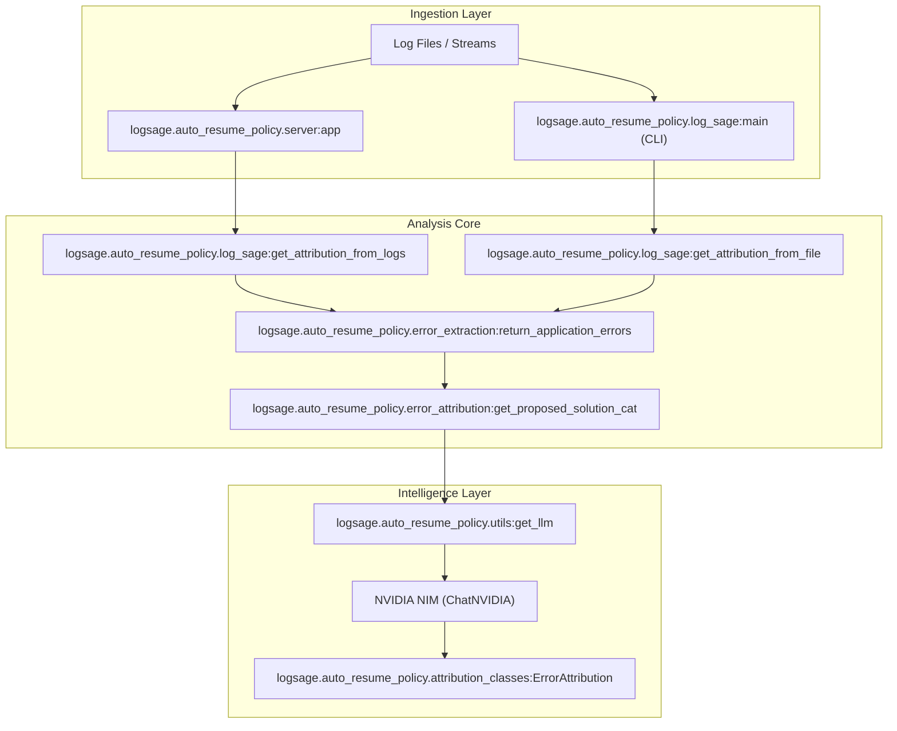
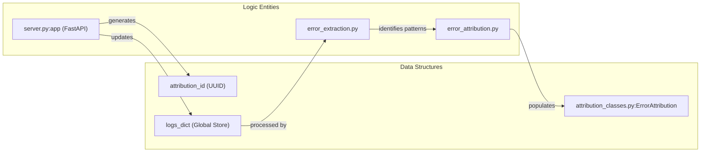

<!-- source: DeepWiki mcp.deepwiki.com · repo NVIDIA/LogSage · page 1 LogSage Overview · fetched 2026-10-26 -->

# LogSage Overview

Relevant source files

The following files were used as context for generating this wiki page:

- [.cruft.json](.cruft.json)
- [README.md](README.md)
- [logsage/__init__.py](logsage/__init__.py)
- [logsage/auto_resume_policy/README.md](logsage/auto_resume_policy/README.md)

LogSage is an LLM-powered toolkit designed to analyze AI training job logs, attribute root causes for failures, and recommend auto-resume policies to minimize wasted GPU time [README.md:1-7](). By leveraging classical log parsing alongside NVIDIA NIM (NVIDIA Inference Microservices), LogSage automates the triage of complex failures in large-scale GPU clusters [logsage/auto_resume_policy/README.md:3-7]().

## Purpose and Scope

Training jobs in high-performance computing environments often fail due to a variety of factors, including hardware malfunctions, networking issues, configuration errors, or data corruption. Manual analysis of these logs is time-consuming and costly [README.md:23-24]().

LogSage provides a structured pipeline to:
*   **Extract and De-duplicate**: Identify critical error patterns and stack traces from SLURM or application logs while removing noise [README.md:27]().
*   **Attribute Root Causes**: Categorize failures into domains such as Hardware, Software, Configuration, or Communication [README.md:5]().
*   **Recommend Actions**: Suggest whether to `RESTART` the job, `STOP` for manual intervention, or perform `TEMPORAL-ISOLATION` of suspected faulty nodes [logsage/auto_resume_policy/README.md:68]().
*   **Improve Availability**: Reduce GPU downtime by providing automated, high-confidence recovery hints [README.md:30]().

For a step-by-step guide on setting up the environment and running your first analysis, see [Getting Started](#1.1).

## Key Capabilities

LogSage exposes its functionality through both a FastAPI web server and a Command-Line Interface (CLI) [README.md:71-84]().

| Capability | Description | Code Entities |
| :--- | :--- | :--- |
| **Error Extraction** | Parses logs to find unique error signatures using clustering. | `return_application_errors()` |
| **LLM Attribution** | Uses NVIDIA NIM to classify errors with natural language reasoning. | `get_proposed_solution_cat()` |
| **Policy Engine** | Decides on the recovery strategy based on attribution confidence. | `get_proposed_solution_policies()` |
| **Node Isolation** | Identifies specific nodes or ranks that should be cordoned. | `get_cordon_nodes()` |
| **Session Management** | Manages log ingestion via unique Attribution IDs. | `generate_attribution_id()` |

The behavior of these capabilities is governed by environment variables and constants. For a full list of settings, see [Configuration Reference](#1.2).

## High-Level Architecture

LogSage bridges the gap between raw log data (Code Entity Space) and actionable intelligence (Natural Language Space). The system processes logs through a series of transformations, often caching LLM results to improve performance.

### Log Processing Flow
The following diagram illustrates how log data moves from ingestion to the final recommendation.

**Title: LogSage Data Transformation Pipeline**

Sources: [logsage/auto_resume_policy/README.md:17-23](), [logsage/auto_resume_policy/README.md:74-111](), [README.md:71-76]()

### Component Interaction
LogSage maintains internal state for log accumulation and utilizes specialized Pydantic models for data validation.

**Title: System Component Associations**

Sources: [logsage/auto_resume_policy/README.md:114-145](), [logsage/auto_resume_policy/README.md:200-211]()

## Major Components

### Auto-Resume Policy Engine
The core logic resides in `logsage/auto_resume_policy/`. It handles the lifecycle of an analysis request, from the initial `POST /errors/attribution_id` to the final policy recommendation [logsage/auto_resume_policy/README.md:65-69](). It utilizes `logs_lock` to ensure thread-safety during concurrent log ingestion [logsage/auto_resume_policy/README.md:188]().

### LLM Integration
LogSage integrates with NVIDIA AI Endpoints using `ChatNVIDIA`. The system is designed with robustness in mind, featuring fallback model logic and automated retries in `get_llm()` [logsage/auto_resume_policy/README.md:56-68](). To optimize costs and latency, it employs an `LRUCache` (stored in `cache_dict`) to avoid redundant LLM calls for identical error patterns [logsage/auto_resume_policy/README.md:184]().

### Security and Sanitization
To ensure the output is safe for web-based dashboards, LogSage includes XSS filtering for LLM-generated text [logsage/auto_resume_policy/README.md:49](). It also implements path safety checks to prevent unauthorized file access during log reading [logsage/auto_resume_policy/README.md:194]().

## Child Pages
*   [Getting Started](#1.1): Installation and basic usage.
*   [Configuration Reference](#1.2): Detailed environment variable documentation.

Sources: [README.md:1-124](), [logsage/auto_resume_policy/README.md:1-211](), [logsage/__init__.py:1-7]()

---

