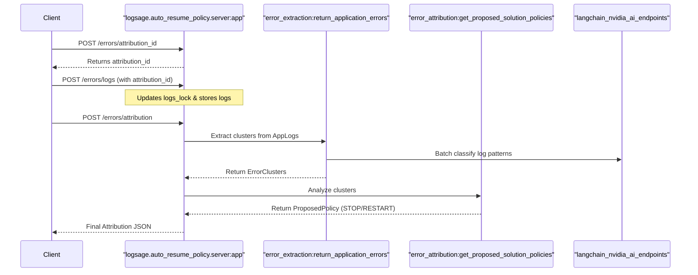
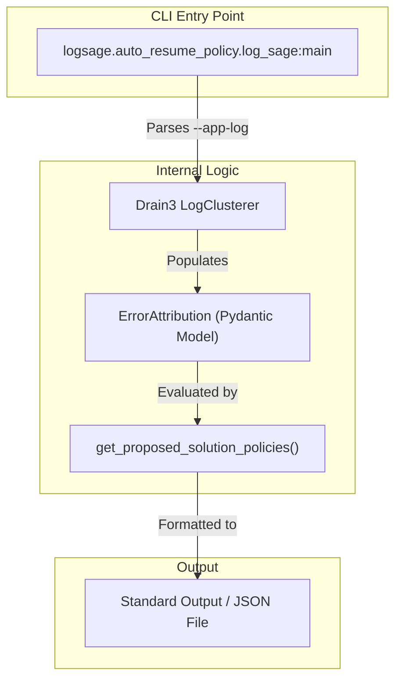

<!-- source: DeepWiki mcp.deepwiki.com · repo NVIDIA/LogSage · page 1.1 Getting Started · fetched 2026-10-26 -->

# Getting Started

<details>
<summary>Relevant source files</summary>

The following files were used as context for generating this wiki page:

- [.python-version](.python-version)
- [Makefile](Makefile)
- [README.md](README.md)
- [pyproject.toml](pyproject.toml)
- [requirements.txt](requirements.txt)

</details>


This page provides a comprehensive guide for setting up LogSage, an LLM-powered toolkit designed to analyze AI training job logs, attribute root causes, and recommend auto-resume policies. It covers prerequisites, installation methods, environment configuration, and basic usage of the API and CLI components.

## Prerequisites

Before installing LogSage, ensure your environment meets the following requirements:

*   **Python**: Version 3.11 or higher is required [pyproject.toml:33](), [.python-version:1]().
*   **Poetry**: Recommended for dependency management and virtual environment handling [README.md:36]().
*   **NVIDIA API Key**: Required for production environments to interact with NVIDIA AI Endpoints (LLM) [README.md:89]().
*   **JFROG Token**: Required if you need to pull internal NVIDIA packages from private PyPI repositories [Makefile:166-167]().

## Installation

LogSage can be installed using Poetry (for development) or pip (for usage as a library).

### Using Poetry (Development)
The `Makefile` provides a streamlined installation process that updates `pyproject.toml` with your local Python version and installs all development dependencies.

```bash
make install
```
*Implementation Detail:* The `make install` target executes `setup-pyproject` to sync Python versions [Makefile:73](), configures Poetry to create virtual environments within the project directory [Makefile:75-76](), and installs all extras including development tools [Makefile:79]().

### Using pip
To install LogSage as a package from the NVIDIA shared PyPI:

```bash
python3 -m venv myenv
source myenv/bin/activate
pip install -U logsage --index-url=https://urm.nvidia.com/artifactory/api/pypi/nv-shared-pypi-local/simple --extra-index-url https://pypi.org/simple
```
[README.md:45-50]()

## Environment Variables

Configuration is managed via Pydantic settings in `logsage/auto_resume_policy/config.py` [README.md:88]().

| Variable | Description | Default |
| :--- | :--- | :--- |
| `NVIDIA_API_KEY` | API key for NVIDIA AI Endpoints (Required for LLM) | None |
| `DEBUG` | Enable debug logging and features | `true` (local) |
| `FAST_API_ROOT_PATH` | Root path for FastAPI when behind a proxy | `""` |
| `LOGSAGE_VERBOSE` | Enables detailed logging for the CLI | `false` |

**Sources:** [README.md:88-91](), [logsage/auto_resume_policy/config.py]()

## Running the API Server

The LogSage API is built with FastAPI and provides endpoints for log ingestion and error attribution.

### Local Execution
You can start the server using the provided wrapper module or directly via `uvicorn`:

```bash
# Method 1: Using the wrapper
python -m logsage.auto_resume_policy.run_server

# Method 2: Direct uvicorn execution
uvicorn logsage.auto_resume_policy.server:app --host 0.0.0.0 --port 8000 --reload
```
[README.md:52-57]()

### Data Flow: API Attribution Lifecycle
The following diagram illustrates how the system processes a request from log ingestion to policy recommendation.

**LogSage API Request Pipeline**

**Sources:** [README.md:71-84](), [logsage/auto_resume_policy/server.py](), [pyproject.toml:35]()

## Command-Line Interface (CLI)

LogSage provides CLI utilities to analyze local log files without requiring a running server.

### Basic Usage
The CLI allows users to pass application and system logs for immediate analysis.

```bash
# Analyze a local log file
python -m logsage.auto_resume_policy.log_sage --app-log training.log --full-analysis
```

### CLI Components and Code Mapping
The CLI bridges the gap between raw text files and the internal Pydantic models used for attribution.

**CLI Entity Mapping**

**Sources:** [README.md:65-70](), [pyproject.toml:45](), [logsage/auto_resume_policy/log_sage.py]()

## Verification and Testing

After installation, verify the setup by running the test suite:

```bash
# Run all tests
make test

# Run tests with coverage report
make test-coverage
```
[Makefile:121-136](), [README.md:95-100]()

The test suite uses `pytest` and is configured in `pyproject.toml` to target the `tests/` directory and generate coverage reports [pyproject.toml:201-212]().

**Sources:**
* [README.md:32-62]() - Quickstart and setup instructions.
* [Makefile:72-82]() - Installation logic.
* [pyproject.toml:32-57]() - Dependencies and tool configuration.
* [README.md:71-84]() - API endpoint definitions.

---

