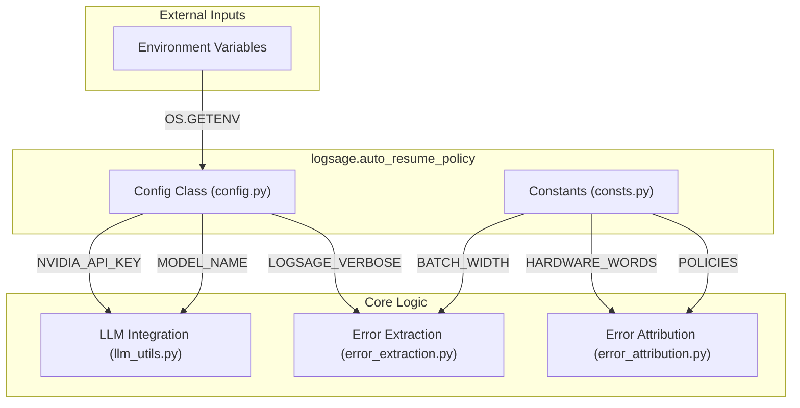
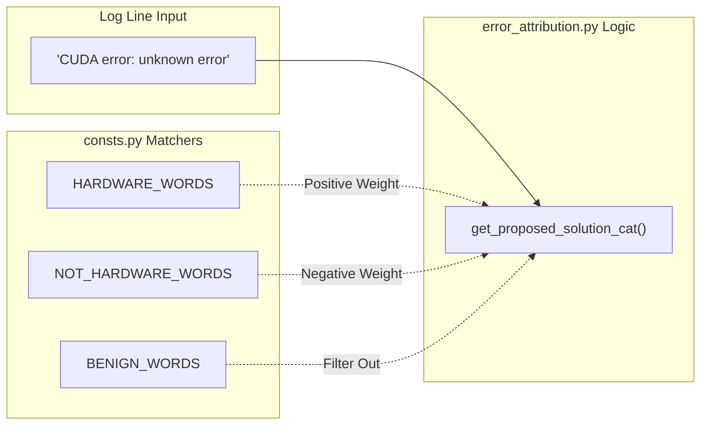

<!-- source: DeepWiki mcp.deepwiki.com · repo NVIDIA/LogSage · page 1.2 Configuration Reference · fetched 2026-10-26 -->

# Configuration Reference

Relevant source files

The following files were used as context for generating this wiki page:

- [logsage/auto_resume_policy/config.py](logsage/auto_resume_policy/config.py)
- [logsage/auto_resume_policy/consts.py](logsage/auto_resume_policy/consts.py)

This page provides a technical reference for the configuration management system in LogSage. Configuration is handled primarily through environment variables and static constants, which control LLM behavior, log processing thresholds, and error attribution logic.

## Configuration Architecture

The configuration system is split into two components:
1.  **Dynamic Configuration (`Config` class):** Consumes environment variables for runtime environment setup (API keys, model selection).
2.  **Static Constants (`consts.py`):** Defines architectural limits, domain-specific hardware keywords, and confidence thresholds for the attribution engine.

### Data Flow Diagram
The following diagram illustrates how configuration data flows from the environment and static files into the core logic of LogSage.

**Configuration Data Flow**

Sources: [logsage/auto_resume_policy/config.py:20-28](), [logsage/auto_resume_policy/consts.py:16-98]()

---

## Runtime Configuration (Config Class)

The `Config` class in `logsage/auto_resume_policy/config.py` manages settings that typically change between deployment environments (e.g., Development vs. Production).

### Environment Variables

| Variable | Type | Default | Description |
| :--- | :--- | :--- | :--- |
| `NVIDIA_API_KEY` | `str` | `""` | API key for authenticating with NVIDIA NIM endpoints [logsage/auto_resume_policy/config.py:24](). |
| `MODEL_NAME` | `str` | `""` | The specific LLM model name to invoke (e.g., `meta/llama-3.1-70b-instruct`) [logsage/auto_resume_policy/config.py:25](). |
| `MODEL_FUNCTION_ID` | `str` | `""` | Function ID for the specific NIM deployment [logsage/auto_resume_policy/config.py:26](). |
| `LOGSAGE_ATTRIBUTION` | `bool` | `true` | Enables or disables the error attribution logic [logsage/auto_resume_policy/config.py:21](). |
| `LOGSAGE_VERBOSE` | `bool` | `true` | Enables verbose logging output during processing [logsage/auto_resume_policy/config.py:22](). |
| `LOGSAGE_ISOLATION` | `bool` | `true` | Enables node isolation (cordoning) recommendations [logsage/auto_resume_policy/config.py:23](). |
| `PERSONAL_ENDPOINT` | `bool` | `true` | Flag to indicate if a personal/custom endpoint is being used [logsage/auto_resume_policy/config.py:27](). |

### Validation Logic
The `Config.validate()` method is called during initialization to ensure that mandatory LLM parameters are present. It raises a `ValueError` if `NVIDIA_API_KEY`, `MODEL_NAME`, or `MODEL_FUNCTION_ID` are missing [logsage/auto_resume_policy/config.py:29-38]().

Sources: [logsage/auto_resume_policy/config.py:19-38]()

---

## System Constants (consts.py)

Constants define the "guardrails" of the system, including token limits and the heuristics used to identify hardware failures.

### Processing & LLM Limits
These values control the scale of log ingestion and LLM concurrency.

| Constant | Value | Description |
| :--- | :--- | :--- |
| `BATCH_WIDTH` | `1000` | Number of tokens per batch for log segmenting [logsage/auto_resume_policy/consts.py:16](). |
| `CONTEXT_SIZE` | `100,000` | Maximum token context length for the LLM analysis window [logsage/auto_resume_policy/consts.py:17](). |
| `BATCH_LLM_CALLS` | `50` | Maximum number of concurrent LLM calls allowed [logsage/auto_resume_policy/consts.py:18](). |
| `NUMBER_LAST_LINES` | `1,000,000` | Max lines to read from the end of the log file (-1 for all) [logsage/auto_resume_policy/consts.py:19](). |

### Hardware & Isolation Logic
These constants define how LogSage interprets cluster architecture and failure thresholds.

| Constant | Value | Description |
| :--- | :--- | :--- |
| `DOMAIN_SIZE` | `8` | GPUs per domain (e.g., 8 for Hopper, 4 for Blackwell) [logsage/auto_resume_policy/consts.py:21](). |
| `ISOLATION_COUNT` | `2` | Max number of nodes to recommend for isolation per failure [logsage/auto_resume_policy/consts.py:22](). |
| `HARDWARE_THR_CATEGORY` | `40` | Confidence threshold (0-100) to categorize an error as Hardware [logsage/auto_resume_policy/consts.py:95](). |
| `HARDWARE_THR_LINE` | `60` | Confidence threshold for specific log line hardware attribution [logsage/auto_resume_policy/consts.py:96](). |

Sources: [logsage/auto_resume_policy/consts.py:16-22](), [logsage/auto_resume_policy/consts.py:95-96]()

---

## Heuristic Word Lists

LogSage uses several pre-defined lists of keywords in `consts.py` to perform initial log filtering and assist the LLM in classification.

### Keyword Categories
1.  **`ERROR_WORDS`**: High-level indicators of failures (e.g., `segmentation fault`, `cuda failure`) [logsage/auto_resume_policy/consts.py:26-38]().
2.  **`HARDWARE_WORDS`**: Specific strings indicating physical component failure (e.g., `uncorrectable ECC error`, `GPU is lost`) [logsage/auto_resume_policy/consts.py:42-53]().
3.  **`NOT_HARDWARE_WORDS`**: Strings that look like hardware errors but are usually software/timeout issues (e.g., `NCCL work timeout`) [logsage/auto_resume_policy/consts.py:55-63]().
4.  **`BENIGN_WORDS`**: Common log noise that should be ignored during error extraction (e.g., `NCCL INFO`, `srun: Job step aborted`) [logsage/auto_resume_policy/consts.py:65-86]().

**Heuristic Matching Process**

Sources: [logsage/auto_resume_policy/consts.py:42-86](), [logsage/auto_resume_policy/error_attribution.py:100-150]() (implied logic).

---

## Security & Filtering

LogSage includes a toggle for Cross-Site Scripting (XSS) protection on LLM outputs.
*   **`XSS_FILTERING`**: Set to `True` by default in `consts.py`. This ensures that any HTML-like tags generated by the LLM are escaped before being returned via the API or CLI [logsage/auto_resume_policy/consts.py:24]().

Sources: [logsage/auto_resume_policy/consts.py:24]()

---

