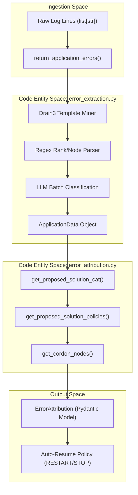
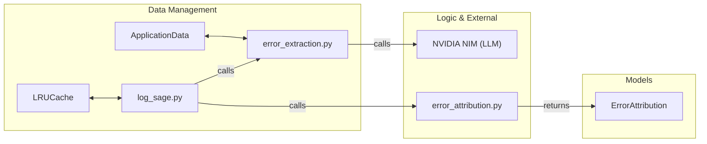

<!-- source: DeepWiki mcp.deepwiki.com · repo NVIDIA/LogSage · page 2 Core Architecture · fetched 2026-10-26 -->

# Core Architecture

Relevant source files

The following files were used as context for generating this wiki page:

- [logsage/auto_resume_policy/attribution_classes.py](logsage/auto_resume_policy/attribution_classes.py)
- [logsage/auto_resume_policy/log_sage.py](logsage/auto_resume_policy/log_sage.py)
- [logsage/auto_resume_policy/main.py](logsage/auto_resume_policy/main.py)

The LogSage **Auto-Resume-Policy** pipeline is a multi-stage system designed to automate the diagnosis of GPU cluster job failures. It transforms raw, unstructured log data into actionable remediation policies (e.g., `RESTART`, `STOP`, or `TEMPORAL-ISOLATION`) by combining traditional log parsing techniques with Large Language Model (LLM) classification.

### Pipeline Overview

The pipeline operates in three primary phases:
1.  **Ingestion & Extraction**: Raw log lines are processed to identify error signatures, rank/node information, and training progress (iterations/checkpoints).
2.  **Analysis & Attribution**: Extracted errors are categorized (Hardware vs. Software, Network vs. Compute) using LLM-based reasoning and regex heuristics.
3.  **Policy Recommendation**: Based on the attribution and confidence scores, the system suggests a resume strategy and identifies nodes that may require cordoning.

### High-Level Data Flow

The following diagram illustrates how log data transitions from the raw input stage through the internal processing logic to the final policy output.

**LogSage Pipeline Architecture**

**Sources:** [logsage/auto_resume_policy/log_sage.py:185-204](), [logsage/auto_resume_policy/error_extraction.py:532-540](), [logsage/auto_resume_policy/error_attribution.py:311-325]()

---

### 1. Error Extraction Pipeline
The entry point for log analysis is `return_application_errors()`. This stage is responsible for reducing the volume of log data by clustering similar lines using the **Drain3** algorithm and identifying unique error patterns. It also extracts critical metadata such as MPI ranks and node identifiers to track where failures occurred.

Key responsibilities:
*   **Log Clustering**: Collapsing thousands of repetitive log lines into unique templates.
*   **Iteration Detection**: Determining if the job was making progress before the crash.
*   **Checkpoint Detection**: Identifying if a valid state was saved prior to failure.

For details, see [Error Extraction Pipeline](#2.1).

**Sources:** [logsage/auto_resume_policy/error_extraction.py:532-650](), [logsage/auto_resume_policy/attribution_classes.py:47-81]()

---

### 2. Error Attribution and Policy Recommendation
Once errors are extracted, they are passed to the attribution engine. The system uses a combination of `get_proposed_solution_cat()` and `get_proposed_solution_policies()` to determine the root cause.

The engine classifies errors into categories such as:
*   **Hardware**: Correctable/Uncorrectable ECC errors, NVLink failures.
*   **Software**: Segmentation faults, Python exceptions, configuration errors.
*   **Network**: Timeout errors, InfiniBand (IB) failures.

If an error is attributed to a specific node with high confidence, the system may recommend a `TEMPORAL-ISOLATION` or `STOP` policy and list the offending nodes in the `cordon_nodes` field.

For details, see [Error Attribution and Policy Recommendation](#2.2).

**Sources:** [logsage/auto_resume_policy/error_attribution.py:311-450](), [logsage/auto_resume_policy/error_attribution.py:557-610]()

---

### 3. LLM Integration and Prompts
LogSage leverages NVIDIA NIM (via `langchain-nvidia-ai-endpoints`) to perform nuanced classification of log templates that regex cannot handle. The `get_llm()` function initializes the connection, while `retry_operation()` ensures resilience against API rate limits or transient network issues.

The system uses specialized prompts defined in `prompts.py` to:
1.  Distinguish between hardware and software errors.
2.  Summarize complex tracebacks.
3.  Assign confidence scores to different failure categories.

For details, see [LLM Integration and Prompts](#2.3).

**Sources:** [logsage/auto_resume_policy/log_sage.py:59-98](), [logsage/auto_resume_policy/utils.py:155-185]()

---

### 4. Data Models and Caching
LogSage uses Pydantic models to ensure type safety across the pipeline. The `ApplicationData` class serves as the primary container for extracted features, while `ErrorAttribution` defines the final schema returned to the user or API client.

To optimize performance and reduce API costs, an `LRUCache` is utilized to store LLM classification results for frequently occurring log templates.

**System Component Interaction**

For details, see [Data Models and Caching](#2.4).

**Sources:** [logsage/auto_resume_policy/attribution_classes.py:22-45](), [logsage/auto_resume_policy/attribution_classes.py:83-89]()

---

