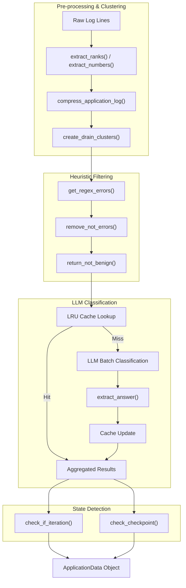
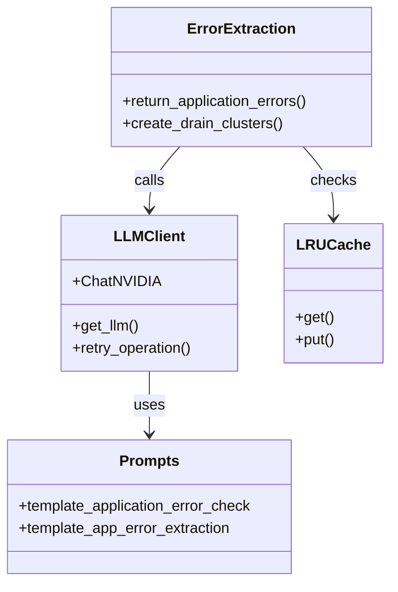

<!-- source: DeepWiki mcp.deepwiki.com · repo NVIDIA/LogSage · page 2.1 Error Extraction Pipeline · fetched 2026-10-26 -->

# Error Extraction Pipeline

Relevant source files

The following files were used as context for generating this wiki page:

- [logsage/auto_resume_policy/consts.py](logsage/auto_resume_policy/consts.py)
- [logsage/auto_resume_policy/error_extraction.py](logsage/auto_resume_policy/error_extraction.py)
- [logsage/auto_resume_policy/utils.py](logsage/auto_resume_policy/utils.py)

The Error Extraction Pipeline is a core component of LogSage responsible for transforming raw, unstructured application logs into structured error data. It utilizes a multi-stage process involving log pre-processing, template mining (clustering), heuristic filtering, and Large Language Model (LLM) classification to identify significant application-level failures while filtering out noise.

The primary entry point for this pipeline is the `return_application_errors()` function in `logsage/auto_resume_policy/error_extraction.py` [[logsage/auto_resume_policy/error_extraction.py:539-541]]().

## Pipeline Architecture and Data Flow

The pipeline follows a sequential flow from raw log ingestion to structured error attribution.

### Logical Flow Diagram

"LogSage Error Extraction Pipeline"

**Sources:** [[logsage/auto_resume_policy/error_extraction.py:539-740]](), [[logsage/auto_resume_policy/utils.py:441-470]]()

## Log Pre-processing and Rank Parsing

Before clustering, LogSage normalizes log lines to improve template matching accuracy.

1.  **Rank and Node Extraction**: The functions `extract_ranks()` and `extract_numbers()` use regex to identify MPI ranks (e.g., `[rank0]:`) and map them to physical nodes based on the `DOMAIN_SIZE` constant [[logsage/auto_resume_policy/error_extraction.py:70-113]]().
2.  **Compression**: `compress_application_log()` removes repetitive lines and applies transformations like `convert_paths_to_token()`, `convert_hex_to_special_token()`, and `replace_quoted_text_with_token()` to reduce the search space for the clustering engine [[logsage/auto_resume_policy/utils.py:441-470]]().
3.  **Tokenization**: Punctuation is padded with spaces via `add_spaces_around_punctuation()` to ensure the clustering algorithm treats them as distinct tokens [[logsage/auto_resume_policy/utils.py:177-191]]().

**Sources:** [[logsage/auto_resume_policy/error_extraction.py:70-131]](), [[logsage/auto_resume_policy/utils.py:121-220]](), [[logsage/auto_resume_policy/consts.py:21]]()

## Log Clustering with Drain3

LogSage uses the **Drain3** algorithm to group similar log lines into templates. This significantly reduces the number of LLM calls required by processing one representative line per cluster.

| Parameter | Value | Description |
| :--- | :--- | :--- |
| `drain_sim_th` | 0.4 | Similarity threshold for clustering [[logsage/auto_resume_policy/error_extraction.py:184]]() |
| `depth` | 4 | Depth of the fixed-depth tree [[logsage/auto_resume_policy/error_extraction.py:185]]() |
| `max_clusters` | 100 | Upper limit of clusters to process [[logsage/auto_resume_policy/error_extraction.py:186]]() |

The `create_drain_clusters()` function initializes a `TemplateMiner` and iterates through the pre-processed logs to generate `cluster_id`s and `template_mined` strings [[logsage/auto_resume_policy/error_extraction.py:163-234]]().

**Sources:** [[logsage/auto_resume_policy/error_extraction.py:20-21]](), [[logsage/auto_resume_policy/error_extraction.py:163-234]]()

## Heuristic and Regex Filtering

To minimize LLM token usage, LogSage applies several layers of heuristic filters defined in `consts.py`:

*   **Regex Detection**: `get_regex_errors()` scans for high-priority patterns like `ERROR_WORDS` (e.g., "runtimeerror", "cuda failure") [[logsage/auto_resume_policy/utils.py:330-353]]().
*   **Benign Filtering**: `return_not_benign()` removes lines containing known harmless strings defined in `BENIGN_WORDS` (e.g., "NCCL INFO", "srun: Job step aborted") [[logsage/auto_resume_policy/utils.py:382-402]]().
*   **Not-Error Removal**: `remove_not_errors()` filters out common false positives like "last enqueued NCCL work" using the `NOT_HARDWARE_WORDS` list [[logsage/auto_resume_policy/utils.py:356-379]]().

**Sources:** [[logsage/auto_resume_policy/consts.py:26-86]](), [[logsage/auto_resume_policy/utils.py:330-402]]()

## LLM Batch Classification

Representative lines from the remaining clusters are sent to an LLM for final validation.

### LLM Implementation Space

**Sources:** [[logsage/auto_resume_policy/error_extraction.py:25]](), [[logsage/auto_resume_policy/error_extraction.py:539-541]](), [[logsage/auto_resume_policy/attribution_classes.py:112-140]]()

### Caching and Batching
1.  **LRU Cache**: LogSage uses an `LRUCache` (default size 1000) to store previous LLM classification results for specific log templates, avoiding redundant API calls [[logsage/auto_resume_policy/error_extraction.py:581-583]](), [[logsage/auto_resume_policy/attribution_classes.py:112-140]]().
2.  **Batch Processing**: Log lines are batched according to `BATCH_WIDTH` and processed concurrently up to `BATCH_LLM_CALLS` [[logsage/auto_resume_policy/consts.py:16-18]]().
3.  **Prompting**: The system uses `template_application_error_check` to ask the LLM if a line represents a critical crash or error [[logsage/auto_resume_policy/error_extraction.py:41-42]]().

**Sources:** [[logsage/auto_resume_policy/error_extraction.py:581-630]](), [[logsage/auto_resume_policy/attribution_classes.py:112-140]](), [[logsage/auto_resume_policy/consts.py:16-18]]()

## Iteration and Checkpoint Detection

The pipeline also detects the operational state of the application:

*   **Iteration Detection**: `check_if_iteration()` uses `template_app_iteration` to identify if the application was actively training and at what iteration/step the failure occurred [[logsage/auto_resume_policy/utils.py:650-681]]().
*   **Checkpoint Detection**: `check_checkpoint()` uses `template_app_checkpointing` to determine if a checkpoint was successfully saved before the crash [[logsage/auto_resume_policy/utils.py:684-715]]().

**Sources:** [[logsage/auto_resume_policy/error_extraction.py:37-40]](), [[logsage/auto_resume_policy/utils.py:650-715]]()

## The `return_application_errors()` Function

This function orchestrates the entire process. It accepts raw log lines and returns an `ApplicationData` object.

**Key Steps in `return_application_errors()`:**
1.  Filters logs to the last `NUMBER_LAST_LINES` [[logsage/auto_resume_policy/error_extraction.py:553]]().
2.  Extracts ranks and identifies unique nodes [[logsage/auto_resume_policy/error_extraction.py:557-562]]().
3.  Performs Drain3 clustering and identifies error candidates via regex and LLM [[logsage/auto_resume_policy/error_extraction.py:570-630]]().
4.  Consolidates errors into a unique list and determines if the job had successfully started training [[logsage/auto_resume_policy/error_extraction.py:680-720]]().
5.  Returns a populated `ApplicationData` object containing `errors`, `nodes`, `iterations`, and `checkpoint_saved` status [[logsage/auto_resume_policy/error_extraction.py:732-740]]().

**Sources:** [[logsage/auto_resume_policy/error_extraction.py:539-740]](), [[logsage/auto_resume_policy/attribution_classes.py:46-56]]()

---

