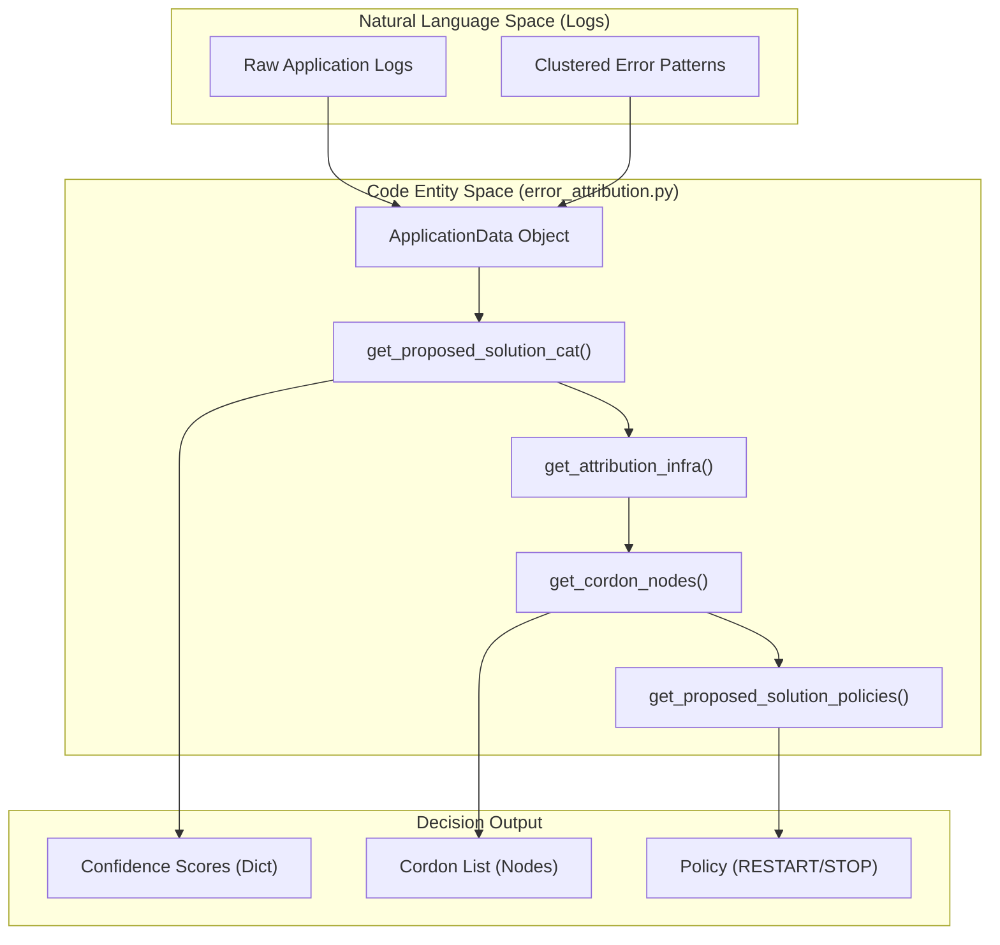
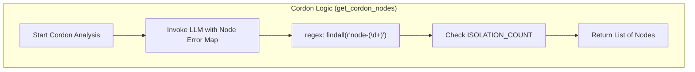

<!-- source: DeepWiki mcp.deepwiki.com · repo NVIDIA/LogSage · page 2.2 Error Attribution and Policy Recommendation · fetched 2026-10-26 -->

# Error Attribution and Policy Recommendation

Relevant source files

The following files were used as context for generating this wiki page:

- [logsage/auto_resume_policy/consts.py](logsage/auto_resume_policy/consts.py)
- [logsage/auto_resume_policy/error_attribution.py](logsage/auto_resume_policy/error_attribution.py)
- [logsage/auto_resume_policy/prompts.py](logsage/auto_resume_policy/prompts.py)

The **Error Attribution and Policy Recommendation** module is the decision-making engine of LogSage. It consumes clustered and classified error data from the extraction pipeline to determine the root cause of a job failure (e.g., hardware vs. software), identify faulty infrastructure components, and suggest an automated recovery policy (RESTART, STOP, or TEMPORAL-ISOLATION).

## Core Logic and Decision Flow

The attribution process follows a hierarchical approach:
1.  **Categorization**: Assigning confidence scores to various error types (Hardware, Numerical Instability, etc.).
2.  **Infrastructure Analysis**: Specifically identifying if the failure stems from Compute or Networking.
3.  **Cordoning**: Identifying specific nodes that should be isolated.
4.  **Policy Generation**: Recommending a resume strategy based on the categorized risk.

### Data Flow: From Extraction to Attribution

The following diagram illustrates how raw log data is transformed into structured attribution via `error_attribution.py`.

**Attribution System Architecture**

**Sources:** [logsage/auto_resume_policy/error_attribution.py:157-163](), [logsage/auto_resume_policy/attribution_classes.py:53-70]()

---

## Hardware vs. Software Categorization

The function `get_proposed_solution_cat()` is the primary entry point for high-level classification. It uses the `template_hardware_category_prompt` to instruct the LLM to distribute 100 confidence points across categories like `HARDWARE`, `NUMERICAL INSTABILITY`, and `DATA LOADING`.

### Confidence Thresholds
LogSage uses predefined constants to drive logic based on LLM confidence:
*   **`HARDWARE_THR_CATEGORY`**: If the total confidence for the "HARDWARE" category exceeds this value (default: 40), the system leans toward hardware-specific recovery actions. [logsage/auto_resume_policy/consts.py:95-95]()
*   **`HARDWARE_THR_LINE`**: Used when evaluating individual log lines for hardware signatures. [logsage/auto_resume_policy/consts.py:96-96]()

### Key Categories Defined in Prompts
| Category | Code Reference (Prompt) | Description |
| :--- | :--- | :--- |
| **HARDWARE** | `template_hardware_category_prompt` | GPU loss, ECC errors, NIC failures, or socket timeouts. |
| **NUMERICAL INSTABILITY** | `template_hardware_category_prompt` | NaNs, Infs, or loss divergence. |
| **LACK OF RESOURCE** | `template_hardware_category_prompt` | Disk full or memory exhaustion (distinct from hardware failure). |
| **COMPUTE COMMUNICATION** | `template_compute_networking_prompt` | Distinguishes between GPU-to-GPU (Compute) and NIC/Switch (Networking). |

**Sources:** [logsage/auto_resume_policy/error_attribution.py:157-230](), [logsage/auto_resume_policy/prompts.py:150-180](), [logsage/auto_resume_policy/consts.py:95-96]()

---

## Infrastructure Classification: Networking vs. Compute

When a hardware issue is suspected, `get_attribution_infra()` and `get_proposed_solution_cat()` work together to narrow down the faulty subsystem.

*   **Compute Classification**: Identified when errors involve CUDA kernels, GPU initialization, or internal GPU memory errors.
*   **Networking Classification**: Identified when errors involve InfiniBand (`ibv_modify_qp`), NCCL timeouts, or RDMA protocol failures.

The system uses `template_compute_networking_prompt` to force the LLM to choose between these two domains, which informs whether the "Cordon" logic should target individual nodes or entire network groups.

**Sources:** [logsage/auto_resume_policy/error_attribution.py:125-154](), [logsage/auto_resume_policy/prompts.py:177-185]()

---

## Cordon Node Detection

The `get_cordon_nodes()` function identifies which specific nodes are likely responsible for the failure.

### Implementation Logic
1.  **Global Analysis**: If the job is large, it uses `cordon_node_global_template_num` to let the LLM see a summarized view of all failing nodes. [logsage/auto_resume_policy/error_attribution.py:270-300]()
2.  **One-on-One Analysis**: For smaller sets or ambiguous cases, `cordon_node_global_1o1_template_num` is used to compare pairs of nodes. [logsage/auto_resume_policy/error_attribution.py:305-320]()
3.  **Isolation Limits**: The number of nodes recommended for cordoning is capped by `ISOLATION_COUNT` (default: 2) to prevent over-aggressive cluster depletion. [logsage/auto_resume_policy/consts.py:22-22]()

**Cordoning Decision Flow**

**Sources:** [logsage/auto_resume_policy/error_attribution.py:252-363](), [logsage/auto_resume_policy/consts.py:22-22]()

---

## Policy Recommendation Logic

The final output of the attribution pipeline is a policy recommendation generated by `get_proposed_solution_policies()`.

### Decision Matrix
The recommendation depends on three factors:
1.  **Training Status**: Was the job already training or still in the "init" phase? (`app_data.training_started`).
2.  **Checkpoint Status**: Was a checkpoint successfully saved recently? (`app_data.checkpoint_saved`).
3.  **Hardware Confidence**: Is the `HARDWARE` category score > `HARDWARE_THR_CATEGORY`?

| Training Started | Checkpoint Saved | Hardware Detected | Policy Result | LLM Prompt Used |
| :--- | :--- | :--- | :--- | :--- |
| Yes | Yes | No | **RESTART** | `suggest_yes_checkpoint_restart` |
| Yes | No | Yes | **STOP** | `suggest_no_checkpoint_stop` |
| No | N/A | Yes | **STOP** | `suggest_no_checkpoint_stop` |
| Yes | Yes | Yes | **RESTART** (with Cordon) | `suggest_yes_checkpoint_restart` |

### Temporal Isolation
If `LOGSAGE_ISOLATION` is enabled and hardware is detected, the policy includes a "TEMPORAL-ISOLATION" instruction. This triggers the system to cordon the identified nodes before attempting the restart.

**Sources:** [logsage/auto_resume_policy/error_attribution.py:366-485](), [logsage/auto_resume_policy/prompts.py:200-250](), [logsage/auto_resume_policy/consts.py:93-93]()

---

## Key Functions Reference

### `get_proposed_solution_cat`
[logsage/auto_resume_policy/error_attribution.py:157-250]()
*   **Role**: Orchestrates the initial categorization of the failure.
*   **Inputs**: `ApplicationData` (containing error lists and training status).
*   **Outputs**: A dictionary of category scores and a summary string.

### `get_cordon_nodes`
[logsage/auto_resume_policy/error_attribution.py:252-363]()
*   **Role**: Extracts specific node hostnames from the error context that are deemed "faulty" by the LLM.
*   **Constraint**: Uses `ISOLATION_COUNT` to limit the impact on cluster capacity.

### `get_proposed_solution_policies`
[logsage/auto_resume_policy/error_attribution.py:366-485]()
*   **Role**: Maps the technical diagnosis to an actionable business policy (`RESTART` vs `STOP`).
*   **Logic**: Heavy reliance on whether the job had successfully reached a "started" state and whether it had saved progress.

**Sources:** [logsage/auto_resume_policy/error_attribution.py:1-485]()

---

