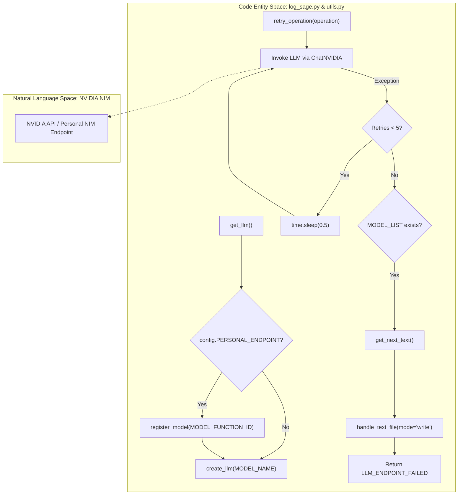
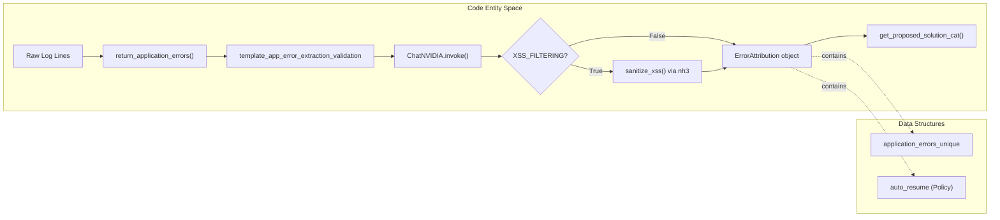

<!-- source: DeepWiki mcp.deepwiki.com · repo NVIDIA/LogSage · page 2.3 LLM Integration and Prompts · fetched 2026-10-26 -->

# LLM Integration and Prompts

Relevant source files

The following files were used as context for generating this wiki page:

- [logsage/auto_resume_policy/log_sage.py](logsage/auto_resume_policy/log_sage.py)
- [logsage/auto_resume_policy/prompts.py](logsage/auto_resume_policy/prompts.py)
- [logsage/auto_resume_policy/utils.py](logsage/auto_resume_policy/utils.py)

LogSage utilizes Large Language Models (LLMs) to perform complex log analysis tasks that traditional regex-based parsing cannot handle, such as distinguishing between benign warnings and critical errors, identifying training iterations, and recommending hardware-vs-software attribution. The system integrates with **NVIDIA NIM** (NVIDIA Inference Microservices) using the `langchain-nvidia-ai-endpoints` library.

## LLM Initialization and Lifecycle

The initialization of the LLM is managed by the `get_llm()` function. LogSage supports both standard NVIDIA API endpoints and private "Personal Endpoints" (custom NIM deployments).

### Initialization Logic (`get_llm`)
The `get_llm()` function [logsage/auto_resume_policy/log_sage.py:59-98]() performs the following steps:
1.  **Configuration Check**: It reads settings from the `Config` object, including `NVIDIA_API_KEY`, `MODEL_NAME`, and `PERSONAL_ENDPOINT` [logsage/auto_resume_policy/log_sage.py:72-81]().
2.  **Model Registration**: If `PERSONAL_ENDPOINT` is enabled, it uses `register_model` from `langchain_nvidia_ai_endpoints` to map a custom `MODEL_FUNCTION_ID` to the local model name [logsage/auto_resume_policy/log_sage.py:73-80]().
3.  **Instance Creation**: It creates a `ChatNVIDIA` instance with `temperature=0.0` to ensure deterministic output, which is critical for classification tasks [logsage/auto_resume_policy/log_sage.py:64-70]().
4.  **Model Fallback**: If a specific model name is read from a local state file but fails to initialize, the system attempts to fall back to the default `MODEL_NAME` defined in the environment [logsage/auto_resume_policy/log_sage.py:87-96]().

### Error Handling and Retries
LLM operations are wrapped in the `retry_operation()` utility [logsage/auto_resume_policy/utils.py:53-104](). This function provides:
*   **Fixed Backoff**: Retries the operation up to 5 times with a 0.5s delay [logsage/auto_resume_policy/utils.py:64-102]().
*   **Dynamic Model Switching**: If a `MODEL_LIST` is provided in the environment, the system will circularly iterate through available models upon exhaustion of retries for a single model, updating a local state file via `handle_text_file()` to track the currently active model [logsage/auto_resume_policy/utils.py:82-98]().

### LLM Connectivity and Fallback Flow
The following diagram illustrates how `get_llm` and `retry_operation` interact with the `ChatNVIDIA` client and the environment configuration.

**LLM Initialization and Retry Flow**

Sources: [logsage/auto_resume_policy/log_sage.py:59-98](), [logsage/auto_resume_policy/utils.py:53-104]()

## Prompt Library (`prompts.py`)

LogSage uses a structured library of prompt templates to guide the LLM's reasoning. These templates are designed for high precision, often requiring "yes/no" or numeric confidence scores to facilitate programmatic parsing of the results.

| Template Name | Purpose | Expected Output |
| :--- | :--- | :--- |
| `template_app_error_extraction_validation` | Filters raw log lines to identify actual errors vs. benign warnings. | "yes" or "no" |
| `template_app_iteration` | Identifies training steps, epochs, or validation progress. | "yes" or "no" |
| `template_app_checkpointing` | Detects successful checkpoint saves. | "yes" or "no" |
| `template_app_error_cat` | Assigns a 0-100 confidence score for Hardware failure. | Integer (0-100) |
| `template_hardware_category_prompt` | Categorizes errors into Hardware, Numerical Instability, Misconfiguration, etc. | Confidence distribution |
| `template_proposed_solution_policies` | Recommends actions: RESTART, STOP, or TEMPORAL-ISOLATION. | Action string |

### Logic Constraints in Prompts
The prompts include explicit exclusion rules to reduce false positives. For example, `template_app_error_extraction_validation` explicitly instructs the LLM to return "no" for `mpi/pmix` related errors or `srun` task exits, while returning "yes" for `NCCL`, `OFI`, or `Infiniband` issues [logsage/auto_resume_policy/prompts.py:31-67]().

Sources: [logsage/auto_resume_policy/prompts.py:16-179]()

## Data Flow and Output Sanitization

When logs are processed, the LLM outputs are integrated back into the LogSage data models. Because LLM outputs are potentially untrusted or may contain characters that break downstream UI rendering, LogSage applies XSS (Cross-Site Scripting) sanitization.

### Integration Flow
1.  **Extraction**: `return_application_errors()` calls the LLM using `template_app_error_extraction_validation` to find unique errors [logsage/auto_resume_policy/log_sage.py:185]().
2.  **Sanitization**: If `XSS_FILTERING` is enabled in `consts.py`, the `sanitize_xss()` function (using the `nh3` library) is applied to all unique error strings before they are stored in the `ErrorAttribution` object [logsage/auto_resume_policy/log_sage.py:188-191]().
3.  **Attribution**: The unique errors are then passed to `get_proposed_solution_cat()`, which uses `template_hardware_category_prompt` to determine the root cause [logsage/auto_resume_policy/log_sage.py:203-210]().

**LLM Data Integration and Sanitization**

Sources: [logsage/auto_resume_policy/log_sage.py:185-210](), [logsage/auto_resume_policy/utils.py:372-383](), [logsage/auto_resume_policy/consts.py:34]()

## Key Functions Reference

### `get_llm()`
*   **Location**: [logsage/auto_resume_policy/log_sage.py:59]()
*   **Role**: Factory function for the `ChatNVIDIA` instance. Handles endpoint registration for custom NIMs and ensures deterministic settings (`temperature=0.0`).

### `retry_operation(operation, max_retries=5)`
*   **Location**: [logsage/auto_resume_policy/utils.py:53]()
*   **Role**: Robustness wrapper for LLM calls. Implements retry logic and model-switching if the primary endpoint fails.

### `sanitize_xss(text)`
*   **Location**: [logsage/auto_resume_policy/utils.py:372]()
*   **Role**: Uses the `nh3` library to strip potentially malicious HTML/JS from LLM-generated strings or log content before returning it to the user or API.

Sources: [logsage/auto_resume_policy/log_sage.py:59-98](), [logsage/auto_resume_policy/utils.py:53-104](), [logsage/auto_resume_policy/utils.py:372-383]()

---

