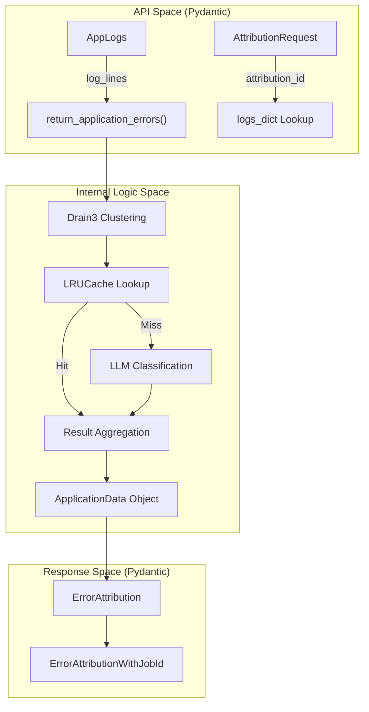
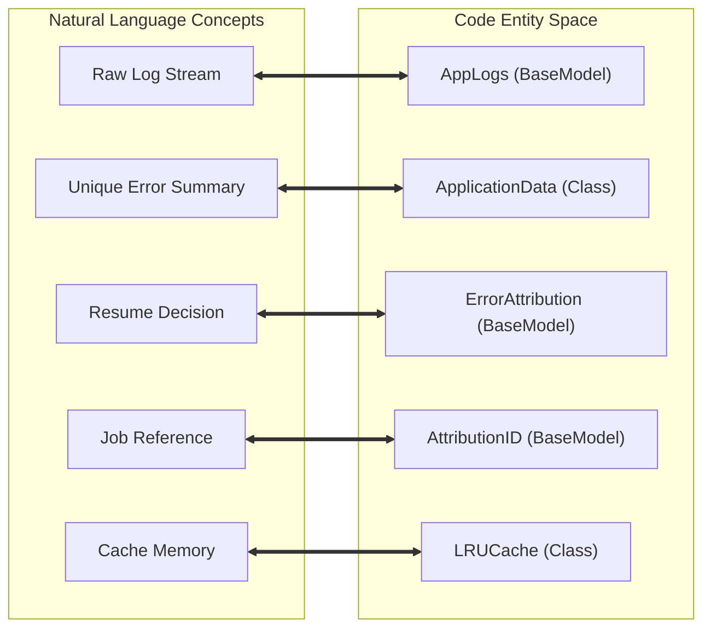

<!-- source: DeepWiki mcp.deepwiki.com · repo NVIDIA/LogSage · page 2.4 Data Models and Caching · fetched 2026-10-26 -->

# Data Models and Caching

Relevant source files

The following files were used as context for generating this wiki page:

- [logsage/auto_resume_policy/attribution_classes.py](logsage/auto_resume_policy/attribution_classes.py)
- [logsage/auto_resume_policy/log_sage.py](logsage/auto_resume_policy/log_sage.py)

This section provides a technical reference for the data structures and caching mechanisms used throughout LogSage. The system relies on Pydantic models for type-safe data exchange across its API and internal pipelines, and implements a custom Least Recently Used (LRU) cache to optimize interactions with LLM endpoints.

## Pydantic Data Models

LogSage uses Pydantic `BaseModel` classes to define the schema for request payloads, internal data processing, and API responses. These models ensure validation and provide a consistent interface for the error extraction and attribution logic.

### Attribution and Job Models

These models carry the results of the log analysis, including identified errors and recommended resume policies.

| Class Name | Description | Key Attributes |
| :--- | :--- | :--- |
| `ErrorAttribution` | Standard response container for log analysis results. | `application_errors_full`, `application_errors_unique`, `auto_resume`, `attribution` |
| `ErrorAttributionWithJobId` | Extension of `ErrorAttribution` that includes a specific Job ID. | Inherits from `ErrorAttribution` + `job_id` |
| `AttributionID` | A simple wrapper for passing unique analysis identifiers. | `attribution_id` |
| `AttributionRequest` | Model used for requesting an existing attribution result via ID. | `attribution_id` |

Sources: [logsage/auto_resume_policy/attribution_classes.py:83-121]()

### Log Management Models

These models facilitate the ingestion and streaming of log data through the FastAPI service.

| Class Name | Description | Key Attributes |
| :--- | :--- | :--- |
| `AppLogs` | Container for a list of raw log lines. | `lines` (list of strings) |
| `AppLogsLen` | Used to report the size/length of the log buffer. | `lines_len` |
| `LogsRequest` | Request schema for retrieving logs associated with an ID. | `attribution_id`, `log_stream` |
| `JobLogsResult` | Metadata container for logs associated with a specific cluster. | `job_id`, `cluster_name`, `log_lines` |

Sources: [logsage/auto_resume_policy/attribution_classes.py:100-129]()

## Internal Data Containers

Beyond Pydantic models, LogSage utilizes standard Python classes for complex internal state management during the extraction pipeline.

### ApplicationData
The `ApplicationData` class is the primary container used by `return_application_errors()` in `error_extraction.py`. It aggregates raw errors, unique clusters, iteration patterns, and training status.

*   **Role**: Acts as the "source of truth" for a single log analysis session.
*   **Key Fields**:
    *   `application_errors_list_unique`: Deduplicated errors after Drain3 clustering.
    *   `tm_text_unique`: Unique text messages extracted from the logs.
    *   `iteration_patterns`: Detected training progress markers.
    *   `checkpoint_saved`: Boolean indicating if a model checkpoint was detected.

Sources: [logsage/auto_resume_policy/attribution_classes.py:47-81]()

## Caching Implementation

To minimize latency and reduce costs associated with LLM API calls, LogSage implements an `LRUCache`. This cache is used to store the results of log line classifications.

### LRUCache Class
The `LRUCache` uses an `OrderedDict` to maintain the order of element access, ensuring that the least recently used items are evicted when the capacity is reached.

*   **`get(key)`**: Retrieves a value and moves the key to the end (most recent). Returns `-1` on a miss. [logsage/auto_resume_policy/attribution_classes.py:27-31]()
*   **`put(key, value)`**: Inserts or updates a value, moving it to the end. If the length exceeds `self.capacity`, it pops the first item (least recent). [logsage/auto_resume_policy/attribution_classes.py:33-37]()

### Global Cache Instances
In `log_sage.py`, several global structures manage the lifecycle of analysis data:

1.  **`cache_dict`**: An `LRUCache` instance with a capacity of 1,000,000 entries, primarily used for log line classification. [logsage/auto_resume_policy/log_sage.py:49]()
2.  **`logs_dict`**: A dictionary mapping `attribution_id` to a nested dict containing `logs` (list) and `timestamp` (float). [logsage/auto_resume_policy/log_sage.py:52]()
3.  **`attributionid_jobid_dict`**: Maps unique attribution IDs to external Job IDs. [logsage/auto_resume_policy/log_sage.py:53]()

Sources: [logsage/auto_resume_policy/log_sage.py:40-55]()

## Data Flow and Entity Mapping

The following diagrams illustrate how Natural Language concepts (Logs, Errors, Jobs) map to specific Code Entities and how data flows through the caching layer.

### Log Attribution Data Flow
This diagram shows the relationship between API request models and the internal `ApplicationData` container.

Sources: [logsage/auto_resume_policy/log_sage.py:185-204](), [logsage/auto_resume_policy/attribution_classes.py:47-98]()

### Entity Mapping: Natural Language to Code
This diagram maps conceptual system requirements to the specific classes defined in `attribution_classes.py`.

Sources: [logsage/auto_resume_policy/attribution_classes.py:22-125]()

## Mocking for Testing

The `FakeListLLM` class is a specialized data container used during unit testing to simulate LLM behavior without making network calls. It implements the `Runnable` interface from `langchain_core`.

*   **`batch(inputs)`**: Returns a pre-configured response from `_batch_responses` and increments the internal stage counter. [logsage/auto_resume_policy/attribution_classes.py:142-146]()
*   **`invoke(input)`**: Returns a single response from `_invoke_response`. [logsage/auto_resume_policy/attribution_classes.py:148-152]()

Sources: [logsage/auto_resume_policy/attribution_classes.py:135-153]()

---

