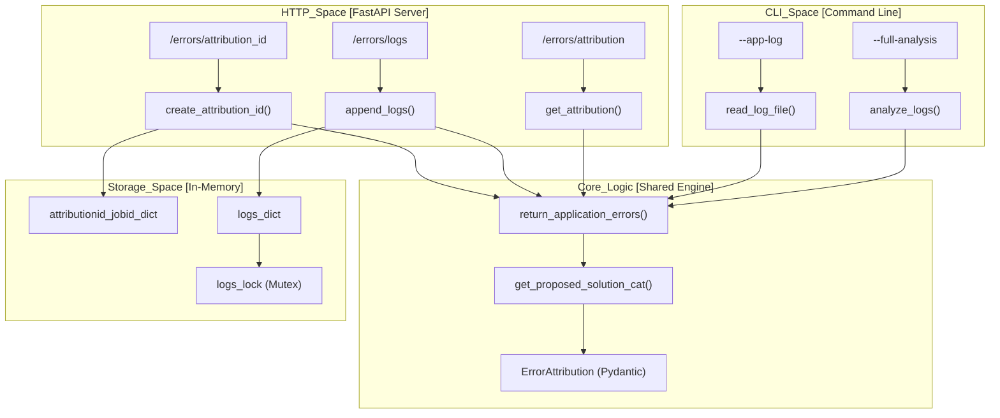
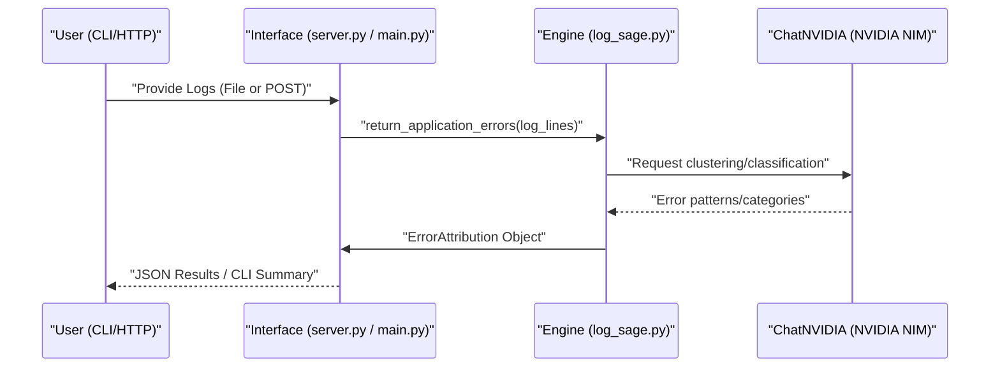

<!-- source: DeepWiki mcp.deepwiki.com · repo NVIDIA/LogSage · page 3 API and CLI Interfaces · fetched 2026-10-26 -->

# API and CLI Interfaces

Relevant source files

The following files were used as context for generating this wiki page:

- [README.md](README.md)
- [logsage/auto_resume_policy/log_sage.py](logsage/auto_resume_policy/log_sage.py)
- [logsage/auto_resume_policy/main.py](logsage/auto_resume_policy/main.py)

LogSage provides two primary interfaces for interacting with its log analysis and error attribution engine: a **FastAPI-based HTTP server** for programmatic integration and a **Command-Line Interface (CLI)** for local file analysis. Both interfaces leverage the same underlying logic to extract error patterns, attribute root causes, and recommend auto-resume policies.

### Interface Overview

The FastAPI server is designed for high-throughput, multi-user environments where logs are streamed or uploaded via RESTful calls [logsage/auto_resume_policy/server.py:1-240](). The CLI is optimized for developers and researchers who need to analyze local log files quickly without deploying a full service [logsage/auto_resume_policy/main.py:16-20]().

| Feature | FastAPI Server | CLI Tool |
| :--- | :--- | :--- |
| **Primary Use Case** | Production pipelines / Web services | Local debugging / Manual triage |
| **State Management** | Centralized `logs_dict` with 24h expiry | Stateless (per-execution) |
| **Input Format** | JSON / HTTP POST | Local file paths (`--app-log`) |
| **Concurrency** | Thread-safe with `logs_lock` | Single-process |
| **Main Entry Point** | `run_server.py` or `server.py` | `main.py` or `log_sage.py` |

**Sources:** [README.md:63-85](), [logsage/auto_resume_policy/log_sage.py:39-55](), [logsage/auto_resume_policy/main.py:16-37]()

---

### System Interface Mapping

The following diagram bridges the high-level interface concepts to the specific code entities that implement them.

**Diagram: Interface to Code Entity Mapping**

**Sources:** [logsage/auto_resume_policy/server.py:111-218](), [logsage/auto_resume_policy/main.py:69-132](), [logsage/auto_resume_policy/log_sage.py:39-55]()

---

### FastAPI Server and Endpoints

The FastAPI service enables a multi-step workflow for log analysis. It maintains an internal state using `logs_dict` to store log fragments until a user requests a final attribution.

*   **Attribution Lifecycle**: Users first generate an `AttributionID`, append log lines to it via subsequent requests, and finally trigger the LLM analysis.
*   **Thread Safety**: The server uses a global `logs_lock` (a `threading.Lock`) to ensure data integrity during log ingestion and the 24-hour cleanup cycle [logsage/auto_resume_policy/log_sage.py:39-43]().
*   **Health and Versioning**: Standard endpoints like `GET /healthz` and `GET /version` are provided for deployment monitoring [README.md:77-80]().

For detailed request/response schemas and lifecycle management, see [FastAPI Server and Endpoints](#3.1).

**Sources:** [logsage/auto_resume_policy/server.py:111-218](), [logsage/auto_resume_policy/log_sage.py:39-55]()

---

### Command-Line Interface (CLI)

The CLI tool, primarily located in `main.py`, provides a direct interface for analyzing log files on disk. It supports several flags to control the depth of analysis and the types of recommendations generated.

*   **Log Parsing**: Reads files via `read_log_file()` and processes them through the standard `return_application_errors()` pipeline [logsage/auto_resume_policy/main.py:69-89]().
*   **Cordon Checks**: Can specifically look for hardware-related failures that justify node isolation using `get_cordon_nodes()` [logsage/auto_resume_policy/main.py:113-118]().
*   **LLM Configuration**: Allows overriding environment variables via the `--api-key` argument [logsage/auto_resume_policy/main.py:56-58]().

For a full list of arguments and example commands, see [Command-Line Interface (CLI)](#3.2).

**Sources:** [logsage/auto_resume_policy/main.py:42-66](), [logsage/auto_resume_policy/main.py:135-181]()

---

### Component Interaction

The following diagram illustrates how the public interfaces interact with the core logic and the NVIDIA LLM backend.

**Diagram: Request Flow from Interface to LLM**

**Sources:** [logsage/auto_resume_policy/log_sage.py:182-205](), [logsage/auto_resume_policy/main.py:155-179](), [logsage/auto_resume_policy/error_extraction.py:36-40]()

---

