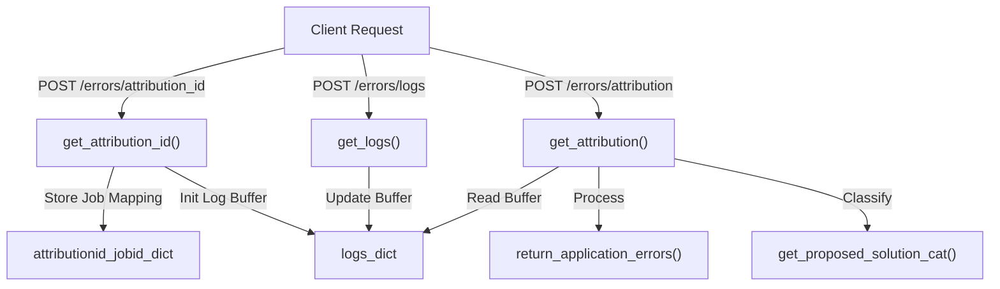
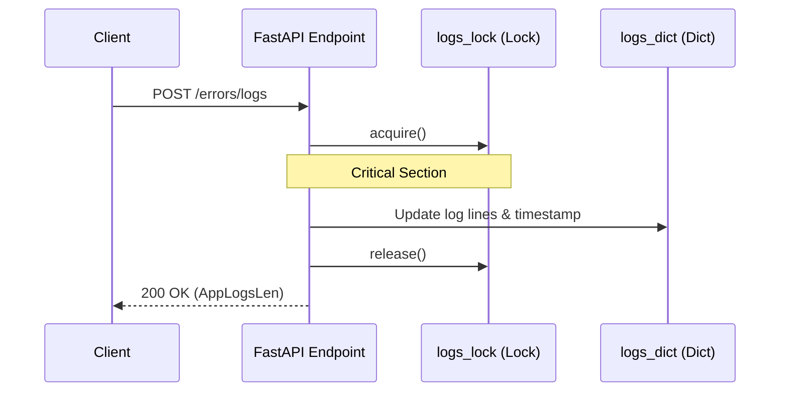

<!-- source: DeepWiki mcp.deepwiki.com · repo NVIDIA/LogSage · page 3.1 FastAPI Server and Endpoints · fetched 2026-10-26 -->

# FastAPI Server and Endpoints

Relevant source files

The following files were used as context for generating this wiki page:

- [logsage/auto_resume_policy/attribution_classes.py](logsage/auto_resume_policy/attribution_classes.py)
- [logsage/auto_resume_policy/log_sage.py](logsage/auto_resume_policy/log_sage.py)
- [logsage/auto_resume_policy/main.py](logsage/auto_resume_policy/main.py)

The LogSage FastAPI server provides a RESTful interface for analyzing GPU cluster job logs. It enables remote clients to submit log lines asynchronously, generate unique attribution IDs, and retrieve LLM-powered error analysis and remediation policies. The server is designed for high-throughput environments, employing thread-safe log buffering and automated cleanup mechanisms.

## Endpoint Overview

The server exposes five primary endpoints to manage the lifecycle of a log analysis request.

| Method | Endpoint | Description |
| :--- | :--- | :--- |
| `GET` | `/healthz` | Liveness probe returning a simple "ok" status. |
| `GET` | `/version` | Returns the current version of the LogSage service. |
| `POST` | `/errors/attribution_id` | Generates a new unique `attribution_id` for a specific `job_id`. |
| `POST` | `/errors/logs` | Appends log lines to the buffer associated with an `attribution_id`. |
| `POST` | `/errors/attribution` | Triggers the analysis pipeline for a given `attribution_id` and returns results. |

Sources: `logsage/auto_resume_policy/log_sage.py`

## Request and Response Schemas

LogSage uses Pydantic models to enforce strict data validation for all API interactions. These models are defined in `attribution_classes.py`.

### Attribution ID Generation
- **Request**: `NewAttributionRequest` [logsage/auto_resume_policy/attribution_classes.py:131-133]()
- **Response**: `AttributionID` [logsage/auto_resume_policy/attribution_classes.py:114-116]()

### Log Ingestion
- **Request**: `LogsRequest` [logsage/auto_resume_policy/attribution_classes.py:126-129](). This includes the `attribution_id` and the `log_stream` (base64 or raw string).
- **Response**: `AppLogsLen` [logsage/auto_resume_policy/attribution_classes.py:122-124](), returning the total number of lines currently stored for that ID.

### Analysis Results
- **Request**: `AttributionRequest` [logsage/auto_resume_policy/attribution_classes.py:118-120]()
- **Response**: `ErrorAttributionWithJobId` [logsage/auto_resume_policy/attribution_classes.py:91-97](), containing:
    - `application_errors_full`: List of all detected errors.
    - `application_errors_unique`: Deduplicated error list.
    - `auto_resume`: The recommended action (e.g., RESTART, STOP).
    - `attribution`: The root cause classification.
    - `job_id`: The original job identifier.

Sources: `logsage/auto_resume_policy/attribution_classes.py`

## Attribution-ID Lifecycle

The server manages state using an `attribution_id` which acts as a session token for log accumulation.

### 1. Generate (`/errors/attribution_id`)
When a client starts a new analysis session, the server generates a UUID [logsage/auto_resume_policy/log_sage.py:20](). It maps this ID to the provided `job_id` in `attributionid_jobid_dict` [logsage/auto_resume_policy/log_sage.py:53]() and initializes an entry in `logs_dict` [logsage/auto_resume_policy/log_sage.py:52]().

### 2. Append (`/errors/logs`)
Clients send chunks of logs to this endpoint. The server retrieves the existing list from `logs_dict`, appends the new lines, and updates the timestamp [logsage/auto_resume_policy/log_sage.py:431-435]().

### 3. Retrieve (`/errors/attribution`)
Once all logs are uploaded, the client calls this endpoint. The server:
1.  Retrieves the full log buffer from `logs_dict`.
2.  Passes the logs to `return_application_errors()` [logsage/auto_resume_policy/error_extraction.py:516]() for extraction.
3.  Calls `get_proposed_solution_cat()` [logsage/auto_resume_policy/error_attribution.py:343]() to determine the policy.
4.  Returns the final `ErrorAttributionWithJobId` object.

### Data Flow and Code Entity Mapping
The following diagram maps the API lifecycle to the internal Python dictionaries and functions.

**Diagram: Attribution Lifecycle Mapping**

Sources: `logsage/auto_resume_policy/log_sage.py`, `logsage/auto_resume_policy/error_extraction.py`, `logsage/auto_resume_policy/error_attribution.py`

## Thread-Safety and Resource Management

### The `logs_lock`
Because the FastAPI server handles concurrent requests, access to the global `logs_dict` and `attributionid_jobid_dict` is protected by a `threading.Lock` named `logs_lock` [logsage/auto_resume_policy/log_sage.py:40](). This ensures that simultaneous log appends or cleanup operations do not cause race conditions or data corruption.

### 24-Hour Log Expiry
To prevent memory exhaustion, the server implements an automated cleanup mechanism.
- **`LOG_EXPIRY_SECONDS`**: Set to 86,400 seconds (24 hours) [logsage/auto_resume_policy/log_sage.py:43]().
- **Cleanup Logic**: Every time a new `attribution_id` is requested or a cleanup is triggered, the server iterates through `logs_dict`. It compares the current time against the stored timestamp for each ID [logsage/auto_resume_policy/log_sage.py:408-418](). Entries older than the expiry threshold are deleted.

**Diagram: Thread-Safe Log Management**

Sources: `logsage/auto_resume_policy/log_sage.py`

## Internal Cache and Configuration
The server utilizes several global structures to optimize performance:
- **`cache_dict`**: An `LRUCache` instance (capacity 1,000,000) used by the extraction pipeline to store LLM classification results for log clusters [logsage/auto_resume_policy/log_sage.py:49]().
- **`Config`**: Loads environment variables such as `NVIDIA_API_KEY` and `MODEL_NAME` to initialize the `ChatNVIDIA` LLM client [logsage/auto_resume_policy/log_sage.py:56-59]().

Sources: `logsage/auto_resume_policy/log_sage.py`, `logsage/auto_resume_policy/config.py`

---

