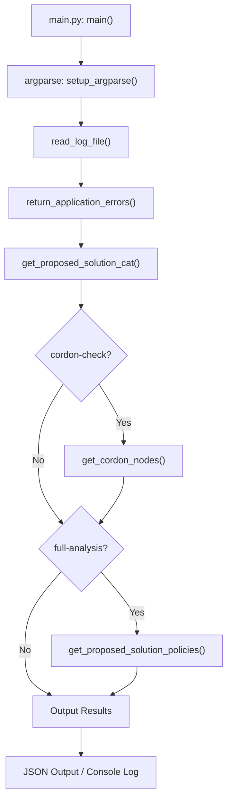
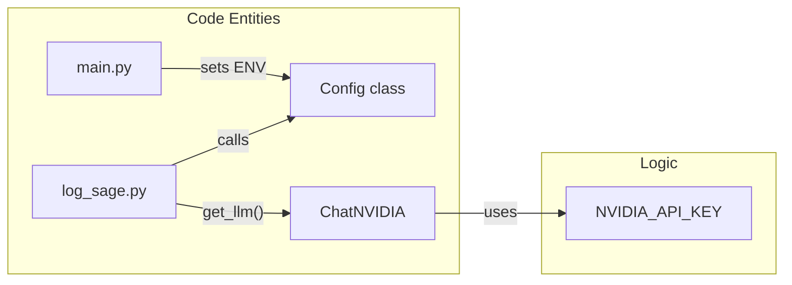

<!-- source: DeepWiki mcp.deepwiki.com · repo NVIDIA/LogSage · page 3.2 Command-Line Interface (CLI) · fetched 2026-10-26 -->

# Command-Line Interface (CLI)

<details>
<summary>Relevant source files</summary>

The following files were used as context for generating this wiki page:

- [logsage/auto_resume_policy/log_sage.py](logsage/auto_resume_policy/log_sage.py)
- [logsage/auto_resume_policy/main.py](logsage/auto_resume_policy/main.py)

</details>


The LogSage Command-Line Interface (CLI) provides a direct entry point for developers and operators to analyze GPU cluster job logs without deploying the full FastAPI service. It facilitates log parsing, error extraction via LLMs, and automated remediation recommendations (e.g., RESTART, STOP, or CORDON) directly from the terminal.

## Entry Points

LogSage defines two primary scripts for CLI interaction:
1.  **`main.py`**: The primary user-facing CLI tool for analyzing local log files and generating JSON reports.
2.  **`log_sage.py`**: Contains the core logic for processing logs from files and managing the LLM lifecycle, used by both the CLI and the API.

### CLI Architecture and Data Flow

The CLI follows a linear pipeline from argument parsing to result serialization. It bridges the gap between raw text logs and structured error attribution models.

**CLI Execution Flow**



**Sources:** [logsage/auto_resume_policy/main.py:42-66](), [logsage/auto_resume_policy/main.py:135-185]()

---

## Argument Parsing Reference

The CLI uses `argparse` to handle configuration. Arguments can override environment variables defined in `Config`.

| Argument | Type | Required | Description |
| :--- | :--- | :--- | :--- |
| `-a`, `--app-log` | `str` | Yes | Path to the application log file to be analyzed. |
| `-s`, `--sys-log` | `str` | No | Path to the system log file for cross-referencing. |
| `-o`, `--output` | `str` | No | File path to save the analysis results in JSON format. |
| `--api-key` | `str` | No | NVIDIA API Key for LLM access. Overrides `NVIDIA_API_KEY` env var. |
| `--full-analysis`| `flag`| No | Triggers `get_proposed_solution_policies()` for detailed remediation. |
| `--cordon-check` | `flag`| No | Triggers `get_cordon_nodes()` to identify failing hardware. |
| `--verbose` | `flag`| No | (Used in `log_sage.py`) Enables detailed logging of the attribution process. |
| `--isolation` | `flag`| No | (Used in `log_sage.py`) Enables isolation-specific analysis modes. |
| `--attribution` | `flag`| No | (Used in `log_sage.py`) Enables detailed root-cause attribution. |

**Sources:** [logsage/auto_resume_policy/main.py:42-66](), [logsage/auto_resume_policy/log_sage.py:142-154]()

---

## Implementation Details

### LLM Initialization
The CLI initializes the LLM through `get_llm()` in `log_sage.py`. It utilizes `langchain_nvidia_ai_endpoints.ChatNVIDIA` and supports both standard NIM endpoints and `PERSONAL_ENDPOINT` configurations defined in the `Config` class.

**LLM Configuration Mapping**



**Sources:** [logsage/auto_resume_policy/log_sage.py:59-98](), [logsage/auto_resume_policy/main.py:140-150]()

### Error Extraction and Attribution
The core logic resides in `analyze_logs()` within `main.py`, which orchestrates the following calls:
1.  **`return_application_errors`**: Parses the log lines, applies Drain3 clustering, and identifies unique error patterns [logsage/auto_resume_policy/main.py:87-89]().
2.  **`get_proposed_solution_cat`**: Categorizes the errors (e.g., Hardware, Software, Network) and provides a confidence score [logsage/auto_resume_policy/main.py:108-110]().
3.  **`get_cordon_nodes`**: If `--cordon-check` is active, it analyzes error distribution across ranks/nodes to recommend cordoning [logsage/auto_resume_policy/main.py:115-117]().

---

## Example Invocations

### Basic Analysis
Analyze a single log file and print the summary to the console:
```bash
python -m logsage.auto_resume_policy.main --app-log training_job.log
```

### Full Hardware Diagnosis
Perform a comprehensive analysis, checking for nodes that require cordoning, and save the output to a JSON file:
```bash
python -m logsage.auto_resume_policy.main \
    --app-log error.log \
    --full-analysis \
    --cordon-check \
    --output results.json
```

### Overriding API Credentials
Run the analysis using a specific API key without modifying the environment:
```bash
python -m logsage.auto_resume_policy.main \
    --app-log cluster.log \
    --api-key "nvapi-..."
```

---

## Output Format

The CLI provides two types of output:
1.  **Console Logs**: Human-readable summaries of error counts, categories, and recommended actions using the `uvicorn.error` logger [logsage/auto_resume_policy/main.py:158-173]().
2.  **JSON Export**: If `--output` is specified, a structured JSON object containing:
    *   `error_count`: Total errors found.
    *   `error_analysis`: Categorization and confidence scores.
    *   `cordon_recommendation`: List of nodes suggested for removal from the cluster.
    *   `policy_recommendation`: Detailed remediation steps (RESTART/STOP).

**Sources:** [logsage/auto_resume_policy/main.py:91-132](), [logsage/auto_resume_policy/main.py:175-179]()

---

