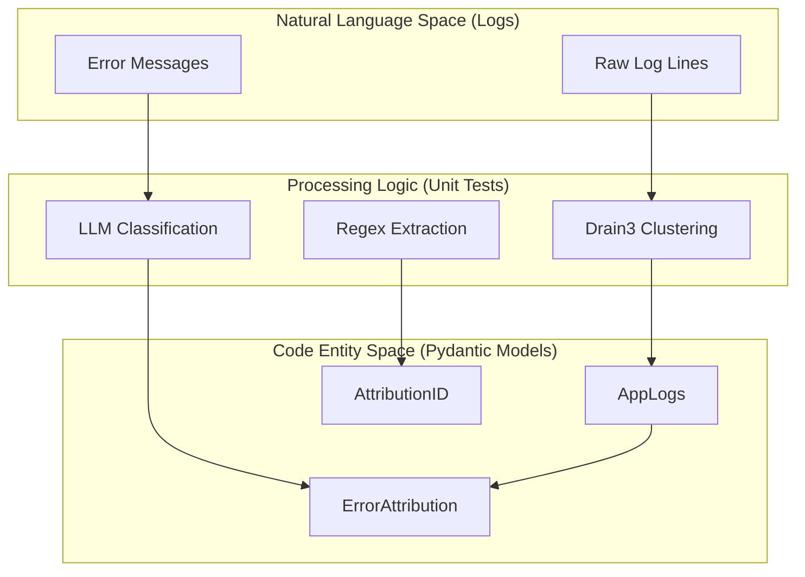
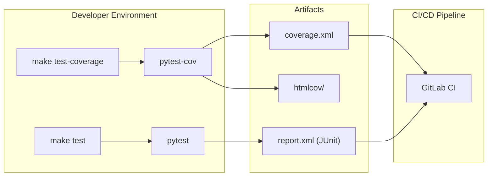

<!-- source: DeepWiki mcp.deepwiki.com · repo NVIDIA/LogSage · page 4 Testing · fetched 2026-10-26 -->

# Testing

Relevant source files

The following files were used as context for generating this wiki page:

- [Makefile](Makefile)
- [tests/README.md](tests/README.md)
- [tests/TEST_COVERAGE_SUMMARY.md](tests/TEST_COVERAGE_SUMMARY.md)

The LogSage test suite provides comprehensive validation of the auto-resume policy pipeline, covering data models, log processing utilities, LLM integration, and API endpoints. The suite is built using `pytest` and emphasizes high coverage through extensive mocking of external dependencies like LLMs and file systems.

### Testing Strategy and Scope

The testing architecture is designed to validate the transition from raw log data to structured policy recommendations. It ensures that the "Natural Language Space" of log messages is correctly parsed and categorized into the "Code Entity Space" used by the recommendation engine.

#### System Mapping: Log Processing to Code Entities
The following diagram illustrates how the test suite validates the transformation of log data into actionable entities.

**Log Transformation Validation**

**Sources:** [tests/README.md:1-15](), [tests/TEST_COVERAGE_SUMMARY.md:9-22]()

---

### Test Suite Structure

The test suite is organized by module, ensuring that each component of the `auto_resume_policy` package is isolated and verified.

| Category | Targeted Files | Key Components Tested |
| :--- | :--- | :--- |
| **Data Models** | `test_attribution_classes.py` | `LRUCache`, `ApplicationData`, `ErrorAttribution`, `FakeListLLM` |
| **Utilities** | `test_utils.py` | Tokenization, similarity scoring, log compression, batching |
| **Extraction** | `test_error_extraction.py` | Drain3 clustering, rank parsing, LLM-based error detection |
| **Attribution** | `test_error_attribution.py` | Policy logic, hardware/software categorization, cordon detection |
| **API/Lifecycle** | `test_server.py`, `test_log_sage.py` | FastAPI endpoints, Attribution ID lifecycle, log expiration |

For a detailed breakdown of individual test files and their coverage, see **[Unit Tests](#4.1)**.

**Sources:** [tests/README.md:17-27](), [tests/TEST_COVERAGE_SUMMARY.md:5-57]()

---

### Execution and Infrastructure

LogSage utilizes `Poetry` for dependency management and `make` for standardized test execution. The infrastructure supports generating coverage reports in both terminal and XML formats for CI/CD integration.

#### Testing Workflow

**Key Commands:**
*   `make test`: Runs the standard test suite. [Makefile:121-123]()
*   `make test-coverage`: Executes tests and generates `coverage.xml` and terminal summaries. [Makefile:129-138]()
*   `make test-html`: Generates JUnit XML reports. [Makefile:125-127]()

For details on configuration and CI/CD integration, see **[Test Infrastructure and CI Integration](#4.2)**.

**Sources:** [Makefile:121-141](), [tests/TEST_COVERAGE_SUMMARY.md:58-71]()

---

### Coverage and Quality Goals

The project maintains high standards for code quality through:
1.  **Mocking**: External LLM calls are replaced with `FakeListLLM` to ensure deterministic tests and avoid API costs. [tests/TEST_COVERAGE_SUMMARY.md:21-21](), [tests/TEST_COVERAGE_SUMMARY.md:74-74]()
2.  **Edge Case Validation**: Tests explicitly target empty log files, malformed JSON, and network timeout scenarios. [tests/TEST_COVERAGE_SUMMARY.md:77-78]()
3.  **Integration Testing**: The `FastAPI TestClient` is used to verify the full request/response cycle for the server. [tests/TEST_COVERAGE_SUMMARY.md:79-79]()

**Sources:** [tests/README.md:28-35](), [tests/TEST_COVERAGE_SUMMARY.md:72-80]()

---

## Child Pages
*   **[Unit Tests](#4.1)**: Deep dive into the specific tests for data models, utility functions, and the core attribution logic.
*   **[Test Infrastructure and CI Integration](#4.2)**: Technical details on `pytest` configuration, `pyproject.toml` settings, and GitLab CI job definitions.

---

