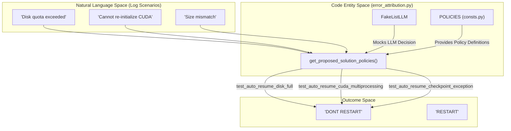
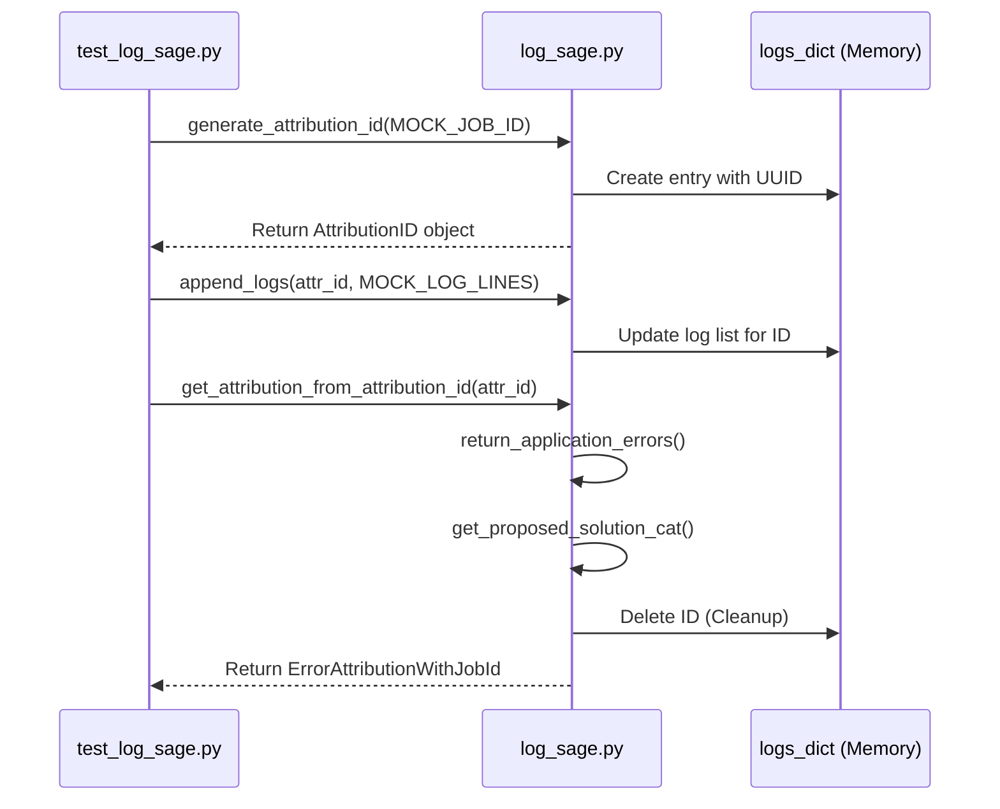

<!-- source: DeepWiki mcp.deepwiki.com · repo NVIDIA/LogSage · page 4.1 Unit Tests · fetched 2026-10-26 -->

# Unit Tests

Relevant source files

The following files were used as context for generating this wiki page:

- [tests/test_attribution_classes.py](tests/test_attribution_classes.py)
- [tests/test_error_attribution.py](tests/test_error_attribution.py)
- [tests/test_error_extraction.py](tests/test_error_extraction.py)
- [tests/test_error_extraction_comprehensive.py](tests/test_error_extraction_comprehensive.py)
- [tests/test_log_sage.py](tests/test_log_sage.py)
- [tests/test_utils.py](tests/test_utils.py)

The LogSage unit test suite ensures the reliability of the Auto-Resume-Policy pipeline by verifying individual components such as log parsing, LLM integration, data modeling, and policy recommendation logic. The tests use a combination of standard `unittest` and `pytest` frameworks, employing extensive mocking to simulate LLM responses and log data.

## 1. Data Models and Cache Testing
The file `tests/test_attribution_classes.py` validates the Pydantic models and the Least Recently Used (LRU) cache implementation used for storing log analysis results.

### LRUCache Implementation
The `LRUCache` is tested for its eviction policy and basic operations to ensure it correctly manages memory when handling large volumes of log data.
*   **Initialization**: Verifies capacity setting and internal `OrderedDict` state [tests/test_attribution_classes.py:42-48]().
*   **Eviction Logic**: Confirms that the least recently used item is removed when the cache exceeds capacity [tests/test_attribution_classes.py:61-80]().
*   **Update Behavior**: Ensures that updating an existing key moves it to the "most recently used" position [tests/test_attribution_classes.py:81-99]().

### Pydantic Models
Tests ensure that the data containers correctly enforce types and handle default values for the attribution pipeline.
*   **ApplicationData**: Validates storage of unique errors, tracebacks, and training status [tests/test_attribution_classes.py:133-157]().
*   **ErrorAttribution**: Tests both default initialization and explicit value assignment for fields like `auto_resume` and `attribution_verbose` [tests/test_attribution_classes.py:162-192]().

**Sources:** [tests/test_attribution_classes.py:1-192]()

---

## 2. Text Processing and Utility Testing
`tests/test_utils.py` and `tests/test_error_extraction.py` cover the sanitization and transformation of raw log strings into structured tokens.

### Tokenization and Sanitization
| Function | Test Case | Expected Behavior |
| :--- | :--- | :--- |
| `convert_numbers_to_token` | `test_convert_numbers_to_token` | Replaces digits with `<NUMBER>` [tests/test_utils.py:57-66]() |
| `replace_quoted_text_with_token` | `test_replace_quoted_text_with_token` | Replaces text in quotes with `<TEXT>` [tests/test_utils.py:83-89]() |
| `convert_hex_to_special_token` | `test_convert_hex_to_special_token` | Replaces `0x...` addresses with `<HEX>` [tests/test_utils.py:104-110]() |
| `add_spaces_around_punctuation`| `test_add_spaces_around_punctuation` | Inserts spaces to improve tokenizer performance [tests/test_utils.py:90-96]() |

### Log Compression and Similarity
Tests verify the logic used to reduce log volume before LLM processing:
*   **Batch Creation**: `test_create_batches_long` ensures that log lines are split into chunks that fit within LLM context limits [tests/test_utils.py:146-158]().
*   **Similarity Scoring**: `test_similarity_score` and `test_count_shared_words` validate the overlap calculation between different log templates [tests/test_utils.py:163-170]().

**Sources:** [tests/test_utils.py:1-170](), [tests/test_error_extraction.py:21-75]()

---

## 3. Error Extraction and Clustering
`tests/test_error_extraction_comprehensive.py` focuses on the logic that identifies ranks, nodes, and unique error clusters within the `return_application_errors()` workflow.

### Rank and Node Parsing
The system must correctly identify which GPU rank or node produced a specific error line.
*   **Rank Extraction**: `test_extract_ranks` verifies that strings like `0: Error` or `[rank0]` are correctly parsed into rank IDs [tests/test_error_extraction_comprehensive.py:37-43]().
*   **Rank Prepending**: `test_add_rank_in_beginning` ensures that if a rank is found later in a line, it is moved to the front for easier clustering [tests/test_error_extraction_comprehensive.py:79-88]().

### LLM-Based Validation
Since clustering might identify benign patterns as errors, the system uses LLM "check" functions:
*   **check_real_error**: Mocks an LLM response to verify if a candidate string is a legitimate software/hardware error [tests/test_error_extraction_comprehensive.py:93-102]().
*   **check_crash**: Validates if the overall log context indicates an application-level crash [tests/test_error_extraction_comprehensive.py:103-117]().

**Sources:** [tests/test_error_extraction_comprehensive.py:34-117]()

---

## 4. Policy Recommendation and Attribution
`tests/test_error_attribution.py` contains complex integration tests that use `FakeListLLM` to verify the logic in `get_proposed_solution_policies()`.

### Policy Logic Flow
This diagram illustrates how the test suite maps natural language log scenarios to the `ErrorAttribution` code entities.

**Diagram: Log Scenario to Policy Mapping**

**Sources:** [tests/test_error_attribution.py:44-160]()

### Specific Policy Tests
*   **Disk Full**: Validates that "Disk quota exceeded" results in a `DONT RESTART` policy to prevent infinite loops [tests/test_error_attribution.py:47-92]().
*   **CUDA Multiprocessing**: Ensures that "Cannot re-initialize CUDA" is flagged for manual intervention [tests/test_error_attribution.py:93-136]().
*   **Cordon Node Logic**: `get_cordon_nodes` is tested to ensure it correctly identifies hardware-faulty nodes from the log stream [tests/test_error_attribution.py:20-25]().

---

## 5. Lifecycle and API Integration
`tests/test_log_sage.py` tests the end-to-end lifecycle of an attribution request, from ID generation to final retrieval.

### Attribution ID Lifecycle
This diagram tracks the state of log data as it moves through the `log_sage.py` functions during a test execution.

**Diagram: Attribution ID Lifecycle in Tests**

**Sources:** [tests/test_log_sage.py:29-169]()

### Key Integration Tests
*   **Success Path**: `test_get_attribution_from_logs_success` mocks both the extraction and categorization layers to verify the assembly of the `ErrorAttribution` object [tests/test_log_sage.py:99-109]().
*   **Empty Logs**: `test_get_attribution_from_logs_no_errors` ensures the system returns a graceful "Errors not found" status instead of failing [tests/test_log_sage.py:111-135]().
*   **Invalid IDs**: `test_get_attribution_from_attribution_id_invalid_id` verifies that the system handles "Bad jobid" scenarios for non-existent or expired attribution IDs [tests/test_log_sage.py:170-181]().

**Sources:** [tests/test_log_sage.py:99-181]()

---

