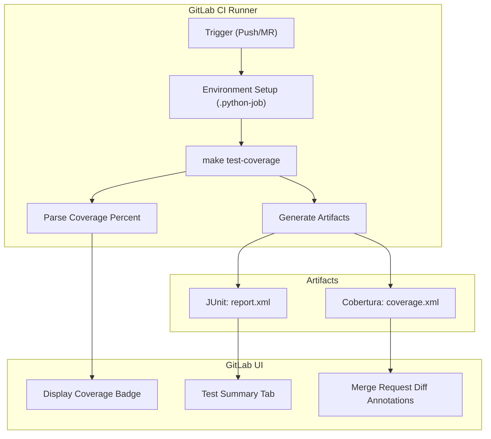
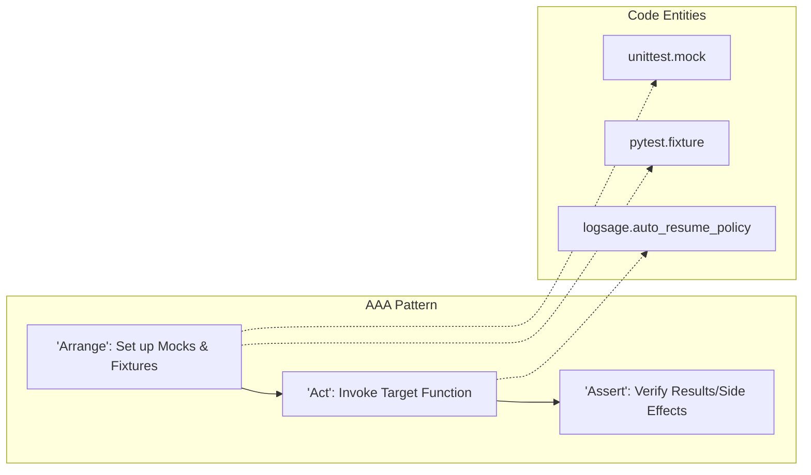

<!-- source: DeepWiki mcp.deepwiki.com · repo NVIDIA/LogSage · page 4.2 Test Infrastructure and CI Integration · fetched 2026-10-26 -->

# Test Infrastructure and CI Integration

Relevant source files

The following files were used as context for generating this wiki page:

- [.gitlab/ci/test.yml](.gitlab/ci/test.yml)
- [Makefile](Makefile)
- [pyproject.toml](pyproject.toml)
- [tests/TEST_COVERAGE_SUMMARY.md](tests/TEST_COVERAGE_SUMMARY.md)

This page details the automation, configuration, and execution environment for the LogSage test suite. The infrastructure is designed to ensure high code quality through comprehensive coverage reporting, standardized linting, and automated validation within the GitLab CI/CD pipeline.

## Pytest Configuration

LogSage uses `pytest` as its primary testing framework. The configuration is centralized in `pyproject.toml`, defining how tests are discovered and executed.

### Test Discovery and Markers
The suite is configured to look for tests in the `tests/` directory [pyproject.toml:202-202](). It identifies test files using the patterns `test_*.py` and `*_test.py` [pyproject.toml:203-203](). 

Key configuration settings include:
*   **Strict Markers**: The `--strict-markers` flag is enabled to ensure all custom markers used in tests are explicitly registered [pyproject.toml:211-211]().
*   **Naming Conventions**: Classes must start with `Test` and functions with `test_` to be picked up by the runner [pyproject.toml:204-205]().

### Coverage and Reporting
The project enforces rigorous coverage tracking using `pytest-cov`. The default options (`addopts`) automatically trigger coverage analysis for the `logsage` package whenever tests are run [pyproject.toml:207-207]().

| Report Format | Configuration | Purpose |
| :--- | :--- | :--- |
| **Terminal** | `--cov-report=term-missing` | Shows lines missing coverage in the console [pyproject.toml:209-209](). |
| **XML** | `--cov-report=xml` | Generates `coverage.xml` for CI/CD integration [pyproject.toml:210-210](). |
| **HTML** | `--cov-report=html` | Generates a navigable web report in `htmlcov/` [pyproject.toml:208-208](). |
| **JUnit** | `--junitxml=report.xml` | Standardized test result format for GitLab CI [Makefile:134-134](). |

**Sources:** [pyproject.toml:201-212](), [Makefile:129-136]()

---

## Makefile Targets

The `Makefile` provides a high-level interface for developers to execute the test suite without manually managing `poetry run` arguments.

### Core Test Commands
*   **`make test`**: Executes the full suite using `pytest` [Makefile:121-122]().
*   **`make test-html`**: Executes tests and generates a JUnit XML report [Makefile:125-126]().
*   **`make test-coverage`**: The primary target for CI and local validation. It runs tests with coverage enabled, disables warnings, and outputs both XML and terminal reports [Makefile:129-137]().

### Supporting Infrastructure Targets
*   **`make setup-pyproject`**: Dynamically updates `pyproject.toml` with the local Python version and validates that the version is at least 3.11 [Makefile:52-66]().
*   **`make install`**: Sets up the local development environment, including `poetry` installation with dev dependencies and pre-commit hook registration [Makefile:72-81]().

**Sources:** [Makefile:52-81](), [Makefile:121-141]()

---

## CI Integration

LogSage is integrated into GitLab CI via a modular configuration. The test execution is defined in `.gitlab/ci/test.yml`.

### GitLab CI Job Definition: `test`
The `test` job is responsible for validating every merge request and push to the main branch.

Title: GitLab CI Test Job Flow

**Sources:** [.gitlab/ci/test.yml:1-12](), [tests/TEST_COVERAGE_SUMMARY.md:98-102]()

### Implementation Details
*   **Execution**: The job executes `make test-coverage` [`.gitlab/ci/test.yml:5-5`]().
*   **Coverage Regex**: GitLab extracts the total coverage percentage from the terminal output using the regex `/TOTAL.*? (100(?:\.0+)?\%|[1-9]?\d(?:\.\d+)?\%)$/` [`.gitlab/ci/test.yml:6-6`]().
*   **Artifact Mapping**:
    *   JUnit reports are mapped to `report.xml` for the GitLab "Tests" tab [`.gitlab/ci/test.yml:9-9`]().
    *   Cobertura XML reports are mapped to `coverage.xml` to enable inline code coverage visualization in Merge Requests [`.gitlab/ci/test.yml:10-12`]().
*   **Rules**: Tests run on all tags, pushes to `main` (excluding version bumps), and all merge request events [`.gitlab/ci/test.yml:13-19`]().

**Sources:** [.gitlab/ci/test.yml:1-20]()

---

## Adding New Tests

Contributors should follow the established patterns to maintain the 100% coverage goal for core classes [tests/TEST_COVERAGE_SUMMARY.md:11-11]().

### Test Organization
Tests are categorized by the module they target:
*   `test_attribution_classes.py`: For Pydantic models and the `LRUCache` [tests/TEST_COVERAGE_SUMMARY.md:9-21]().
*   `test_utils.py`: For text processing and log compression utilities [tests/TEST_COVERAGE_SUMMARY.md:23-35]().
*   `test_error_extraction_comprehensive.py`: For the Drain3 clustering and LLM retry logic [tests/TEST_COVERAGE_SUMMARY.md:37-47]().

### Testing Standards
Title: Test Implementation Pattern (AAA)

**Sources:** [tests/TEST_COVERAGE_SUMMARY.md:72-78](), [tests/TEST_COVERAGE_SUMMARY.md:90-94]()

### Guidelines for New Contributions
1.  **Mocking**: Use `unittest.mock` for external dependencies like LLM calls or file I/O to ensure tests remain hermetic [tests/TEST_COVERAGE_SUMMARY.md:74-74]().
2.  **Edge Cases**: Always include tests for empty inputs, malformed log lines, and large file handling [tests/TEST_COVERAGE_SUMMARY.md:77-77]().
3.  **Linting**: Run `make lint` and `make format` before committing. The `ruff` configuration in `pyproject.toml` enforces strict rules, though some (like `S101` for asserts) are relaxed specifically for the `tests/` directory [pyproject.toml:161-175]().
4.  **Verification**: Locally run `make test-coverage` to ensure no regressions in coverage metrics before pushing to GitLab [Makefile:129-138]().

**Sources:** [tests/TEST_COVERAGE_SUMMARY.md:60-80](), [pyproject.toml:161-175]()

---

