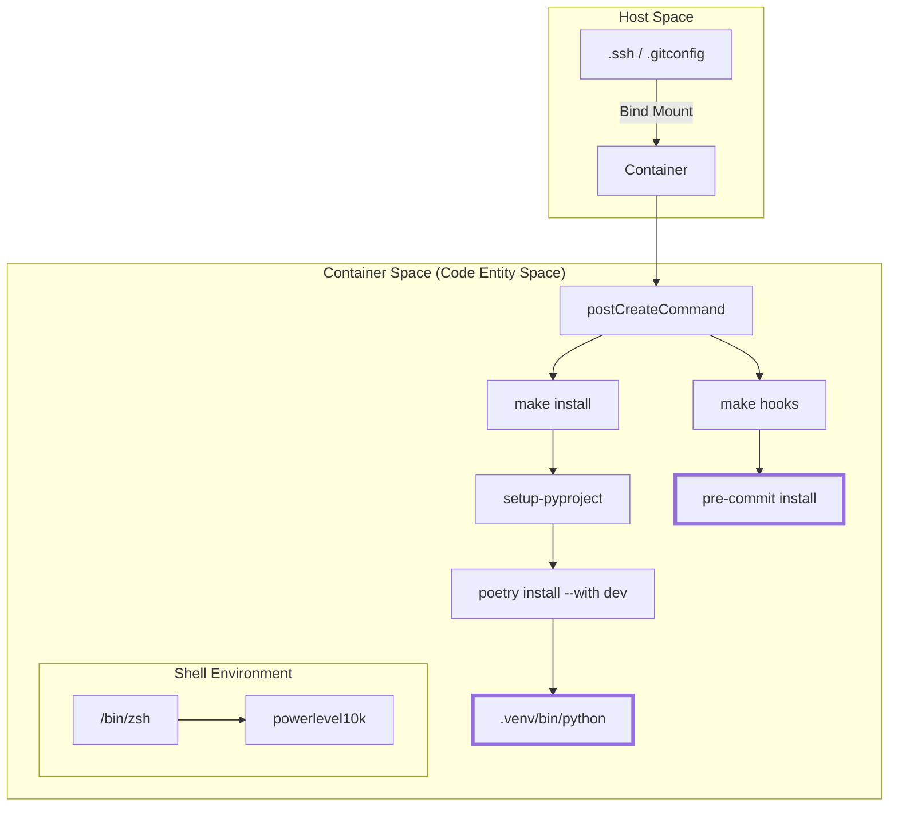
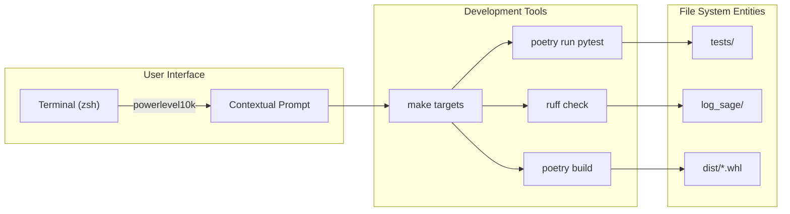

<!-- source: DeepWiki mcp.deepwiki.com · repo NVIDIA/LogSage · page 5.1 Development Environment Setup · fetched 2026-10-26 -->

# Development Environment Setup

Relevant source files

The following files were used as context for generating this wiki page:

- [.devcontainer/Dockerfile](.devcontainer/Dockerfile)
- [.devcontainer/devcontainer.json](.devcontainer/devcontainer.json)
- [.dockerignore](.dockerignore)
- [.editorconfig](.editorconfig)
- [Makefile](Makefile)

This page provides technical details for setting up a local or containerized development environment for LogSage. The project utilizes VS Code Dev Containers to provide a consistent, reproducible environment pre-configured with all necessary system dependencies, Python tooling, and shell customizations.

## Containerized Development (VS Code Dev Containers)

The primary development method for LogSage is through VS Code Dev Containers. This ensures that every developer uses the same Python version, system libraries, and tool configurations.

### Dockerfile Implementation
The environment is based on `mcr.microsoft.com/devcontainers/python:3.12-bullseye` [[.devcontainer/Dockerfile:1-1]](). The `Dockerfile` explicitly installs `poetry` via `pip` to manage Python dependencies and virtual environments [[.devcontainer/Dockerfile:4-4]]().

### DevContainer Configuration
The `.devcontainer/devcontainer.json` file defines the orchestration of the development environment:

*   **Features**: It includes standard utilities, Git LFS support, Docker-in-Docker for potential container testing, and the `powerlevel10k` zsh theme [[.devcontainer/devcontainer.json:9-14]]().
*   **Mounts**: To facilitate seamless Git operations, the developer's local `.ssh` directory and `.gitconfig` are bind-mounted into the container at `/home/vscode/` [[.devcontainer/devcontainer.json:15-18]]().
*   **Post-Creation**: Upon container startup, it automatically executes `make install` and `make hooks` to initialize the environment [[.devcontainer/devcontainer.json:19-19]]().
*   **VS Code Settings**: It enforces the use of the `.venv` created by Poetry as the default interpreter [[.devcontainer/devcontainer.json:25-25]()] and sets `zsh` as the default terminal [[.devcontainer/devcontainer.json:28-33]]().

### Environment Initialization Flow

The following diagram illustrates the transition from the host machine to a fully initialized "Code Entity Space" within the container.

**Diagram: Dev Container Initialization Flow**

**Sources:** [[.devcontainer/devcontainer.json:1-43]](), [[Makefile:72-82]]()

## Local Environment and Dependency Management

If not using Dev Containers, the environment can be set up manually using the `Makefile`.

### Poetry Virtual Environment
LogSage uses Poetry for dependency resolution. The `make install` target performs the following sequence:
1.  **setup-pyproject**: Detects the local Python version and updates `pyproject.toml` metadata to match the environment (requiring at least Python 3.11) [[Makefile:52-67]]().
2.  **Configuration**: Sets `virtualenvs.in-project` to `true`, ensuring the `.venv` directory is created inside the project root [[Makefile:75-76]]().
3.  **Installation**: Runs `poetry install --with dev --all-extras`, which installs both core dependencies and development tools like `ruff`, `mypy`, and `pytest` [[Makefile:79-79]]().
4.  **Requirements Export**: Generates a `requirements.txt` file for compatibility with systems not using Poetry [[Makefile:83-89]]().

### Makefile Automation
The `Makefile` serves as the central entry point for all development tasks:

| Target | Description | Code Reference |
| :--- | :--- | :--- |
| `make install` | Full environment setup (Poetry + Hooks) | [[Makefile:72-82]]() |
| `make hooks` | Manually run pre-commit hooks on all files | [[Makefile:91-92]]() |
| `make lint` | Run `ruff` linter with auto-fix enabled | [[Makefile:94-96]]() |
| `make test` | Execute the `pytest` suite | [[Makefile:121-123]]() |
| `make build` | Build the distribution wheel via `poetry build` | [[Makefile:160-162]]() |

**Sources:** [[Makefile:1-163]]()

## Editor Standards and Formatting

LogSage enforces strict coding standards via `.editorconfig` and VS Code settings to ensure consistency across different editors and operating systems.

### .editorconfig Standards
The project defines the following formatting rules [[.editorconfig:1-25]]():
*   **General**: UTF-8 charset, LF line endings, and a final newline at the end of files.
*   **Python**: 4-space indentation.
*   **Makefile**: Tab-based indentation (required by Make syntax).
*   **Markdown**: Trailing whitespace is preserved (to support Markdown line breaks).

### VS Code Integration
The `.devcontainer/devcontainer.json` file reinforces these standards by setting `files.insertFinalNewline` and `files.eol` specifically for the VS Code workspace [[.devcontainer/devcontainer.json:26-27]](). It also pre-installs essential extensions:
*   `ms-python.python`: Core Python support.
*   `ms-vscode.makefile-tools`: Integration for the `Makefile` targets.
*   `ms-python.debugpy`: Debugging support [[.devcontainer/devcontainer.json:36-40]]().

**Sources:** [[.editorconfig:1-25]](), [[.devcontainer/devcontainer.json:20-42]]()

## Shell and CLI Experience

The development environment is optimized for an interactive CLI experience.

### Shell Customization
The Dev Container defaults to `zsh` [[.devcontainer/devcontainer.json:28-33]()] and includes the `powerlevel10k` feature [[.devcontainer/devcontainer.json:13-13]](). This provides immediate visual feedback on the state of the Git repository and the active Python virtual environment.

### Git Integration
To prevent sensitive files or build artifacts from entering the repository, a comprehensive `.dockerignore` is maintained. This file excludes `.venv`, `__pycache__`, and IDE-specific directories (`.vscode`, `.idea`) from being copied into container layers during builds [[.dockerignore:1-39]]().

**Diagram: CLI and Environment Interaction**

**Sources:** [[.devcontainer/devcontainer.json:13-33]](), [[Makefile:121-162]](), [[.dockerignore:1-39]]()

---

