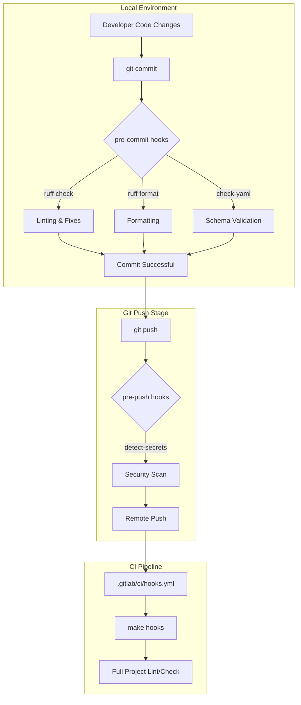
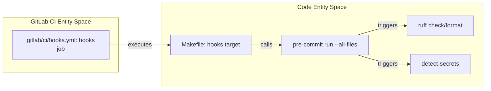

<!-- source: DeepWiki mcp.deepwiki.com · repo NVIDIA/LogSage · page 5.2 Linting, Formatting, and Pre-commit Hooks · fetched 2026-10-26 -->

# Linting, Formatting, and Pre-commit Hooks

Relevant source files

The following files were used as context for generating this wiki page:

- [.gitlab/ci/hooks.yml](.gitlab/ci/hooks.yml)
- [.pre-commit-config.yaml](.pre-commit-config.yaml)
- [Makefile](Makefile)
- [pyproject.toml](pyproject.toml)

This page describes the code quality toolchain used in LogSage to ensure consistency, security, and type safety across the codebase. The project employs a modern Python stack centered around `ruff` for linting and formatting, `mypy` for static type analysis, and `pre-commit` to automate these checks during the development lifecycle.

## Overview of the Toolchain

LogSage utilizes several specialized tools to maintain a high standard of code quality. These are orchestrated via a `.pre-commit-config.yaml` file and exposed through `Makefile` targets for manual execution.

| Tool | Purpose | Configuration |
| :--- | :--- | :--- |
| **Ruff** | Replaces Black, isort, and Pylint for extremely fast linting and formatting. | `[tool.ruff]` in `pyproject.toml` |
| **MyPy** | Performs static type checking to catch type-related bugs. | `[tool.mypy]` in `pyproject.toml` |
| **detect-secrets** | Scans for accidentally committed credentials or API keys. | `.pre-commit-config.yaml` |
| **licensecheck** | Validates that third-party dependencies comply with project licensing. | `Makefile` |
| **Pre-commit** | Manages git hooks to run all the above before commits or pushes. | `.pre-commit-config.yaml` |

### Code Quality Execution Flow

The following diagram illustrates how a developer's changes flow through the validation layers before reaching the remote repository.

**Developer Workflow and Validation Layers**

**Sources:** [.pre-commit-config.yaml:1-54](), [.gitlab/ci/hooks.yml:1-12](), [Makefile:91-113]()

---

## Ruff: Linting and Formatting

LogSage has consolidated its Python linting and formatting into `ruff`. It is configured to target Python 3.11+ [pyproject.toml:85-86]().

### Linting Rules
The project enables a comprehensive set of rules including:
*   **E/W**: Pycodestyle errors and warnings [pyproject.toml:98-99]().
*   **F**: Pyflakes for logical errors [pyproject.toml:100]().
*   **I**: Isort for import sorting [pyproject.toml:101]().
*   **S**: Flake8-bandit for security analysis [pyproject.toml:110]().
*   **PL**: Pylint parity [pyproject.toml:106]().
*   **D**: Pydocstyle using the Google-style convention [pyproject.toml:109, 198-199]().

### Formatting
The formatter is configured to use double quotes and a line length of 120 characters [pyproject.toml:85, 156](). Specific rules that conflict with the formatter, such as `COM812` (trailing commas) and `Q000` (quote preference), are explicitly ignored in the linting configuration to prevent oscillations [pyproject.toml:129-131]().

**Sources:** [pyproject.toml:84-158]()

---

## Pre-commit Hook Configuration

The `.pre-commit-config.yaml` file defines the hooks that run automatically. Hooks are categorized into different stages to balance developer speed with security.

### Hook Stages
1.  **Commit Stage**: Runs `ruff`, `ruff-format`, and basic file checks (YAML, large files) [(.pre-commit-config.yaml:16-23)]().
2.  **Pre-push Stage**: Runs `detect-secrets` to prevent credentials from leaving the local machine [(.pre-commit-config.yaml:41-45)]().

### Secret Detection
The `detect-secrets` hook excludes specific files that often contain false positives or non-sensitive configuration, such as `.env` templates, test directories, and lock files [(.pre-commit-config.yaml:46-53)](). Developers can mark intentional false positives using the `pragma: allowlist secret` inline comment [(.pre-commit-config.yaml:40)]().

**Sources:** [.pre-commit-config.yaml:1-54]()

---

## Makefile Integration

The `Makefile` provides a standardized interface for running quality tools, which is used both locally and by the GitLab CI pipeline.

| Target | Command | Description |
| :--- | :--- | :--- |
| `make hooks` | `pre-commit run --all-files` | Runs all configured hooks on the entire repository [Makefile:91-92](). |
| `make lint` | `ruff check --fix .` | Runs the linter and applies safe automatic fixes [Makefile:94-96](). |
| `make format` | `ruff format .` | Reformats all Python files in the repository [Makefile:106-108](). |
| `make secrets` | `detect-secrets scan .` | Performs a manual scan for secrets [Makefile:114-116](). |
| `make update-licensecheck` | `licensecheck --file LICENSE-3rd-party.txt` | Updates the third-party license manifest [Makefile:118-119](). |

### Environment Setup
The `make install` target handles the initialization of the toolchain by installing the `pre-commit` hooks into the local `.git` directory for both `pre-commit` and `pre-push` stages [Makefile:72-81]().

**Sources:** [Makefile:72-119]()

---

## CI/CD Enforcement

Code quality is enforced in the GitLab CI pipeline via the `hooks` job defined in `.gitlab/ci/hooks.yml`.

**CI Hook Execution Entity Mapping**

The CI job runs on every push to `main`, every merge request, and every tag [(.gitlab/ci/hooks.yml:6-12)](). It ensures that even if a developer bypasses local hooks (e.g., using `--no-verify`), the code must still pass all quality checks before being merged.

**Sources:** [.gitlab/ci/hooks.yml:1-13](), [Makefile:91-92]()

---

