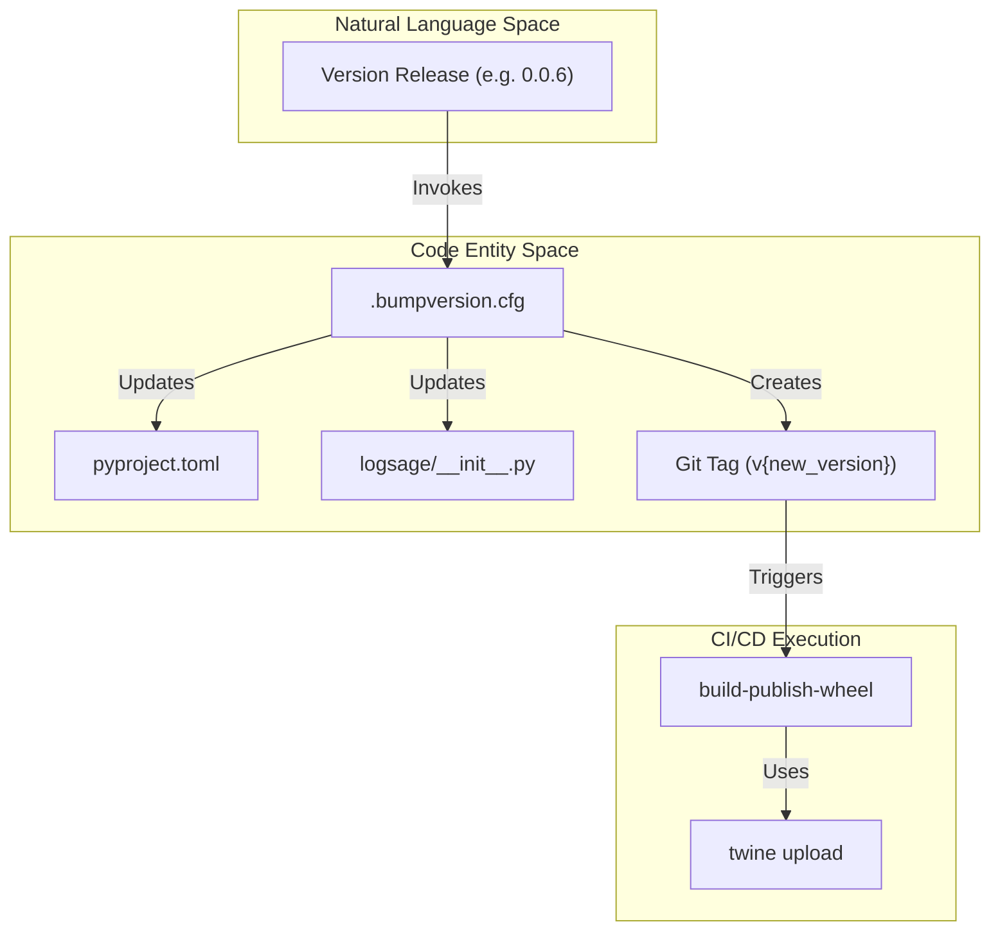
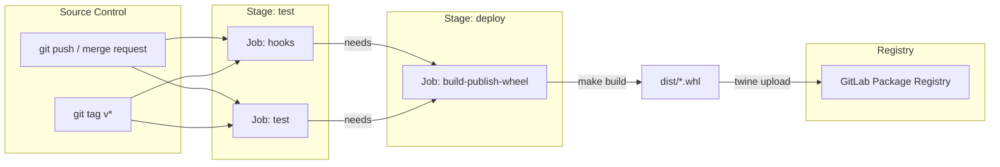

<!-- source: DeepWiki mcp.deepwiki.com · repo NVIDIA/LogSage · page 5.3 CI/CD Pipeline · fetched 2026-10-26 -->

# CI/CD Pipeline

Relevant source files

The following files were used as context for generating this wiki page:

- [.bumpversion.cfg](.bumpversion.cfg)
- [.gitlab-ci.yml](.gitlab-ci.yml)
- [.gitlab/cd/build-publish-wheel.yml](.gitlab/cd/build-publish-wheel.yml)
- [.gitlab/ci/hooks.yml](.gitlab/ci/hooks.yml)
- [.gitlab/ci/test.yml](.gitlab/ci/test.yml)
- [.gitlab/common.yml](.gitlab/common.yml)

The LogSage CI/CD pipeline is designed to automate the validation, testing, and distribution of the codebase. It leverages GitLab CI/CD with a modular configuration structure to ensure code quality through automated hooks, comprehensive test coverage, and automated package distribution to the GitLab Package Registry.

### Pipeline Architecture and Modular Structure

The pipeline is defined using a modular `include` strategy in the root configuration file. This separation of concerns allows for easier maintenance of individual stages (Continuous Integration vs. Continuous Deployment) and shared job templates.

The pipeline is divided into two primary stages:
1.  **test**: Handles code quality checks (hooks) and unit testing with coverage reporting.
2.  **deploy**: Handles the building and publishing of the Python wheel.

**Pipeline Component Map**
| File | Role | Key Entities |
| :--- | :--- | :--- |
| `.gitlab-ci.yml` | Entry point | `stages`, `include` |
| `.gitlab/common.yml` | Shared Job Templates | `.python-job`, `.docker-job` |
| `.gitlab/ci/hooks.yml` | Quality Gates | `hooks` job, `make hooks` |
| `.gitlab/ci/test.yml` | Validation | `test` job, `make test-coverage` |
| `.gitlab/cd/build-publish-wheel.yml` | Distribution | `build-publish-wheel` job, `twine` |

**Sources:**
- [.gitlab-ci.yml:1-9]()
- [.gitlab/common.yml:1-27]()

---

### Shared Environment: .python-job

Most pipeline jobs inherit from the `.python-job` template. This template standardizes the execution environment using `python:3.11-bullseye` and ensures that the dependency management layer (`poetry`) is initialized before any scripts run.

The `before_script` routine performs the following:
1.  Installs `poetry` via the official installer [[.gitlab/common.yml:11-11]]().
2.  Updates the system `PATH` to include the poetry binary [[.gitlab/common.yml:12-12]]().
3.  Executes `make install` to synchronize the virtual environment based on `poetry.lock` [[.gitlab/common.yml:14-14]]().

**Sources:**
- [.gitlab/common.yml:3-15]()

---

### Continuous Integration (CI) Logic

The CI phase consists of two parallel jobs that gate the codebase against regressions and style violations.

#### 1. Hooks Job
The `hooks` job executes the pre-commit suite in a non-interactive environment. This ensures that all linting, formatting (Ruff), and security scans (detect-secrets) pass before code can be merged.
- **Command**: `make hooks` [[.gitlab/ci/hooks.yml:5-5]]().
- **Triggers**: Runs on tags, pushes to `main` (excluding version bumps), and merge request events [[.gitlab/ci/hooks.yml:7-12]]().

#### 2. Test Job
The `test` job runs the full suite of `pytest` unit tests and generates coverage metrics.
- **Execution**: Calls `make test-coverage` [[.gitlab/ci/test.yml:5-5]]().
- **Coverage Extraction**: Uses a regex to capture the total percentage from the stdout [[.gitlab/ci/test.yml:6-6]]().
- **Artifacts**: Produces `junit` reports for GitLab's test visualization and `cobertura` XML for inline MR coverage visualization [[.gitlab/ci/test.yml:7-12]]().

**Sources:**
- [.gitlab/ci/hooks.yml:1-13]()
- [.gitlab/ci/test.yml:1-20]()

---

### Continuous Deployment (CD) and Distribution

LogSage uses a tag-gated deployment strategy. When a git tag (e.g., `v0.0.6`) is pushed, the pipeline triggers the distribution workflow.

#### Build and Publish Workflow
The `build-publish-wheel` job is responsible for packaging the source code and uploading it to the GitLab Package Registry.
1.  **Dependencies**: Installs `build` and `twine` [[.gitlab/cd/build-publish-wheel.yml:5-5]]().
2.  **Packaging**: Runs `make build`, which invokes `poetry build` to create `.whl` and `.tar.gz` files in the `dist/` directory [[.gitlab/cd/build-publish-wheel.yml:6-6]]().
3.  **Authentication**: Uses the `CI_JOB_TOKEN` for seamless authentication with the GitLab API [[.gitlab/cd/build-publish-wheel.yml:7-7]]().
4.  **Upload**: Uploads the artifacts to the project's PyPI repository [[.gitlab/cd/build-publish-wheel.yml:7-7]]().

**Sources:**
- [.gitlab/cd/build-publish-wheel.yml:1-14]()

---

### Versioning with bump2version

LogSage utilizes `bump2version` to maintain semantic versioning consistency across the project. This tool ensures that the version string is updated simultaneously in the configuration files and the source code.

**Version Synchronization Logic**
The `.bumpversion.cfg` file tracks the version in two primary locations:
1.  `pyproject.toml`: The `version` key used by Poetry for packaging [[.bumpversion.cfg:9-11]]().
2.  `logsage/__init__.py`: The `__version__` variable used for runtime version reporting [[.bumpversion.cfg:13-15]]().

**Code Entity Association: Versioning Pipeline**
The following diagram illustrates how the `bump2version` configuration maps to code entities and the CI/CD flow.

**Sources:**
- [.bumpversion.cfg:1-16]()
- [.gitlab/cd/build-publish-wheel.yml:8-10]()

---

### Pipeline Data Flow

The following diagram traces the flow of data from a code commit through the modular CI/CD stages to the final package registry.

**Sources:**
- [.gitlab-ci.yml:1-3]()
- [.gitlab/ci/hooks.yml:1-13]()
- [.gitlab/ci/test.yml:1-20]()
- [.gitlab/cd/build-publish-wheel.yml:1-14]()

---

