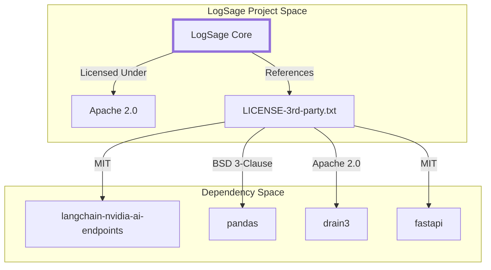
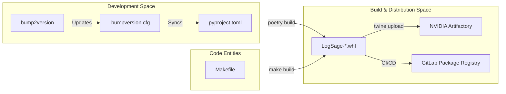

<!-- source: DeepWiki mcp.deepwiki.com · repo NVIDIA/LogSage · page 6 Project Governance and Packaging · fetched 2026-10-26 -->

# Project Governance and Packaging

Relevant source files

The following files were used as context for generating this wiki page:

- [CODEOWNERS](CODEOWNERS)
- [CONTRIBUTING.md](CONTRIBUTING.md)
- [LICENSE-3rd-party.txt](LICENSE-3rd-party.txt)
- [LICENSE.txt](LICENSE.txt)
- [SECURITY.md](SECURITY.md)

This page provides a high-level overview of the administrative, legal, and distribution frameworks governing the LogSage project. It covers how the community contributes to the codebase, the licensing terms for the software and its dependencies, and the mechanisms used for versioning and distributing the package.

## 6.1 Contributing Guide

LogSage follows a structured contribution process to ensure code quality and maintainability. Contributors are expected to follow specific branching strategies and commit conventions linked to JIRA project `NAIS` [CONTRIBUTING.md:104-106](). The project utilizes a `CODEOWNERS` file to automatically assign reviewers based on the areas of the codebase being modified [CODEOWNERS:1-2]().

Key aspects of the contribution workflow include:
*   **Branch Naming**: Branches must follow the pattern `NAIS-<ID>-<description>` [CONTRIBUTING.md:110-113]().
*   **Quality Gates**: Every contribution must pass pre-commit hooks (linting, formatting, and secret detection) and the full test suite [CONTRIBUTING.md:122-130]().
*   **Dependency Management**: New dependencies must be added and pinned using Poetry [CONTRIBUTING.md:144-152]().

For details, see [Contributing Guide](#6.1).

**Sources:** [CONTRIBUTING.md:104-152](), [CODEOWNERS:1-2]()

## 6.2 Licensing and Security

LogSage is released under the **Apache License 2.0** [LICENSE.txt:2-5](). This permissive license allows for broad use, modification, and distribution. Because LogSage integrates various third-party libraries (such as `FastAPI`, `Pydantic`, `LangChain`, and `Drain3`), it maintains a dedicated file to track the licenses of these dependencies [LICENSE-3rd-party.txt:1-95]().

Security is managed through a formal policy. Vulnerabilities should not be reported via public issues but rather through the official NVIDIA PSIRT channels [SECURITY.md:5-11](). The project also employs automated tools like `detect-secrets` and `licensecheck` to maintain a secure and compliant codebase [CONTRIBUTING.md:124-130]().

For details, see [Licensing and Security](#6.2).

### Licensing Relationship Diagram
This diagram illustrates how the core LogSage project relates to its third-party dependencies and their respective licenses.

**Sources:** [LICENSE.txt:2-5](), [LICENSE-3rd-party.txt:1-95](), [SECURITY.md:5-20]()

## 6.3 Versioning and Package Distribution

LogSage uses **Semantic Versioning** (SemVer) and automates the release process using `bump2version` [CONTRIBUTING.md:15-17](). The project is packaged as a Python wheel using `Poetry` [CONTRIBUTING.md:34-40]().

The distribution pipeline is integrated into the GitLab CI/CD environment:
1.  **Build**: The `make build` command triggers `poetry build` to generate distribution archives.
2.  **Versioning**: Version numbers are tracked in `.bumpversion.cfg` and `pyproject.toml`.
3.  **Registry**: Packages are published to NVIDIA's private PyPI repositories (Artifactory) and the GitLab Package Registry for consumption by other internal services.

For details, see [Versioning and Package Distribution](#6.3).

### Distribution Flow Diagram
This diagram bridges the developer actions to the resulting artifacts and distribution points.

**Sources:** [CONTRIBUTING.md:15-17](), [CONTRIBUTING.md:34-40]()

---

