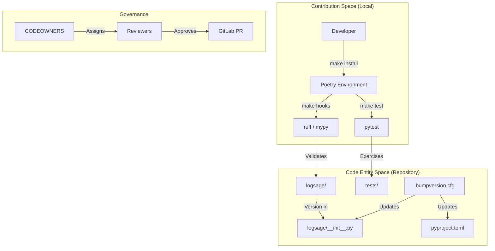
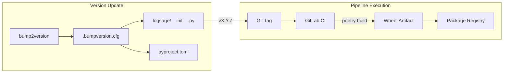

<!-- source: DeepWiki mcp.deepwiki.com · repo NVIDIA/LogSage · page 6.1 Contributing Guide · fetched 2026-10-26 -->

# Contributing Guide

Relevant source files

The following files were used as context for generating this wiki page:

- [.bumpversion.cfg](.bumpversion.cfg)
- [CODEOWNERS](CODEOWNERS)
- [CONTRIBUTING.md](CONTRIBUTING.md)

This guide outlines the standards and procedures for contributing to LogSage. We value high-quality code, clear ownership, and rigorous testing to maintain the reliability of the Auto-Resume-Policy pipeline.

## Branching Strategy

LogSage follows a strict branching policy linked to the **NAIS** (Networking AI Security) JIRA project.

### Format Requirements
All branches must follow the regex pattern: `^(NAIS-(0|[1-9][0-9]*))-[a-z0-9\-]{2,30}$` [CONTRIBUTING.md:110-110]().

1.  **Ticket Number**: Must start with `NAIS-` followed by the JIRA ID (e.g., `NAIS-123`). Use `NAIS-0` for minor changes without a ticket [CONTRIBUTING.md:113-113]().
2.  **Descriptive Name**: 2-30 characters of lowercase letters, numbers, and dashes [CONTRIBUTING.md:114-114]().

**Examples:**
*   `NAIS-1234-add-authentication-logging`
*   `NAIS-567-update-readme`

Sources: [CONTRIBUTING.md:104-121]()

## Commit and PR Process

### Development Workflow
The typical workflow involves setting up a virtual environment and installing dependencies via `make install`, which configures both Poetry and pre-commit hooks [CONTRIBUTING.md:43-54]().

### Pre-commit Hooks
Before committing, contributors must run pre-commit checks to ensure linting and security standards are met:
*   `make hooks`: Runs all pre-commit checks [CONTRIBUTING.md:128-128]().
*   `make lint`: Runs the `ruff` linter [CONTRIBUTING.md:134-134]().
*   `make format`: Formats code according to project standards.

### Pull Requests (PR)
*   **AI Reviews**: LogSage uses **CodeRabbit** for automated AI code reviews [CONTRIBUTING.md:12-12]().
*   **Signing**: Contributors must sign their work (DCO) to certify they have the right to submit the code [CONTRIBUTING.md:21-21]().
*   **File Size**: Files must not exceed **2MB**. Larger files (models/datasets) must be handled via **Git LFS** [CONTRIBUTING.md:154-159]().

Sources: [CONTRIBUTING.md:43-181]()

## Code Ownership and Review

The project uses a `CODEOWNERS` file to automatically assign reviewers based on the file paths modified in a PR. This ensures that domain experts (e.g., those familiar with the `error_extraction` logic) review relevant changes.

### Review Expectations
*   **Responsibility**: Contributors are responsible for responding to feedback and ongoing maintenance of their contributions [CONTRIBUTING.md:27-27]().
*   **Standards**: Code must adhere to the rules defined in `.editorconfig` and the `ruff` configuration in `pyproject.toml`.

Sources: [CODEOWNERS:1-2](), [CONTRIBUTING.md:23-28]()

## Versioning and Releases

LogSage uses **Semantic Versioning** (SemVer). Versioning is managed via `bump2version`.

### Version Configuration
The `.bumpversion.cfg` file synchronizes the version string across multiple files:
*   `pyproject.toml`: `version = "{version}"` [.bumpversion.cfg:9-11]()
*   `logsage/__init__.py`: `__version__ = "{version}"` [.bumpversion.cfg:13-15]()

### Release Process
1.  Update the version: `bump2version [major|minor|patch]`.
2.  This creates a commit and a git tag (e.g., `v0.0.6`) [.bumpversion.cfg:1-7]().
3.  The CI pipeline detects the tag and triggers the deployment stage to publish the wheel to the package registry.

### Dependency Management
Dependencies must be pinned using Poetry. For example:
`poetry add requests = "^1.2.3"` [CONTRIBUTING.md:151-151]().

Sources: [.bumpversion.cfg:1-16](), [CONTRIBUTING.md:142-152]()

## Testing Standards

All contributions must include tests. LogSage uses `pytest` with a focus on coverage and HTML reporting.

### Test Commands
| Command | Purpose |
| :--- | :--- |
| `make test` | Runs all tests in the `tests/` directory [CONTRIBUTING.md:195-195](). |
| `make test-coverage` | Runs tests and generates a terminal coverage report. |
| `make test-html` | Generates a detailed HTML coverage report. |

### Implementation Details
The test suite utilizes specialized tools like `FakeListLLM` to mock LLM responses in `test_attribution_classes.py` and `test_error_extraction.py`.

Sources: [CONTRIBUTING.md:188-202]()

## Technical Contribution Flow

The following diagram illustrates the relationship between the contribution tools and the codebase entities.

### Contribution Tooling to Code Entity Mapping

Sources: [.bumpversion.cfg:1-16](), [CONTRIBUTING.md:43-130](), [CODEOWNERS:1-2]()

### CI/CD and Versioning Data Flow

Sources: [.bumpversion.cfg:1-16](), [CONTRIBUTING.md:15-17]()

---

