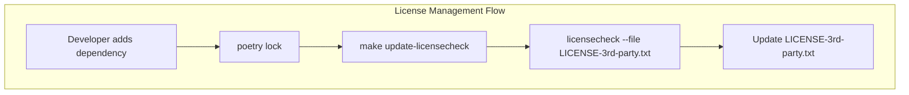
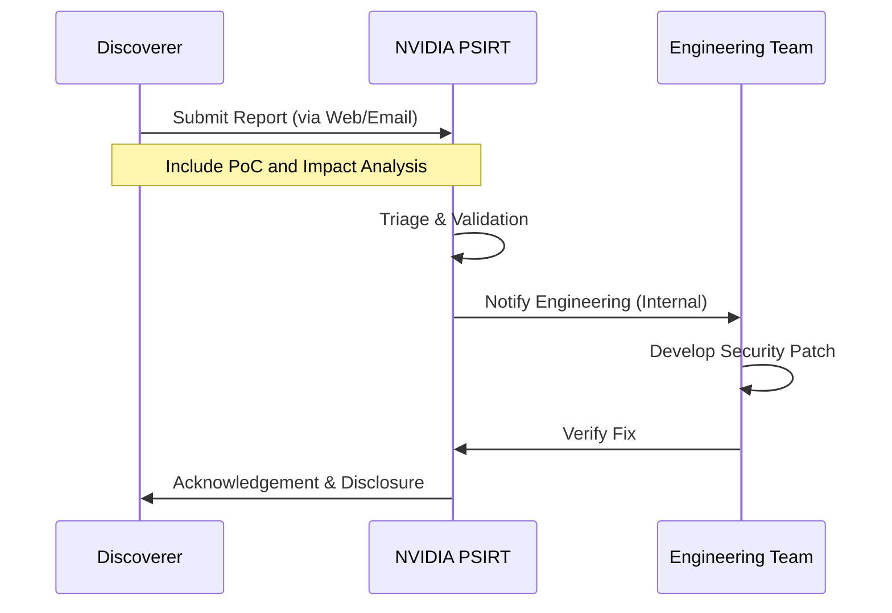

<!-- source: DeepWiki mcp.deepwiki.com · repo NVIDIA/LogSage · page 6.2 Licensing and Security · fetched 2026-10-26 -->

# Licensing and Security

Relevant source files

The following files were used as context for generating this wiki page:

- [LICENSE-3rd-party.txt](LICENSE-3rd-party.txt)
- [LICENSE.txt](LICENSE.txt)
- [Makefile](Makefile)
- [SECURITY.md](SECURITY.md)

This page details the legal and security frameworks governing the LogSage codebase. It covers the primary Apache 2.0 license, the management of third-party dependencies, and the official NVIDIA protocols for vulnerability reporting.

## Licensing Framework

LogSage is released under the **Apache License, Version 2.0**. This license provides a perpetual, worldwide, non-exclusive, no-charge, royalty-free, irrevocable copyright license to reproduce, prepare derivative works of, and distribute the software [LICENSE.txt:67-72]().

### Core License Terms
The Apache 2.0 license includes specific requirements for redistribution and contribution:
*   **Redistribution**: Any redistributed copies must include a copy of the license and prominent notices for modified files [LICENSE.txt:95-99]().
*   **Patent Grant**: Contributors grant a patent license to users, which terminates if the user institutes patent litigation against any contributor regarding the work [LICENSE.txt:74-88]().
*   **Contributions**: Unless stated otherwise, any contribution submitted for inclusion is governed by the terms of the Apache 2.0 license [LICENSE.txt:131-135]().

### Third-Party Dependency Management
LogSage relies on several third-party libraries with various permissive licenses (MIT, BSD 3-Clause, and Apache 2.0). These are tracked in `LICENSE-3rd-party.txt`.

| Dependency | License | Purpose |
| :--- | :--- | :--- |
| `langchain` | MIT | LLM orchestration and NVIDIA AI integration [LICENSE-3rd-party.txt:1-3]() |
| `pandas` | BSD 3-Clause | Structured data manipulation [LICENSE-3rd-party.txt:22-24]() |
| `fastapi` | MIT | Web framework for API services [LICENSE-3rd-party.txt:40-42]() |
| `drain3` | Apache 2.0 | Streaming log template mining [LICENSE-3rd-party.txt:80-82]() |
| `pydantic` | MIT | Settings management and data validation [LICENSE-3rd-party.txt:66-68]() |

**Sources:** [LICENSE.txt:1-135](), [LICENSE-3rd-party.txt:1-95]()

## License Compliance Automation

The project uses the `licensecheck` tool to ensure `LICENSE-3rd-party.txt` remains synchronized with the actual dependencies defined in the environment.

### License Update Workflow
The `Makefile` provides a specific target to refresh the third-party license file. This is typically executed during the release preparation phase or when adding new dependencies.

The `update-licensecheck` target runs within the Poetry virtual environment to scan installed packages and format the output into the standard simple format used by the project [Makefile:118-120]().

**Sources:** [Makefile:118-120](), [LICENSE-3rd-party.txt:1-95]()

## Security Policy

NVIDIA maintains a centralized security policy for LogSage. Security vulnerabilities should **never** be reported via public GitHub issues [SECURITY.md:5-6]().

### Vulnerability Reporting Process
Potential security issues must be reported through official NVIDIA channels to the Product Security Incident Response Team (PSIRT).

| Channel | Contact Information |
| :--- | :--- |
| **Web Form** | [Security Vulnerability Submission Form](https://www.nvidia.com/object/submit-security-vulnerability.html) [SECURITY.md:10]() |
| **Email** | psirt@nvidia.com [SECURITY.md:11]() |
| **Encryption** | NVIDIA Public PGP Key [SECURITY.md:12]() |

### Submission Requirements
When reporting a vulnerability, the following technical details are required:
1.  Product name and version/branch [SECURITY.md:14]().
2.  Vulnerability type (e.g., Buffer Overflow, Denial of Service) [SECURITY.md:15]().
3.  Reproduction instructions and Proof-of-Concept (PoC) code [SECURITY.md:16-17]().
4.  Potential impact and exploitability analysis [SECURITY.md:18]().

### Security Data Flow
The following diagram maps the reporting process from discovery to resolution within the NVIDIA ecosystem.

**Sources:** [SECURITY.md:1-25]()

## Developer Security Tooling

To prevent accidental leaks of sensitive information (such as `NVIDIA_API_KEY`), the project integrates automated scanning into the development workflow.

### Secret Detection
The `Makefile` includes a `secrets` target that utilizes `detect-secrets` to scan the repository for hardcoded credentials or tokens [Makefile:114-116](). This is also integrated into the `pre-commit` hooks, which are installed during the `make install` process [Makefile:81]().

### Code Sanitization
While not a license issue, the LLM integration logic includes XSS sanitization to ensure that potentially malicious strings returned by the LLM (which might have processed malicious log data) do not compromise the user interface or API consumers.

**Sources:** [Makefile:81-116](), [SECURITY.md:1-25]()

---

