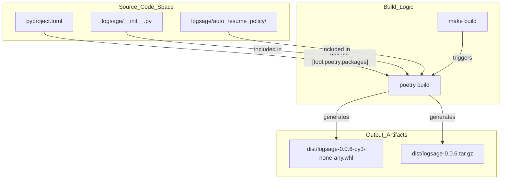
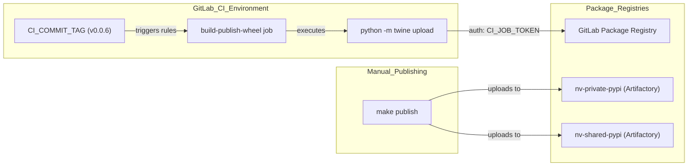

<!-- source: DeepWiki mcp.deepwiki.com · repo NVIDIA/LogSage · page 6.3 Versioning and Package Distribution · fetched 2026-10-26 -->

# Versioning and Package Distribution

Relevant source files

The following files were used as context for generating this wiki page:

- [.bumpversion.cfg](.bumpversion.cfg)
- [.cruft.json](.cruft.json)
- [.gitlab/cd/build-publish-wheel.yml](.gitlab/cd/build-publish-wheel.yml)
- [Makefile](Makefile)
- [pyproject.toml](pyproject.toml)

This page details the mechanisms LogSage uses for version management, package construction, and distribution across NVIDIA's internal infrastructure and GitLab registries. The project follows Semantic Versioning (SemVer) and utilizes automated tooling to ensure consistency across the codebase and artifact repositories.

## Versioning Strategy

LogSage employs `bump2version` to manage its version state across multiple files. The versioning follows the `major.minor.patch` format [ .bumpversion.cfg:6-7 ]().

### Configuration and Hooks
The `.bumpversion.cfg` file acts as the central authority for version transitions. When a version bump is triggered, the tool automatically updates the following locations:
*   **Project Metadata**: The `version` field in `pyproject.toml` [ .bumpversion.cfg:9-11 ]().
*   **Runtime Metadata**: The `__version__` variable in `logsage/__init__.py` [ .bumpversion.cfg:13-15 ]().

The configuration is set to automatically commit the changes and create a git tag (e.g., `v0.0.6`) upon execution [ .bumpversion.cfg:3-5 ]().

### Version Bump Workflow
Developers use `Makefile` targets to increment versions, which ensures the `bump2version` utility is called through the Poetry virtual environment:

| Target | Command | Description |
| :--- | :--- | :--- |
| `make bump-patch` | `poetry run bump2version patch` | Increments the patch version (e.g., 0.0.6 -> 0.0.7) [ Makefile:142-144 ](). |
| `make bump-minor` | `poetry run bump2version minor` | Increments the minor version (e.g., 0.0.6 -> 0.1.0) [ Makefile:148-150 ](). |
| `make bump-major` | `poetry run bump2version major` | Increments the major version (e.g., 0.0.6 -> 1.0.0) [ Makefile:154-156 ](). |

**Sources:** [ .bumpversion.cfg:1-16 ](), [ Makefile:142-158 ](), [ pyproject.toml:4-4 ]()

## Package Building

LogSage is packaged as a Python Wheel using `poetry`. The build process gathers the core logic located in the `logsage/` directory and its subpackages [ pyproject.toml:27-30 ]().

### Build Process Flow
The build is initiated via `make build`, which executes `poetry build` [ Makefile:160-161 ](). This generates both a source distribution (`.tar.gz`) and a compiled wheel (`.whl`) in the `dist/` directory [ Makefile:162 ]().

### Dependency Management
The project distinguishes between core runtime dependencies and development tools:
*   **Core Dependencies**: Includes `langchain-nvidia-ai-endpoints`, `fastapi`, and `drain3` [ pyproject.toml:32-47 ]().
*   **Build System**: Uses `poetry-core` as the backend [ pyproject.toml:79-81 ]().

### Building Diagram: Code to Artifact
The following diagram illustrates how the `Makefile` and `pyproject.toml` configurations transform the source code into a distributable wheel.

Title: LogSage Build Pipeline

**Sources:** [ Makefile:160-163 ](), [ pyproject.toml:27-30 ](), [ pyproject.toml:79-81 ]()

## Distribution and Publishing

LogSage is distributed to three primary destinations: NVIDIA Artifactory (Private and Shared) and the GitLab Package Registry.

### NVIDIA Artifactory (URM)
The project is configured to interface with NVIDIA's Universal Repository Manager (URM). The URLs for these repositories are defined in the project configuration:
*   **Private PyPI**: `https://urm.nvidia.com/artifactory/api/pypi/sw-networking-ai-security-pypi-local` [ .cruft.json:14 ](), [ Makefile:7 ]().
*   **Shared PyPI**: `https://urm.nvidia.com/artifactory/api/pypi/nv-shared-pypi-local` [ .cruft.json:15 ](), [ Makefile:8 ]().

Poetry is configured to use these as supplemental or explicit sources for fetching and publishing packages [ pyproject.toml:67-77 ]().

### GitLab Package Registry
The automated CI/CD pipeline handles publishing to the GitLab Project's PyPI registry. This is managed by the `build-publish-wheel` job [ .gitlab/cd/build-publish-wheel.yml:1 ]().

**Data Flow for Distribution:**
1.  **Trigger**: A git tag (e.g., `v*`) is pushed to the repository [ .gitlab/cd/build-publish-wheel.yml:9 ]().
2.  **Environment**: The job extends `.python-job` and runs in the `deploy` stage [ .gitlab/cd/build-publish-wheel.yml:2-3 ]().
3.  **Authentication**: Uses `CI_JOB_TOKEN` with the username `gitlab-ci-token` [ .gitlab/cd/build-publish-wheel.yml:7 ]().
4.  **Upload**: Uses `twine` to upload the contents of the `dist/` directory to the GitLab API endpoint `${CI_API_V4_URL}/projects/${CI_PROJECT_ID}/packages/pypi` [ .gitlab/cd/build-publish-wheel.yml:7 ]().

### Distribution Diagram: Pipeline to Registry
This diagram maps the CI/CD configuration to the final distribution endpoints.

Title: LogSage Distribution Flow

**Sources:** [ .gitlab/cd/build-publish-wheel.yml:1-14 ](), [ Makefile:6-8 ](), [ .cruft.json:14-15 ](), [ pyproject.toml:67-77 ]()

---

