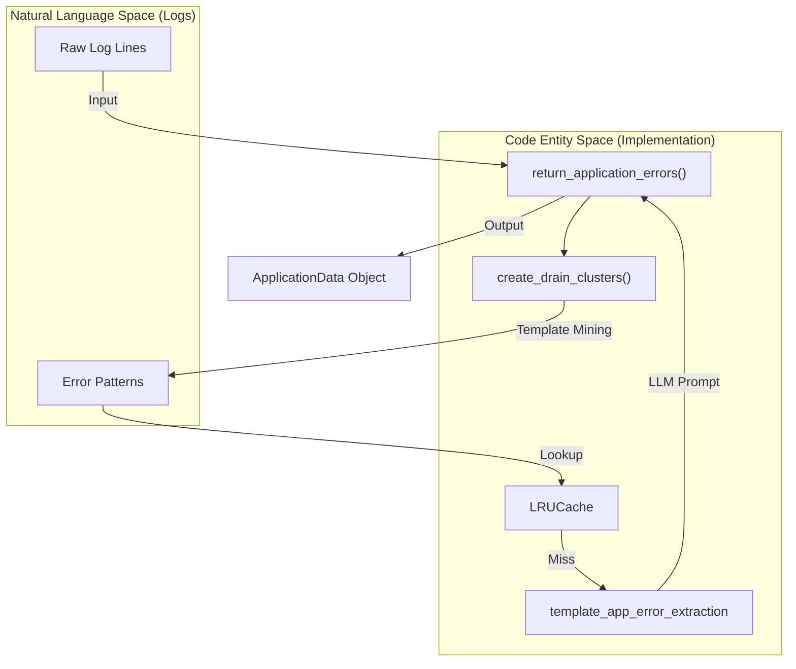
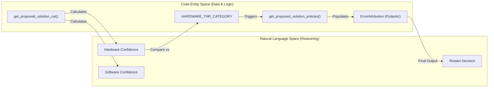

<!-- source: DeepWiki mcp.deepwiki.com · repo NVIDIA/LogSage · page 7 Glossary · fetched 2026-10-26 -->

# Glossary

Relevant source files

The following files were used as context for generating this wiki page:

- [logsage/auto_resume_policy/attribution_classes.py](logsage/auto_resume_policy/attribution_classes.py)
- [logsage/auto_resume_policy/config.py](logsage/auto_resume_policy/config.py)
- [logsage/auto_resume_policy/consts.py](logsage/auto_resume_policy/consts.py)
- [logsage/auto_resume_policy/error_attribution.py](logsage/auto_resume_policy/error_attribution.py)
- [logsage/auto_resume_policy/error_extraction.py](logsage/auto_resume_policy/error_extraction.py)
- [logsage/auto_resume_policy/log_sage.py](logsage/auto_resume_policy/log_sage.py)
- [logsage/auto_resume_policy/prompts.py](logsage/auto_resume_policy/prompts.py)
- [logsage/auto_resume_policy/utils.py](logsage/auto_resume_policy/utils.py)

This page provides definitions for codebase-specific terms, domain concepts, and architectural components within LogSage. It serves as a technical reference for engineers to understand the mapping between high-level log analysis concepts and their specific implementations in the code.

## Core Domain Concepts

### Error Attribution
The process of determining the root cause category of a job failure (e.g., Hardware, Numerical Instability, Misconfiguration).
*   **Implementation**: Handled primarily by `get_proposed_solution_cat` in `logsage/auto_resume_policy/error_attribution.py`.
*   **Data Model**: Results are encapsulated in the `ErrorAttribution` Pydantic model [logsage/auto_resume_policy/attribution_classes.py:83-89]().

### Auto-Resume Policy
A recommendation engine that decides whether a failed job should be automatically restarted or stopped based on the attribution results and the presence of checkpoints.
*   **Logic**: Defined in `get_proposed_solution_policies` [logsage/auto_resume_policy/error_attribution.py:321-325]().
*   **Policies**: Defined as constants in `POLICIES` [logsage/auto_resume_policy/consts.py:93-93]().

### Drain3 Clustering
An online log parsing algorithm used to group similar log lines into templates. This reduces the volume of data sent to the LLM by processing unique patterns instead of every individual log line.
*   **Implementation**: `create_drain_clusters` [logsage/auto_resume_policy/error_extraction.py:163-234]().
*   **Configuration**: The miner uses a similarity threshold of 0.4 and a depth of 4 [logsage/auto_resume_policy/error_extraction.py:184-185]().

---

## Technical Terms & Components

| Term | Definition | Code Pointer |
| :--- | :--- | :--- |
| **Attribution ID** | A unique UUID generated for each analysis session to track logs and results in the API. | [logsage/auto_resume_policy/log_sage.py:20-20]() |
| **LRU Cache** | A Least Recently Used cache used to store LLM classification results for log templates to avoid redundant API calls. | [logsage/auto_resume_policy/attribution_classes.py:22-45]() |
| **Cordon Nodes** | The identification of specific hardware nodes that should be taken out of service (isolated) due to detected faults. | [logsage/auto_resume_policy/error_attribution.py:532-535]() |
| **Domain Size** | The number of GPUs per node (e.g., 8 for Hopper), used to map log ranks to physical nodes. | [logsage/auto_resume_policy/consts.py:21-21]() |
| **XSS Filtering** | Sanitization of LLM outputs using `nh3` to prevent malicious script injection in UI displays. | [logsage/auto_resume_policy/utils.py:27-27]() |

### Natural Language Space to Code Entity Space: Error Extraction
The following diagram illustrates how raw log text is transformed into structured error data using specific code entities.

**Log Processing Flow**

**Sources**: [logsage/auto_resume_policy/error_extraction.py:465-470](), [logsage/auto_resume_policy/attribution_classes.py:47-58](), [logsage/auto_resume_policy/prompts.py:16-22]()

---

## LLM Integration & Pipeline

LogSage utilizes NVIDIA NIM endpoints via `langchain-nvidia-ai-endpoints`. The system manages model initialization, retries, and prompt templating.

### Key LLM Components
*   **`get_llm()`**: Factory function that initializes the `ChatNVIDIA` client with environment-specific configurations like `NVIDIA_API_KEY` and `MODEL_NAME` [logsage/auto_resume_policy/log_sage.py:59-98]().
*   **`retry_operation()`**: A wrapper that handles transient network failures and model fallback logic if the primary LLM endpoint fails [logsage/auto_resume_policy/utils.py:53-104]().
*   **`ApplicationData`**: A container class that holds the intermediate state of the analysis, including unique errors and iteration patterns [logsage/auto_resume_policy/attribution_classes.py:47-81]().

### Data Flow: Attribution to Policy
This diagram bridges the conceptual "Root Cause Analysis" to the internal Pydantic models and logic functions.

**Attribution and Policy Logic**

**Sources**: [logsage/auto_resume_policy/error_attribution.py:157-163](), [logsage/auto_resume_policy/attribution_classes.py:83-89](), [logsage/auto_resume_policy/consts.py:95-95]()

---

## Configuration & Constants

LogSage behavior is heavily influenced by thresholds and word lists defined in `consts.py`.

*   **`CONTEXT_SIZE`**: The maximum token window for LLM analysis (default 100,000) [logsage/auto_resume_policy/consts.py:17-17]().
*   **`ERROR_WORDS`**: A list of high-confidence error strings (e.g., "cuda failure", "segmentation fault") used for regex-based pre-filtering [logsage/auto_resume_policy/consts.py:26-38]().
*   **`HARDWARE_THR_LINE`**: The confidence threshold (default 60) required to classify a specific log line as a hardware issue [logsage/auto_resume_policy/consts.py:96-96]().

**Sources**:
*   `logsage/auto_resume_policy/attribution_classes.py`
*   `logsage/auto_resume_policy/config.py`
*   `logsage/auto_resume_policy/consts.py`
*   `logsage/auto_resume_policy/error_attribution.py`
*   `logsage/auto_resume_policy/error_extraction.py`
*   `logsage/auto_resume_policy/log_sage.py`
*   `logsage/auto_resume_policy/prompts.py`
*   `logsage/auto_resume_policy/utils.py`