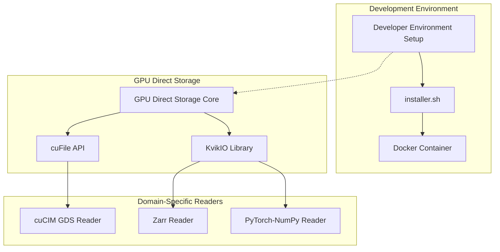
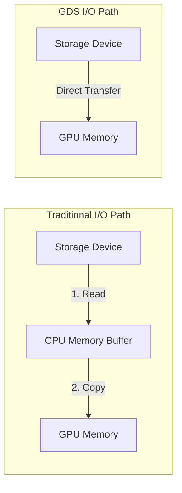
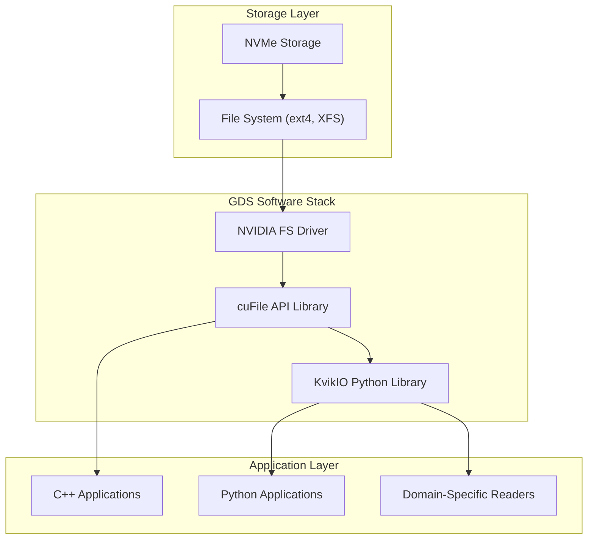
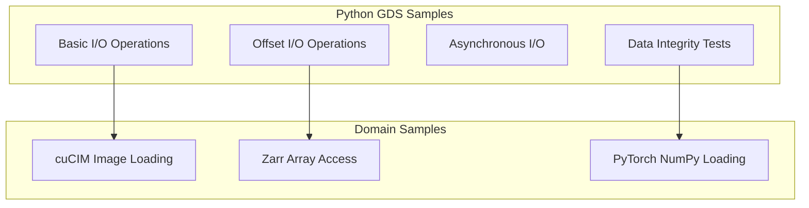

<!-- source: DeepWiki mcp.deepwiki.com · repo NVIDIA/MagnumIO · page 1 Home · fetched 2026-10-26 -->

# Home

<details>
<summary>Relevant source files</summary>

The following files were used as context for generating this wiki page:

- [.gitmodules](.gitmodules)
- [dev-env/.gitignore](dev-env/.gitignore)
- [dev-env/README.md](dev-env/README.md)
- [dev-env/installer.sh](dev-env/installer.sh)
- [dev-env/magnum-io-hpccm.py](dev-env/magnum-io-hpccm.py)
- [dev-env/magnum-io.Dockerfile](dev-env/magnum-io.Dockerfile)
- [gds/readers/cucim-gds/README.md](gds/readers/cucim-gds/README.md)
- [gds/readers/cucim-gds/test_gds.py](gds/readers/cucim-gds/test_gds.py)
- [gds/samples/README.md](gds/samples/README.md)

</details>


## Introduction to NVIDIA MagnumIO

NVIDIA MagnumIO is a collection of I/O technologies and tools designed to accelerate data movement between storage and NVIDIA GPUs. The primary focus is on GPU Direct Storage (GDS), which enables direct data transfer between storage devices and GPU memory without CPU involvement, significantly reducing latency and increasing throughput for data-intensive applications.

This repository provides:
- Development environment setup tools
- GPU Direct Storage (GDS) implementation and samples
- cuFile API for direct GPU storage access
- KvikIO library for Python-based GDS access
- Domain-specific readers for formats like Zarr and integration with frameworks like cuCIM and PyTorch

Sources: [dev-env/README.md:1-19](), [gds/readers/cucim-gds/README.md:1-20]()

## System Architecture Overview

The following diagram illustrates the high-level architecture of NVIDIA MagnumIO:



Sources: [.gitmodules:1-7](), [dev-env/README.md:20-27]()

## Data Flow Comparison

The key innovation in MagnumIO is the direct data path between storage and GPU memory:



Sources: [gds/readers/cucim-gds/README.md:1-20](), [dev-env/README.md:164-175]()

## Development Environment

The MagnumIO repository provides a comprehensive development environment setup to help developers get started quickly. The setup includes:

1. **Installer Script**: A bash script (`installer.sh`) that automates the setup of necessary components:
   - NVIDIA GPU driver installation
   - CUDA toolkit installation
   - Docker and NVIDIA Container Toolkit setup
   - User configuration for Docker access

2. **Docker Container**: A pre-configured container with all necessary libraries and tools:
   - CUDA Toolkit
   - NVIDIA Nsight Systems for performance analysis
   - Mellanox OFED for networking
   - GDRCOPY for GPU Direct RDMA
   - UCX for unified communication
   - NVSHMEM for GPU-initiated operations
   - NCCL for collective communication

### Setup Process

```mermaid
flowchart LR
    Start["Start Setup"] --> CheckDeps["Check Dependencies"]
    CheckDeps --> InstallDriver["Install NVIDIA Driver"]
    InstallDriver --> InstallCUDA["Install CUDA Toolkit"]
    InstallCUDA --> InstallDocker["Install Docker"]
    InstallDocker --> SetupUser["Configure User Permissions"]
    SetupUser --> BuildContainer["Build Container"]
    BuildContainer --> RunContainer["Run Container"]
```



Sources: [dev-env/installer.sh:1-30](), [dev-env/installer.sh:513-594](), [dev-env/README.md:30-70]()

### Quick Start

The development environment can be set up using the installer script:

```
git clone https://github.com/NVIDIA/MagnumIO.git
cd MagnumIO/dev-env
./installer.sh setup-system
./installer.sh build-container
./installer.sh run-container
```

For more detailed options and commands, refer to [Developer Environment Setup](#2).

Sources: [dev-env/README.md:30-70](), [dev-env/installer.sh:451-509]()

## GPU Direct Storage (GDS)

GPU Direct Storage is the core technology in MagnumIO that enables a direct data path between storage and GPU memory, bypassing the CPU and system memory. This significantly reduces latency and increases throughput for data-intensive applications.

### GDS Architecture



Sources: [gds/readers/cucim-gds/README.md:15-110](), [dev-env/README.md:162-175]()

### Key Components

#### 1. cuFile API

The cuFile API provides low-level access to GDS functionality, allowing direct data transfers between storage and GPU memory. It includes functions for:

- File operations (open, close)
- Direct data transfer (read, write)
- Memory management (buffer registration)
- Batch I/O operations
- Asynchronous I/O

The repository includes numerous samples demonstrating various aspects of the cuFile API usage.

Sources: [gds/samples/README.md:1-15](), [gds/samples/README.md:30-221]()

#### 2. KvikIO Library

KvikIO is a high-level Python interface for GDS, making it easier to use GDS functionality in Python applications. It integrates with popular Python libraries like CuPy and PyTorch for GPU computing.

Sources: [gds/readers/cucim-gds/test_gds.py:1-32](), [.gitmodules:1-3]()

#### 3. Domain-Specific Readers

MagnumIO includes specialized readers for specific data formats:

- **cuCIM GDS Reader**: Provides GDS implementation for GPU-accelerated image processing with cuCIM
- **Zarr Reader**: GDS-based reader for N-dimensional array data stored in Zarr format
- **PyTorch-NumPy Reader**: GDS reader for NumPy files in PyTorch workflows

For more information on these readers, see [Domain-Specific GDS Readers](#6).

Sources: [gds/readers/cucim-gds/README.md:1-10](), [.gitmodules:1-7]()

## Sample Applications

MagnumIO includes a comprehensive set of sample applications demonstrating various aspects of GDS functionality:

### C++ Samples

The repository contains numerous C++ samples demonstrating different aspects of the cuFile API:

| Sample | Description |
|--------|-------------|
| Basic I/O | Demonstrates basic file read/write operations using cuFile API |
| Data Integrity | Tests for ensuring data integrity during transfers |
| Batch I/O | Shows how to use batch I/O operations for improved performance |
| Asynchronous I/O | Demonstrates asynchronous read/write operations |
| Memory Mapping | Shows usage of memory mapping with cuFile API |
| Fcntl Locking | Demonstrates file locking for concurrent access |

Sources: [gds/samples/README.md:32-221]()

### Python Samples

The Python samples demonstrate KvikIO usage:



Sources: [gds/readers/cucim-gds/test_gds.py:1-32]()

## Getting Started

To get started with NVIDIA MagnumIO:

1. **Set up the development environment**:
   ```
   git clone https://github.com/NVIDIA/MagnumIO.git
   cd MagnumIO/dev-env
   ./installer.sh setup-system
   ./installer.sh build-container
   ./installer.sh run-container
   ```

2. **Explore the samples**:
   ```
   cd MagnumIO/gds/samples
   export CUFILE_PATH=/usr/local/cuda/targets/x86_64-linux/lib/
   make
   ./cufile_sample_001 <file-path> <gpu-id>
   ```

3. **Try domain-specific readers**:
   - For cuCIM GDS Reader, see [cuCIM GDS Reader](#6.1)
   - For Zarr Reader, see [Zarr Reader](#6.2)
   - For PyTorch-NumPy Reader, see [PyTorch-NumPy Reader](#6.3)

For more detailed documentation on specific components:
- [Developer Environment Setup](#2)
- [GPU Direct Storage (GDS)](#3)
- [cuFile API](#4)
- [KvikIO Library](#5)
- [Domain-Specific GDS Readers](#6)
- [Building and Running Samples](#7)
- [Docker Integration](#8)

Sources: [dev-env/README.md:30-70](), [gds/samples/README.md:15-30]()

---

