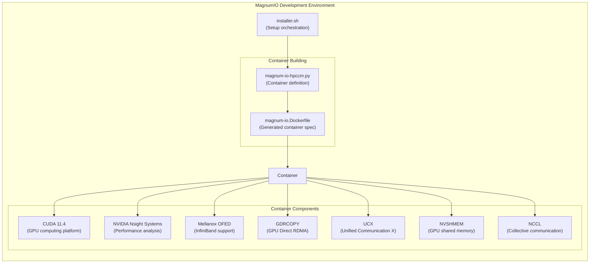
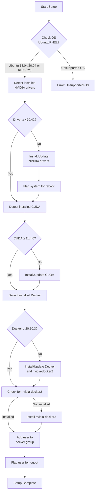
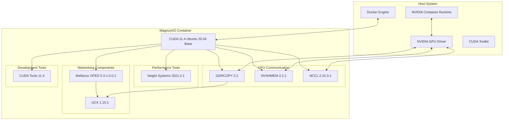

<!-- source: DeepWiki mcp.deepwiki.com · repo NVIDIA/MagnumIO · page 2 Developer Environment Setup · fetched 2026-10-26 -->

# Developer Environment Setup

<details>
<summary>Relevant source files</summary>

The following files were used as context for generating this wiki page:

- [dev-env/.gitignore](dev-env/.gitignore)
- [dev-env/README.md](dev-env/README.md)
- [dev-env/installer.sh](dev-env/installer.sh)
- [dev-env/magnum-io-hpccm.py](dev-env/magnum-io-hpccm.py)
- [dev-env/magnum-io.Dockerfile](dev-env/magnum-io.Dockerfile)

</details>


## Overview and Purpose

This document provides detailed instructions for setting up the NVIDIA MagnumIO development environment. It covers the installation of required dependencies, container setup, and usage of the development tools included in the MagnumIO ecosystem. For information about GPU Direct Storage (GDS) itself, see [GPU Direct Storage (GDS)](#3).

The MagnumIO development environment provides a consistent, reproducible platform for developing and testing GPU-accelerated I/O applications, with all necessary components pre-installed and configured.

Sources: [dev-env/README.md:1-18](), [dev-env/installer.sh:5-10]()

## System Requirements

### Hardware Requirements

The basic development environment will run on any system with:
- An NVIDIA GPU supported by CUDA
- Sufficient storage space for container images and development files

For full functionality, especially for GDS features, you'll need:
- Tesla, Volta, or Ampere series NVIDIA GPUs
- NVMe storage devices
- Properly configured ext4 filesystem with specific mounting options

### Software Requirements

- Operating Systems:
  - Ubuntu 18.04 LTS or 20.04 LTS
  - Red Hat Enterprise Linux 7.x or 8.x
- Minimum component versions:
  - NVIDIA Driver: 470.42 or newer
  - CUDA Toolkit: 11.4.0 or newer
  - Docker: 20.10.3 or newer

Sources: [dev-env/installer.sh:7-9](), [dev-env/README.md:100-113](), [dev-env/README.md:214-224]()

## Components of the Development Environment

The MagnumIO development environment consists of several key components:



Sources: [dev-env/magnum-io-hpccm.py:1-25](), [dev-env/magnum-io.Dockerfile:1-126](), [dev-env/README.md:118-211]()

## Setup Workflow

The installer script (`installer.sh`) provides a streamlined process for setting up the development environment:



Sources: [dev-env/installer.sh:38-446](), [dev-env/installer.sh:512-604]()

## Setting Up the Development Environment

### Quick Start

For a standard setup, follow these steps:

1. Clone the MagnumIO repository:
```bash
git clone https://github.com/NVIDIA/MagnumIO.git
cd MagnumIO/dev-env
```

2. Run the system setup:
```bash
./installer.sh setup-system
```

3. If prompted, reboot your system or log out and back in to apply changes.

4. Build or pull the container:
   
   **Option 1: Pull from NGC (recommended)**
   ```bash
   docker pull nvcr.io/nvidia/magnum-io/magnum-io:21.07
   ```
   
   **Option 2: Build locally**
   ```bash
   ./installer.sh build-container
   ```

5. Run the container:
```bash
./installer.sh run-container
```

Sources: [dev-env/README.md:29-98](), [dev-env/installer.sh:451-510]()

### Detailed Setup Process

#### System Setup

The `setup-system` command performs several key tasks:

1. Detects and installs/updates NVIDIA drivers if needed
2. Installs or updates CUDA to version 11.4 or newer
3. Installs Docker CE and NVIDIA Container Toolkit
4. Configures user permissions for Docker

```bash
./installer.sh setup-system
```

If a component requires updates, you may need to reboot or log out and back in for changes to take effect.

Sources: [dev-env/installer.sh:527-537](), [dev-env/installer.sh:73-119](), [dev-env/installer.sh:176-230](), [dev-env/installer.sh:241-327](), [dev-env/installer.sh:330-348]()

#### Individual Component Installation

You can also install or update components individually:

- Install NVIDIA drivers: `./installer.sh install-driver`
- Purge existing drivers (Ubuntu only): `./installer.sh purge-driver`
- Install CUDA: `./installer.sh install-driver`
- Install Docker and NVIDIA Container Toolkit: `./installer.sh install-docker`
- Configure Docker user permissions: `./installer.sh setup-docker-user`

Sources: [dev-env/installer.sh:538-556]()

#### Container Management

The installer provides commands for managing the MagnumIO container:

- Generate Dockerfile from HPCCM script: `./installer.sh build-dockerfile`
- Build the container: `./installer.sh build-container`
- Run the container: `./installer.sh run-container`
- Remove the container: `./installer.sh purge-container`

Sources: [dev-env/installer.sh:557-585](), [dev-env/installer.sh:351-375]()

## Container Architecture

The MagnumIO container is built with a layered architecture, providing all necessary components for GPU-accelerated I/O development:



Sources: [dev-env/magnum-io.Dockerfile:3-108](), [dev-env/magnum-io-hpccm.py:5-15]()

## Using the Container

### Running the Container

The most straightforward way to run the container is using the installer script:

```bash
./installer.sh run-container
```

This command launches the container with:
- All GPUs accessible
- Your home directory mounted inside the container
- User permissions matching your host user
- `/run/udev` mounted for device access

Sources: [dev-env/installer.sh:570-585]()

### Manual Container Execution

You can also run the container manually with Docker:

```bash
docker run --gpus all --rm -it \
  --user "$(id -u):$(id -g)" \
  --volume $HOME:$HOME \
  --volume /run/udev:/run/udev:ro \
  --workdir $HOME \
  magnum-io:21.07
```

This is equivalent to the `run-container` command but gives you more control over container options if needed.

Sources: [dev-env/README.md:63-70](), [dev-env/installer.sh:579-584]()

### Using NGC Pre-Built Containers

NVIDIA provides pre-built containers on NGC that can be used instead of building locally:

1. Visit the [Magnum IO Container on NGC](https://ngc.nvidia.com/catalog/containers/nvidia:magnum-io:magnum-io)
2. Pull the container:
   ```bash
   docker pull nvcr.io/nvidia/magnum-io/magnum-io:21.07
   ```
3. Run the container using the same commands as above, but with the NGC image name.

Sources: [dev-env/README.md:41-70]()

## Key Components In The Container

The MagnumIO container includes several key components for GPU-accelerated I/O development:

| Component | Version | Purpose |
|-----------|---------|---------|
| CUDA | 11.4 | GPU computing platform and programming model |
| NVIDIA Nsight Systems | 2021.2.1 | Performance analysis tool for CUDA applications |
| Mellanox OFED | 5.3-1.0.0.1 | InfiniBand drivers and utilities |
| GDRCOPY | 2.2 | Low-latency GPU memory copy library |
| UCX | 1.10.1 | Unified communication framework |
| NVSHMEM | 2.2.1 | GPU-integrated shared memory library |
| NCCL | 2.10.3-1 | Collective communications library for multi-GPU/multi-node |

Sources: [dev-env/magnum-io-hpccm.py:5-15](), [dev-env/magnum-io.Dockerfile:1-126](), [dev-env/README.md:118-211]()

## Troubleshooting

### Driver Installation Issues

If you encounter issues with NVIDIA driver installation:

1. For Ubuntu systems, try purging the drivers and reinstalling:
   ```bash
   ./installer.sh purge-driver
   # Reboot when prompted
   ./installer.sh install-driver
   ```

2. For Red Hat systems, manual driver installation is required:
   - Download drivers from the [NVIDIA website](https://www.nvidia.com/Download/index.aspx)
   - Install following the NVIDIA documentation

Sources: [dev-env/installer.sh:122-161](), [dev-env/README.md:231-244]()

### Docker Permission Issues

If you encounter "permission denied" errors when using Docker:

1. Ensure your user is in the docker group:
   ```bash
   ./installer.sh setup-docker-user
   ```

2. Log out and log back in to apply the group changes.

3. Verify with:
   ```bash
   groups | grep docker
   ```

Sources: [dev-env/installer.sh:330-348]()

### Container Build Failures

If the container build fails:

1. Verify internet connectivity:
   ```bash
   ping -c 3 8.8.8.8
   ```

2. Check for sufficient disk space:
   ```bash
   df -h
   ```

3. Try rebuilding the Dockerfile from the HPCCM script:
   ```bash
   ./installer.sh build-dockerfile
   ./installer.sh build-container
   ```

4. As an alternative, pull the pre-built container from NGC.

Sources: [dev-env/installer.sh:558-563](), [dev-env/README.md:41-70]()

## Customizing the Environment

### Modifying the Container Definition

The container is defined using HPC Container Maker (HPCCM), which provides a higher-level interface for container creation:

1. Install HPCCM:
   ```bash
   pip install hpccm
   ```

2. Modify the `magnum-io-hpccm.py` script according to your needs.

3. Regenerate the Dockerfile:
   ```bash
   ./installer.sh build-dockerfile
   ```

4. Build the updated container:
   ```bash
   ./installer.sh build-container
   ```

Sources: [dev-env/installer.sh:558-563](), [dev-env/magnum-io-hpccm.py:1-25]()

### Building on Top of the MagnumIO Container

You can use the MagnumIO container as a base for your own containers:

```dockerfile
FROM magnum-io:21.07

# Add your custom packages and configurations
RUN apt-get update && apt-get install -y your-packages

# Add your application code
COPY your-app /app

# Set working directory
WORKDIR /app

# Define command to run
CMD ["./your-app"]
```

This allows you to extend the MagnumIO environment with your specific requirements.

Sources: [dev-env/magnum-io.Dockerfile:1-126]()

## Diagnostic Information

The installer includes a diagnostic command to help troubleshoot issues:

```bash
./installer.sh diagnostics
```

This command displays:
- OS information
- Storage devices and space
- Network connectivity
- NVIDIA driver version and status
- CUDA and Docker versions
- NVIDIA-related shared libraries

Sources: [dev-env/installer.sh:386-422](), [dev-env/installer.sh:523-526]()

## Conclusion

The MagnumIO Developer Environment provides a complete ecosystem for developing, testing, and optimizing GPU-accelerated I/O applications. By following the setup instructions in this document, you can quickly establish a consistent, reproducible environment that includes all necessary components for NVIDIA Magnum IO development.

For more information about using the specific components within MagnumIO, refer to their respective documentation pages in this wiki.

---

