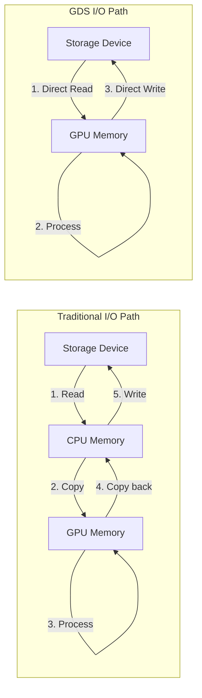
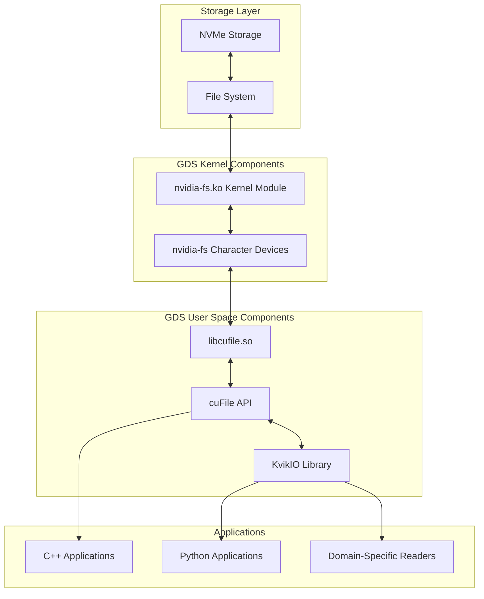
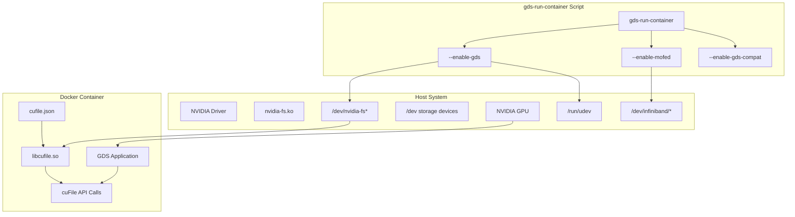
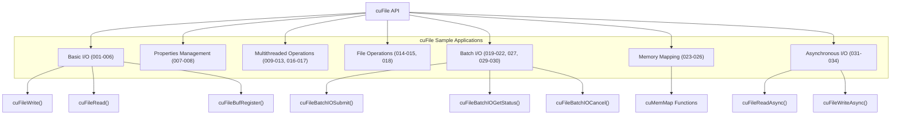

<!-- source: DeepWiki mcp.deepwiki.com · repo NVIDIA/MagnumIO · page 3 GPU Direct Storage (GDS) · fetched 2026-10-26 -->

# GPU Direct Storage (GDS)

<details>
<summary>Relevant source files</summary>

The following files were used as context for generating this wiki page:

- [gds/docker/README.md](gds/docker/README.md)
- [gds/docker/gds-run-container](gds/docker/gds-run-container)
- [gds/samples/README.md](gds/samples/README.md)

</details>


## Introduction and Purpose

GPU Direct Storage (GDS) is a key technology that enables direct data transfers between GPU memory and storage devices, bypassing CPU memory. This documentation covers the GDS system within NVIDIA MagnumIO, detailing its architecture, components, and use cases. GDS is designed to significantly improve I/O performance for GPU-accelerated applications by eliminating unnecessary data copies through the CPU.

For information about the specific API that GDS provides, see [cuFile API](#4). For the high-level Python interface to GDS, see [KvikIO Library](#5).

Sources: gds/samples/README.md

## GDS Architecture and Data Flow

### Traditional vs GDS I/O Path



GDS establishes a direct data path between storage and GPU memory, eliminating the CPU memory as an intermediary. This reduces latency, increases bandwidth, and frees CPU resources.

Sources: gds/samples/README.md

### GDS Component Stack



The GDS stack consists of kernel components (nvidia-fs kernel module), user space libraries (libcufile.so), and APIs (cuFile and KvikIO) that applications use to access the direct data path.

Sources: gds/docker/README.md

## Core GDS Components

### cuFile API

The cuFile API provides low-level C/C++ functions for direct data transfer between storage and GPU memory. Key functions include:

- `cuFileHandleRegister()` - Registers a file handle for GDS operations
- `cuFileBufRegister()` - Registers a GPU buffer for GDS operations
- `cuFileRead()`/`cuFileWrite()` - Performs direct I/O between storage and GPU memory
- `cuFileBufDeregister()`/`cuFileHandleDeregister()` - Deregisters resources

The API also offers batch operations, asynchronous I/O, and memory mapping capabilities.

For comprehensive documentation of the cuFile API, see [cuFile API](#4).

Sources: gds/samples/README.md

### KvikIO Library

KvikIO is a high-level Python interface for GDS, built on top of the cuFile API. It simplifies GDS usage in Python applications and integrates with NumPy, PyTorch, and other data science frameworks.

For detailed documentation of KvikIO, see [KvikIO Library](#5).

Sources: gds/samples/README.md

### Domain-Specific GDS Readers

MagnumIO includes specialized GDS-enabled readers for various data formats:

- cuCIM GDS Reader - Optimized for medical and scientific imaging
- Zarr Reader - For N-dimensional array data
- PyTorch-NumPy Reader - Integrated with PyTorch for ML workflows

These readers are built on KvikIO and provide format-specific optimizations.

For more information on these readers, see [Domain-Specific GDS Readers](#6).

## Docker Integration

GDS can be used in containerized environments through the `gds-run-container` script, which extends Docker to support GDS capabilities.

### Docker Integration Architecture



The `gds-run-container` script exposes the necessary devices and flags to enable GDS functionality within Docker containers.

Sources: gds/docker/README.md, gds/docker/gds-run-container

### Container Configuration Options

| Option | Description |
|--------|-------------|
| `--enable-gds` | Passes nvidia-fs character devices and required flags for full GDS support |
| `--enable-gds-compat` | Enables GDS in compatibility mode only |
| `--enable-mofed` | Passes Mellanox devices and flags for RDMA support |

Example usage:

```bash
gds-run-container run --rm --gpus=all --enable-gds \
                     --volume /data_mount:/data:rw \
                     --workdir /opt/app \
                     -it gds-container bash
```

Sources: gds/docker/README.md:56-163

## Configuration

GDS uses a configuration file (`cufile.json`) to specify parameters like buffer sizes, properties, and mount points. By default, the library searches for this file at `/etc/cufile.json`, but this location can be changed with the `CUFILE_ENV_PATH_JSON` environment variable.

In Docker environments, the configuration file can be provided via:

```bash
gds-run-container run --rm --gpus=all --enable-gds \
                     -e CUFILE_ENV_PATH_JSON=/path/to/cufile.json \
                     -it gds-container bash
```

Sources: gds/docker/README.md:146-164

## Sample Applications

MagnumIO includes extensive samples demonstrating GDS functionality, located in the `gds/samples` directory.

### Sample Categories



The samples cover a wide range of GDS capabilities from basic operations to advanced features.

Sources: gds/samples/README.md:32-221

### Key Sample Demonstrations

| Sample Category | Examples | Key Functionality |
|-----------------|----------|-------------------|
| Basic I/O | 001-006 | File read/write, buffer registration |
| Properties | 007-008 | Set/get properties, error handling |
| Multithreaded | 009-013, 016-017 | Thread safety, sharing handles |
| Batch I/O | 019-022, 027, 029-030 | Submitting multiple operations, status checking |
| Memory Mapping | 023-026 | Using cuMemMap with GDS |
| Async I/O | 031-034 | Non-blocking operations with CUDA streams |

Sources: gds/samples/README.md:32-221

## System Requirements

GDS requires specific hardware and software components:

- NVIDIA GPU with compute capability 6.0 or later
- NVMe storage device
- CUDA Toolkit 11.4 or later
- NVIDIA driver supporting GDS
- For RDMA support: Mellanox OFED stack

Sources: gds/samples/README.md:8-12

## Related Documentation

- [cuFile API](#4) - Detailed documentation of the C/C++ interface
- [KvikIO Library](#5) - Documentation of the Python interface
- [Domain-Specific GDS Readers](#6) - Information on specialized data format readers
- [Building and Running Samples](#7) - Guidelines for using the sample applications
- [Docker Integration](#8) - Detailed documentation on using GDS with Docker

---

