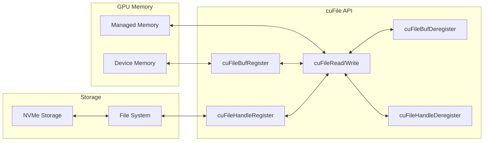
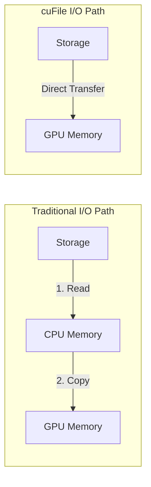
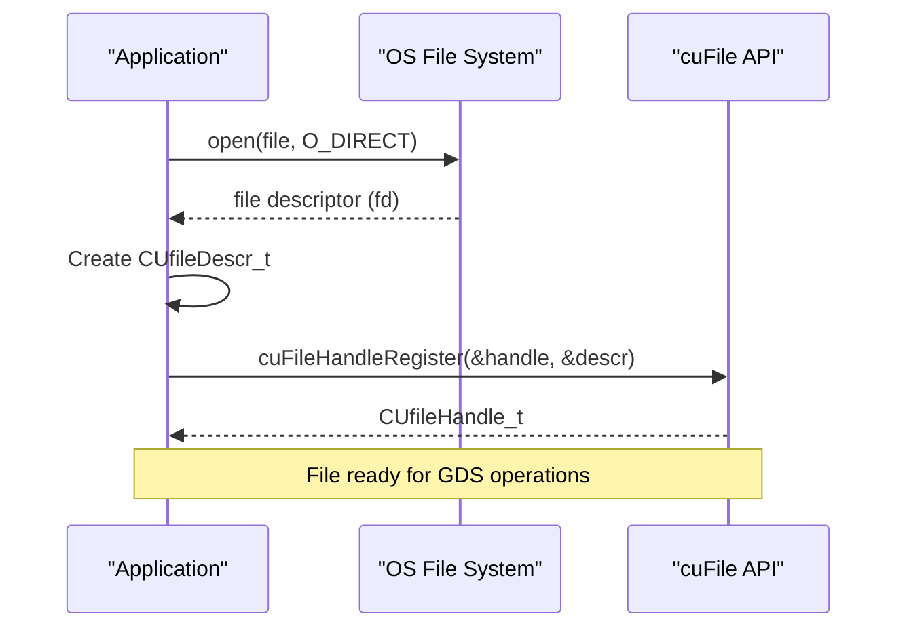
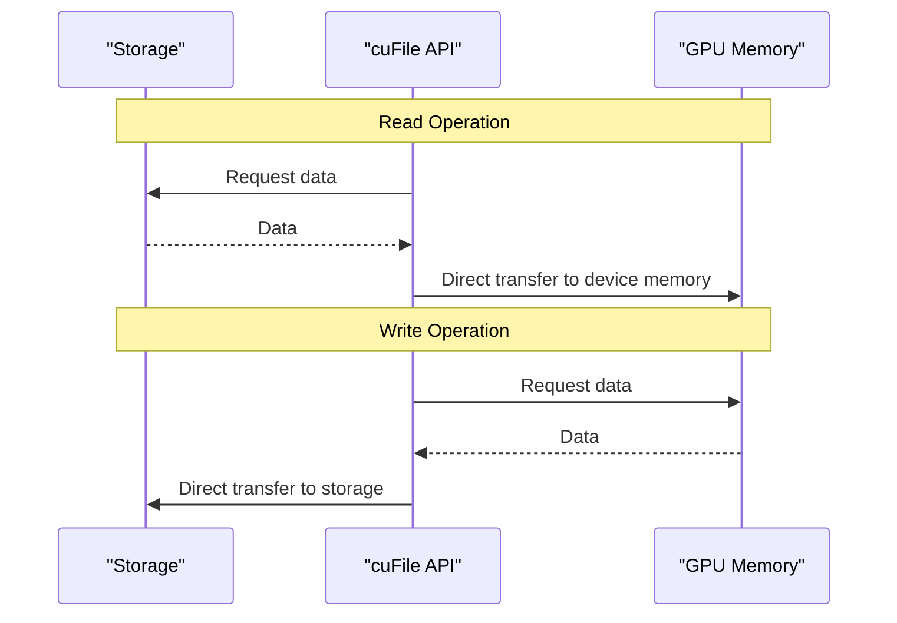
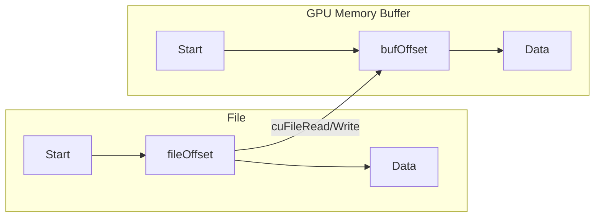
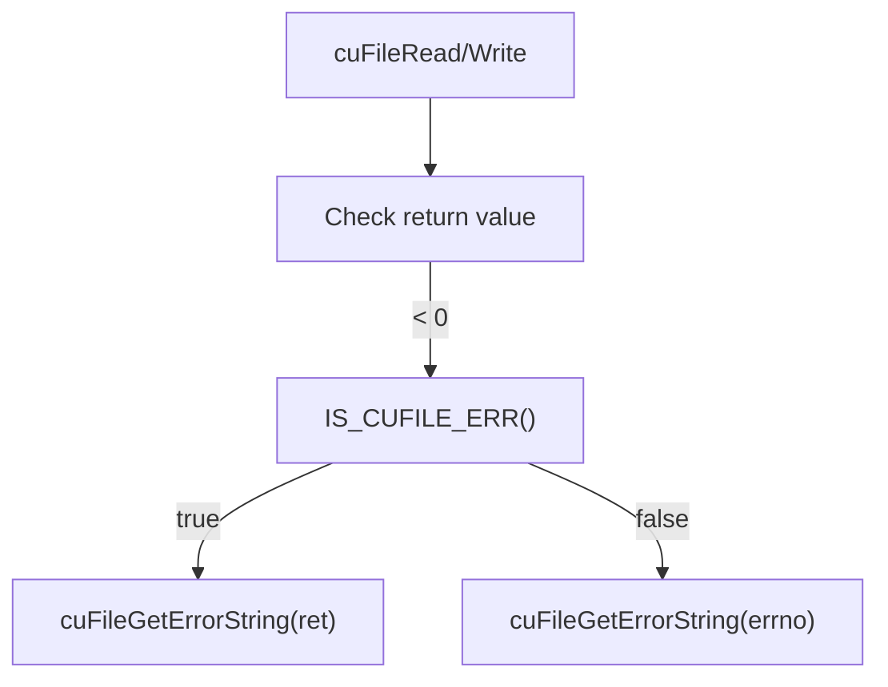
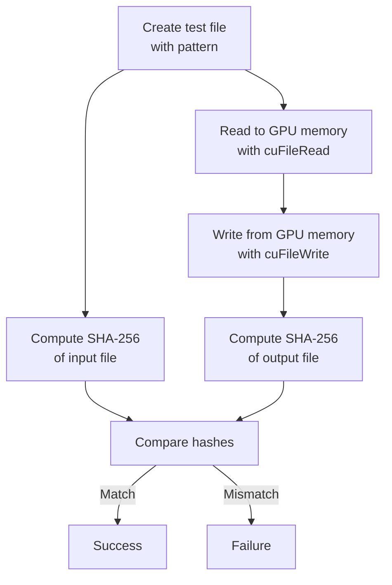

<!-- source: DeepWiki mcp.deepwiki.com · repo NVIDIA/MagnumIO · page 4 cuFile API · fetched 2026-10-26 -->

# cuFile API

Relevant source files

The following files were used as context for generating this wiki page:

- [gds/samples/README.md](gds/samples/README.md)
- [gds/samples/cufile_sample_001.cc](gds/samples/cufile_sample_001.cc)
- [gds/samples/cufile_sample_002.cc](gds/samples/cufile_sample_002.cc)
- [gds/samples/cufile_sample_003.cc](gds/samples/cufile_sample_003.cc)
- [gds/samples/cufile_sample_004.cc](gds/samples/cufile_sample_004.cc)
- [gds/samples/cufile_sample_006.cc](gds/samples/cufile_sample_006.cc)
- [gds/samples/cufile_sample_014.cc](gds/samples/cufile_sample_014.cc)
- [gds/samples/cufile_sample_015.cc](gds/samples/cufile_sample_015.cc)
- [gds/samples/cufile_sample_utils.h](gds/samples/cufile_sample_utils.h)

The cuFile API is a core component of NVIDIA's GPUDirect Storage (GDS) system that enables direct data transfers between storage devices and GPU memory, bypassing CPU memory. This page documents the cuFile API functionality, its core operations, and usage patterns. For information about higher-level interfaces to GDS, see [KvikIO Library](#5), and for specialized data format readers built on GDS, see [Domain-Specific GDS Readers](#6).

## Overview

The cuFile API provides low-level functions to directly read from and write to files from GPU memory without requiring intermediate copies through CPU memory, significantly improving I/O performance for GPU-accelerated applications.

Sources: [gds/samples/README.md:1-31](), [gds/samples/cufile_sample_003.cc:11-28]()

## Key Concepts

### Direct I/O Path

The primary benefit of cuFile is the elimination of the CPU memory copy step in traditional I/O paths.

Sources: [gds/samples/cufile_sample_001.cc:11-19](), [gds/samples/cufile_sample_003.cc:11-28]()

### Core Components

The cuFile API consists of several key functions and structures:

| Component | Description |
|-----------|-------------|
| `CUfileHandle_t` | Opaque handle to a file |
| `CUfileDescr_t` | File descriptor structure |
| `cuFileHandleRegister` | Registers a file handle with cuFile |
| `cuFileHandleDeregister` | Deregisters a file handle |
| `cuFileBufRegister` | Registers GPU memory for I/O operations |
| `cuFileBufDeregister` | Deregisters GPU memory |
| `cuFileRead` | Reads data from a file to GPU memory |
| `cuFileWrite` | Writes data from GPU memory to a file |

Sources: [gds/samples/cufile_sample_001.cc:30-47](), [gds/samples/cufile_sample_utils.h:95-112]()

## Basic Usage

### Initialization and Cleanup

Before using cuFile API functions, the driver must be initialized with `cuFileDriverOpen()`. When finished, clean up with `cuFileDriverClose()`.

Sources: [gds/samples/cufile_sample_001.cc:57-62](), [gds/samples/cufile_sample_001.cc:137-142]()

### File Handle Registration

Files must be registered with cuFile using the `cuFileHandleRegister` function:

Sources: [gds/samples/cufile_sample_001.cc:65-85](), [gds/samples/cufile_sample_002.cc:54-74]()

### Memory Registration

For optimal performance, GPU memory should be registered using `cuFileBufRegister` before I/O operations:

Sources: [gds/samples/cufile_sample_001.cc:87-100](), [gds/samples/cufile_sample_014.cc:87-98]()

### Reading and Writing

The core I/O operations are performed using `cuFileRead` and `cuFileWrite`:

Sources: [gds/samples/cufile_sample_001.cc:102-116](), [gds/samples/cufile_sample_003.cc:132-144](), [gds/samples/cufile_sample_003.cc:171-180]()

### Example Workflow

A typical cuFile workflow consists of:

1. Opening a file with O_DIRECT flag
2. Registering the file handle
3. Allocating GPU memory
4. Registering the GPU memory (optional)
5. Performing I/O operations
6. Deregistering GPU memory
7. Deregistering file handle
8. Closing the file

Sources: [gds/samples/cufile_sample_001.cc:39-144](), [gds/samples/cufile_sample_003.cc:54-212]()

## Memory Types Support

The cuFile API supports different types of memory:

| Memory Type | Description | Registration Needed |
|-------------|-------------|---------------------|
| Device Memory | Standard GPU memory allocated with `cudaMalloc` | Optional, but recommended |
| Managed Memory | Memory allocated with `cudaMallocManaged` | Not required |
| Host Memory | Memory allocated with `cudaMallocHost` | Not required |

Sources: [gds/samples/cufile_sample_015.cc:52-91](), [gds/samples/cufile_sample_002.cc:81-89]()

## Advanced Features

### Buffer and File Offsets

The cuFile API supports reading and writing with specific offsets in both files and memory buffers:

Sources: [gds/samples/cufile_sample_014.cc:99-119](), [gds/samples/cufile_sample_006.cc:96-110]()

### Error Handling

cuFile API functions return detailed error information that can be processed with helper functions:

Sources: [gds/samples/cufile_sample_utils.h:95-112](), [gds/samples/cufile_sample_001.cc:105-112]()

### Batch I/O Operations

For advanced use cases, cuFile provides batch I/O operations:

- `cuFileBatchIOSubmit`: Submit multiple I/O operations as a batch
- `cuFileBatchIOGetStatus`: Check the status of batch operations
- `cuFileBatchIOCancel`: Cancel submitted batch operations

Sources: [gds/samples/README.md:135-153]()

### Asynchronous I/O

cuFile supports asynchronous I/O operations through:

- `cuFileReadAsync`: Asynchronous read operation
- `cuFileWriteAsync`: Asynchronous write operation

Sources: [gds/samples/README.md:201-221]()

### Memory Mapping

For applications requiring memory mapping, cuFile provides integration with CUDA's memory management:

Sources: [gds/samples/README.md:155-173]()

### File Locking (fcntl)

cuFile supports file locking mechanisms for concurrent access:

Sources: [gds/samples/README.md:127-131]()

## Performance Considerations

For optimal performance with cuFile:

1. Use O_DIRECT flag when opening files
2. Register GPU memory with `cuFileBufRegister` when possible
3. Align I/O operations to storage device block boundaries
4. Use batch operations for multiple small I/O operations
5. Consider memory type choices based on access patterns

Sources: [gds/samples/cufile_sample_001.cc:67](), [gds/samples/cufile_sample_003.cc:107]()

## Data Integrity

Many of the cuFile samples demonstrate data integrity verification using SHA-256 checksums:

Sources: [gds/samples/cufile_sample_003.cc:182-195](), [gds/samples/cufile_sample_004.cc:200-223]()

## Sample Applications

The NVIDIA MagnumIO repository contains numerous sample applications demonstrating different aspects of the cuFile API. These samples provide practical examples for:

- Basic file reading and writing
- Data integrity verification
- Using different memory types
- Buffer and file offset handling
- Multithreaded operations
- Batch I/O operations
- Asynchronous I/O
- Memory mapping
- File locking

Sources: [gds/samples/README.md:32-221]()

## Related Pages

- For a higher-level Python interface to GDS, see [KvikIO Library](#5)
- For batch operations details, see [Batch I/O Operations](#4.1)
- For memory mapping, fcntl locking, and other advanced features, see [Advanced cuFile Features](#4.2)

---

