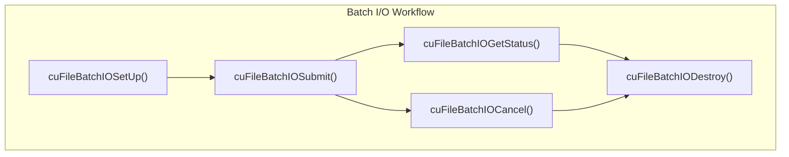
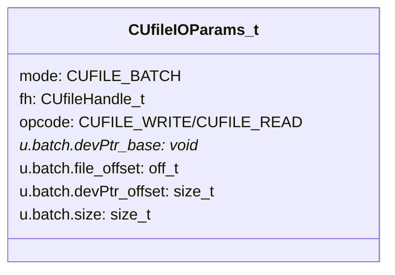
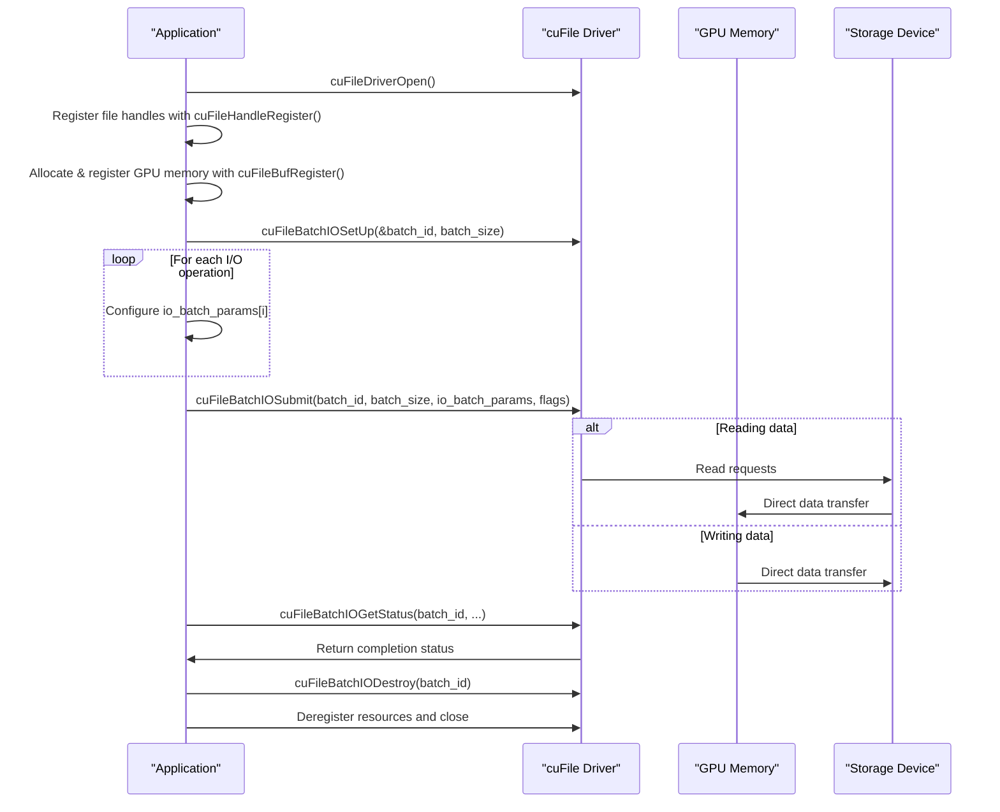
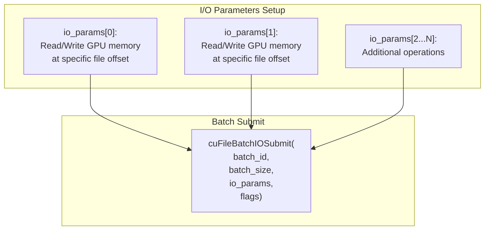
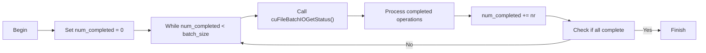
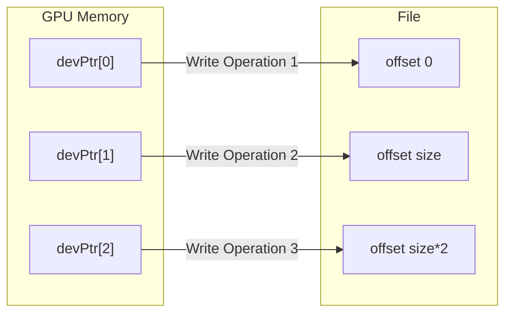
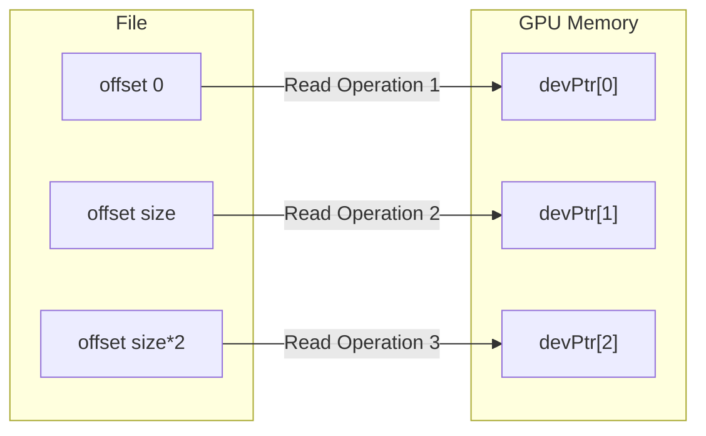

<!-- source: DeepWiki mcp.deepwiki.com · repo NVIDIA/MagnumIO · page 4.1 Batch I/O Operations · fetched 2026-10-26 -->

# Batch I/O Operations

<details>
<summary>Relevant source files</summary>

The following files were used as context for generating this wiki page:

- [gds/samples/cufile_sample_019.cc](gds/samples/cufile_sample_019.cc)
- [gds/samples/cufile_sample_020.cc](gds/samples/cufile_sample_020.cc)
- [gds/samples/cufile_sample_021.cc](gds/samples/cufile_sample_021.cc)
- [gds/samples/cufile_sample_022.cc](gds/samples/cufile_sample_022.cc)

</details>


## Purpose and Scope

This document describes the batch I/O capabilities of the cuFile API in NVIDIA MagnumIO. Batch I/O operations allow multiple file read or write operations to be submitted, monitored, and managed as a single unit, providing improved performance and simplified management for high-throughput I/O workloads.

For information about other cuFile API features, see [Advanced cuFile Features](#4.2). For high-level Python interfaces to GDS functionality, see [KvikIO Library](#5).

## Batch I/O Overview

Batch I/O operations in cuFile enable applications to:

1. Submit multiple I/O operations in a single batch
2. Monitor completion status of operations
3. Cancel pending operations when needed
4. Efficiently manage resources for high-throughput workloads

The batch API provides significant performance advantages by reducing system call overhead and allowing the underlying implementation to optimize I/O scheduling.



Sources: [gds/samples/cufile_sample_019.cc:154-188](), [gds/samples/cufile_sample_020.cc:154-186](), [gds/samples/cufile_sample_021.cc:141-166]()

## Key Data Structures

### Batch I/O Handles and Parameters

The cuFile batch I/O API uses these key data structures:

| Data Structure | Description |
|----------------|-------------|
| `CUfileBatchHandle_t` | Handle representing a batch of I/O operations |
| `CUfileIOParams_t` | Parameters for individual I/O operations in a batch |
| `CUfileIOEvents_t` | Status and results of completed I/O operations |

Example parameter setup for a write operation:



Sources: [gds/samples/cufile_sample_019.cc:51-52](), [gds/samples/cufile_sample_019.cc:143-150]()

## Batch I/O Workflow

The complete workflow for batch I/O operations follows these steps:



Sources: [gds/samples/cufile_sample_019.cc:40-226](), [gds/samples/cufile_sample_020.cc:40-224]()

## Setting Up Batch I/O Operations

To set up batch I/O operations, follow these steps:

1. Open the cuFile driver with `cuFileDriverOpen()`
2. Open files and register file handles
3. Allocate and register GPU memory
4. Initialize a batch handle with `cuFileBatchIOSetUp()`

Example code structure:

```
// Initialize batch handle
CUfileBatchHandle_t batch_id;
CUfileError_t errorBatch = cuFileBatchIOSetUp(&batch_id, batch_size);
```

Sources: [gds/samples/cufile_sample_019.cc:69-156](), [gds/samples/cufile_sample_020.cc:70-154]()

## Submitting Batch I/O Operations

After setting up the batch, configure each I/O operation's parameters and submit the batch:

1. Configure `CUfileIOParams_t` for each operation
2. Submit with `cuFileBatchIOSubmit()`



Sources: [gds/samples/cufile_sample_019.cc:143-163](), [gds/samples/cufile_sample_020.cc:142-166]()

## Monitoring Batch Operation Status

To monitor the status of submitted batch operations:

1. Prepare a buffer of `CUfileIOEvents_t` to receive completion events
2. Call `cuFileBatchIOGetStatus()` to check for completed operations
3. Process the completed operations based on the returned events

```
// Get status of batch operations
unsigned nr = batch_size; // in/out parameter
CUfileIOEvents_t io_batch_events[MAX_BATCH_IOS];
CUfileError_t errorBatch = cuFileBatchIOGetStatus(batch_id, batch_size, &nr, io_batch_events, NULL);
```

The `nr` parameter is both an input and output value. As input, it specifies the maximum number of events to retrieve. As output, it indicates how many events were actually retrieved.

Sources: [gds/samples/cufile_sample_019.cc:171-185](), [gds/samples/cufile_sample_022.cc:158-170]()

## Handling Partial Completions

When dealing with large batches, you may need to handle partial completions by repeatedly calling `cuFileBatchIOGetStatus()` until all operations complete:



The sample in [gds/samples/cufile_sample_022.cc:155-170]() demonstrates this approach using a limited buffer size for status events.

Sources: [gds/samples/cufile_sample_019.cc:171-185](), [gds/samples/cufile_sample_022.cc:155-170]()

## Cancelling Batch Operations

To cancel pending batch operations:

1. Submit the batch with `cuFileBatchIOSubmit()`
2. Call `cuFileBatchIOCancel()` to cancel pending operations
3. Call `cuFileBatchIOGetStatus()` to get status of operations (which may include cancellation status)

```
// Cancel batch operations
CUfileError_t errorBatch = cuFileBatchIOCancel(batch_id);
```

After cancellation, you should still retrieve operation status to ensure proper cleanup.

Sources: [gds/samples/cufile_sample_021.cc:151-164]()

## Cleaning Up Batch Resources

After batch operations complete (or are cancelled), clean up resources:

1. Call `cuFileBatchIODestroy()` to release the batch handle
2. Deregister buffer memory with `cuFileBufDeregister()`
3. Free GPU memory
4. Deregister file handles and close files
5. Close the cuFile driver

```
// Clean up batch resources
cuFileBatchIODestroy(batch_id);
```

Sources: [gds/samples/cufile_sample_019.cc:188-219](), [gds/samples/cufile_sample_020.cc:186-216]()

## Batch I/O Use Cases

### Batch Writes

Batch write operations allow efficient transfer of data from GPU memory to storage:



Sources: [gds/samples/cufile_sample_019.cc:40-226]()

### Batch Reads

Batch read operations efficiently load data from storage directly into GPU memory:



Sources: [gds/samples/cufile_sample_020.cc:40-224]()

## Best Practices

1. **Error Handling**: Always check return values from batch API functions
2. **Resource Management**: Ensure proper cleanup in all code paths, including error cases
3. **Buffer Size Considerations**: When using large batches, consider limiting the number of status entries retrieved at once
4. **Memory Alignment**: For best performance, align GPU memory and file offsets appropriately
5. **Cancellation**: Use cancellation to abort long-running operations when needed

Sources: [gds/samples/cufile_sample_019.cc:100-115](), [gds/samples/cufile_sample_022.cc:155-170]()

---

