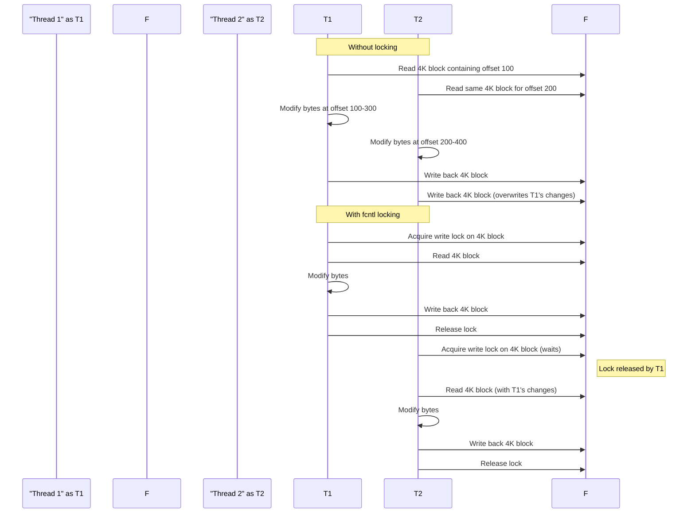
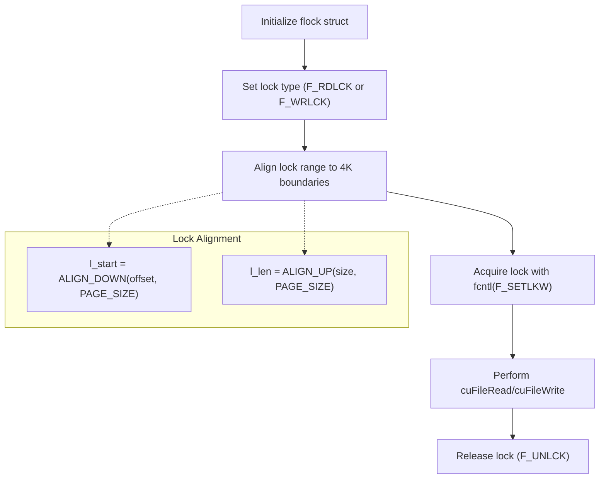
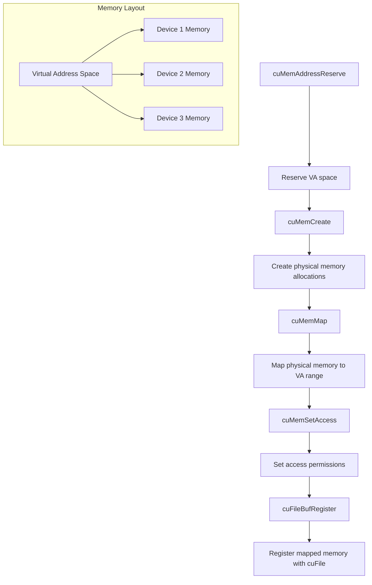
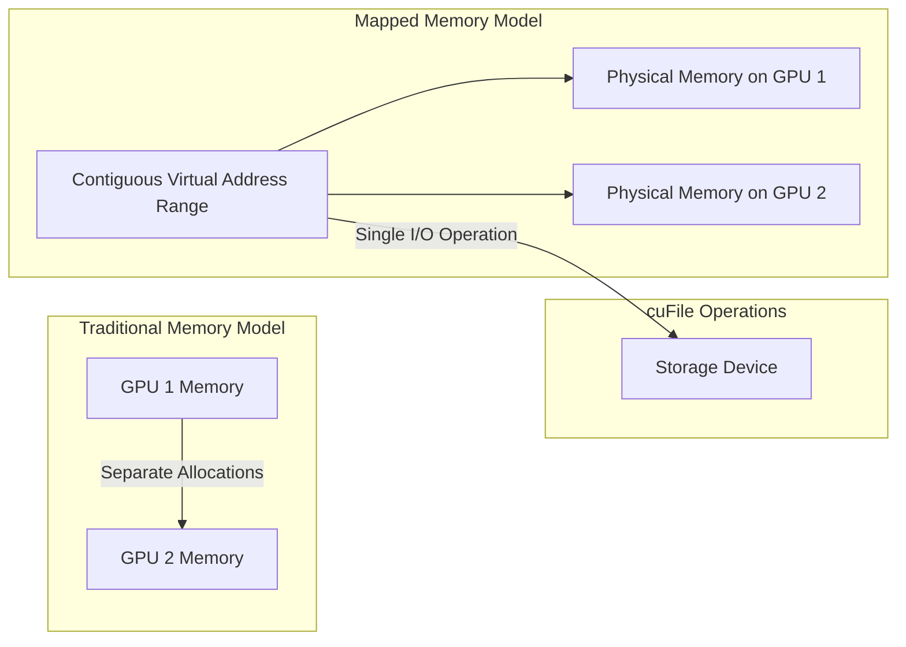
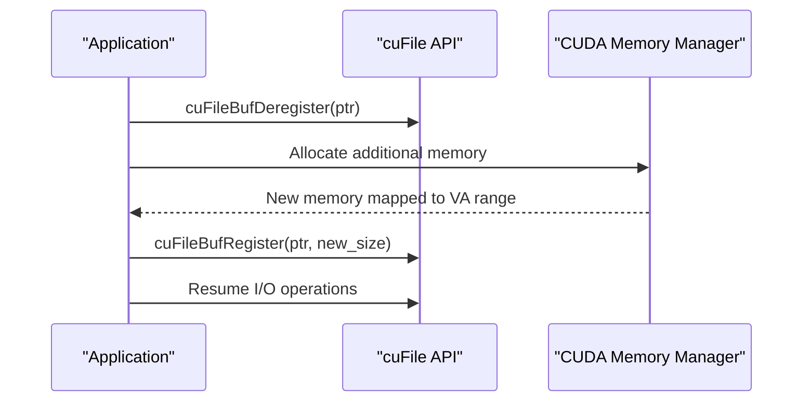

<!-- source: DeepWiki mcp.deepwiki.com · repo NVIDIA/MagnumIO · page 4.2 Advanced cuFile Features · fetched 2026-10-26 -->

# Advanced cuFile Features

<details>
<summary>Relevant source files</summary>

The following files were used as context for generating this wiki page:

- [gds/samples/cufile_sample_018.cc](gds/samples/cufile_sample_018.cc)
- [gds/samples/cufile_sample_023.cc](gds/samples/cufile_sample_023.cc)
- [gds/samples/cufile_sample_026.cc](gds/samples/cufile_sample_026.cc)

</details>


This page documents the advanced features of the cuFile API that extend beyond basic file I/O operations. These features include file locking for atomic operations, memory mapping capabilities, and virtual address management, designed to maximize the performance and reliability of GPU Direct Storage (GDS) operations.

For information about basic cuFile operations, see [cuFile API](#4), and for batch I/O capabilities, see [Batch I/O Operations](#4.1).

## File Locking for Atomic Operations

The cuFile API supports file locking through the standard POSIX `fcntl` mechanism. This feature is essential when coordinating access to shared files across multiple threads or processes, particularly for unaligned data access that requires read-modify-write operations.

### Understanding Unaligned Access and Read-Modify-Write

When performing I/O operations that are not aligned to 4K boundaries (the typical page size), GDS needs to perform read-modify-write operations to maintain data integrity. Without proper locking, these operations can lead to race conditions and data corruption when multiple threads access overlapping regions.



**Diagram: Unaligned Access with and without File Locking**

Sources: [gds/samples/cufile_sample_018.cc:27-41](), [gds/samples/cufile_sample_018.cc:236-244]()

### Implementing File Locking with cuFile

The implementation of file locking with cuFile involves:

1. Setting up a `struct flock` with the appropriate lock type (read or write)
2. Aligning the lock boundaries to 4K (page size)
3. Acquiring the lock using `fcntl` before cuFile operations
4. Releasing the lock after operations complete



**Diagram: File Locking Process with cuFile**

Sources: [gds/samples/cufile_sample_018.cc:57-80](), [gds/samples/cufile_sample_018.cc:119-142]()

### Example: Multi-threaded File Access with Locking

A typical use case involves multiple threads accessing potentially overlapping regions of a file:

1. Thread 1: Writing to offset 10 for 100 bytes (unaligned)
2. Thread 2: Writing to offset 50 for 200 bytes (unaligned, overlapping with Thread 1)
3. Thread 3: Reading from offset 1000 for 100 bytes (different region)

Even though Thread 3 is reading from a different logical region, if these operations use the same 4K block, proper locking is required since GDS performs operations at 4K page boundaries.

The sample code demonstrates proper locking implementation for both read and write operations:

- For read operations: [gds/samples/cufile_sample_018.cc:49-103]()
- For write operations: [gds/samples/cufile_sample_018.cc:105-165]()

Sources: [gds/samples/cufile_sample_018.cc:214-247]()

## Memory Mapping with cuFile

The cuFile API integrates with CUDA's memory management capabilities, including virtual address management and multi-device memory mapping. These features enable advanced memory configurations for optimal GPU I/O performance.

### Virtual Address Management

CUDA's virtual address management API (`cuMemMap` and related functions) allows applications to:

1. Reserve contiguous virtual address ranges
2. Map physical memory from multiple devices to these ranges
3. Control access permissions for different devices
4. Optimize memory layouts for GDS operations



**Diagram: CUDA Memory Mapping Process for cuFile**

Sources: [gds/samples/cufile_sample_026.cc:98-116](), [gds/samples/cufile_sample_026.cc:267-406]()

### Multi-Device Memory Allocation

The cuFile API supports operations on memory that spans multiple GPUs, providing:

1. Striped memory allocations across devices
2. Proper handling of allocation granularity requirements
3. Seamless read/write operations using a single virtual address range

The allocation process follows these steps:

1. Determine the minimum granularity required across all devices
2. Round up allocation sizes to match granularity requirements
3. Create and map memory on each device
4. Set up access permissions for all devices that need to access the memory
5. Register the memory with cuFile for I/O operations



**Diagram: Multi-Device Memory Model with cuFile**

Sources: [gds/samples/cufile_sample_026.cc:80-97](), [gds/samples/cufile_sample_023.cc:80-97]()

### Dynamic Memory Resizing

Advanced applications can dynamically resize memory allocations while maintaining cuFile registrations:

1. Deregister existing memory from cuFile
2. Expand the virtual address mapping with new physical allocations
3. Re-register the expanded memory with cuFile

This enables applications to adapt to changing memory requirements without completely rebuilding their memory structures.



**Diagram: Dynamic Memory Resizing Process**

Sources: [gds/samples/cufile_sample_026.cc:118-264](), [gds/samples/cufile_sample_023.cc:702-735]()

## Integration with Memory-Mapped I/O

The cuFile API supports operations on memory-mapped files, combining the benefits of GDS with memory mapping:

### Memory-Mapped cuFile Workflow

1. Reserve virtual address space using `cuMemAddressReserve`
2. Create and map physical memory using `cuMemCreate` and `cuMemMap`
3. Register the memory with cuFile using `cuFileBufRegister`
4. Perform file I/O using `cuFileRead` and `cuFileWrite`
5. Access/manipulate data directly through the virtual address

This approach provides several advantages:
- Simplified memory management for large datasets
- Efficient handling of sparse access patterns
- Reduced CPU overhead for data manipulation

```mermaid
flowchart TD
    A["Open file with O_DIRECT"] --> B["Register file handle with cuFileHandleRegister"]
    B --> C["Reserve VA space with cuMemAddressReserve"]
    C --> D["Set up multi-device memory with cuMemMap"]
    D --> E["Register memory with cuFileBufRegister"]
    E --> F["Perform I/O with cuFileRead/cuFileWrite"]
    F --> G["Access data directly through mapped memory"]
    G --> H["Deregister when done"]
    
    subgraph "Memory Operations"
        G1["GPU Kernels"]
        G2["Host Access"]
        G3["File I/O"]
        
        G --> G1
        G --> G2
        G --> G3
    end
```



**Diagram: Memory-Mapped I/O Workflow with cuFile**

Sources: [gds/samples/cufile_sample_026.cc:575-580](), [gds/samples/cufile_sample_026.cc:659-680]()

## Best Practices and Considerations

When using advanced cuFile features, consider the following best practices:

### For File Locking

1. Always lock at 4K (page size) boundaries for both aligned and unaligned operations
2. Use appropriate retry logic for lock acquisition in high-contention scenarios
3. Keep lock duration as short as possible to minimize contention
4. Use read locks when possible to allow concurrent reads

```
struct flock fl = { F_RDLCK, SEEK_SET, 0, 0, 0 };
fl.l_pid = getpid();
fl.l_start = ALIGN_DOWN(offset, PAGE_SIZE);
fl.l_len = ALIGN_UP(size, PAGE_SIZE);
```

### For Memory Mapping

1. Consider memory allocation granularity requirements when designing data structures
2. Properly handle memory deregistration before resizing or freeing memory
3. Use appropriate error handling and cleanup for mapped memory
4. Understand the relationship between virtual address management and cuFile operations

### General Considerations

1. Test operations with various alignments and offsets to ensure proper handling
2. Implement appropriate error handling for all cuFile and memory management operations
3. Consider the impact of these features on overall application architecture

Sources: [gds/samples/cufile_sample_018.cc:65-80](), [gds/samples/cufile_sample_026.cc:842-858]()

## Summary

Advanced cuFile features enable sophisticated I/O patterns for GDS operations. File locking provides atomicity for multi-threaded access, while integration with CUDA's memory management capabilities offers flexible memory configurations. These features are essential for building high-performance, reliable applications that leverage GPU Direct Storage for data-intensive workloads.

Understanding these advanced features allows developers to fully utilize the capabilities of the cuFile API and optimize their applications for specific use cases and hardware configurations.

---

