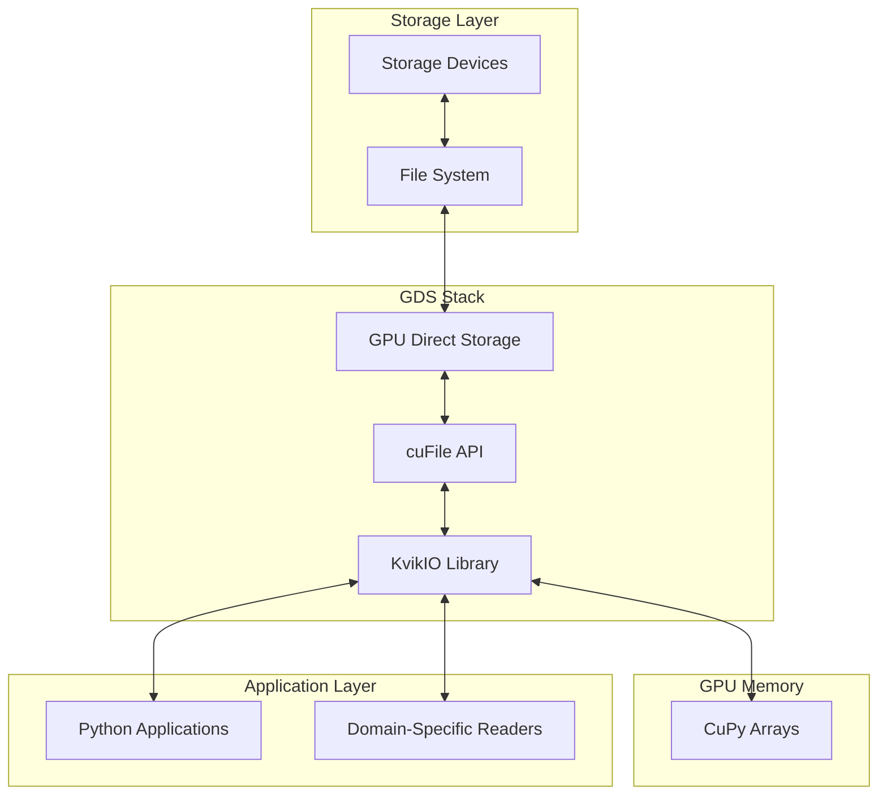
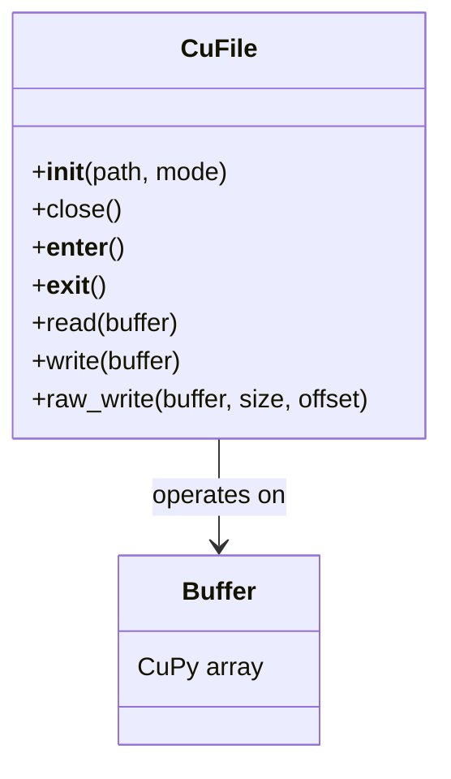
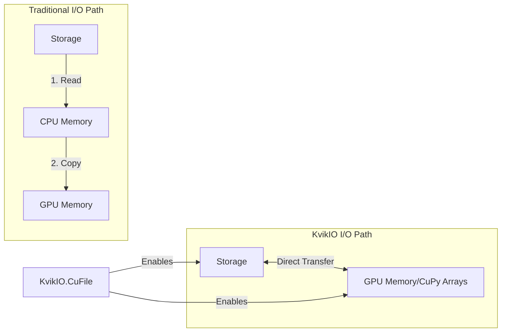
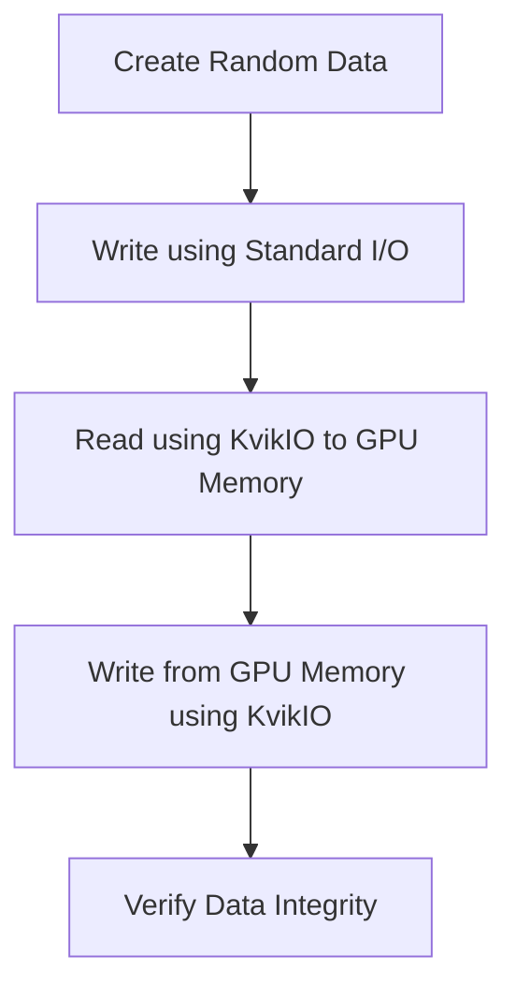

<!-- source: DeepWiki mcp.deepwiki.com · repo NVIDIA/MagnumIO · page 5 KvikIO Library · fetched 2026-10-26 -->

# KvikIO Library

<details>
<summary>Relevant source files</summary>

The following files were used as context for generating this wiki page:

- [gds/samples/python/sample_001.py](gds/samples/python/sample_001.py)
- [gds/samples/python/sample_002.py](gds/samples/python/sample_002.py)
- [gds/samples/python/sample_003.py](gds/samples/python/sample_003.py)

</details>


## Purpose and Scope

The KvikIO library is a high-level Python interface for NVIDIA GPU Direct Storage (GDS) that enables direct data transfer between storage devices and GPU memory. It serves as a bridge between the low-level cuFile API and Python applications, providing convenient methods for performing GPU-accelerated I/O operations without needing intermediate CPU memory copies. For information about the underlying cuFile API, see [cuFile API](#4).

## Architecture Overview

KvikIO sits at a strategic position within the MagnumIO architecture, providing Python applications with access to the performance benefits of GPU Direct Storage.



Sources: [gds/samples/python/sample_001.py:1-70](), [gds/samples/python/sample_003.py:1-79]()

## Core Components and API

KvikIO's primary interface is through the `CuFile` class, which provides methods for reading from and writing to files directly from/to GPU memory.



Sources: [gds/samples/python/sample_001.py:43-62](), [gds/samples/python/sample_002.py:46-61](), [gds/samples/python/sample_003.py:50-63]()

## Basic Usage

### File Operations

KvikIO provides a simple interface for file operations, similar to Python's built-in file I/O but optimized for GPU memory.

#### Opening and Closing Files

Files can be opened using the `CuFile` constructor:

```python
file_writer = kvikio.CuFile(path, "w")  # Open for writing
file_reader = kvikio.CuFile(path, "r")  # Open for reading
```

Files should be closed when done:

```python
file_writer.close()
```

Alternatively, the context manager pattern ensures files are properly closed:

```python
with kvikio.CuFile(path, "w") as file_writer:
    # File operations here
# File is automatically closed when exiting the block
```

Sources: [gds/samples/python/sample_001.py:43-62](), [gds/samples/python/sample_002.py:46-61]()

### Reading and Writing

KvikIO provides several methods for reading and writing data:

#### Write Methods

- `write(buffer)`: Writes data from a CuPy array to the file. This is a blocking call that uses an internal threadpool on top of the cuFile library. It supports both host and device memory.
- `raw_write(buffer, size, offset)`: A lower-level write method that doesn't use an internal threadpool. It allows specifying the size and offset for writing.

#### Read Methods

- `read(buffer)`: Reads data from the file into a CuPy array. This is a blocking call that waits for the I/O to complete before returning.

Sources: [gds/samples/python/sample_001.py:44-58](), [gds/samples/python/sample_003.py:52-61]()

## Data Flow

KvikIO enables a streamlined data flow between storage and GPU memory, eliminating the CPU memory copy that traditional I/O requires.



Sources: [gds/samples/python/sample_003.py:10-18]()

## Integration with CuPy

KvikIO is designed to work seamlessly with CuPy, a NumPy-compatible array library for GPU-accelerated computing in Python. CuPy arrays serve as the primary buffer type for KvikIO operations.

### Creating GPU Buffers for I/O

```python
# Create a filled array
buf = cupy.full((FILE_SIZE_BYTES,), int("ab", 16), dtype=cupy.uint8)

# Create an empty array to read into
buf = cupy.empty(DATA_SIZE_BYTES, dtype=cupy.uint8)
```

Sources: [gds/samples/python/sample_001.py:45](), [gds/samples/python/sample_003.py:47]()

## Common Usage Patterns

### Basic Write Operation

```python
import cupy
import kvikio

# Create data on GPU
buf = cupy.full((128 * 1024,), int("ab", 16), dtype=cupy.uint8)

# Write to file
with kvikio.CuFile("output.bin", "w") as file_writer:
    bytes_written = file_writer.write(buf)
```

Sources: [gds/samples/python/sample_002.py:44-53]()

### Basic Read Operation

```python
import cupy
import kvikio

# Create empty buffer on GPU
buf = cupy.empty(128 * 1024, dtype=cupy.uint8)

# Read from file
with kvikio.CuFile("input.bin", "r") as file_reader:
    bytes_read = file_reader.read(buf)
```

Sources: [gds/samples/python/sample_003.py:47-55]()

### Writing with Offset

```python
import cupy
import kvikio

# Create data on GPU
buf = cupy.full((128 * 1024,), int("ab", 16), dtype=cupy.uint8)

# Write to file with offset
with kvikio.CuFile("output.bin", "w") as file_writer:
    # Regular write at the beginning of the file
    file_writer.write(buf)
    
    # Write with offset (4KB from the end of previous write)
    file_writer.raw_write(buf, buf.size, buf.size + 4 * 1024)
```

Sources: [gds/samples/python/sample_001.py:54-59](), [gds/samples/python/sample_002.py:56-60]()

## Data Integrity Verification

KvikIO can be used in workflows that require data integrity verification, as demonstrated in the sample code:



Sources: [gds/samples/python/sample_003.py:39-69]()

## Performance Benefits

KvikIO offers significant performance benefits compared to traditional I/O paths:

1. **Elimination of CPU Memory Copies**: Data transfers directly between storage and GPU memory, avoiding the overhead of CPU memory copies.
   
2. **Reduced Host Memory Consumption**: Since data doesn't need to be staged in host memory, applications can work with larger datasets than would otherwise fit in CPU RAM.

3. **Lower Latency**: Direct data transfer paths reduce overall I/O latency.

4. **Higher Throughput**: By eliminating bottlenecks in the I/O path, applications can achieve higher throughput.

Sources: [gds/samples/python/sample_003.py:10-18]()

## Integration with Domain-Specific Readers

KvikIO serves as the foundation for several domain-specific readers that provide optimized I/O for particular data formats:

- **cuCIM GDS Reader**: For GPU-accelerated image processing. See [cuCIM GDS Reader](#6.1).
- **Zarr Reader**: For N-dimensional arrays. See [Zarr Reader](#6.2).
- **PyTorch-NumPy Reader**: For NumPy files in PyTorch workflows. See [PyTorch-NumPy Reader](#6.3).

For more advanced features including asynchronous I/O and additional offset operations, see [Data Integrity and Advanced Features](#5.2).

---

