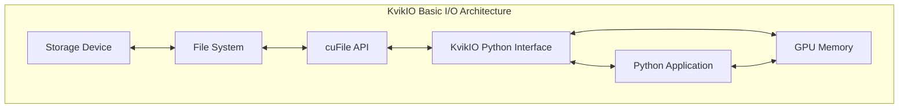
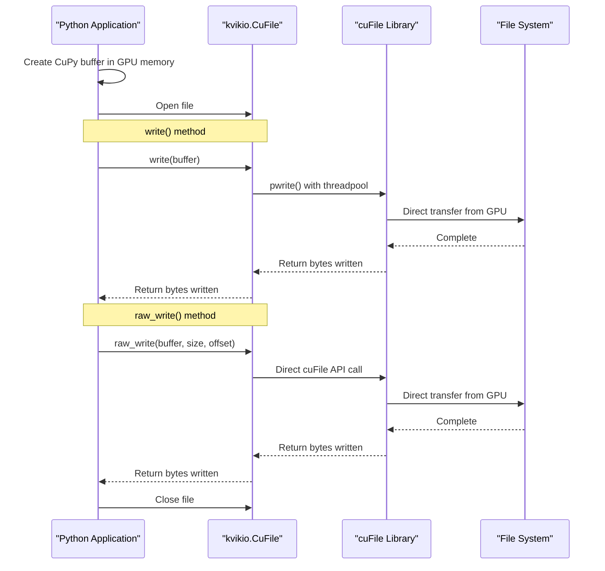
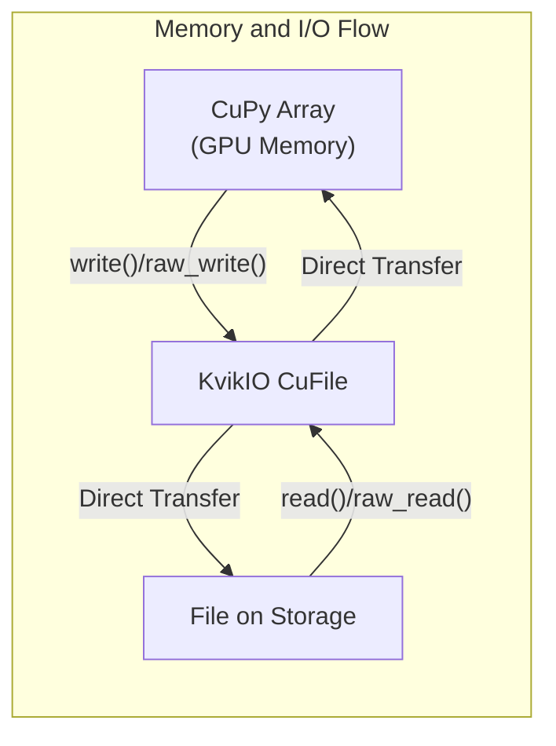
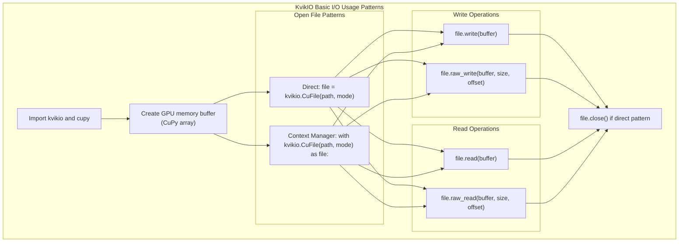

<!-- source: DeepWiki mcp.deepwiki.com · repo NVIDIA/MagnumIO · page 5.1 Basic I/O Operations · fetched 2026-10-26 -->

# Basic I/O Operations

<details>
<summary>Relevant source files</summary>

The following files were used as context for generating this wiki page:

- [gds/samples/python/sample_001.py](gds/samples/python/sample_001.py)
- [gds/samples/python/sample_002.py](gds/samples/python/sample_002.py)

</details>


This page documents the fundamental input/output operations provided by KvikIO, NVIDIA's high-level Python interface for GPU Direct Storage (GDS). The focus is on reading and writing data between files and GPU memory using KvikIO's core functionality.

For information about data integrity verification and advanced features such as offsets and asynchronous I/O, see [Data Integrity and Advanced Features](#5.2).

## KvikIO Overview

KvikIO provides a Python interface to the cuFile API, enabling direct data transfers between storage and GPU memory without CPU memory copies. It integrates seamlessly with data science libraries like CuPy, making it ideal for GPU-accelerated data processing pipelines.



Sources: [gds/samples/python/sample_001.py:1-70](), [gds/samples/python/sample_002.py:1-69]()

## The CuFile Class

The primary interface for file operations in KvikIO is the `CuFile` class. This class wraps the lower-level cuFile API calls and provides methods for file operations directly to and from GPU memory.

```mermaid
classDiagram
    class CuFile {
        +__init__(path, mode)
        +write(buffer)
        +raw_write(buffer, size, offset)
        +read(buffer)
        +raw_read(buffer, size, offset)
        +close()
        +__enter__()
        +__exit__()
    }
    
    CuFile --> "cuFile API" : wraps
    CuFile --> "GPU Memory" : transfers data to/from
```

Sources: [gds/samples/python/sample_001.py:42-62](), [gds/samples/python/sample_002.py:44-61]()

## Opening and Closing Files

KvikIO offers two patterns for opening and closing files:

### Direct Open/Close Method

```python
# Open a file for writing
file_writer = kvikio.CuFile(path, "w")

# Perform operations
# ...

# Close the file when done
file_writer.close()
```

Sources: [gds/samples/python/sample_001.py:42-62]()

### Context Manager (Recommended)

```python
# Using a context manager (automatically handles close)
with kvikio.CuFile(path, "w") as file_writer:
    # Perform operations
    # ...
```

The context manager approach is recommended as it automatically handles closing the file, even if exceptions occur.

Sources: [gds/samples/python/sample_002.py:46-61]()

## Write Operations

KvikIO provides two primary methods for writing data:

| Method | Description | Use Case |
|--------|-------------|----------|
| `write(buffer)` | Higher-level API that uses an internal threadpool on top of cuFile. Supports both host and device memory. | General-purpose writing, when maximum performance is not critical. |
| `raw_write(buffer, size, offset)` | Lower-level API without the internal threadpool. Offers better performance but less flexibility. | Performance-critical code paths with direct control over offset. |

Both methods are blocking calls, meaning they complete the I/O operation before returning to the caller.



Sources: [gds/samples/python/sample_001.py:47-59](), [gds/samples/python/sample_002.py:48-60]()

## Example: Writing to a File

The following example demonstrates writing a CuPy array to a file and then writing the same data at a different offset:

```python
import cupy
import kvikio

# Create data in GPU memory
file_size = 128 * 1024  # 128 KB
offset = 4 * 1024  # 4 KB
data = cupy.full((file_size,), 0xAB, dtype=cupy.uint8)

# Write using context manager
with kvikio.CuFile("output.bin", "w") as file_writer:
    # Write data to the beginning of the file
    bytes_written = file_writer.write(data)
    
    # Write data again at an offset
    bytes_written = file_writer.raw_write(data, file_size, file_size + offset)
```

This example creates a CuPy array filled with the value 0xAB, writes it to the beginning of the file, and then writes it again after an offset of 132KB (file_size + offset).

Sources: [gds/samples/python/sample_002.py:35-61]()

## Memory and Data Considerations

KvikIO works with GPU memory, typically in the form of CuPy arrays. When creating data buffers for I/O operations, keep in mind:

1. The data must be in contiguous memory (e.g., CuPy arrays)
2. For write operations, the data must be allocated before writing
3. When specifying sizes and offsets, they are in bytes



Sources: [gds/samples/python/sample_001.py:44-59](), [gds/samples/python/sample_002.py:43-61]()

## Usage Patterns

The following diagram illustrates the typical usage patterns for KvikIO basic I/O operations:



Sources: [gds/samples/python/sample_001.py:26-70](), [gds/samples/python/sample_002.py:27-69]()

## Summary

KvikIO provides a straightforward Python interface for GPU Direct Storage operations:

1. Create GPU memory buffers using CuPy
2. Open files using the `CuFile` class (preferably with a context manager)
3. Write data using `write()` or `raw_write()` methods
4. Close the file (automatically handled with context manager)

These operations enable direct data transfer between storage and GPU memory, eliminating the need for CPU memory as an intermediate buffer and improving I/O performance for GPU-accelerated applications.

Sources: [gds/samples/python/sample_001.py:1-70](), [gds/samples/python/sample_002.py:1-69]()

---

