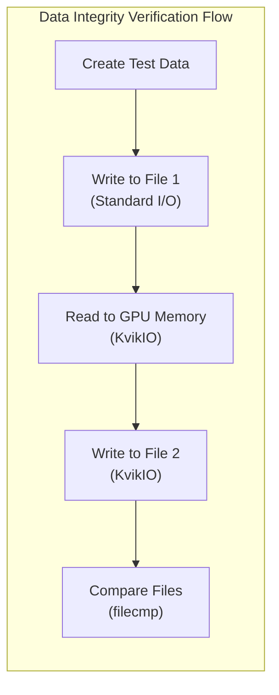
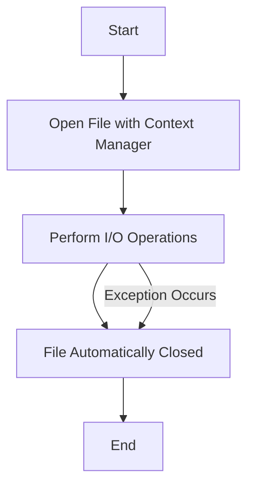
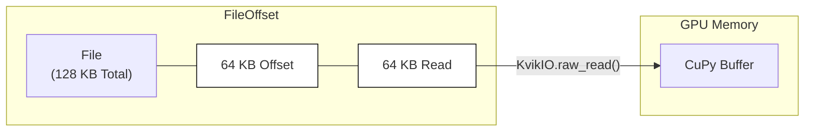
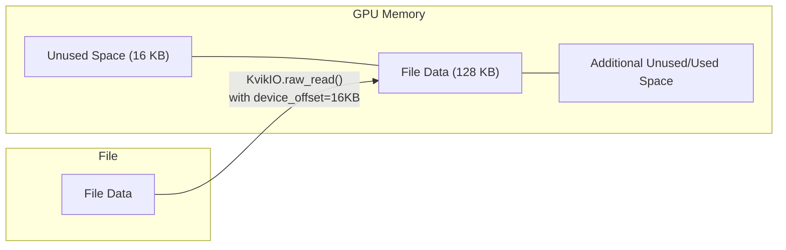
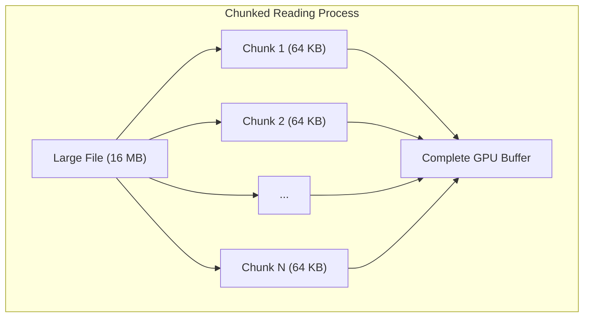
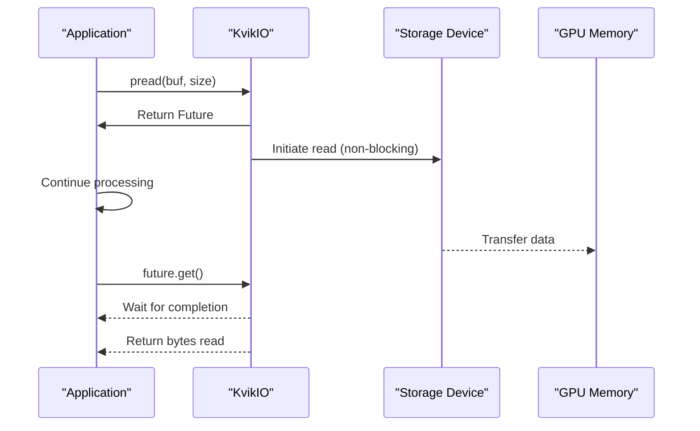
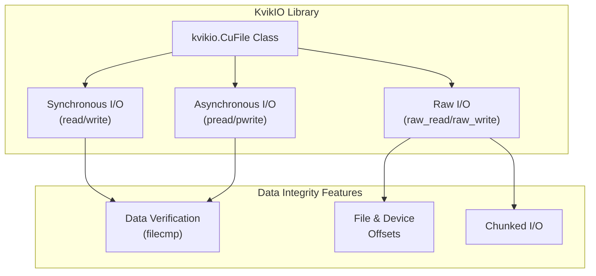

<!-- source: DeepWiki mcp.deepwiki.com · repo NVIDIA/MagnumIO · page 5.2 Data Integrity and Advanced Features · fetched 2026-10-26 -->

# Data Integrity and Advanced Features

<details>
<summary>Relevant source files</summary>

The following files were used as context for generating this wiki page:

- [gds/samples/python/sample_003.py](gds/samples/python/sample_003.py)
- [gds/samples/python/sample_004.py](gds/samples/python/sample_004.py)
- [gds/samples/python/sample_005.py](gds/samples/python/sample_005.py)
- [gds/samples/python/sample_006.py](gds/samples/python/sample_006.py)
- [gds/samples/python/sample_007.py](gds/samples/python/sample_007.py)
- [gds/samples/python/sample_008.py](gds/samples/python/sample_008.py)
- [gds/samples/python/sample_009.py](gds/samples/python/sample_009.py)
- [gds/samples/python/sample_010.py](gds/samples/python/sample_010.py)

</details>


## Purpose and Scope

This document describes the data integrity verification mechanisms and advanced features available in KvikIO, NVIDIA MagnumIO's high-level Python interface for GPU Direct Storage (GDS). It covers techniques for ensuring data consistency when transferring data between storage and GPU memory, as well as advanced I/O capabilities like offset operations, chunked I/O, and asynchronous operations. For basic I/O operations, see [Basic I/O Operations](#5.1).

## Data Integrity Verification

KvikIO provides reliable methods to verify that data transferred directly between storage and GPU memory maintains its integrity throughout the I/O process. This is crucial for scientific computing, machine learning, and other applications where data corruption could lead to invalid results.



Sources: [gds/samples/python/sample_003.py:1-80](), [gds/samples/python/sample_004.py:1-74]()

The typical pattern for validating data integrity with KvikIO involves:

1. Creating test data (typically random bytes)
2. Writing the data to a file using standard Python I/O
3. Reading the data back using KvikIO into GPU memory
4. Writing the data from GPU memory to a new file using KvikIO
5. Comparing the original and new files to verify data integrity

### Basic Data Integrity Example

KvikIO makes it straightforward to implement data integrity checks. The example below demonstrates the standard pattern:

```python
# Create data on GPU
buf = cupy.empty(DATA_SIZE_BYTES, dtype=cupy.uint8)

# Read data from file to GPU memory
with kvikio.CuFile(read_path, "r") as file_reader:
    ret = file_reader.read(buf)
    
# Write data from GPU memory to another file
with kvikio.CuFile(write_path, "w") as file_writer:
    ret = file_writer.write(buf)
    
# Verify data integrity
if filecmp.cmp(read_path, write_path, shallow=False):
    print("Data integrity verified - files match")
```

Sources: [gds/samples/python/sample_004.py:39-64]()

### Context Managers for Resource Management

KvikIO supports Python's context manager pattern (`with` statement) for automatic resource management, ensuring proper file closure even when exceptions occur:



Sources: [gds/samples/python/sample_004.py:42-63]()

## Offset Operations

KvikIO offers powerful capabilities for operating with offsets, both in files and in GPU memory, enabling precise control over data placement and access.

### File Offsets

File offsets allow reading or writing at specific positions within a file. This is particularly useful for accessing specific sections of large files without reading the entire content.



Sources: [gds/samples/python/sample_007.py:29-71]()

Example usage:

```python
# Read 64KB from file at 64KB offset into device memory
with kvikio.CuFile(read_path, 'r') as file_reader:
    ret = file_reader.raw_read(buf, READ_SIZE_BYTES, FILE_OFFSET_BYTES, 0)
```

### Device Offsets

Device offsets allow reading into or writing from specific positions within GPU memory. This enables more efficient memory management by allowing different parts of a buffer to be used for different operations.



Sources: [gds/samples/python/sample_005.py:29-72](), [gds/samples/python/sample_008.py:29-73]()

Example usage:

```python
# Read file into GPU memory with a 16KB offset in the device buffer
with kvikio.CuFile(read_path, 'r') as file_reader:
    ret = file_reader.raw_read(buf, FILE_SIZE_BYTES, 0, DEV_READ_OFFSET_BYTES)
```

## Chunked I/O

For handling large files efficiently, KvikIO supports reading and writing data in chunks, which helps manage memory usage and can improve performance for certain workloads.



Sources: [gds/samples/python/sample_006.py:30-79]()

Example implementation:

```python
# Read a large file in 64KB chunks
with kvikio.CuFile(read_path, "r") as file_reader:
    bytes_read = 0
    file_offset = 0
    device_offset = 0
    
    while bytes_read < DATA_SIZE_BYTES:
        read_size = min(DATA_SIZE_BYTES-bytes_read, CHUNK_SIZE_BYTES)
        ret = file_reader.raw_read(buf, read_size, file_offset, device_offset)
        bytes_read += ret
        file_offset += ret
        device_offset += ret
```

This approach is particularly useful when:
- Working with files larger than available GPU memory
- Processing data incrementally
- Implementing parallel processing pipelines

## Asynchronous I/O

KvikIO provides asynchronous I/O operations that enable non-blocking reads and writes, allowing your application to continue processing while I/O operations complete in the background.



Sources: [gds/samples/python/sample_009.py:29-79](), [gds/samples/python/sample_010.py:30-79]()

### Asynchronous Read Operations

```python
# Asynchronous read
with kvikio.CuFile(read_path, "r") as file_reader:
    # Non-blocking call - returns a future
    read_future = file_reader.pread(buf, FILE_SIZE_BYTES)
    
    # ... do other work while read is in progress ...
    
    # Wait for completion and get result (blocks until I/O completes)
    bytes_read = read_future.get()
```

### Asynchronous Write Operations

```python
# Asynchronous write
with kvikio.CuFile(write_path, "w") as file_writer:
    # Non-blocking call - returns a future
    write_future = file_writer.pwrite(buf, FILE_SIZE_BYTES)
    
    # ... do other work while write is in progress ...
    
    # Wait for completion and get result (blocks until I/O completes)
    bytes_written = write_future.get()
```

Important considerations when using asynchronous I/O:
- Futures must be resolved (by calling `.get()`) before leaving the context manager scope
- The buffer used for asynchronous operations must not be modified until the operation completes
- Multiple asynchronous operations can be initiated in parallel for improved throughput

## KvikIO Components and Data Integrity Features



Sources: [gds/samples/python/sample_003.py:29-69](), [gds/samples/python/sample_007.py:29-71](), [gds/samples/python/sample_009.py:29-79]()

## Summary of Advanced KvikIO Operations

| Feature | Method | Description | Example File |
|---------|--------|-------------|-------------|
| Basic Read/Write | `read()`, `write()` | Simple I/O operations | [sample_003.py]() |
| Context Managers | `with` statement | Automatic resource management | [sample_004.py]() |
| Device Offsets | `raw_read()`, `raw_write()` | Specify position in GPU memory | [sample_005.py](), [sample_008.py]() |
| File Offsets | `raw_read()`, `raw_write()` | Specify position in file | [sample_007.py]() |
| Chunked I/O | `raw_read()` in loop | Read large files in pieces | [sample_006.py]() |
| Async Read | `pread()` | Non-blocking read operations | [sample_009.py]() |
| Async Write | `pwrite()` | Non-blocking write operations | [sample_010.py]() |

These advanced features enable efficient, high-performance data transfer between storage and GPU memory while maintaining data integrity, making KvikIO ideal for data-intensive applications that require both speed and reliability.

---

