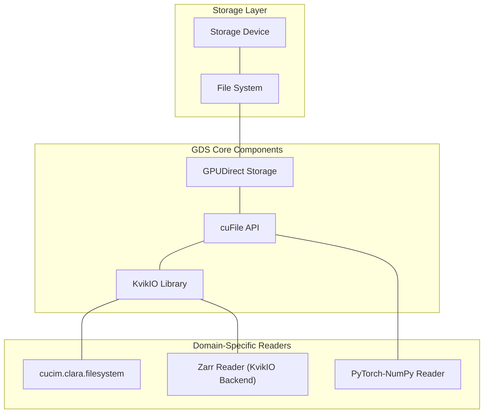
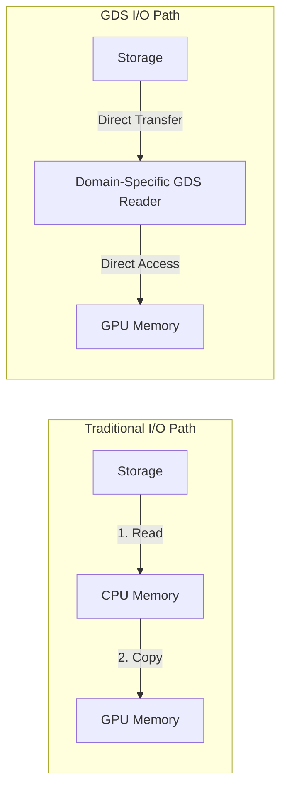
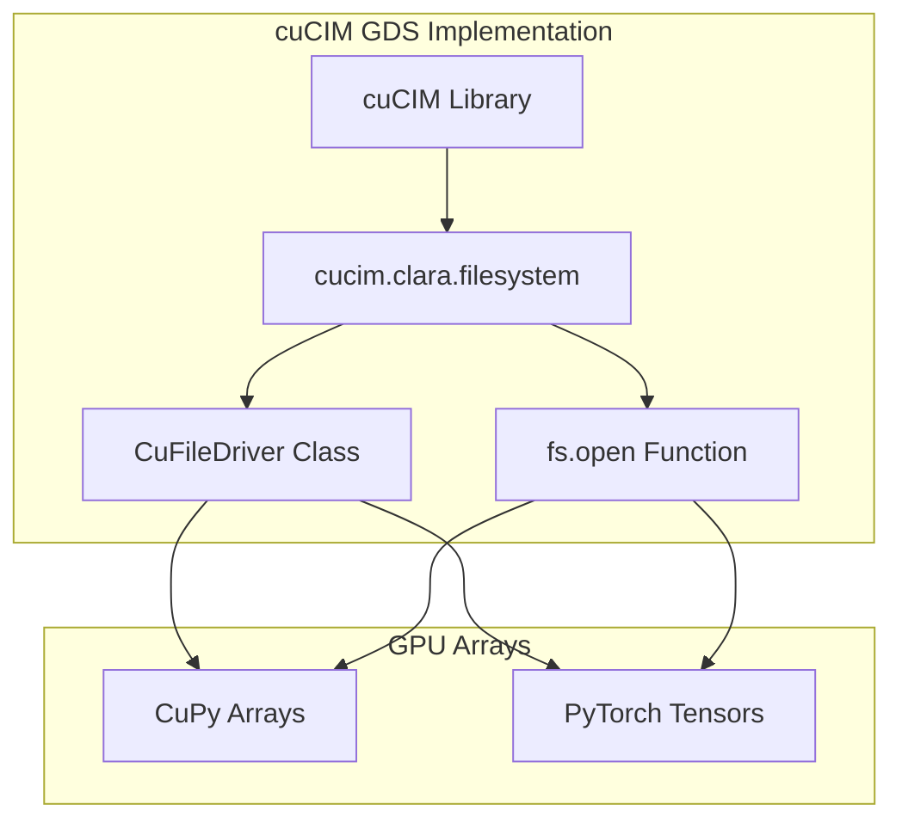
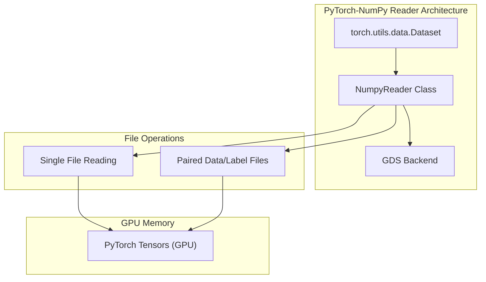
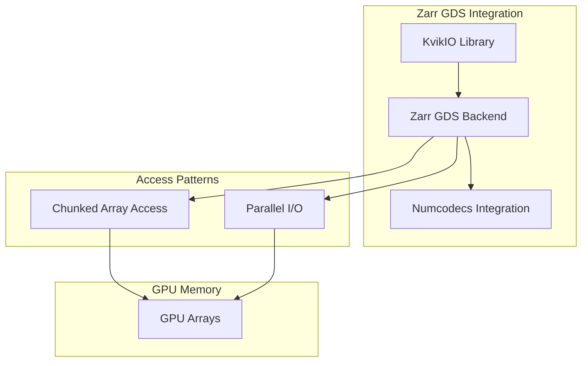

<!-- source: DeepWiki mcp.deepwiki.com · repo NVIDIA/MagnumIO · page 6 Domain-Specific GDS Readers · fetched 2026-10-26 -->

# Domain-Specific GDS Readers

<details>
<summary>Relevant source files</summary>

The following files were used as context for generating this wiki page:

- [.gitmodules](.gitmodules)
- [gds/readers/cucim-gds/README.md](gds/readers/cucim-gds/README.md)
- [gds/readers/cucim-gds/test_gds.py](gds/readers/cucim-gds/test_gds.py)
- [gds/readers/pytorch-numpy/README.md](gds/readers/pytorch-numpy/README.md)
- [gds/readers/zarr/README.md](gds/readers/zarr/README.md)

</details>


This page documents the specialized readers in the MagnumIO repository that leverage GPU Direct Storage (GDS) technology for specific data formats. These readers enable direct data transfer from storage to GPU memory, bypassing CPU memory copies, which significantly improves performance for data-intensive applications.

For information about the underlying GDS technology, see [GPU Direct Storage (GDS)](#3). For details about the KvikIO library that many of these readers build upon, see [KvikIO Library](#5).

## Overview

Domain-specific GDS readers extend the core GDS functionality to provide optimized I/O solutions for specific file formats and frameworks. The current implementations include:

- **cuCIM GDS Reader**: For GPU-accelerated image processing, particularly biomedical imaging
- **PyTorch-NumPy Reader**: For efficient loading of NumPy files in PyTorch workflows
- **Zarr Reader**: For high-performance access to chunked, N-dimensional arrays in the Zarr format



Sources: [.gitmodules:1-6](), [gds/readers/cucim-gds/README.md:1-19](), [gds/readers/pytorch-numpy/README.md:1-5](), [gds/readers/zarr/README.md:1-4]()

## Data Flow Comparison

The primary advantage of domain-specific GDS readers is the elimination of CPU memory copies in the I/O path:



Sources: [gds/readers/cucim-gds/README.md:3-12](), [gds/readers/pytorch-numpy/README.md:3-4]()

## cuCIM GDS Reader

The cuCIM GDS Reader integrates NVIDIA's GPUDirect Storage with cuCIM (CUDA Clara Image), a toolkit for GPU-accelerated image processing and computer vision, focusing on biomedical imaging.

### Features and Components

- Works with both CuPy arrays and PyTorch Tensor objects
- Supports JPEG-compressed TIFF images with GPU acceleration via nvJPEG
- Provides OpenSlide-like and scikit-image-compatible APIs
- Includes two main components:
  - `CuFileDriver`: For direct file access with low-level control
  - `fs.open`: High-level API for file operations



Sources: [gds/readers/cucim-gds/README.md:1-19](), [gds/readers/cucim-gds/test_gds.py:1-31]()

### Usage Example

The cuCIM GDS Reader can be used with both CuPy arrays and PyTorch tensors:

```python
# Using CuFileDriver for direct file access
from cucim.clara.filesystem import CuFileDriver
import os
import cupy as cp

# Create a GPU array
cp_arr = cp.ones(10, dtype=cp.uint8)

# Open file with O_DIRECT flag (required for GDS)
fno = os.open("input.raw", os.O_RDONLY | os.O_DIRECT)
with CuFileDriver(fno) as fd:
    # Read 8 bytes from file offset 0 into buffer offset 2
    read_count = fd.pread(cp_arr, 8, 0, 2)
os.close(fno)

# Using high-level fs.open API
import cucim.clara.filesystem as fs
with fs.open("output.raw", "w") as fd:
    # Write from GPU array to file
    write_count = fd.pwrite(cp_arr, 10, 5)
```

Sources: [gds/readers/cucim-gds/test_gds.py:1-31](), [gds/readers/cucim-gds/README.md:114-148]()

### Prerequisites and Installation

To use the cuCIM GDS Reader, you need:
- NVIDIA GPUDirect Storage (GDS) installed
- CuPy for GPU array operations
- PyTorch (optional) for tensor operations
- cuCIM library

You can check if GDS is properly configured:
```python
import cucim
print(cucim.clara.filesystem.is_gds_available())  # Should return True
```

Sources: [gds/readers/cucim-gds/README.md:14-56](), [gds/readers/cucim-gds/README.md:60-66]()

## PyTorch-NumPy Reader

The PyTorch-NumPy Reader enables direct reading of NumPy (`.npy`) files into PyTorch tensors using GDS, eliminating the need for a CPU memory copy.

### Features and Integration

- Reads NumPy files directly into PyTorch tensors on the GPU
- Integrates with PyTorch's Dataset API
- Supports complex workflows like segmentation tasks with paired data/label files



Sources: [gds/readers/pytorch-numpy/README.md:1-16]()

### Example Integration with PyTorch Dataset

```python
# Example in a PyTorch Dataset
class GDSDataset(torch.utils.data.Dataset):
    def __init__(self, data_dir):
        # Find all data and label files
        self.data_files = sorted(glob.glob(os.path.join(data_dir, "*_data.npy")))
        self.label_files = sorted(glob.glob(os.path.join(data_dir, "*_label.npy")))
        
        # Initialize NumPy readers
        self.data_reader = NumpyReader()
        self.label_reader = NumpyReader()
    
    def __getitem__(self, idx):
        # Read data directly to GPU using GDS
        data = self.data_reader.read(self.data_files[idx])
        label = self.label_reader.read(self.label_files[idx])
        
        # Process if needed (e.g., HWC to CHW conversion)
        data = data.permute(2, 0, 1)
        
        return data, label
```

Sources: [gds/readers/pytorch-numpy/README.md:9-16]()

### Implementation Considerations

- Requires PyTorch >= 1.6, CUDA 10.2 or newer, and GDS
- In multiprocessing environments (PyTorch DataLoader), process spawning or forkserver is recommended over forking
- Standard CUDA subprocess restrictions apply

Sources: [gds/readers/pytorch-numpy/README.md:5-8](), [gds/readers/pytorch-numpy/README.md:12-15]()

## Zarr Reader

The Zarr Reader leverages KvikIO's GDS backend to provide high-performance access to data in the Zarr format, which is designed for chunked, compressed, N-dimensional arrays.

### Features and Components

- Direct GPU access to Zarr-formatted data
- Support for chunked, compressed N-dimensional arrays
- Built on KvikIO's GDS backend for maximum performance



Sources: [gds/readers/zarr/README.md:1-14]()

### Implementation Status

The Zarr Reader is currently under active development:
- KvikIO implements a GDS-backend for Zarr
- Some features are available through PRs that are being merged into the main projects:
  - https://github.com/zarr-developers/numcodecs/pull/305
  - https://github.com/zarr-developers/zarr-python/pull/934

Sources: [gds/readers/zarr/README.md:1-14]()

## Common Prerequisites and Requirements

All domain-specific GDS readers require:

1. **GPU Direct Storage (GDS)**: Must be properly installed and configured
   - For NVMe storage, ensure the NVMe driver is supported
   - Check that GDS is not running in compatible mode

2. **CUDA Toolkit**: Version requirements vary by reader (typically 10.2 or newer)

3. **Domain-Specific Libraries**:
   - cuCIM reader: cuCIM, CuPy, and optionally PyTorch
   - PyTorch-NumPy reader: PyTorch 1.6 or newer
   - Zarr reader: Zarr Python, Numcodecs, and KvikIO

Sources: [gds/readers/cucim-gds/README.md:14-110](), [gds/readers/pytorch-numpy/README.md:5-8](), [gds/readers/zarr/README.md:6-14]()

## Performance Considerations

For optimal performance with any of the domain-specific GDS readers:

1. **Storage Configuration**: NVMe storage offers the best performance with GDS
2. **File Access Flags**: Use `O_DIRECT` flag when opening files for GDS access
3. **System Configuration**: Ensure IOMMU is disabled for maximum performance
4. **Compatible Mode**: Verify GDS is not running in compatible mode, which limits performance

Sources: [gds/readers/cucim-gds/README.md:67-110]()

---

