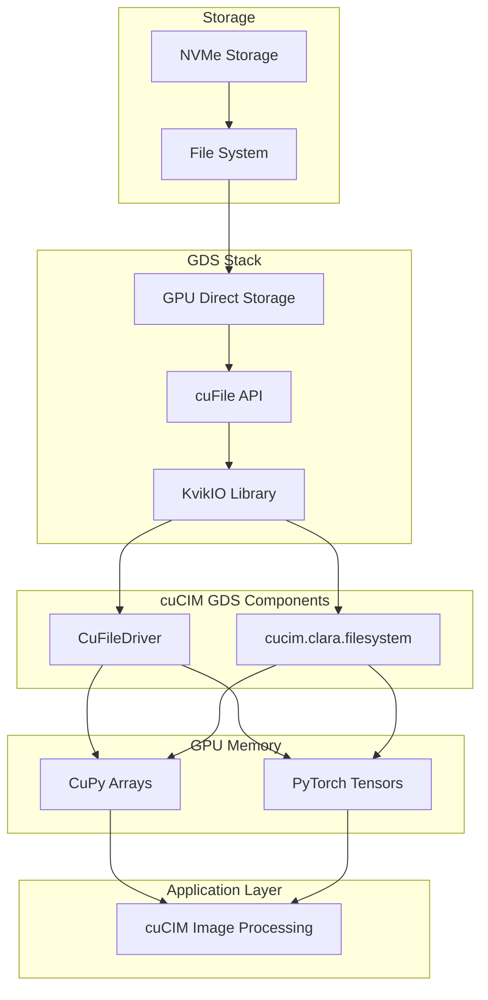
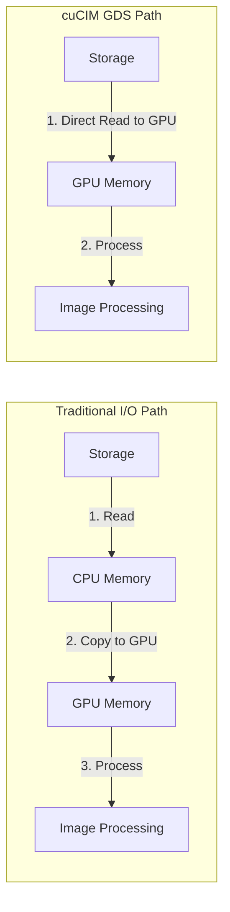
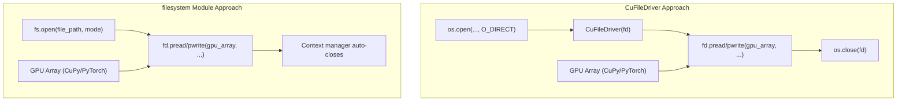

<!-- source: DeepWiki mcp.deepwiki.com · repo NVIDIA/MagnumIO · page 6.1 cuCIM GDS Reader · fetched 2026-10-26 -->

# cuCIM GDS Reader

<details>
<summary>Relevant source files</summary>

The following files were used as context for generating this wiki page:

- [.gitmodules](.gitmodules)
- [gds/readers/cucim-gds/README.md](gds/readers/cucim-gds/README.md)
- [gds/readers/cucim-gds/test_gds.py](gds/readers/cucim-gds/test_gds.py)

</details>


## Introduction

cuCIM GDS Reader is a domain-specific implementation that leverages NVIDIA's GPU Direct Storage (GDS) technology to accelerate image processing workflows in biomedical and scientific imaging. It integrates with cuCIM (CUDA Clara IMage), a toolkit under RAPIDS that provides GPU-accelerated I/O, image processing, and computer vision primitives for N-dimensional images.

This component enables direct data transfer between storage devices and GPU memory, bypassing CPU memory and reducing latency for large image datasets commonly used in medical imaging, microscopy, and other scientific applications.

For information about the overall GPU Direct Storage system, see [GPU Direct Storage (GDS)](#3). For details on other domain-specific readers, see [Domain-Specific GDS Readers](#6).

Sources: [gds/readers/cucim-gds/README.md:1-12]()

## Architecture and Integration

### cuCIM GDS Reader in the MagnumIO Ecosystem



The cuCIM GDS Reader consists of two primary components:

1. `CuFileDriver` class - Provides direct file I/O operations
2. `cucim.clara.filesystem` module - Offers higher-level utility functions

These components integrate with the MagnumIO ecosystem by leveraging the KvikIO library, which provides a Python interface to the cuFile API (the core of GDS functionality). The reader supports both CuPy arrays and PyTorch tensors, offering flexibility for various GPU-accelerated image processing workflows.

Sources: [gds/readers/cucim-gds/README.md:1-12](), [.gitmodules:4-6]()

### Data Flow Comparison



The key benefit of using cuCIM GDS Reader is the elimination of CPU memory as an intermediary. In traditional I/O paths, data must first be read into CPU memory and then copied to GPU memory, introducing additional latency. With GDS, data flows directly from storage to GPU memory, significantly reducing I/O overhead.

Sources: [gds/readers/cucim-gds/README.md:14-19]()

## Installation and Prerequisites

### GDS Installation

NVIDIA GPU Direct Storage (GDS) must be installed to use the GDS features of cuCIM. Since CUDA Toolkit 11.4, the GDS client package has been available as part of the CUDA installation.

File access APIs will still work without GDS, but you won't see the performance benefits of direct GPU-storage transfers. To install GDS in your host system, follow the official GDS installation guide referenced in the cuCIM documentation.

Note: During GDS prerequisite installation, you'll need MOFED (Mellanox OpenFabrics Enterprise Distribution) installed if you're using RDMA-capable storage.

Sources: [gds/readers/cucim-gds/README.md:14-21]()

### Required Libraries

The cuCIM GDS Reader requires the following libraries:

| Library | Installation Command | Purpose |
|---------|---------------------|---------|
| CuPy | `python3 -m pip install cupy-cuda114` | GPU-accelerated array library |
| PyTorch | `python3 -m pip install torch torchvision torchaudio` | Deep learning framework with GPU tensor support |
| cuCIM | `python3 -m pip install cucim` | GPU-accelerated image processing |
| Additional (optional) | `python3 -m pip install scipy 'scikit-image<0.20.0'` | Required for cuCIM's scikit-image API |

Sources: [gds/readers/cucim-gds/README.md:24-56]()

### Verifying GDS Availability

You can verify GDS availability in your system:

```python
import cucim
print(cucim.clara.filesystem.is_gds_available())
# Should output: True
```

Even if this returns `True`, ensure GDS is not running in compatible mode by checking for `cufile.log` in your current directory. If GDS is running in compatible mode, you'll see:
```
NOTICE  cufio-drv:693 running in compatible mode
```

For optimal performance, also verify that your storage driver (e.g., NVMe) is supported:

```bash
/usr/local/cuda/gds/tools/gdscheck -p
```

Sources: [gds/readers/cucim-gds/README.md:60-110]()

## API Overview

### API Usage Patterns



The cuCIM GDS Reader provides two interfaces for working with files using GDS:

1. **CuFileDriver (Low-level API)**:
   - Works directly with file descriptors
   - Requires opening files with `O_DIRECT` flag
   - Manual management of file descriptors
   
2. **cucim.clara.filesystem (High-level API)**:
   - More convenient file operations with context manager
   - Automatic file closing
   - Similar method signatures to CuFileDriver

Sources: [gds/readers/cucim-gds/test_gds.py:1-32]()

### Key API Methods

#### CuFileDriver

| Method | Description |
|--------|-------------|
| `pread(gpu_buffer, size, file_offset, buffer_offset=0)` | Read from file at specified offset into GPU memory |
| `pwrite(gpu_buffer, size, file_offset, buffer_offset=0)` | Write from GPU memory to file at specified offset |

#### cucim.clara.filesystem

| Function | Description |
|----------|-------------|
| `open(file_path, mode)` | Open a file for GDS operations with context manager interface |
| `is_gds_available()` | Check if GDS is available on the system |

Sources: [gds/readers/cucim-gds/test_gds.py:1-32]()

## Usage Examples

### Basic Example

```python
from cucim.clara.filesystem import CuFileDriver
import cucim.clara.filesystem as fs
import os
import cupy as cp
import torch

# Create test data
with open("input.raw", "wb") as input_file:
    input_file.write(
        bytearray([101, 102, 103, 104, 105, 106, 107, 108, 109, 110]))

# Create GPU arrays
cp_arr = cp.ones(10, dtype=cp.uint8)
cuda0 = torch.device('cuda:0')
torch_arr = torch.ones(10, dtype=torch.uint8, device=cuda0)

# Using CuFileDriver with a CuPy array
fno = os.open("input.raw", os.O_RDONLY | os.O_DIRECT)
with CuFileDriver(fno) as fd:
    # Read 8 bytes starting from file offset 0 into buffer offset 2
    read_count = fd.pread(cp_arr, 8, 0, 2)
os.close(fno)

# Using fs.open with a file path
with fs.open("output.raw", "w") as fd:
    # Write data from the array to the file
    write_count = fd.pwrite(cp_arr, 10, 5)
```

Sources: [gds/readers/cucim-gds/test_gds.py:1-32]()

### Key Operations

The cuCIM GDS Reader API supports several important operations:

1. **Reading with offset into the file and buffer**:
   ```python
   # Read 8 bytes starting from file offset 0 into buffer offset 2
   read_count = fd.pread(cp_arr, 8, 0, 2)
   ```

2. **Reading with only file offset**:
   ```python
   # Read 10 bytes starting from file offset 3
   read_count = fd.pread(torch_arr, 10, 3)
   ```

3. **Writing with file offset**:
   ```python
   # Write 10 bytes from cp_array to file starting from offset 5
   write_count = fd.pwrite(cp_arr, 10, 5)
   ```

Sources: [gds/readers/cucim-gds/test_gds.py:18-31]()

## Performance Considerations

cuCIM GDS Reader achieves optimal performance under these conditions:

1. Files stored on GDS-compatible storage systems (preferably NVMe SSDs)
2. System properly configured for GDS (verify with `gdscheck -p`)
3. Files opened with the `O_DIRECT` flag
4. Operations using aligned buffers and access patterns

cuCIM provides benchmark utilities to evaluate performance:

```bash
# Create test data
python3 cucim/benchmarks/gds/gen_testdata.py

# Benchmark sequential reads
python3 cucim/benchmarks/gds/gds_performance.py

# Benchmark random reads
python3 cucim/benchmarks/gds/gds_random_access_performance.py
```

A notable feature of cuCIM GDS is its ability to read JPEG-compressed TIFF images with GDS+nvJPEG, allowing compressed images to be decoded directly on the GPU without CPU intervention. This can provide significant performance improvements for medical and scientific imaging workflows.

Sources: [gds/readers/cucim-gds/README.md:157-170]()

## Future Development

The cuCIM GDS Reader roadmap includes:

- Support for additional image formats used in CT/MRI/Microscopy imaging
- Further storage system-specific optimizations
- Enhanced integration with GPU-accelerated image processing pipelines

Sources: [gds/readers/cucim-gds/README.md:12]()

## Additional Resources

For more detailed examples and tutorials, refer to the Jupyter notebook `Accessing_File_with_GDS.ipynb` in the cuCIM repository, which demonstrates comprehensive usage patterns of the cuFile (GDS) API in cuCIM.

Sources: [gds/readers/cucim-gds/README.md:172-174]()

---

