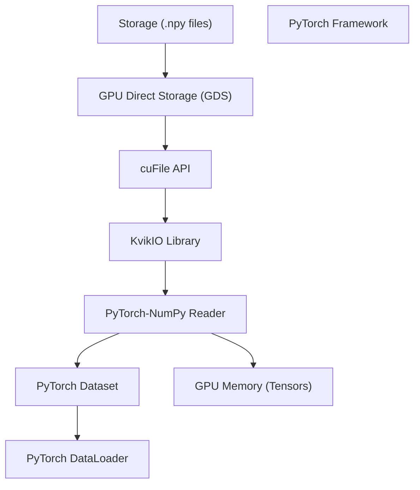
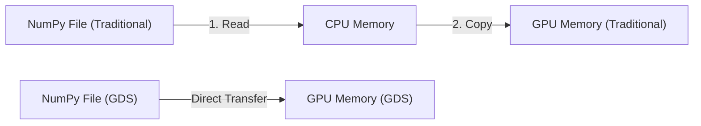
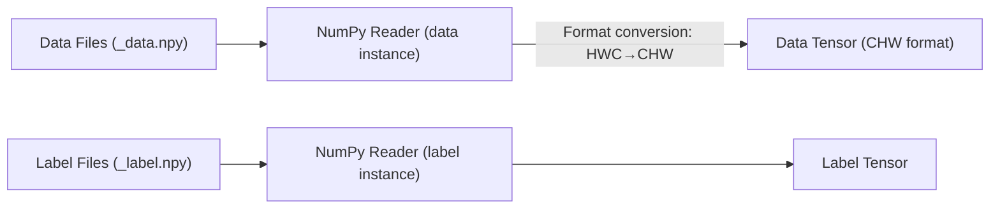

<!-- source: DeepWiki mcp.deepwiki.com · repo NVIDIA/MagnumIO · page 6.3 PyTorch-NumPy Reader · fetched 2026-10-26 -->

# PyTorch-NumPy Reader

<details>
<summary>Relevant source files</summary>

The following files were used as context for generating this wiki page:

- [gds/readers/pytorch-numpy/README.md](gds/readers/pytorch-numpy/README.md)

</details>


## Purpose and Scope

The PyTorch-NumPy Reader is a specialized GPU Direct Storage (GDS) implementation for reading NumPy (.npy) files directly into PyTorch tensors. It enables direct data transfer between storage devices and GPU memory, bypassing CPU memory copies, which significantly accelerates data loading pipelines in PyTorch workflows. This component is part of the Domain-Specific GDS Readers in the NVIDIA MagnumIO suite.

For information about other GDS readers, see [Domain-Specific GDS Readers](#6) or [Zarr Reader](#6.2).

Sources: [gds/readers/pytorch-numpy/README.md:1-3]()

## Architecture

The PyTorch-NumPy Reader integrates into the GDS stack, extending PyTorch's data loading capabilities with GDS performance benefits:



Sources: [gds/readers/pytorch-numpy/README.md:1-16]()

## Installation Requirements

The PyTorch-NumPy Reader has the following prerequisites:

| Requirement | Minimum Version |
|-------------|-----------------|
| PyTorch     | >= 1.6          |
| CUDA        | >= 10.2         |
| GDS         | Installed       |
| cuFile      | Libraries and headers in system search locations |

Installation is performed via Python's setup utility:

```bash
python setup.py install
```

Sources: [gds/readers/pytorch-numpy/README.md:5-7]()

## Data Flow Comparison

The key performance advantage of the PyTorch-NumPy Reader comes from eliminating CPU memory as an intermediary:



Sources: [gds/readers/pytorch-numpy/README.md:1-3]()

## Usage Pattern

The PyTorch-NumPy Reader is designed to be integrated within PyTorch's `Dataset` class. A typical implementation for a segmentation task would involve:



Key implementation aspects include:
1. Creating separate NumPy reader instances for data and label files
2. Ensuring synchronization between data and label files during shuffling
3. Converting image format from HWC (Height, Width, Channel) to CHW (Channel, Height, Width) for PyTorch compatibility

Sources: [gds/readers/pytorch-numpy/README.md:9-14]()

## Example Implementation

The repository includes an example in `python/example.py` that demonstrates using the reader within a PyTorch Dataset. The example:

1. Expects a directory with paired files:
   - `<some-tag>_data.npy` - input data files
   - `<some-tag>_label.npy` - corresponding label files
2. Loads and processes the data with format conversion (HWC to CHW)
3. Maintains synchronization between data and label files

Sources: [gds/readers/pytorch-numpy/README.md:9-12]()

## Multiprocessing Considerations

When using the PyTorch-NumPy Reader with PyTorch's DataLoader in multiprocessing mode, standard CUDA subprocess restrictions apply:

| Method | Support Status | Notes |
|--------|---------------|-------|
| Process forking | Not supported | CUDA restriction |
| Process spawning | Supported | Compatible with GDS reader |
| Forkserver | Supported | Preferred method |

These restrictions are important when configuring PyTorch's DataLoader with `num_workers` greater than 0.

Sources: [gds/readers/pytorch-numpy/README.md:13-14]()

## Performance Benefits

The primary advantage of the PyTorch-NumPy Reader is the elimination of CPU memory copies in the data loading pipeline. This direct GPU-to-storage path is particularly beneficial for:

1. Large-scale datasets where I/O can become a bottleneck
2. High-resolution image data used in segmentation tasks
3. Training workflows where data loading speed is critical to overall throughput

Sources: [gds/readers/pytorch-numpy/README.md:1-3]()

---

