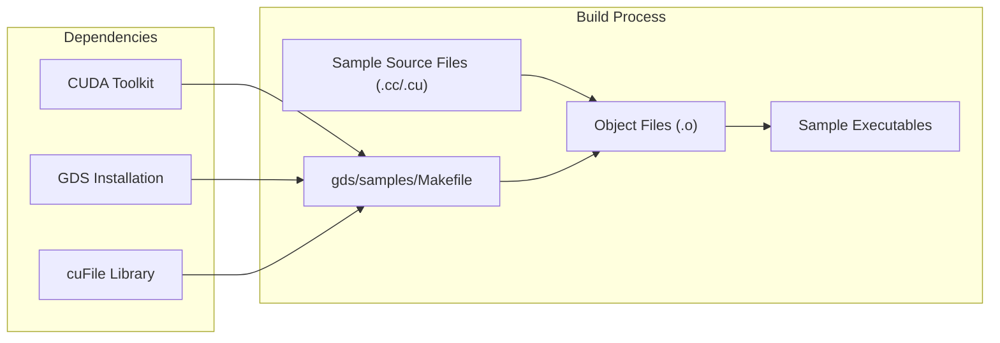
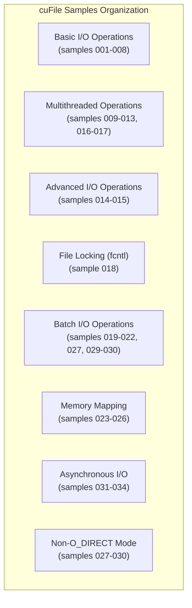
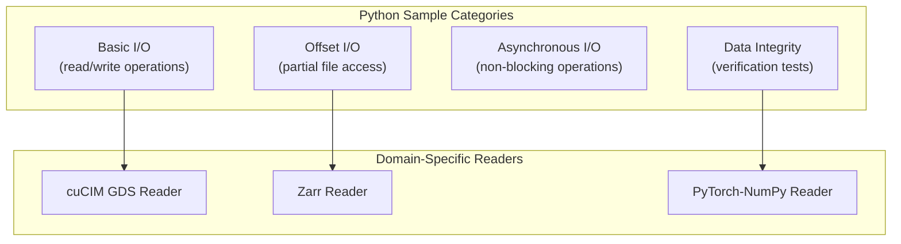

<!-- source: DeepWiki mcp.deepwiki.com · repo NVIDIA/MagnumIO · page 7 Building and Running Samples · fetched 2026-10-26 -->

# Building and Running Samples

<details>
<summary>Relevant source files</summary>

The following files were used as context for generating this wiki page:

- [gds/samples/Makefile](gds/samples/Makefile)
- [gds/samples/README.md](gds/samples/README.md)

</details>


This document provides comprehensive guidelines for building and running the sample applications included in the NVIDIA MagnumIO repository. These samples demonstrate the functionality of both cuFile API (C++) and KvikIO library (Python), allowing users to understand how to leverage GPU Direct Storage (GDS) for direct data transfers between storage and GPU memory.

For information about the cuFile API itself, see [cuFile API](#4). For details about the KvikIO library, see [KvikIO Library](#5).

## Overview of Sample Programs

MagnumIO includes two main categories of sample programs:

```mermaid
flowchart TD
    subgraph "MagnumIO Samples"
        CPPSamples["C++ Samples (cuFile API)"]
        PythonSamples["Python Samples (KvikIO)"]
    end
    
    subgraph "C++ Sample Categories"
        BasicIO["Basic I/O Operations"]
        DataIntegrity["Data Integrity Verification"]
        BatchIO["Batch I/O Operations"]
        AsyncIO["Asynchronous I/O"]
        MemMap["Memory Mapping"]
        Fcntl["fcntl Locking"]
        MultiThread["Multithreaded Operations"]
    end
    
    subgraph "Python Sample Categories"
        PyBasicIO["Basic I/O Operations"]
        PyDataIntegrity["Data Integrity Tests"]
        PyAsyncIO["Async I/O Samples"]
        PyOffsetIO["Offset I/O Samples"]
    end
    
    CPPSamples --> BasicIO
    CPPSamples --> DataIntegrity
    CPPSamples --> BatchIO
    CPPSamples --> AsyncIO
    CPPSamples --> MemMap
    CPPSamples --> Fcntl
    CPPSamples --> MultiThread
    
    PythonSamples --> PyBasicIO
    PythonSamples --> PyDataIntegrity
    PythonSamples --> PyAsyncIO
    PythonSamples --> PyOffsetIO
```



Sources: [gds/samples/README.md:1-221]()

## Prerequisites

Before building and running the samples, ensure your system meets the following requirements:

1. **Hardware Requirements**:
   - NVIDIA GPU with compute capability 6.0 or higher
   - NVMe storage device with GDS support

2. **Software Requirements**:
   - CUDA Toolkit 11.4 or above
   - GPU Direct Storage (GDS) installed and configured
   - For Python samples: Python 3.6+ with KvikIO installed

Sources: [gds/samples/README.md:8-12]()

## Building C++ Samples

The C++ samples demonstrate various aspects of the cuFile API, including basic I/O operations, batch processing, asynchronous I/O, memory mapping, and more.

### Compilation Process



Sources: [gds/samples/Makefile:36-62]()

### Step-by-Step Build Instructions

1. **Set up environment variables**:
   ```bash
   export CUFILE_PATH=/usr/local/cuda/targets/x86_64-linux/lib/
   ```
   
   Note: For ARM architecture (aarch64), use:
   ```bash
   export CUFILE_PATH=/usr/local/cuda/targets/sbsa-linux/lib/
   ```

2. **Build the samples**:
   ```bash
   cd gds/samples
   make
   ```

3. **Build options**:
   - Build all samples: `make build`
   - Clean the build: `make clean`
   - Build in Docker container: `make release_samples`

Sources: [gds/samples/README.md:22-28](), [gds/samples/Makefile:70-83](), [gds/samples/Makefile:126-130]()

### Build System Details

The Makefile in the samples directory handles compilation of both C++ (.cc) and CUDA (.cu) files. It automatically detects the NVCC version and sets appropriate CUDA architecture flags based on the version.

Key Makefile variables:
- `CUDA_PATH`: Path to CUDA installation
- `CUFILE_PATH`: Path to cuFile library
- `CXXFLAGS`: C++ compiler flags
- `LDFLAGS`: Linker flags for dynamic linking
- `LDFLAGS_STATIC`: Linker flags for static linking

The build system compiles each sample twice: once with dynamic linking and once with static linking to the cuFile library.

Sources: [gds/samples/Makefile:36-62](), [gds/samples/Makefile:84-107](), [gds/samples/Makefile:114-121]()

## Running C++ Samples

The C++ samples are organized by functionality, demonstrating various aspects of the cuFile API.

### Sample Categories



Sources: [gds/samples/README.md:32-221]()

### Basic Sample Usage

Each sample follows a similar pattern for execution, with specific command-line arguments based on functionality:

| Sample Category | Example Command | Description |
|-----------------|----------------|-------------|
| Basic I/O | `./cufile_sample_001 <file-path> <gpu-id>` | File write with buffer registration |
| Data Integrity | `./cufile_sample_003 <file-path-1> <file-path-2> <gpu-id>` | Verifies data integrity between files |
| Multithreaded | `./cufile_sample_009 <file-path-1> <file-path-2>` | Thread-specific file handles |
| Batch I/O | `./cufile_sample_019 <file-path> <gpu-id> <num-batch-entries>` | Batch write operations |
| Async I/O | `./cufile_sample_031 <read-file> <write-file> <gpu-id>` | Async read/write with default stream |
| Memory Mapping | `./cufile_sample_023 <file-path-A> <file-path-B>` | cuMemMap allocations |

**Important Note**: The sample tests expect data files to be at least 128 MiB in size with read/write permissions in GDS-enabled mounts.

Sources: [gds/samples/README.md:32-221]()

### Sample Program Details

Here's a breakdown of key sample programs by functionality:

#### Basic I/O Operations
- `cufile_sample_001` to `cufile_sample_008`: Demonstrate basic read/write operations, buffer management, and error handling
- Notes: These samples form the foundation for understanding cuFile API usage

#### Data Integrity Verification
- `cufile_sample_003`, `cufile_sample_004`, `cufile_sample_015`: Verify data consistency between files
- Support different memory types (Device, Managed, and Host memory)

#### Batch I/O Operations
- `cufile_sample_019` to `cufile_sample_022`, `cufile_sample_027`, `cufile_sample_029`, `cufile_sample_030`
- Demonstrate submitting, monitoring, and canceling batched operations
- Note: Requires cuFile library version 11.6 or above

#### Asynchronous I/O
- `cufile_sample_031` to `cufile_sample_034`: Show asynchronous read/write operations
- Demonstrate stream handling and batch asynchronous operations
- Note: Requires cuFile library version 12.2 or above

#### Memory Mapping
- `cufile_sample_023` to `cufile_sample_026`: Show cuFile API with cuMemMap allocations
- Demonstrate resize operations with mapped memory

#### File Locking (fcntl)
- `cufile_sample_018`: Shows usage of fcntl locks with GDS for unaligned writes

Sources: [gds/samples/README.md:32-221]()

## Building and Running Python Samples

Python samples in the MagnumIO repository demonstrate the KvikIO library, which provides a high-level Python interface to GDS functionality.

### Python Sample Structure



Sources: [gds/samples/README.md:1-5]()

### Running Python Samples

To run Python samples:

1. Navigate to the Python samples directory:
   ```bash
   cd gds/samples/python
   ```

2. Run a sample with appropriate arguments:
   ```bash
   python sample_name.py [arguments]
   ```

## Integration with Domain-Specific Readers

MagnumIO's sample programs demonstrate the integration with domain-specific readers that leverage GDS for specific data formats:

1. **cuCIM GDS Reader**: For GPU-accelerated image processing
2. **Zarr Reader**: For N-dimensional arrays
3. **PyTorch-NumPy Reader**: For NumPy files in PyTorch workflows

For more detailed information on these readers, refer to the [Domain-Specific GDS Readers](#6) page.

## Troubleshooting

### Common Issues

1. **Missing cuFile Library**:
   - Ensure GDS is properly installed
   - Verify the CUFILE_PATH is correctly set

2. **Compilation Errors**:
   - Ensure CUDA Toolkit is installed (version 11.4+)
   - Check compiler compatibility

3. **Runtime Errors**:
   - Verify data files are at least 128 MiB
   - Check file permissions in GDS-enabled mounts
   - Ensure GPU has compute capability 6.0 or higher

4. **Performance Issues**:
   - Verify GDS is properly configured
   - Check for storage device compatibility with GDS

Sources: [gds/samples/README.md:5-6](), [gds/samples/README.md:8-12]()

## Conclusion

The sample programs provided in the MagnumIO repository serve as practical examples for leveraging GPU Direct Storage for high-performance I/O operations. By working through these samples, users can understand how to implement GDS in their own applications, whether using the low-level cuFile API in C++ or the higher-level KvikIO library in Python.

For more information about specific GDS components, refer to:
- [cuFile API](#4)
- [KvikIO Library](#5)
- [Domain-Specific GDS Readers](#6)
- [Docker Integration](#8)

---

